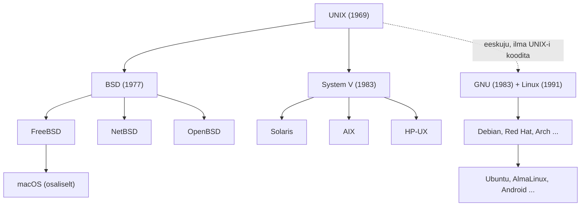

<!-- navigatsioon -->
[← Linuxi distributsioonide ülevaade](distrod.md) · [Sisukord](../../README.md#sisukord) · [Sõnastik →](sonastik.md)
<!-- /navigatsioon -->

# UNIX-i ja Linuxi ajalugu

See lisa räägib, kuidas tekkisid UNIX, BSD, GNU ja Linux. Ajaloo tundmine aitab mõista, miks Linux on just selline, nagu ta on: miks käsud on lühikesed, miks „kõik on fail“, miks Linux ja BSD on nii sarnased ning kust tuleb vaba tarkvara idee.

## Lühidalt

```text
1969  UNIX sünnib Bell Labsis
1973  UNIX kirjutatakse ümber C-keeles
1977  Berkeleys valmib esimene BSD
1983  Richard Stallman kuulutab välja GNU projekti
1987  Andrew Tanenbaum avaldab MINIX-i
1991  Linus Torvalds avaldab Linuxi kerneli
1993  Tekivad Debian, Slackware, FreeBSD ja NetBSD
1994  Linux 1.0
2004  Ubuntu
2008  Esimene Android-telefon
2010  systemd
2017  Kõik maailma 500 võimsaimat superarvutit töötavad Linuxil
2021  AlmaLinux ja Rocky Linux asendavad CentOS Linuxi
2022  Steam Deck viib Linuxi miljonite mängijateni
```

---

## 1. UNIX-i sünd (1969–1975)

### Multics

1960. aastatel arendasid MIT, General Electric ja AT&T Bell Labs ühiselt ambitsioonikat operatsioonisüsteemi **Multics**, mis pidi võimaldama paljudel kasutajatel korraga ühte arvutit kasutada. Projekt muutus aga liiga suureks ja keeruliseks ning Bell Labs loobus sellest 1969. aastal.

### Ken Thompson ja Dennis Ritchie

Kaks Bell Labsi programmeerijat, **Ken Thompson** ja **Dennis Ritchie**, tahtsid Multicsist saadud kogemusi kasutada, kuid teha midagi palju lihtsamat. 1969. aastal kirjutas Thompson vanale miniarvutile PDP-7 väikese operatsioonisüsteemi. Algne nimi **Unics** oli sõnamäng Multicsi nimest: *multi* tähendab „palju“, *uni* „üks“ - uus süsteem pidi olema lihtsam. Hiljem kujunes nimest **UNIX**.

Esimene UNIX-i kasutusjuhend ilmus 1971. aastal. Juba siis olid seal paljud käsud, mida kasutad ka sellel kursusel: `ls`, `cp`, `mv`, `rm`, `cat`, `chmod`.

### C-keel ja teisaldatavus

Algul oli UNIX kirjutatud assemblerkeeles, mis töötas ainult ühel arvutitüübil. Dennis Ritchie lõi programmeerimiskeele **C** ja 1973. aastal kirjutati UNIX-i kernel C-keeles ümber.

See oli revolutsiooniline: operatsioonisüsteemi sai nüüd viia uuele arvutitüübile, kompileerides selle uuesti, mitte kirjutades kõike nullist. Tänapäevalgi on Linuxi kernel kirjutatud peamiselt C-keeles.

### UNIX-i filosoofia

UNIX-i loojad sõnastasid põhimõtted, mis kehtivad tänini (näitega moodulis 2, punkt 2.1):

- iga programm teeb üht asja ja teeb seda hästi;
- programmid töötavad koos: ühe väljund on teise sisend (torud võeti kasutusele 1973);
- tekst on universaalne liides;
- **kõik on fail** - ka seadmed ja protsessid;
- lihtne on parem kui keeruline.

## 2. UNIX levib ülikoolidesse (1975–1985)

Kuna AT&T-l oli monopolivastase kohtuotsuse tõttu keelatud arvutitarkvaraga äri ajada, andis ettevõte UNIX-i koos lähtekoodiga ülikoolidele odavalt litsentsi alusel. Tudengid ja õppejõud said süsteemi uurida, muuta ja täiendada.

### BSD

Eriti aktiivne oli **California Ülikool Berkeleys**. Seal koguti täiendused kokku ja levitati neid nime all **BSD** (*Berkeley Software Distribution*). Esimene versioon valmis 1977. aastal tudeng **Bill Joy** juhtimisel, kes kirjutas muu hulgas tekstiredaktori `vi`.

1983. aastal ilmunud 4.2BSD sisaldas USA kaitseministeeriumi rahastatud **TCP/IP võrgutarkvara**. See on üks peamisi põhjusi, miks internet ja UNIX on algusest peale tihedalt seotud. Ka sõnad nagu *socket* pärinevad BSD-st.

### Kommertslikud UNIX-id ja „UNIX-i sõjad“

1980. aastatel lõpetati AT&T monopol ja ettevõte hakkas UNIX-it (versiooni **System V**) müüma. Peagi oli oma UNIX igal suurel arvutitootjal:

| Süsteem | Tootja |
|---|---|
| SunOS, hiljem Solaris | Sun Microsystems |
| AIX | IBM |
| HP-UX | Hewlett-Packard |
| IRIX | Silicon Graphics |

Need süsteemid olid omavahel osaliselt ühildumatud ja tootjad võistlesid ägedalt - seda perioodi nimetatakse **UNIX-i sõdadeks**. Ühilduvuse taastamiseks loodi 1988. aastal standard **POSIX**, mis määrab, kuidas UNIX-i-laadne süsteem peab käituma. Ka Linux järgib suures osas POSIX-it.

Litsentsid muutusid kalliks ja lähtekood suletuks. See tekitas vastureaktsiooni.

## 3. Vaba tarkvara liikumine (1983–1991)

### GNU

MIT-i programmeerija **Richard Stallman** pidas tarkvara sulgemist ebaeetiliseks. 1983. aastal kuulutas ta välja projekti **GNU** (rekursiivne lühend: *GNU's Not Unix*), mille eesmärk oli luua täiesti vaba UNIX-iga ühilduv operatsioonisüsteem.

1985. aastal asutas Stallman **Vaba Tarkvara Sihtasutuse** (*Free Software Foundation*, FSF) ja sõnastas vaba tarkvara neli vabadust: tarkvara võib **kasutada** mis tahes eesmärgil, **uurida** ja muuta, **levitada** ning **levitada muudetud versioone**.

Nende vabaduste kaitseks lõi ta litsentsi **GNU GPL** (*General Public License*): kes levitab GPL-i all oleva programmi muudetud versiooni, peab ka selle lähtekoodi avaldama samadel tingimustel. Seda põhimõtet nimetatakse **copyleft**'iks.

1990. aastaks oli GNU projekt valmis kirjutanud peaaegu kõik operatsioonisüsteemi osad: kompilaatori **GCC**, kesta **Bash**, redaktori **Emacs** ja põhitööriistad (`ls`, `grep`, `sed` jt). Puudu oli ainult üks, kuid kõige olulisem osa - **kernel**. GNU enda kernel **Hurd** ei saanud kunagi valmis.

### MINIX

Hollandi professor **Andrew Tanenbaum** kirjutas 1987. aastal õppeotstarbelise UNIX-i-laadse süsteemi **MINIX**, mida tudengid said oma arvutis uurida. MINIX-i lähtekood oli raamatu juures saadaval, kuid seda ei tohtinud vabalt muuta ega levitada.

## 4. Linuxi sünd (1991–1994)

### „Lihtsalt hobi“

1991. aastal oli **Linus Torvalds** 21-aastane informaatikatudeng Helsingi Ülikoolis. Ta oli ostnud uue Intel 386 protsessoriga arvuti ja kasutas MINIX-it, kuid tahtis paremini ära kasutada oma arvuti võimalusi.

**25. augustil 1991** kirjutas ta MINIX-i uudistegruppi `comp.os.minix` sõnumi, kus teatas, et teeb (vaba) operatsioonisüsteemi, mis on „lihtsalt hobi, ei tule suur ja professionaalne nagu GNU“. Septembris 1991 avaldas ta versiooni 0.01.

Torvalds ise tahtis süsteemi nimeks panna **Freax** (*free + freak + x*), kuid Helsingi Tehnikaülikooli FTP-serveri haldaja **Ari Lemmke** nimetas faile sisaldava kataloogi omal algatusel `linux`. Nimi jäi püsima.

### GPL ja GNU/Linux

Alguses keelas Linuxi litsents kommertskasutuse. 1992. aastal muutis Torvalds litsentsi **GPL-iks**. See otsus oli Linuxi edu jaoks määrava tähtsusega: kõik said koodi vabalt kasutada ja parandada, kuid keegi ei saanud parandusi endale jätta.

Linuxi kernel ja GNU tööriistad sobisid nagu valatult kokku: GNU-l oli kõik peale kerneli, Linuxil oli kernel. Seepärast nimetab Stallman süsteemi **GNU/Linux**. Igapäevakõnes räägitakse lihtsalt Linuxist.

### Tanenbaumi ja Torvaldsi vaidlus

1992. aastal kirjutas Tanenbaum uudistegruppi postituse „Linux on vananenud“. Tema arvates oli Linuxi **monoliitne kernel** (kogu kernel töötab ühe programmina) vanamoodne ja tulevik kuulus **mikrokernelitele** (kernel on väike, ülejäänu töötab eraldi programmidena). Järgnenud vaidlus on üks kuulsamaid arutelusid informaatika ajaloos. Linux on monoliitne tänini, kuid saab laadida mooduleid (vt moodul 11).

### Linux 1.0

Märtsis 1994 ilmus **Linux 1.0**. Selleks ajaks panustasid kerneli arendusse sajad vabatahtlikud üle maailma - Linux oli üks esimesi suuri projekte, mida arendati peamiselt interneti kaudu.

## 5. Distrode ajastu (1993–2000)

Kerneli ja tööriistade käsitsi kokkupanemine oli keeruline, seetõttu hakati looma **distributsioone**:

| Aasta | Distro | Märkus |
|---|---|---|
| 1993 | **Slackware** | Vanim tänini arendatav distro |
| 1993 | **Debian** | **Ian Murdock** asutas; nimi on tema ja tema elukaaslase Debra nimede liit |
| 1994 | **Red Hat Linux** | Hiljem RHEL-i, Fedora ja kogu Red Hati perekonna alus |
| 1994 | **SUSE** | Saksa ettevõte, Euroopas levinud |

Samal ajal arenes edasi BSD. AT&T ja Berkeley vaheline kohtuvaidlus (1992–1994) BSD koodi autoriõiguste üle pidurdas BSD levikut just ajal, mil Linux kiiresti kasvas - see on üks põhjusi, miks Linux sai populaarsemaks. Kohtuvaidluse järel tekkisid **FreeBSD** ja **NetBSD** (1993) ning **OpenBSD** (1995). Loe lähemalt [distrode ülevaatest](distrod.md#bsd-ja-linux).

1996. aastal sai Linux oma maskoti - pingviini **Tux**.

1998. aastal võeti kasutusele mõiste **avatud lähtekood** (*open source*). See rõhutas vaba tarkvara praktilisi eeliseid (kvaliteet, turvalisus, koostöö) ja tegi idee ettevõtetele vastuvõetavamaks.

## 6. Linux vallutab maailma (2000–tänapäev)

| Aasta | Sündmus |
|---|---|
| 2001 | Apple'i Mac OS X - UNIX-i-laadne süsteem, mille aluses on palju BSD koodi |
| 2002–2004 | Red Hat keskendub ettevõtetele (RHEL), kogukonnale jääb Fedora. Tekib CentOS - tasuta RHEL-i koopia |
| 2003 | Virtualiseerimisplatvorm **Xen** |
| 2004 | **Ubuntu** - **Mark Shuttleworthi** ettevõtte Canonical loodud Debianil põhinev kasutajasõbralik distro, mis tõi Linuxi paljudele töölaudadele |
| 2005 | Linus Torvalds loob kerneli arenduse jaoks versioonihaldussüsteemi **Git** (vt moodul 6) |
| 2007 | **KVM** lisatakse Linuxi kernelisse - Linux muutub ise virtualiseerimisplatvormiks. Asutatakse **Linux Foundation**, mis toetab kerneli arendust ja palkab Linus Torvaldsi |
| 2008 | Esimene **Android**-telefon. Androidist sai maailma levinuim operatsioonisüsteem - ja see põhineb Linuxi kernelil. Samal aastal ilmub **Proxmox VE** esimene versioon |
| 2010 | **Lennart Poettering** ja **Kay Sievers** alustavad **systemd** arendust (vt punkt 6.3 ja moodul 5) |
| 2011 | Esimesed **Chromebookid** - Google'i ChromeOS põhineb Linuxil |
| 2012 | **Raspberry Pi** - odav pisiarvuti, millest sai Linuxi õppimise ja sardsüsteemide lemmik |
| 2013 | **Docker** teeb konteinerid populaarseks (vt moodul 14). Valve kuulutab välja **SteamOS**-i (vt moodul 26) |
| 2014 | Google avaldab konteinerite orkestreerimissüsteemi **Kubernetes** |
| 2016 | Microsoft lisab Windowsi **WSL**-i (*Windows Subsystem for Linux*), 2019 tuleb WSL 2 päris Linuxi kerneliga |
| 2017 | Kõik TOP500 nimekirja superarvutid töötavad Linuxil |
| 2018 | Valve avaldab **Protoni**, mis võimaldab Windowsi mänge Linuxis mängida |
| 2019 | IBM ostab Red Hati |
| 2020–2021 | Red Hat lõpetab CentOS Linuxi. Selle asemele tekivad **AlmaLinux** ja **Rocky Linux** |
| 2022 | **Steam Deck** - Archil põhineva SteamOS 3-ga mängukonsool. Linuxi kernelisse lisatakse C kõrvale teise programmeerimiskeelena **Rust** |
| 2024 | Avastatakse **xz** tagauks (vt punkt 6.4) |

Tänapäeval töötab Linux peaaegu kõikjal: serverites, pilves, telefonides, ruuterites, autodes, telerites, superarvutites, isegi Marsi kopteris. Linuxi kernel on üks suurimaid koostööprojekte inimkonna ajaloos: sellesse on panustanud kümned tuhanded arendajad ja sadu ettevõtteid.

### 6.1 Töölaud ja graafika

Linuxi graafiline töölaud koosneb mitmest eraldi kihist, mida arendavad eri projektid:

| Aasta | Sündmus |
|---|---|
| 1984 | MIT-is luuakse **X Window System** (X11 alates 1987) - graafikasüsteem, mis võimaldab programmi akent näidata ka teises arvutis üle võrgu. Linuxis kasutati seda aastakümneid |
| 1993 | Algab **Wine** arendus - kiht, mis võimaldab käivitada Windowsi programme Linuxis |
| 1996 | **Matthias Ettrich** kuulutab välja töölauakeskkonna **KDE** |
| 1997 | **Miguel de Icaza** ja **Federico Mena** alustavad töölauakeskkonna **GNOME** arendust. KDE ja GNOME on tänapäevani kaks suurimat Linuxi töölauda |
| 2008 | **Kristian Høgsberg** alustab **Waylandi** arendust - X-i tänapäevane asendus, mis on praeguseks enamiku distrode vaikimisi graafikasüsteem |

### 6.2 Mängud: SteamOS ja Proton

Pikka aega peeti Linuxi suurimaks puuduseks töölaual mängude puudumist. Selle muutis mängude digipoe Steam omanik **Valve**, kelle juht **Gabe Newell** kartis, et Microsoft muudab Windowsi suletud poeplatvormiks.

- **2013** kuulutas Valve välja **SteamOS**-i - Debianil põhineva mängudele mõeldud distro - ja mänguarvutid Steam Machine. Need ei saavutanud suurt edu, sest enamik mänge töötas ainult Windowsis.
- **2018** avaldas Valve **Protoni** - Wine'il ja teistel vabadel projektidel põhineva ühilduvuskihi, mis laseb Windowsi mänge Linuxis käivitada ilma neid ümber kirjutamata. Valve rahastas ka Wine'i, graafikadraiverite ja kerneli arendust.
- **2022** tuli müügile **Steam Deck** - pihuarvutina kasutatav mängukonsool, mille SteamOS 3 põhineb **Arch Linuxil**. Sellest sai miljonite inimeste esimene Linuxi seade, kuigi paljud ei teagi, et nad Linuxit kasutavad.
- **2025** jõudis SteamOS ka teiste tootjate pihuarvutitesse ja Valve kuulutas välja uue SteamOS-iga Steam Machine'i.

Linuxi osakaal Steami kasutajate seas on kasvanud alla 1% tasemelt 2026. aastaks ligikaudu 4%-ni. Mängude toetus mõjutab ka teisi distrosid: SteamOS-i mõjul on tekkinud mängudele keskendunud distrod nagu Bazzite ja CachyOS (vt [distrode ülevaade](distrod.md)).

### 6.3 systemd ja vaidlused

**systemd** loojad on **Lennart Poettering** ja **Kay Sievers**, kes töötasid tollal Red Hatis. Poettering oli varem loonud ka helisüsteemi **PulseAudio** ja võrguteenuste avastamise teenuse **Avahi**.

systemd asendas vana init-süsteemi (SysV init), mis käivitas teenuseid järjest shelliskriptidega. systemd käivitab teenuseid paralleelselt, jälgib neid ja ühendab ühte süsteemi ka logid (journald), võrgu, aja sünkroniseerimise ja palju muud. Aastatel 2011–2015 võtsid selle kasutusele Fedora, RHEL, Debian, Ubuntu ja enamik teisi distrosid.

systemd on Linuxi ajaloo üks vastuolulisemaid projekte. Kriitikute arvates rikub see UNIX-i filosoofiat („tee üht asja hästi“), sest teeb liiga paljusid asju. 2014. aastal pidas Debian selle üle pika ja tulise arutelu ning hääletuse; vastaseid ei rahuldanud tulemus ja osa arendajaid lõi Debianist haru **Devuan**, mis töötab ilma systemd-ta. Toetajate arvates lahendas systemd aga ammu teada probleemid ja ühtlustas distrode haldust - seda, et teenuseid hallatakse kõigil sinu kursuse distrodel sama `systemctl` käsuga, võib tänada just systemd-d.

### 6.4 Avatud lähtekoodi haavatavus: xz tagauks

Märtsis 2024 märkas Microsofti arendaja **Andres Freund**, et SSH-sisselogimine tema testmasinas võttis umbes pool sekundit kauem ja kulutas rohkem protsessorit kui tavaliselt. Uurimine näitas, et pakkimisteeki **xz** oli peidetud tagauks, mis oleks võinud anda ründajale ligipääsu miljonitele SSH-serveritele.

Ründaja oli varjunime all rohkem kui kaks aastat projektiga kaasa töötanud, võitnud ainsa ülekoormatud hooldaja usalduse ja saanud kaashooldajaks. Tagauks jõudis juba mõne distro testversioonidesse ja pidevalt uuenevatesse distrodesse, kuid avastati enne, kui see stabiilsetesse väljalasetesse (nt Debiani, Ubuntu LTS-i ja RHEL-i stabiilsed versioonid) jõudis.

Juhtum näitas korraga avatud lähtekoodi tugevust ja nõrkust:

- **tugevus:** kuna kood on avatud, sai üks tähelepanelik inimene probleemi leida ja kogu maailm sai kohe reageerida;
- **nõrkus:** paljud olulised projektid sõltuvad ühest-kahest vabatahtlikust hooldajast, kellel puudub abi ja rahastus.

Õppetund administraatorile: kasuta distro stabiilseid väljalaseid, uuenda süsteeme regulaarselt ja jälgi turvateateid (vt moodul 12).

## UNIX täna

Nimi **UNIX** on tänapäeval kaubamärk, mille omanik on organisatsioon **The Open Group**. Ametlikult tohib end UNIX-iks nimetada ainult süsteem, mis on läbinud sertifitseerimise (nt macOS, AIX). Linux ja BSD ei ole sertifitseeritud, seepärast nimetatakse neid **UNIX-i-laadseteks** süsteemideks - kuigi praktikas töötavad need väga sarnaselt.



## Inimesed, keda tasub teada

| Nimi | Panus |
|---|---|
| **Ken Thompson** | UNIX-i looja |
| **Dennis Ritchie** | UNIX-i kaaslooja, C-keele looja |
| **Bill Joy** | BSD, `vi` |
| **Richard Stallman** | GNU projekt, FSF, GPL |
| **Andrew Tanenbaum** | MINIX, operatsioonisüsteemide õpikud |
| **Linus Torvalds** | Linuxi kernel, Git |
| **Ian Murdock** | Debian |
| **Patrick Volkerding** | Slackware |
| **Theo de Raadt** | OpenBSD, OpenSSH |
| **Greg Kroah-Hartman** | Linuxi kerneli stabiilsete versioonide hooldaja |
| **Matthias Ettrich** | KDE |
| **Miguel de Icaza** | GNOME |
| **Mark Shuttleworth** | Canonical ja Ubuntu |
| **Lennart Poettering**, **Kay Sievers** | systemd |
| **Gabe Newell** | Valve, SteamOS, Steam Deck |
| **Gregory Kurtzer** | CentOS-e kaasasutaja, Rocky Linux |
| **Eric S. Raymond** | „Katedraal ja turg“ (1997) - essee avatud arendusmudelist |

## Lisalugemist

- Linus Torvalds, David Diamond, „Just for Fun: The Story of an Accidental Revolutionary“ (2001) - Linuxi sünnilugu autori enda sõnul
- Eric S. Raymond, „The Art of Unix Programming“ - UNIX-i filosoofia (tasuta veebis)
- Dokumentaalfilm „Revolution OS“ (2001) - vaba tarkvara ja Linuxi ajalugu
- Brian Kernighan, „UNIX: A History and a Memoir“ (2019) - UNIX-i ajalugu Bell Labsi töötaja pilgu läbi

<!-- navigatsioon -->
---

[← Linuxi distributsioonide ülevaade](distrod.md) · [Sisukord](../../README.md#sisukord) · [Sõnastik →](sonastik.md)
<!-- /navigatsioon -->
