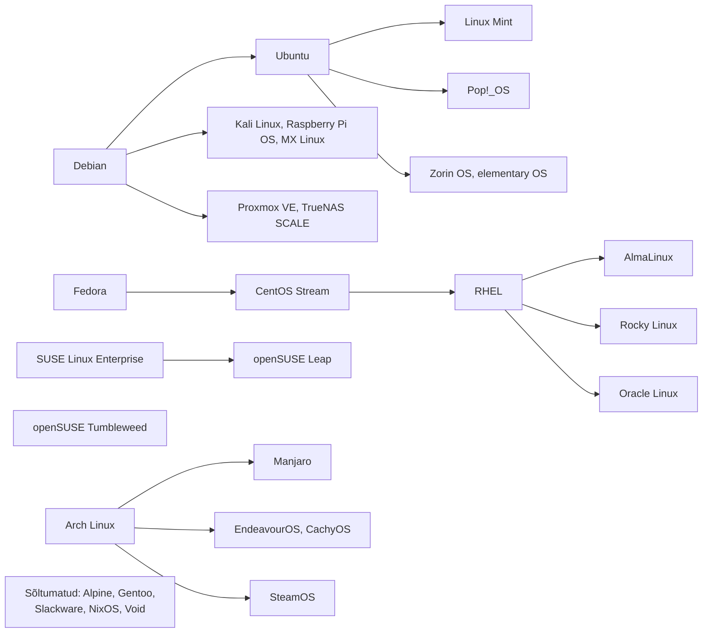
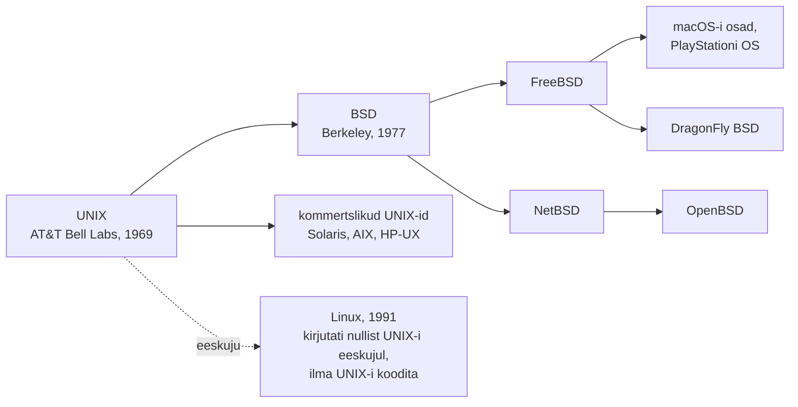

# Linuxi distributsioonide ülevaade

Distrosid on sadu, kuid enamik neist põhineb mõnel suuremal **alusdistrol**. Selles ülevaates on aktiivselt arendatavad olulisemad distrod, mis on rühmitatud perekondade kaupa.

> [!NOTE]
> **Kursusel kasutatavad distrod** on **Debian**, **Ubuntu** ja **AlmaLinux**. Need on Haapsalu Kutsehariduskeskuse Proxmoxi labori põhilised distrod ja kogu kursuse materjal on üles ehitatud nende kolme põhjal. Teiste distrode tundmine aitab aga mõista, kust need pärinevad ja millega võid tööl kokku puutuda.

Tabelites on kursusel kasutatavad distrod märgitud tärniga (★). Lehe lõpus on ülevaade Linuxi lähisugulasest **BSD-st** ja selle erinevustest Linuxiga.

> [!NOTE]
> **Märkus:** distrode olukord muutub: tekib uusi, mõni lõpetab tegevuse. Ülevaade on koostatud 2026. aasta sügisel. Ajakohase info leiad distro kodulehelt.

## Kuidas distrod omavahel seotud on?

## Debiani perekond

Pakihaldur `apt`, paketivorming `.deb`. Kõige suurem ja mitmekesisem perekond.

| Distro | Kirjeldus | Tüüpiline kasutus | Koduleht |
|---|---|---|---|
| **Debian** ★ | Kogukonna arendatud, üks vanimaid distrosid, rõhk stabiilsusel ja vabal tarkvaral | Serverid, paljude teiste distrode alus | [debian.org](https://www.debian.org/) |
| **Ubuntu** ★ | Canonicali arendatud, põhineb Debianil, LTS-versioonid iga 2 aasta järel | Pilv, serverid, töölaud | [ubuntu.com](https://ubuntu.com/) |
| Linux Mint | Ubuntul põhinev algajasõbralik töölauadistro (ka Debiani-põhine versioon LMDE) | Töölaud | [linuxmint.com](https://linuxmint.com/) |
| Pop!_OS | System76 arendatud, Ubuntul põhinev, oma töölaud COSMIC | Töölaud, arendajad, mängimine | [system76.com/pop](https://system76.com/pop/) |
| Zorin OS | Ubuntul põhinev, Windowsiga sarnase välimusega | Töölaud, Windowsilt üleminek | [zorin.com/os](https://zorin.com/os/) |
| elementary OS | Ubuntul põhinev, macOS-iga sarnase disainiga | Töölaud | [elementary.io](https://elementary.io/) |
| MX Linux | Debianil põhinev kerge ja kiire töölauadistro | Töölaud, vanem riistvara | [mxlinux.org](https://mxlinux.org/) |
| Kali Linux | Debianil põhinev, sisaldab sadu turvatestimise tööriistu | Küberturvalisus, läbistustestimine | [kali.org](https://www.kali.org/) |
| Raspberry Pi OS | Debianil põhinev Raspberry Pi ametlik OS | Raspberry Pi, õppimine, sardsüsteemid | [raspberrypi.com/software](https://www.raspberrypi.com/software/) |
| Proxmox VE | Debianil põhinev virtualiseerimisplatvorm (KVM, LXC) | Virtualiseerimine | [proxmox.com](https://www.proxmox.com/) |
| TrueNAS SCALE | Debianil põhinev salvestusplatvorm (ZFS) | Võrgusalvestus (NAS) | [truenas.com](https://www.truenas.com/) |

## Red Hati perekond

Pakihaldur `dnf`, paketivorming `.rpm`. Ettevõtete serverite standard.

Arendus liigub suunas **Fedora → CentOS Stream → RHEL**: uued lahendused jõuavad kõigepealt Fedorasse, seejärel CentOS Streami ja lõpuks stabiilsesse RHEL-i. AlmaLinux, Rocky Linux ja Oracle Linux on tasuta RHEL-iga ühilduvad distrod.

| Distro | Kirjeldus | Tüüpiline kasutus | Koduleht |
|---|---|---|---|
| Red Hat Enterprise Linux (RHEL) | Red Hati kommertsdistro koos tasulise toega | Ettevõtete serverid | [redhat.com](https://www.redhat.com/en/technologies/linux-platforms/enterprise-linux) |
| **AlmaLinux** ★ | Kogukonna arendatud, tasuta, RHEL-iga ühilduv | Serverid | [almalinux.org](https://almalinux.org/) |
| Rocky Linux | Kogukonna arendatud, tasuta, RHEL-iga ühilduv | Serverid | [rockylinux.org](https://rockylinux.org/) |
| Oracle Linux | Oracle'i tasuta RHEL-iga ühilduv distro | Serverid, Oracle'i tarkvara | [oracle.com/linux](https://www.oracle.com/linux/) |
| CentOS Stream | RHEL-i järgmise väikeversiooni arendusharu | Arendus ja testimine | [centos.org](https://www.centos.org/) |
| Fedora | Red Hati toetatud kogukonnadistro, uusim tarkvara, väljalase ca iga 6 kuu järel | Töölaud, arendajad | [fedoraproject.org](https://fedoraproject.org/) |
| Amazon Linux | AWS-i pilve jaoks loodud Fedoral põhinev distro | AWS-i pilv | [aws.amazon.com/linux](https://aws.amazon.com/linux/) |

> [!NOTE]
> **Ajalugu:** varem oli tasuta RHEL-i koopia **CentOS Linux**. Red Hat lõpetas selle ja CentOS Linux 7 tugi lõppes 2024. aastal. Selle asemele tekkisid AlmaLinux ja Rocky Linux. Tänapäeval tähendab „CentOS“ ainult arendusharu CentOS Stream.

## SUSE perekond

Pakihaldur `zypper`, paketivorming `.rpm`. Levinud eriti Saksamaal ja Kesk-Euroopas.

| Distro | Kirjeldus | Tüüpiline kasutus | Koduleht |
|---|---|---|---|
| SUSE Linux Enterprise (SLES) | SUSE kommertsdistro | Ettevõtete serverid, SAP | [suse.com](https://www.suse.com/) |
| openSUSE Leap | Põhineb SUSE Linux Enterprise'il, stabiilne | Serverid, töölaud | [opensuse.org](https://www.opensuse.org/) |
| openSUSE Tumbleweed | Pidevalt uuenev (*rolling release*) | Töölaud, arendajad | [opensuse.org](https://www.opensuse.org/) |

## Archi perekond

Pakihaldur `pacman`. Pidevalt uuenevad distrod, kus on alati uusim tarkvara.

| Distro | Kirjeldus | Tüüpiline kasutus | Koduleht |
|---|---|---|---|
| Arch Linux | Minimalistlik, kasutaja ehitab süsteemi ise kokku. Väga hea dokumentatsioon (Arch Wiki) | Edasijõudnud kasutajad, õppimine | [archlinux.org](https://archlinux.org/) |
| Manjaro | Archil põhinev, kasutajasõbralikum, oma testitud hoidlad | Töölaud | [manjaro.org](https://manjaro.org/) |
| EndeavourOS | Archile lähedane, lihtsa paigaldusprogrammiga | Töölaud | [endeavouros.com](https://endeavouros.com/) |
| CachyOS | Archil põhinev, jõudlusele optimeeritud | Töölaud, mängimine | [cachyos.org](https://cachyos.org/) |
| SteamOS | Valve'i arendatud, Archil põhinev mänguseadmete OS | Steam Deck, mängimine | [store.steampowered.com/steamos](https://store.steampowered.com/steamos) |

## Sõltumatud distrod

Need ei põhine ühelgi teisel distrol.

| Distro | Kirjeldus | Tüüpiline kasutus | Koduleht |
|---|---|---|---|
| Alpine Linux | Väga väike (mõni MB), turvalisusele keskendunud, `apk` | Konteinerid, sardsüsteemid | [alpinelinux.org](https://alpinelinux.org/) |
| Gentoo | Tarkvara kompileeritakse lähtekoodist, väga paindlik | Edasijõudnud kasutajad | [gentoo.org](https://www.gentoo.org/) |
| Slackware | Vanim tänini arendatav distro (1993), traditsiooniline UNIX-i laad | Huvilised | [slackware.com](http://www.slackware.com/) |
| NixOS | Kogu süsteem kirjeldatakse ühes konfiguratsioonis, muudatusi saab tagasi pöörata | Arendajad, korratavad keskkonnad | [nixos.org](https://nixos.org/) |
| Void Linux | Kasutab systemd asemel teenusehaldurit runit | Edasijõudnud kasutajad | [voidlinux.org](https://voidlinux.org/) |

## Eriotstarbelised distrod

| Distro | Alus | Kirjeldus | Koduleht |
|---|---|---|---|
| Tails | Debian | Privaatsusele keskendunud, käivitub USB-lt ega jäta jälgi | [tails.net](https://tails.net/) |
| Fedora Silverblue | Fedora | Muutumatu (*immutable*) töölaud: süsteemiosa on kirjutuskaitstud ja uuendatakse tervikuna | [fedoraproject.org](https://fedoraproject.org/atomic-desktops/silverblue/) |
| Bazzite | Fedora | Muutumatu mängimisele suunatud töölaud | [bazzite.gg](https://bazzite.gg/) |

## Hiljuti lõpetatud distrod

Vanemates juhendites võib kohata distrosid, mida enam ei arendata. Neid ei tasu uutes süsteemides kasutada.

| Distro | Mis juhtus |
|---|---|
| CentOS Linux | Asendati CentOS Streamiga, viimase versiooni tugi lõppes 2024 |
| Clear Linux | Intel lõpetas arenduse 2025. aastal |
| ArcoLinux | Arch-põhine õppedistro, lõpetati 2025. aastal |

## Kuidas distrot valida?

| Vajadus | Soovitus |
|---|---|
| Server, kus on vaja stabiilsust | Debian, AlmaLinux, Rocky Linux, Ubuntu LTS |
| Ettevõte, kus kasutatakse Red Hati | RHEL või AlmaLinux / Rocky Linux |
| Pilveserver | Ubuntu, Debian või pilveteenuse pakkuja oma distro |
| Esimene töölaud Linuxiga tutvumiseks | Linux Mint, Ubuntu, Zorin OS |
| Konteinerpildid | Alpine, Debian slim |
| Linuxi süvitsi mõistmine | Arch Linux, Gentoo, Linux From Scratch |
| Küberturvalisuse õpe | Kali Linux |

Kõige tähtsam on aru saada, et **käsurea põhioskused kehtivad kõigis distrodes**. Kui oled õppinud ühe perekonna selgeks, on teise juurde liikumine lihtne.

---

## BSD ja Linux

Linuxi kõrval on teine suur vaba UNIX-i-laadsete operatsioonisüsteemide pere **BSD**. Väljast vaadates on need väga sarnased: käsurida, kataloogipuu, kestad ja suur osa käske on tuttavad. Ajalugu ja ülesehitus on aga erinevad.

### Natuke ajalugu

**BSD** (*Berkeley Software Distribution*) on otsene UNIX-i järeltulija, mis sai alguse California Ülikoolist Berkeleys. **Linux** ei põhine UNIX-i koodil: Linus Torvalds kirjutas kerneli nullist, järgides UNIX-i põhimõtteid ja POSIX-i standardit. Seetõttu nimetatakse mõlemat **UNIX-i-laadseks** süsteemiks.

### Peamised erinevused

| | **Linux** | **BSD** |
|---|---|---|
| Mis see on | Kernel. Distro paneb kerneli ja tarkvara kokku eri allikatest | Terviklik OS: kernel ja põhitööriistad arendatakse koos ühes repos |
| Arendus | Kernel Linus Torvaldsi juhtimisel, distrod eraldi | Iga BSD-d arendab oma meeskond tervikuna |
| Litsents | GPL: muudetud koodi levitamisel tuleb ka lähtekood avaldada | BSD-litsents: lubav, koodi võib kasutada ka kinnises tarkvaras |
| Põhitööriistad | GNU tööriistad (`ls`, `grep`, `sed` jt GNU versioonid) | BSD omad versioonid. Mõned võtmed erinevad |
| Tarkvara | Distro pakihaldur (`apt`, `dnf` jne) | Pordid (*ports*, kompileerimine lähtekoodist) ja binaarpaketid (FreeBSD-s `pkg`) |
| Riistvara tugi | Väga lai | Kitsam, eriti uuema töölauariistvara puhul |
| Teenusehaldus | Enamasti systemd | Lihtsad `rc` skriptid |
| Tulemüür | nftables, iptables | pf, ipfw |
| Konteinerid | Docker, Podman, LXC | *Jails* (FreeBSD) |
| Levik | Domineerib serverites, pilves, sardseadmetes | Väiksem, kuid tugev võrgu-, turva- ja salvestuslahendustes |

**Litsentsi erinevus on olulisim põhjus, miks BSD-d on palju kommertstoodetes.** BSD-litsents lubab ettevõttel koodi võtta, muuta ja oma tootes kasutada, ilma et peaks muudatusi avaldama. Linuxi GPL-litsents nõuab muudatuste avaldamist.

### Olulisemad BSD-d

| Süsteem | Kirjeldus | Tüüpiline kasutus | Koduleht |
|---|---|---|---|
| FreeBSD | Kõige levinum BSD, hea jõudlus ja ZFS-i tugi | Serverid, võrgu- ja salvestusseadmed | [freebsd.org](https://www.freebsd.org/) |
| OpenBSD | Keskendub turvalisusele ja koodi kvaliteedile | Tulemüürid, turvakriitilised süsteemid | [openbsd.org](https://www.openbsd.org/) |
| NetBSD | Eesmärk on töötada võimalikult paljudel riistvaraplatvormidel | Sardsüsteemid, vanem riistvara | [netbsd.org](https://www.netbsd.org/) |
| DragonFly BSD | FreeBSD-st eraldunud, oma failisüsteem HAMMER2 | Huvilised, uurimistöö | [dragonflybsd.org](https://www.dragonflybsd.org/) |
| OPNsense | FreeBSD-l põhinev tulemüüri- ja ruuterilahendus | Võrgu tulemüür | [opnsense.org](https://opnsense.org/) |
| pfSense | FreeBSD-l põhinev tulemüüri- ja ruuterilahendus | Võrgu tulemüür | [pfsense.org](https://www.pfsense.org/) |

### Kus BSD-d igapäevaselt kohtad?

- **macOS ja iOS** - Apple'i süsteemide aluskiht Darwin sisaldab palju FreeBSD koodi. Seepärast on macOS-i terminal Linuxi kasutajale tuttav, kuid mõne käsu võtmed erinevad.
- **PlayStationi mängukonsoolid** - operatsioonisüsteem põhineb FreeBSD-l.
- **Netflix** - sisuedastusvõrgu serverid töötavad FreeBSD-l.
- **Tulemüürid** - OPNsense ja pfSense on väga levinud ka koolides ja väikeettevõtetes.
- **OpenSSH** - maailma levinuim SSH-tarkvara, mida kasutad ka sellel kursusel, on pärit OpenBSD projektist.

### Mida see Linuxi õppijale tähendab?

Kui oskad Linuxit, saad BSD-ga põhimõtteliselt hakkama: failisüsteemis liikumine, failide haldus, torud ja enamik käske töötavad samamoodi. Erinevused tulevad välja süsteemi halduses (tarkvara paigaldus, teenused, võrgu ja tulemüüri seadistus) ning mõne käsu võtmetes. Näiteks GNU `sed -i 's/a/b/' fail` asemel tuleb BSD-s (ja macOS-is) kirjutada `sed -i '' 's/a/b/' fail`.

Kursusel käsitletakse BSD-d kahes valikmoodulis: [moodul 18](../moodul-18-opnsense/index.md) (OPNsense tulemüür FreeBSD peal) ja [moodul 25](../moodul-25-freebsd/index.md) (FreeBSD server käsurealt).

<!-- navigatsioon -->
---

[← Laborikeskkond ja serverite paigaldus](paigaldus.md) · [Sisukord](../../README.md#sisukord) · [UNIX-i ja Linuxi ajalugu →](ajalugu.md)
<!-- /navigatsioon -->
