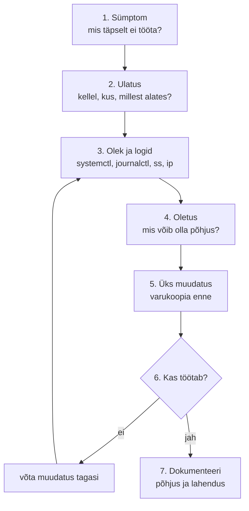

<!-- navigatsioon -->
[← Laborikeskkond ja serverite paigaldus](paigaldus.md) · [Sisukord](../../README.md#sisukord) · [Linuxi distributsioonide ülevaade →](distrod.md)
<!-- /navigatsioon -->

# Tõrkeotsingu töövoog

Iga moodul õpetab oma teema tõrkeotsingut: võrk (moodul 7), teenused ja logid (moodul 5), alglaadimine (moodul 11), DNS (moodul 17), DHCP (moodul 18). Selle lisa töövoog on nende kõigi ühine alus. Kogenud haldur ei arva ega proovi juhuslikult - ta liigub samm-sammult ja kirjutab üles, mida nägi.

> [!TIP]
> **Lühidalt:** 1) kirjelda sümptom täpselt, 2) selgita ulatus, 3) vaata olekut ja logisid, 4) sõnasta oletus, 5) muuda üht asja korraga, 6) kontrolli tulemust, 7) dokumenteeri. Kui oletus ei pidanud paika, võta muudatus tagasi ja mine tagasi 3. sammu juurde.



---

## 1. Kirjelda sümptom täpselt

„Ei tööta“ ei ole veakirjeldus. Küsi (endalt või kasutajalt):

- **Mis täpselt ei tööta?** Veebileht ei avane, avaneb aeglaselt või näitab veateadet? Milline veateade - kopeeri see täpselt.
- **Mida sa tegid?** Millise käsu, millise aadressi, millise kasutajaga?
- **Mis peaks juhtuma?** Mis oli oodatud tulemus?

Hea kirjeldus: *„`curl http://10.0.83.152` annab `Connection refused`, eile andis lehe.“* Halb: *„veeb on maas“*.

## 2. Selgita ulatus

Ulatus kitsendab põhjust kõige kiiremini:

| Küsimus | Kui vastus on „jah“, otsi põhjust... |
|---|---|
| Kas viga on **ainult ühel kasutajal**? | kasutaja õigustest, paroolist, tema arvutist |
| Kas viga on **kõigil**? | serverist või võrgust |
| Kas töötab **serveris endas** (`curl localhost`), aga mitte väljast? | tulemüürist, kuulamisaadressist, võrgust |
| Kas töötab **IP-aadressiga**, aga mitte nimega? | DNS-ist (moodul 17) |
| **Millest alates?** Mis vahepeal muutus? | viimasest muudatusest - vaata muudatuste logi, `dnf history`, `/var/log/apt/history.log`, `git log` |

Kõige sagedasem põhjus on **viimane muudatus**. Küsi alati: „mis muutus?“

## 3. Vaata olekut ja logisid

Enne kui midagi muudad, **vaata**. Need käsud ei muuda midagi ja neid võib alati käivitada:

| Mida | Käsk | Moodul |
|---|---|---|
| Kas teenus töötab? | `systemctl status teenus`, `systemctl --failed` | 5 |
| Mida teenus ütles? | `journalctl -u teenus -n 50`, `journalctl -p err -b` | 5, 12 |
| Kas port on avatud? | `sudo ss -tulpn` | 7 |
| Kas võrk töötab? | `ip -br a`, `ip r`, `ping`, `getent hosts nimi` | 7 |
| Kas kettal on ruumi? | `df -h`, `df -i` | 8 |
| Kas mälu ja protsessorit jätkub? | `free -h`, `uptime`, `top` | 5, 21 |
| Kas seadistus on korras? | `nginx -t`, `named-checkconf`, `kea-dhcp4 -t`, `sshd -t`, `findmnt --verify` | eri moodulid |
| Kas õigused on korras? | `ls -l`, `namei -l /tee/failini`, `ausearch -m AVC` (SELinux) | 3, 12 |

Võrgu puhul liigu **kihtide kaupa alt üles**: liides ja aadress → lüüs → internet IP-ga → nimelahendus → teenus ja port (moodul 7, punkt 7.5). Ära kontrolli teenust enne, kui tead, et võrk töötab.

**Loe veateadet.** Enamasti ütleb logi otse, mis valesti on: `Permission denied`, `Address already in use`, `No such file or directory`, `unknown directive`. Otsi veateate täpset teksti ka internetist - sama viga on peaaegu alati kellelgi varem olnud.

## 4. Sõnasta oletus

Sõnasta põhjus lausena, mida saab kontrollida: *„nginx ei käivitu, sest port 80 on juba kasutusel“*. Siis kontrolli seda: `sudo ss -tlpn | grep :80`. Kui oletus ei pea paika, sõnasta uus - ära muuda midagi enne, kui sul on põhjendatud oletus.

## 5. Muuda üht asja korraga

- **Tee enne varukoopia** muudetavast failist (`sudo cp fail fail.bak`) või hetktõmmis.
- **Muuda ainult üht asja.** Kui muudad kolme asja korraga ja viga kaob, ei tea sa, mis aitas - ja kahe ülejäänud muudatusega võisid tekitada uue vea.
- **Kontrolli seadistuse süntaksit** enne teenuse taaskäivitamist (`nginx -t` jt).
- Kirjuta üles, mida muutsid.

## 6. Kontrolli tulemust

- Proovi **sama asja, mis enne ei töötanud** - sama käsk, sama kasutaja, sama koht.
- Kontrolli, et muudatus **ei rikkunud midagi muud**: `systemctl --failed`, teised teenused.
- Kui muudatus puudutab alglaadimist või püsivat seadistust (`fstab`, võrk, teenuse `enable`), **taaskäivita** ja kontrolli uuesti.
- Kui viga jäi, **võta muudatus tagasi** (taasta varukoopia) ja mine tagasi 3. sammu juurde. Ära jäta süsteemi poolikute katsetustega.

## 7. Dokumenteeri

Kirjuta muudatuste logisse, mis juhtus ja mida tegid. Kui viga võib korduda, kirjuta **teadmusbaasi artikkel** - järgmine kord leiab lahenduse sinu kolleeg (või sina ise poole aasta pärast) mõne minutiga:

```text
Pealkiri:   nginx ei käivitu pärast uuendust: "Address already in use"
Sümptom:    veebileht ei avane, systemctl status nginx -> failed
Ulatus:     kõik kasutajad, alates 12.11 uuendusest
Põhjus:     uuendusega paigaldati apache2, mis hõivas pordi 80
Lahendus:   sudo systemctl disable --now apache2; sudo apt remove apache2;
            sudo systemctl start nginx
Kontroll:   curl -I http://localhost -> 200; taaskäivituse järel töötab
Ennetus:    vaata enne uuendust, mida apt paigaldab (apt -s upgrade)
```

---

## Levinud vead ja kiirkontroll

| Sümptom | Esimene kontroll |
|---|---|
| `Permission denied` | `ls -l`, `id`, `namei -l /tee`; AlmaLinuxis `ausearch -m AVC` |
| `Connection refused` | kas teenus kuulab: `sudo ss -tlpn`; kas õigel aadressil (`127.0.0.1` vs `0.0.0.0`) |
| `Connection timed out` | tulemüür (`ufw status`, `firewall-cmd --list-all`, `nft list ruleset`), marsruut |
| `Could not resolve host`, `Name or service not known` | DNS: `getent hosts nimi`, `/etc/resolv.conf`, `resolvectl status` |
| `No space left on device` | `df -h` ja `df -i`; suurimad kataloogid `sudo du -xh / --max-depth=2 \| sort -h \| tail` |
| Teenus `failed` kohe pärast käivitamist | `journalctl -u teenus -n 50`; seadistuse süntaksikontroll |
| Pärast taaskäivitust ei tööta | kas teenus on `enable`; `fstab` (`findmnt --verify`); võrgu püsiv seadistus |
| Süsteem ei käivitu | moodul 11, punkt 11.9 |

---

## Lisamaterjal

- Moodul 7, punkt 7.5 - võrguprobleemide diagnoosimine
- Moodul 11, punkt 11.9 - süsteemi taastamine
- Moodul 17, punkt 17.8 ja moodul 18, punkt 18.6 - DNS-i ja DHCP tõrkeotsing
- Moodul 21, punkt 21.1 - USE meetod jõudlusprobleemide otsimiseks

<!-- navigatsioon -->
---

[← Laborikeskkond ja serverite paigaldus](paigaldus.md) · [Sisukord](../../README.md#sisukord) · [Linuxi distributsioonide ülevaade →](distrod.md)
<!-- /navigatsioon -->
