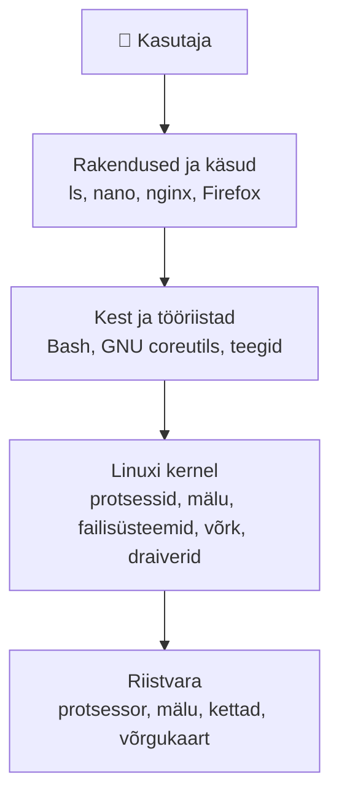
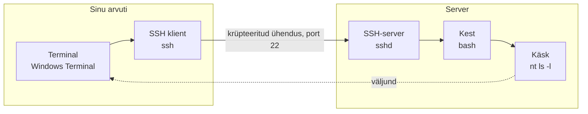
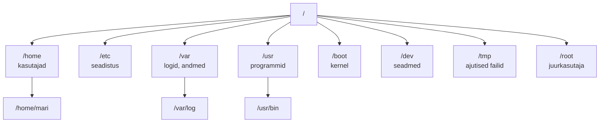

<!-- navigatsioon -->
[← Kursuse kava](../kava.md) · [Sisukord](../../README.md#sisukord) · [Laboritöö 1. Esimesed sammud käsureal →](labor.md)
<!-- /navigatsioon -->

# Moodul 1. Linux ja käsurida

**Maht:** 8 tundi · **Laboritöö:** Debian · **Eeldused:** puuduvad

## Õpiväljundid

Mooduli läbinud õppija:

- selgitab, mis on Linux, kernel ja distributsioon;
- nimetab distrode peamised perekonnad ja nende erinevused;
- ühendub serveriga SSH kaudu;
- kasutab käske koos võtmete ja argumentidega;
- leiab käskude kohta abi süsteemi dokumentatsioonist;
- kirjeldab Linuxi failisüsteemi hierarhiat;
- liigub failisüsteemis absoluutsete ja suhteliste teede abil;
- loob, kopeerib, teisaldab ja kustutab faile ning katalooge.

> [!NOTE]
> **Kuidas seda lehte lugeda:** iga teema algab kastiga **Lühidalt** - seal on kõige tähtsam paari lausega. Käsud ja näited on alati näha. Pikemad selgitused ja taust on peidetud plokkidesse **Loe lähemalt** - ava need, kui tahad teemast rohkem teada või kui laboritöös midagi ei õnnestu.

---

## 1.1 Mis on Linux?

> [!TIP]
> **Lühidalt:** **Linux** on operatsioonisüsteemi tuum (kernel). **Distro** on kernel koos tööriistade ja programmidega, mida saab kasutada. Linux on tasuta ja avatud lähtekoodiga ning töötab suuremas osas maailma serverites.

Linuxi süsteem koosneb kihtidest. Kasutaja ei räägi riistvaraga otse, vaid programmide ja kerneli kaudu:



<details>
<summary>Loe lähemalt: kernel, GNU, UNIX, BSD ja kus Linuxit kasutatakse</summary>

Rangelt võttes on **Linux** operatsioonisüsteemi **kernel** ehk tuum: programm, mis haldab riistvara (protsessor, mälu, kettad, võrk) ja jagab ressursse teiste programmide vahel. Kerneli kirjutas 1991. aastal Soome tudeng **Linus Torvalds** ja seda arendavad tänapäeval tuhanded inimesed üle maailma.

Kernel üksi ei ole veel kasutatav süsteem. Selleks on vaja ka käsurea tööriistu, teeke, pakihaldurit, teenuseid ja muud tarkvara. Suur osa sellest pärineb **GNU projektist**, mistõttu räägitakse vahel ka nimest **GNU/Linux**.

Linux on **vaba ja avatud lähtekoodiga tarkvara**: lähtekood on kõigile kättesaadav ning seda võib uurida, muuta ja levitada.

Linux on **UNIX-i-laadne** operatsioonisüsteem: see järgib 1969. aastal loodud UNIX-i põhimõtteid, kuid ei sisalda UNIX-i koodi. UNIX-i otsene järeltulija on hoopis **BSD** perekond (FreeBSD, OpenBSD jt), mis on Linuxiga väga sarnane, kuid on terviklik süsteem ja kasutab teistsugust litsentsi. BSD aluseid kasutavad näiteks macOS ja paljud tulemüürid. Linuxi ja BSD erinevustest loe lähemalt lisast [Linuxi distributsioonide ülevaade](../lisad/distrod.md#bsd-ja-linux).

> [!NOTE]
> **Ajalugu:** kuidas tekkisid UNIX, BSD, GNU ja Linux ning miks Linux on just selline, nagu ta on - sellest räägib lisa [UNIX-i ja Linuxi ajalugu](../lisad/ajalugu.md).

**Kus Linuxit kasutatakse?**

- suurem osa veebiserveritest ja pilveteenustest;
- kõik maailma 500 võimsaimat superarvutit;
- Android-telefonid (Androidi aluseks on Linuxi kernel);
- ruuterid, nutiteleviisorid, autod ja muud sardseadmed;
- konteinerid (Docker, Kubernetes) ja virtualiseerimisplatvormid (nt Proxmox VE).

> [!NOTE]
> **Miks see IT-spetsialistile oluline on?** Kui haldad servereid, võrguseadmeid või pilveteenuseid, puutud Linuxiga kokku peaaegu kindlasti, isegi kui sinu töölaual on Windows.

</details>

## 1.2 Distributsioonid

> [!TIP]
> **Lühidalt:** Kursusel kasutame kolme distrot: **Debian**, **Ubuntu** ja **AlmaLinux**. Debian ja Ubuntu kasutavad pakihaldurit `apt`, AlmaLinux `dnf`. Käsurea põhitõed on kõigis samad.

**Distributsioon** ehk **distro** on terviklik operatsioonisüsteem, mis koosneb Linuxi kernelist ja selle ümber valitud tarkvarast, pakihaldurist, paigaldusprogrammist ja seadistustest. Distrosid on sadu, kuid enamik neist kuulub mõnda suuremasse **perekonda**. Suuremate distrode ülevaate leiad lisast [Linuxi distributsioonide ülevaade](../lisad/distrod.md).

### Kursusel kasutatavad distrod

**Debian, Ubuntu ja AlmaLinux on Haapsalu Kutsehariduskeskuse Proxmoxi labori põhilised distrod ning kogu selle kursuse materjal on üles ehitatud nende kolme põhjal.** Iga laboritöö on kirjutatud ühe kindla distro jaoks ja teoorias on nende erinevused välja toodud lõikudes „Distrode erinevused“.

<details>
<summary>Loe lähemalt: distrode võrdlus</summary>

Need kolm on valitud, sest koos katavad need kaks levinuimat serveridistrode perekonda ja suurema osa reaalsetest Linuxi serveritest.

| | **Debian** | **Ubuntu** | **AlmaLinux** |
|---|---|---|---|
| Koduleht | [debian.org](https://www.debian.org/) | [ubuntu.com](https://ubuntu.com/) | [almalinux.org](https://almalinux.org/) |
| Dokumentatsioon | [debian.org/doc](https://www.debian.org/doc/) | [documentation.ubuntu.com](https://documentation.ubuntu.com/) | [wiki.almalinux.org](https://wiki.almalinux.org/) |
| Perekond | Debian | Debian | Red Hat (RHEL) |
| Taust | Kogukonna arendatud, üks vanimaid distrosid (1993) | Ettevõtte Canonical arendatud, põhineb Debianil | Kogukonna arendatud, ühildub binaartasemel RHEL-iga |
| Väljalasked | Stabiilne versioon ligikaudu iga 2 aasta järel | LTS-versioon iga 2 aasta järel (aprillis) | Järgib RHEL-i, iga põhiversioon ca 10 aastat toetatud |
| Pakihaldur | `apt` | `apt` | `dnf` |
| Paketi formaat | `.deb` | `.deb` | `.rpm` |
| Tüüpiline kasutus | Serverid, stabiilsust vajavad süsteemid | Pilv, töölaud, serverid | Ettevõtete serverid |

Sama perekonna distrod on väga sarnased: kui oskad Debianit, saad hakkama ka Ubuntuga. Perekondade vahel erinevad peamiselt pakihaldus, mõne konfiguratsioonifaili asukoht ja vaikimisi turvalahendused. Käsurea põhitõed, mida selles moodulis õpid, on kõigis distrodes samad.

> [!NOTE]
> **Märkus:** distrode versioonid muutuvad. Kehtiv versioon ja toe kestus on alati kirjas distro kodulehel.

</details>

### Kus Linuxit harjutada?

HKHK õppijal on laborimasinad Proxmoxis olemas. Iseõppija saab kasutada oma arvuti virtuaalmasinat või WSL-i.

<details>
<summary>Loe lähemalt: harjutamise võimalused</summary>

- **HKHK Proxmoxi labor** - õppija saab oma virtuaalmasinad (Debian, Ubuntu, AlmaLinux) ja need on kursuse laboritööde põhikeskkond. Masinate loomine, paigaldus ja võrguplaan on kirjeldatud lisas [Laborikeskkond ja paigaldus](../lisad/paigaldus.md).
- **Oma arvuti virtuaalmasin** - VirtualBox, VMware Workstation, Hyper-V või macOS-is UTM. Sobib iseõppijale ja koduseks tööks.
- **WSL** (*Windows Subsystem for Linux*) - Linux otse Windowsi sees, ilma eraldi virtuaalmasinata. Paigaldus PowerShellis (administraatorina): `wsl --install -d Debian` (või `Ubuntu`, `AlmaLinux-10`; valikud näitab `wsl --list --online`). WSL sobib hästi käsurea, Bashi ja Giti harjutamiseks (moodulid 1–4 ja 6, osaliselt 14 ja 19), kuid mitte kõigi laboritööde jaoks: alglaadimine, kettad, võrguseadistus ja tulemüür töötavad seal teisiti kui päris serveris.
- **Pilveserver** - väike virtuaalserver mõne teenusepakkuja juures. Arvesta, et see on kohe internetis ja vajab algusest peale turvalist seadistust (moodulid 7 ja 12).

</details>

## 1.3 Terminal, kest ja käsurida

> [!TIP]
> **Lühidalt:** Servereid hallatakse **käsurealt**. Sinu arvutis on **terminal**, millega ühendud serverisse. Serveris loeb ja täidab sinu käske **kest** (Bash).

Serveril ei ole tavaliselt graafilist liidest, sest see kulutaks ressursse ja suurendaks ründepinda.

Mõisted, mida tihti segi aetakse:

- **Terminal** (terminaliemulaator) on programm, mis kuvab tekstiakent ja edastab sinu klahvivajutused, nt Windows Terminal, GNOME Terminal või PuTTY.
- **Konsool** on otse arvuti külge ühendatud ekraan ja klaviatuur või virtuaalmasina konsooliaken (nt Proxmoxi veebiliideses).
- **Kest** (*shell*) on programm, mis loeb sinu käske, tõlgendab neid ja käivitab vastavad programmid. Linuxi levinuim kest on **Bash**. Kestasid on teisigi (nt `zsh`, `fish`) - neist ja kesta vahetamisest räägime moodulis 6.
- **Käsurida** (*command line*) on üldnimetus tekstipõhisele töötamisele.

Kuidas need osad kokku käivad, kui haldad serverit oma arvutist:



## 1.4 Ühendumine serveriga SSH kaudu

> [!TIP]
> **Lühidalt:** Serverisse ühendud käsuga `ssh kasutaja@aadress`. Parooli sisestamisel ekraanil midagi ei kuvata - see on normaalne. Välja saad käsuga `exit`.

**SSH** (*Secure Shell*) on krüpteeritud protokoll, millega saab üle võrgu teise arvuti käsureale ligi. SSH klient on olemas Windowsis, macOS-is ja Linuxis.

```bash
ssh kasutaja@aadress
```

Näiteks:

```bash
ssh mari@10.0.83.52
```

Esimesel ühendumisel küsib SSH, kas usaldad serveri võtit:

```text
The authenticity of host '10.0.83.52' can't be established.
ED25519 key fingerprint is SHA256:...
Are you sure you want to continue connecting (yes/no/[fingerprint])?
```

Kirjuta `yes` ja vajuta Enter. Seejärel küsitakse parooli. **Parooli sisestamisel ei kuvata ekraanil midagi** - ei tärne ega punkte. See on normaalne.

Ühenduse lõpetamiseks kirjuta `exit` või vajuta **Ctrl+D**.

<!-- PILT: ../pildid/m01-esimene-ssh-uhendus.png | Windows Terminal: esimene `ssh` ühendus koos sõrmejälje küsimusega -->

### Viip

Pärast sisselogimist näed **viipa** (*prompt*), mis näitab, et kest ootab käsku:

```text
mari@debian:~$
```

| Osa | Tähendus |
|---|---|
| `mari` | Kasutajanimi |
| `debian` | Masina nimi (*hostname*) |
| `~` | Praegune kataloog (`~` tähendab kodukataloogi) |
| `$` | Tavakasutaja. Juurkasutajal on selle asemel `#` |

> [!WARNING]
> **Ohutusreegel:** kui viip lõpeb märgiga `#`, töötad juurkasutajana (*root*) ja süsteem täidab iga käsu küsimata. Ole eriti tähelepanelik.

## 1.5 Käsu ülesehitus

> [!TIP]
> **Lühidalt:** Käsk on kujul `käsk võtmed argumendid`, nt `ls -l /etc`. Suur- ja väiketähed on erinevad. Kasuta **Tab**-klahvi: see lõpetab käsu ja failinime sinu eest.

Käsk koosneb üldjuhul kolmest osast:

```text
käsk  [võtmed]  [argumendid]
ls    -l        /etc
```

- **Käsk** on programm, mida käivitatakse.
- **Võtmed** (*options*) muudavad käsu käitumist. Lühikesed võtmed algavad ühe sidekriipsuga (`-l`) ja neid saab kokku kirjutada (`-la` on sama mis `-l -a`). Pikad võtmed algavad kahe sidekriipsuga (`--all`).
- **Argumendid** näitavad, millega käsk töötab (nt failinimi või kataloog).

Näited:

```bash
ls                  # loetle praeguse kataloogi sisu
ls -l               # pikk vorming
ls -la /etc         # pikk vorming koos peidetud failidega kataloogis /etc
ls --all --human-readable -l   # pikad võtmed
```

Märk `#` koos sellele järgneva tekstiga on **kommentaar** - kest ignoreerib seda.

**Linux eristab suur- ja väiketähti.** `ls` töötab, `LS` ei tööta. Samuti on `Fail.txt` ja `fail.txt` kaks erinevat faili.

### Kasulikud klahvid

| Klahv | Tegevus |
|---|---|
| **Tab** | Lõpetab käsu või failinime. Kaks vajutust näitavad kõiki võimalusi |
| **↑ / ↓** | Sirvi varem sisestatud käske |
| **Ctrl+R** | Otsi käsuajaloost |
| **Ctrl+C** | Katkesta töötav käsk |
| **Ctrl+L** | Puhasta ekraan (sama mis `clear`) |
| **Ctrl+D** | Lõpeta sisestus või logi välja |
| **Ctrl+A / Ctrl+E** | Liigu rea algusesse / lõppu |

> [!TIP]
> **Harjumus:** kasuta Tab-klahvi kogu aeg. See säästab aega ja hoiab ära trükivead failinimedes.

Käsuajalugu saad vaadata käsuga `history`.

## 1.6 Abi leidmine

> [!TIP]
> **Lühidalt:** `man käsk` näitab käsu kasutusjuhendit (välju klahviga **q**), `käsk --help` annab lühiabi. Tehisintellekti vastust kontrolli enne käivitamist.

Ükski süsteemiadministraator ei mäleta kõiki käske ja võtmeid. Oluline on osata abi leida.

### `man` - kasutusjuhend

```bash
man ls
```

Avaneb käsu kasutusjuhend (*manual page*). Selles liikumiseks:

| Klahv | Tegevus |
|---|---|
| **↑ / ↓**, **PgUp / PgDn** | Keri |
| **/sõna** | Otsi sõna, **n** järgmine vaste |
| **q** | Välju |

<details>
<summary>Loe lähemalt: kasutusjuhendi osad</summary>

Kasutusjuhendid on jaotatud osadesse. Olulisemad on **1** (tavakäsud), **5** (failivormingud ja konfiguratsioonifailid) ja **8** (halduskäsud). Näiteks `man 5 passwd` näitab faili `/etc/passwd` kirjeldust, mitte käsku `passwd`.

</details>

Kui sa ei tea käsu nime, otsi märksõna järgi:

```bash
man -k kopeeri    # otsib ainult ingliskeelsetest kirjeldustest
man -k copy
```

### `--help` - lühiabi

Enamik käske näitab võtmega `--help` lühikest kokkuvõtet:

```bash
cp --help
```

### Muud abivahendid

- `type käsk` - näitab, kas tegu on programmi, kesta sisekäsu või aliasega;
- `which käsk` - näitab programmi asukohta;
- `whereis käsk` - näitab programmi, selle lähtekoodi ja kasutusjuhendi failide asukohti;
- veebis: distro dokumentatsioon, Arch Wiki.

### Tehisintellekt abilisena

Tehisintellekti vestlusrobotid (ChatGPT, Claude, Copilot jt) oskavad selgitada käske, kirjutada skripte ja aidata veateateid tõlgendada. Need on head abilised - kui kasutad neid targalt:

- **Saa enne ise aru.** Proovi esmalt `man`-i ja `--help`-i. Kui kasutad AI vastust, peaksid oskama selgitada iga käsku ja võtit, mida käivitad.
- **Kontrolli enne käivitamist.** AI võib „enesekindlalt eksida“: välja mõelda olematu võtme, segi ajada distrod (`apt` vs `dnf`) või pakkuda ohtlikku käsku (`rm -rf`, `chmod -R 777`, `curl … | sudo bash`). Ära käivita `sudo`-ga midagi, mida sa ei mõista.
- **Ära kleebi saladusi.** Paroolid, privaatvõtmed, API-võtmed, isikuandmed ja asutuse siseinfo (IP-plaanid, kasutajanimed) ei kuulu vestlusrobotisse.
- **Testi laboris.** Proovi pakutud lahendust kõigepealt virtuaalmasinas, mille saad hetktõmmisest taastada.
- **Järgi reegleid.** Laboritöödes, enesekontrollis ja eksamil kehtivad õpetaja reeglid AI kasutamise kohta. Proovieksamil on AI keelatud - päris töös peab oskama ka ilma.

> [!TIP]
> Hea harjutus: lase AI-l selgitada mõnda selle mooduli käsku ja kontrolli vastust `man`-lehe abil. Kas kõik oli õige?

## 1.7 Failisüsteemi hierarhia

> [!TIP]
> **Lühidalt:** Linuxis on üks kataloogipuu, mis algab juurest `/`. Tähtsamad kohad: `/home` - kasutajate failid, `/etc` - seadistus, `/var/log` - logid.

Windowsis on igal kettal oma täht (`C:`, `D:`). Linuxis on **üks puu**, mis algab **juurkataloogist** `/`. Kõik kettad, USB-mälud ja võrgukettad haagitakse selle puu mõnda kataloogi.

Kataloogide paigutust kirjeldab standard **FHS** (*Filesystem Hierarchy Standard*):



<details>
<summary>Loe lähemalt: kõik põhikataloogid</summary>

| Kataloog | Sisu |
|---|---|
| `/` | Juurkataloog, kogu puu algus |
| `/home` | Tavakasutajate kodukataloogid (nt `/home/mari`) |
| `/root` | Juurkasutaja kodukataloog |
| `/etc` | Süsteemi ja teenuste konfiguratsioonifailid |
| `/var` | Muutuvad andmed: logid (`/var/log`), vahemälu, andmebaasid |
| `/tmp` | Ajutised failid, kustutatakse tavaliselt taaskäivitusel |
| `/usr` | Paigaldatud programmid ja teegid (`/usr/bin`, `/usr/lib`) |
| `/bin`, `/sbin` | Põhikäsud. Tänapäevastes distrodes viidad kataloogidele `/usr/bin` ja `/usr/sbin` |
| `/boot` | Kernel ja alglaadija failid |
| `/dev` | Seadmefailid (kettad, terminalid) |
| `/proc`, `/sys` | Virtuaalsed failisüsteemid kerneli ja protsesside info jaoks |
| `/mnt`, `/media` | Ajutiselt haagitud failisüsteemid ja eemaldatavad andmekandjad |
| `/opt` | Kolmandate osapoolte lisatarkvara |
| `/srv` | Serveriteenuste andmed (nt veebilehe failid) |

</details>

> [!NOTE]
> **Linuxis on kõik fail.** Ka seadmed, protsessid ja kerneli seaded on esitatud failidena. Sellepärast saab neid uurida samade tööriistadega, millega tavalisi faile.

## 1.8 Liikumine failisüsteemis

> [!TIP]
> **Lühidalt:** `pwd` - kus ma olen, `ls` - mis siin on, `cd` - mine mujale. **Absoluutne tee** algab märgiga `/`, **suhteline tee** algab sealt, kus parajasti oled. `..` on ülemkataloog, `~` kodukataloog.

### Kus ma olen? - `pwd`

```bash
pwd
```

```text
/home/mari
```

### Mis siin on? - `ls`

```bash
ls            # kataloogi sisu
ls -l         # pikk vorming: õigused, omanik, suurus, kuupäev
ls -a         # ka peidetud failid (nimi algab punktiga, nt .bashrc)
ls -lh        # suurused inimloetaval kujul (K, M, G)
ls /etc       # teise kataloogi sisu
```

`ls -l` väljund näeb välja selline:

```text
-rw-r--r-- 1 mari mari  220 jaan  5 10:12 .bash_logout
drwxr-xr-x 2 mari mari 4096 jaan  5 10:15 dokumendid
```

Esimene märk näitab tüüpi: `-` on tavaline fail, `d` kataloog, `l` viit. Ülejäänud õiguste tähistust käsitleme moodulis 3.

### Liikumine - `cd`

```bash
cd /etc          # mine kataloogi /etc
cd               # mine kodukataloogi
cd ~             # sama
cd ..            # mine ühe taseme võrra üles
cd -             # mine eelmisesse kataloogi tagasi
```

### Absoluutne ja suhteline tee

**Tee** (*path*) näitab faili või kataloogi asukohta.

- **Absoluutne tee** algab juurkataloogist `/` ja kehtib alati, sõltumata sellest, kus parajasti oled: `/home/mari/dokumendid`.
- **Suhteline tee** algab praegusest kataloogist: kui oled kataloogis `/home/mari`, siis `dokumendid` viitab kataloogile `/home/mari/dokumendid`.

Erilised tähised:

| Tähis | Tähendus |
|---|---|
| `.` | Praegune kataloog |
| `..` | Ülemkataloog |
| `~` | Kodukataloog |

Näide: kui oled kataloogis `/home/mari/dokumendid`, viitavad kõik järgmised samale failile:

```text
/home/mari/pildid/foto.jpg     # absoluutne
../pildid/foto.jpg             # suhteline
~/pildid/foto.jpg              # kodukataloogi suhtes
```

## 1.9 Failid ja kataloogid

> [!TIP]
> **Lühidalt:** `mkdir` loob kataloogi, `touch` faili, `cp` kopeerib, `mv` teisaldab või nimetab ümber, `rm` kustutab. **Prügikasti ei ole** - kontrolli enne kustutamist, mida kustutad.

### Loomine

```bash
mkdir projekt                  # loo kataloog
mkdir -p projekt/a/b/c         # loo ka puuduvad vahekataloogid
touch märkmed.txt              # loo tühi fail (või uuenda olemasoleva faili aega)
```

<details>
<summary>Loe lähemalt: mitu kataloogi korraga</summary>

Kest oskab laiendada **loogelisi sulge**, mis aitab luua mitu kataloogi korraga:

```bash
mkdir -p projekt/{dokumendid,pildid,skriptid}
# sama mis: mkdir -p projekt/dokumendid projekt/pildid projekt/skriptid
```

</details>

### Kopeerimine ja teisaldamine

```bash
cp fail.txt koopia.txt         # kopeeri fail
cp fail.txt dokumendid/        # kopeeri fail kataloogi
cp -r projekt projekt-varu     # kopeeri kataloog koos sisuga (-r = rekursiivselt)
mv vana.txt uus.txt            # nimeta ümber
mv fail.txt dokumendid/        # teisalda kataloogi
```

Linuxis ei ole eraldi ümbernimetamise käsku - ümbernimetamine on teisaldamine samasse kataloogi uue nimega.

### Kustutamine

```bash
rm fail.txt                    # kustuta fail
rm -i fail.txt                 # küsi enne kustutamist kinnitust
rmdir tühi-kataloog            # kustuta tühi kataloog
rm -r kataloog                 # kustuta kataloog koos sisuga
```

> [!WARNING]
> **Hoiatus:** käsureal ei ole prügikasti. `rm` kustutab failid jäädavalt. Eriti ettevaatlik ole käsuga `rm -r` ja metamärkidega. Kontrolli enne Enteri vajutamist, kus sa oled (`pwd`) ja mida kustutad (`ls`).

### Failide sisu vaatamine

```bash
cat fail.txt                   # kuva kogu sisu
less /etc/services             # sirvi pikka faili (klahvid nagu man-is, q väljub)
head fail.txt                  # esimesed 10 rida
tail fail.txt                  # viimased 10 rida
tail -n 20 fail.txt            # viimased 20 rida
file /bin/ls                   # näita faili tüüpi
```

Linuxis ei määra faililaiend faili tüüpi. Käsk `file` uurib faili sisu ja ütleb, mis see tegelikult on.

### Metamärgid

**Metamärgid** (*wildcards*) võimaldavad viidata korraga mitmele failile. Kest asendab need enne käsu käivitamist sobivate failinimedega.

| Metamärk | Tähendus | Näide |
|---|---|---|
| `*` | Suvaline hulk mis tahes märke | `*.txt` - kõik `.txt` failid |
| `?` | Täpselt üks suvaline märk | `fail?.txt` - `fail1.txt`, `failA.txt` |
| `[ ]` | Üks märk loetelust | `fail[123].txt` - `fail1.txt`, `fail2.txt`, `fail3.txt` |

```bash
ls /etc/*.conf
cp *.jpg pildid/
rm aruanne-202?.txt
```

> [!TIP]
> **Nipp:** enne kui kasutad metamärke koos käsuga `rm`, käivita sama muster käsuga `ls`. Nii näed, mida kustutama hakkad.

### Tühikud failinimedes

Kest kasutab tühikut argumentide eraldajana. Tühikuga failinimi tuleb panna jutumärkidesse või tühik varjestada kaldkriipsuga:

```bash
touch "minu fail.txt"
ls minu\ fail.txt
```

Serverites on parem tühikuid failinimedes vältida ja kasutada sidekriipsu või allkriipsu.

## 1.10 Süsteemi info

> [!TIP]
> **Lühidalt:** Distro ja versiooni näitab kõige kindlamalt `cat /etc/os-release`, masina üldinfot `hostnamectl`.

```bash
whoami                 # kes ma olen
hostname               # masina nimi
hostnamectl            # masina nimi, OS, kernel, riistvara
cat /etc/os-release    # distro nimi ja versioon
uname -r               # kerneli versioon
uptime                 # kui kaua süsteem on töötanud ja koormus
date                   # kuupäev ja kellaaeg
```

Fail `/etc/os-release` on olemas kõigis tänapäevastes distrodes ning on kõige kindlam viis distro ja selle versiooni tuvastamiseks.

---

## Distrode erinevused

Selles moodulis käsitletud käsud töötavad Debianis, Ubuntus ja AlmaLinuxis ühtemoodi. Märgatavad erinevused:

<details>
<summary>Loe lähemalt: erinevuste tabel</summary>

| | **Debian** | **Ubuntu** | **AlmaLinux** |
|---|---|---|---|
| Viip | `mari@debian:~$` | `mari@ubuntu:~$` | `[mari@alma ~]$` |
| Sisselogimisel | Lühike teade | Pikem teade süsteemi seisu ja uuenduste kohta | Võib soovitada veebikonsooli Cockpit aktiveerimist |
| Halduri grupp | `sudo` | `sudo` | `wheel` |
| Esimene kasutaja saab `sudo` õiguse | Ainult siis, kui paigaldusel jäeti juurkasutaja parool määramata | Alati | Kui paigaldusel märgiti kasutaja administraatoriks |

</details>

Halduriõigusi ja `sudo` käsku käsitleme lähemalt moodulis 3.

---

## Kokkuvõte

| Käsk | Tegevus |
|---|---|
| `ssh kasutaja@aadress` | Ühendu serveriga |
| `pwd` | Näita praegust kataloogi |
| `ls -la` | Loetle kataloogi sisu koos peidetud failidega |
| `cd tee` | Liigu kataloogi |
| `mkdir -p tee` | Loo kataloog (koos vahekataloogidega) |
| `touch fail` | Loo tühi fail |
| `cp -r allikas siht` | Kopeeri |
| `mv allikas siht` | Teisalda või nimeta ümber |
| `rm -r tee` | Kustuta (jäädavalt!) |
| `cat`, `less`, `head`, `tail` | Vaata faili sisu |
| `file fail` | Näita faili tüüpi |
| `man käsk`, `käsk --help` | Leia abi |
| `history` | Näita käsuajalugu |
| `cat /etc/os-release` | Näita distro versiooni |

**Järgmised sammud:** tee [laboritöö](labor.md) ja kontrolli oma teadmisi [enesekontrolli](enesekontroll.md) abil.

## Lisamaterjal

- William Shotts, „The Linux Command Line“ (I osa, tasuta: linuxcommand.org)
- OverTheWire Bandit, tasemed 0–5 (overthewire.org/wargames/bandit)
- Linux Foundation, „Introduction to Linux“ (LFS101, tasuta edX-is)

<!-- navigatsioon -->
---

[← Kursuse kava](../kava.md) · [Sisukord](../../README.md#sisukord) · [Laboritöö 1. Esimesed sammud käsureal →](labor.md)
<!-- /navigatsioon -->
