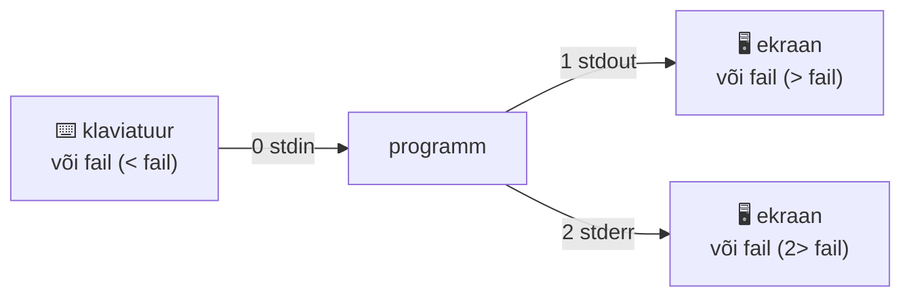
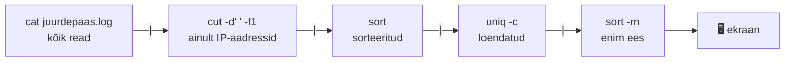

<!-- navigatsioon -->
[← Moodul 1. Enesekontroll](../moodul-01-sissejuhatus/enesekontroll.md) · [Sisukord](../../README.md#sisukord) · [Laboritöö 2. Logide analüüs ja failide haldus →](labor.md)
<!-- /navigatsioon -->

# Moodul 2. Failid, tekst ja torud

**Maht:** 10 tundi · **Laboritöö:** Debian · **Eeldused:** moodul 1

## Õpiväljundid

Mooduli läbinud õppija:

- redigeerib tekstifaile redaktoritega `nano` ja `vim`;
- suunab käskude väljundi ja veateated faili;
- ühendab käske torude abil;
- otsib ja töötleb teksti käskudega `grep`, `sort`, `uniq`, `wc`, `cut` ja `tr`;
- kasutab regulaaravaldiste põhielemente;
- otsib faile käsuga `find`;
- loob sümbol- ja kõvaviitu;
- arhiveerib ja pakib faile käsuga `tar`;
- võrdleb faile (`diff`), rakendab paiku (`patch`) ja edastab käskude väljundi argumentideks (`xargs`).

> [!NOTE]
> **Kuidas seda lehte lugeda:** iga teema algab kastiga **Lühidalt** - seal on kõige tähtsam paari lausega. Käsud ja näited on alati näha. Pikemad selgitused ja taust on peidetud plokkidesse **Loe lähemalt** - ava need, kui tahad teemast rohkem teada või kui laboritöös midagi ei õnnestu.

---

## 2.1 Miks tekst?

> [!TIP]
> **Lühidalt:** Linuxis on seadistus, logid ja süsteemi info **tekstina**. Väikesed käsud teevad igaüks ühe asja ja neid ühendatakse torudega - nii lahendad ka keerulise ülesande.

Linuxis on peaaegu kõik konfiguratsioonid, logid ja süsteemi info **tekstifailid**. Linuxi tööriistad järgivad **UNIX-i filosoofiat**:

1. iga programm teeb üht asja ja teeb seda hästi;
2. programmid töötavad koos;
3. programmid kasutavad universaalse liidesena tekstivoogu.

Seetõttu ei ole Linuxis üht hiiglaslikku programmi logide analüüsimiseks. Selle asemel ühendatakse mitu väikest tööriista, millest igaüks teeb ühe sammu. Selle mooduli eesmärk on õppida neid tööriistu kombineerima.

Näide: **mitu kasutajat kasutab millist kesta?** Ühtki käsku, mis just seda teeks, ei ole - aga neli väikest käsku koos annavad vastuse:

```bash
cut -d: -f7 /etc/passwd | sort | uniq -c | sort -rn
```

```text
     19 /usr/sbin/nologin
      3 /bin/bash
      1 /bin/sync
```

| Samm | Mida teeb | Tulemus |
|---|---|---|
| `cut -d: -f7 /etc/passwd` | võtab igalt realt 7. välja (kest) | üks kest rea kohta |
| `sort` | sorteerib | samad kestad kõrvuti |
| `uniq -c` | loendab järjestikused korduvad read | arv + kest |
| `sort -rn` | sorteerib arvu järgi kahanevalt | enim kasutatud ees |

Ükski neist käskudest ei tea midagi kasutajatest ega kestadest - nad töötlevad lihtsalt teksti. Sama ahelat saab kasutada logides IP-aadresside, veakoodide või muu loendamiseks (punkt 2.4). Käske `cut`, `sort` ja `uniq` õpid selles moodulis lähemalt.

Neljas põhimõte, **kõik on fail** (moodul 1), tähendab, et samade tööriistadega saab lugeda ka süsteemi infot: `cat /proc/cpuinfo`, `grep MemTotal /proc/meminfo`, `cat /sys/class/net/ens18/address`.

<details>
<summary>Loe lähemalt: Kust käsud pärinevad?</summary>

Käsud nagu `ls`, `grep` või `ps` ei ole kerneli ega kesta osa, vaid eraldi programmid failidena kataloogis `/usr/bin`. Need pärinevad mõnest **paketist** (moodul 4) ja enamik neist on **GNU projekti** tööriistad:

| Pakett | Käsud (näited) | Päritolu |
|---|---|---|
| `coreutils` | `ls`, `cp`, `mv`, `rm`, `cat`, `cut`, `sort`, `uniq`, `wc`, `chmod`, `df`, `date` | GNU |
| `findutils` | `find`, `xargs` | GNU |
| `grep`, `sed`, `gawk`, `tar`, `gzip`, `diffutils` | samanimelised käsud, `diff` | GNU |
| `bash` | kest ise | GNU |
| `util-linux` | `mount`, `lsblk`, `fdisk`, `su`, `more`, `logger` | Linuxi projekt |
| `procps` (AlmaLinuxis `procps-ng`) | `ps`, `top`, `free`, `kill`, `sysctl` | Linuxi projekt |
| `iproute2` | `ip`, `ss` | Linuxi projekt |

```bash
type ls                     # kas käsk on programm, kesta sisekäsk või alias
dpkg -S /usr/bin/ls         # Debian, Ubuntu: coreutils: /usr/bin/ls
rpm -qf /usr/bin/ls         # AlmaLinux: coreutils-9...
ls --version                # versioon ja projekt (GNU coreutils)
```

**GNU, POSIX, BSD ja BusyBox.** Standard **POSIX** kirjeldab, millised käsud ja võtmed peavad Unixi-laadses süsteemis olemas olema. GNU tööriistad teevad rohkem: neil on pikad võtmed (`--help`, `--human-readable`) ja lisavõimalused (`grep -P`, `sed -i`, `date -d`), mida mujal ei pruugi olla.

| Kus | Tööriistad | Mida arvestada |
|---|---|---|
| Debian, Ubuntu, AlmaLinux | GNU | Kõik selle kursuse näited |
| FreeBSD, macOS | BSD | Võtmed osaliselt erinevad (`sed -i ''`, `ls -G`), vt moodul 30 |
| Alpine, konteinerid, ruuterid | **BusyBox**: üks väike programm, mis asendab sadu käske | Ainult põhivõtmed; pikki GNU võtmeid sageli pole |

Kui kirjutad skripti, mis peab töötama igal pool, kasuta ainult POSIX-võtmeid. Kui skript töötab ainult sinu Linuxi serverites, võid GNU lisavõimalusi julgelt kasutada.

</details>

## 2.2 Tekstiredaktorid

> [!TIP]
> **Lühidalt:** Serveris muudad faile terminalis. **nano** on lihtne (salvesta **Ctrl+O**, välju **Ctrl+X**). **vim** on võimsam, kuid tal on režiimid: `i` - kirjuta, **Esc** - tagasi, `:wq` - salvesta ja välju.

Serveris ei ole graafilist redaktorit, seega tuleb konfiguratsioonifaile muuta terminalis.

### nano

**nano** on lihtne ja algajasõbralik redaktor. Kõik olulised käsud on kirjas ekraani allservas, kus `^` tähendab klahvi **Ctrl**.

```bash
nano fail.txt
```

| Klahv | Tegevus |
|---|---|
| **Ctrl+O**, Enter | Salvesta |
| **Ctrl+X** | Välju (küsib, kas salvestada) |
| **Ctrl+W** | Otsi |
| **Ctrl+K** | Lõika rida |
| **Ctrl+U** | Kleebi |
| **Alt+U** | Võta tagasi |
| **Ctrl+_** | Mine reale (number) |

### vim

**vi** on olemas peaaegu igas UNIX-i süsteemis, ka siis, kui midagi muud pole paigaldatud. **vim** on selle täiustatud versioon. vim on võimas, kuid harjumatu, sest sellel on mitu **režiimi**:

| Režiim | Mida teeb | Kuidas sinna saab |
|---|---|---|
| **Tavarežiim** (*normal*) | Liikumine ja käsud. Klahvivajutused ei kirjuta teksti | **Esc** |
| **Sisestusrežiim** (*insert*) | Teksti kirjutamine | **i** (kursori ette), **a** (kursori järele), **o** (uus rida) |
| **Käsurežiim** (*command*) | Salvestamine, väljumine, otsing ja asendus | Tavarežiimis **:** |

Olulisemad käsud (tavarežiimis):

| Käsk | Tegevus |
|---|---|
| `:w` | Salvesta |
| `:q` | Välju |
| `:wq` või `:x` | Salvesta ja välju |
| `:q!` | Välju salvestamata |
| `/sõna` | Otsi, **n** järgmine vaste |
| `dd` | Kustuta (lõika) rida |
| `yy` | Kopeeri rida |
| `p` | Kleebi |
| `u` | Võta tagasi |
| `gg` / `G` | Faili algusesse / lõppu |
| `:set number` | Näita reanumbreid |

> [!TIP]
> **Kui jäid vim-i lõksu:** vajuta paar korda **Esc**, kirjuta `:q!` ja vajuta Enter. Nii väljud, ilma et muudatusi salvestataks.

Vim-i õppimiseks sobivad:

- `vimtutor` - interaktiivne õpetus otse terminalis (vajab paketti `vim`); hea alustuseks, võtab umbes 30 minutit.
- [Vim Adventures](https://vim-adventures.com/) - brauserimäng, kus tegelast liigutatakse vim-i klahvidega; esimesed tasemed on tasuta.
- [The Viminator](https://www.theviminator.com/) - brauseris töötav vim-i käskude harjutamise rakendus.
- [VimGolf](https://www.vimgolf.com/) - ülesanded, kus tuleb tekst muuta võimalikult väheste klahvivajutustega; sobib edasijõudnule.

> [!TIP]
> **Kumba kasutada?** Igapäevaseks tööks sobib nano. vim-i põhitõed (`i`, `Esc`, `:wq`, `:q!`) peab aga oskama iga süsteemiadministraator, sest mõnes süsteemis on ainult `vi`.

## 2.3 Standardvood ja ümbersuunamine

> [!TIP]
> **Lühidalt:** Igal programmil on sisend (0), väljund (1) ja veateated (2). `>` kirjutab väljundi faili üle, `>>` lisab lõppu, `2>` suunab veateated.

Igal programmil on kolm **standardvoogu**:

| Voog | Number | Vaikimisi |
|---|---|---|
| **stdin** - standardsisend | 0 | Klaviatuur |
| **stdout** - standardväljund | 1 | Ekraan |
| **stderr** - standardveaväljund | 2 | Ekraan |



Väljundit ja veateateid näed ekraanil koos, kuid need on kaks erinevat voogu. Neid saab **ümber suunata**:

| Tähis | Tegevus |
|---|---|
| `käsk > fail` | Suuna väljund faili (fail kirjutatakse üle!) |
| `käsk >> fail` | Lisa väljund faili lõppu |
| `käsk 2> fail` | Suuna veateated faili |
| `käsk > fail 2>&1` | Suuna väljund ja veateated samasse faili |
| `käsk &> fail` | Sama, Bashi lühikuju |
| `käsk < fail` | Loe sisend failist |

Näited:

```bash
ls -l /etc > failid.txt              # salvesta väljund faili
date >> logi.txt                     # lisa kuupäev logi lõppu
echo "Tere" > tervitus.txt           # kirjuta tekst faili
ls /olematu 2> vead.txt              # salvesta veateade
find / -name "*.conf" 2> /dev/null   # peida veateated
```

**`/dev/null`** on eriline fail, mis neelab kõik sinna kirjutatu. Seda kasutatakse soovimatu väljundi kõrvaldamiseks.

> [!WARNING]
> **Hoiatus:** `>` kirjutab faili üle ilma küsimata. `ls > tähtis.txt` kustutab faili `tähtis.txt` varasema sisu. Kui tahad lisada, kasuta `>>`.

## 2.4 Torud

> [!TIP]
> **Lühidalt:** Toru `|` saadab ühe käsu väljundi järgmise käsu sisendiks: `cat fail | grep viga | wc -l`.

**Toru** (*pipe*) `|` suunab ühe käsu väljundi järgmise käsu sisendiks:

```bash
käsk1 | käsk2 | käsk3
```

Iga käsk töötleb eelmise väljundit ja annab tulemuse edasi - nagu konveier:



Näited:

```bash
ls -l /etc | less                    # sirvi pikka väljundit
cat /etc/passwd | wc -l              # loe ridade arvu
history | grep ssh                   # otsi käsuajaloost
```

Torusid saab ühendada pikkadeks ahelateks, kus iga samm teeb üht asja. Ahelat on mõistlik ehitada järk-järgult: lisa üks käsk korraga ja vaata vahetulemust.

### tee - väljund nii ekraanile kui ka faili

```bash
ls -l /etc | tee failid.txt | wc -l
```

Käsk `tee` kirjutab sisendi faili ja annab selle ka edasi. Võti `-a` lisab faili lõppu.

## 2.5 Teksti töötlemine

> [!TIP]
> **Lühidalt:** `grep` otsib ridu, `sort` sorteerib, `uniq -c` loendab kordusi, `wc -l` loeb ridu, `cut` ja `awk` võtavad välja veerge.

Näidetes kasutame faili `/etc/passwd`, kus on iga kasutaja kohta üks rida ja väljad on eraldatud kooloniga:

```text
mari:x:1000:1000:Mari Maasikas:/home/mari:/bin/bash
```

Väljad on: kasutajanimi, parooli kohatäide, UID, GID, kirjeldus, kodukataloog ja kest.

### grep - ridade otsimine

`grep` näitab ridu, mis sisaldavad otsitavat mustrit.

```bash
grep mari /etc/passwd                # read, kus on „mari“
grep -i error logi.txt               # tõstutundetu otsing
grep -v nologin /etc/passwd          # read, kus EI ole „nologin“
grep -n bash /etc/passwd             # näita reanumbreid
grep -c bash /etc/passwd             # loe vastete arv
grep -r "Listen" /etc/ 2>/dev/null   # otsi kõigist failidest rekursiivselt
grep -w root /etc/passwd             # ainult terve sõna
grep -o "[0-9]*" fail.txt            # näita ainult vastet, mitte tervet rida
```

### sort ja uniq - sorteerimine ja kordused

```bash
sort nimed.txt                       # tähestiku järjekorras
sort -r nimed.txt                    # vastupidises järjekorras
sort -n numbrid.txt                  # numbrite järgi
sort -t: -k3 -n /etc/passwd          # 3. välja (UID) järgi, eraldaja koolon
sort -u nimed.txt                    # ainult unikaalsed read
```

`uniq` eemaldab **järjestikused** korduvad read, seega tuleb sisend enne sorteerida:

```bash
sort nimed.txt | uniq                # unikaalsed read
sort nimed.txt | uniq -c             # loenda iga rea esinemised
sort nimed.txt | uniq -d             # ainult korduvad read
```

Väga levinud muster on „mis esineb kõige sagedamini“:

```bash
sort | uniq -c | sort -rn | head
```

### wc - loendamine

```bash
wc fail.txt                          # read, sõnad, baidid
wc -l fail.txt                       # ainult read
ls /etc | wc -l                      # mitu faili on kataloogis /etc
```

### cut - väljade eraldamine

```bash
cut -d: -f1 /etc/passwd              # 1. väli (kasutajanimed)
cut -d: -f1,7 /etc/passwd            # 1. ja 7. väli
cut -c1-10 fail.txt                  # märgid 1–10
```

Võti `-d` määrab eraldaja ja `-f` välja numbri. `cut` sobib, kui eraldaja on üks kindel märk. Tühikutega joondatud väljundi jaoks sobib paremini `awk` (vt allpool).

### tr - märkide asendamine

```bash
echo "tere" | tr 'a-z' 'A-Z'         # TERE
echo "a:b:c" | tr ':' '\n'           # iga väli eraldi reale
tr -d '\r' < windows.txt > linux.txt # eemalda Windowsi reavahetuse märgid
tr -s ' ' < fail.txt                 # asenda mitu tühikut üheks
```

### awk - väike sissejuhatus

`awk` on omaette programmeerimiskeel, kuid kõige sagedamini kasutatakse seda väljade eraldamiseks tühikutega eraldatud tekstist:

```bash
df -h | awk '{print $1, $5}'         # 1. ja 5. veerg
awk -F: '{print $1}' /etc/passwd     # sama mis cut -d: -f1
awk -F: '$3 >= 1000 {print $1}' /etc/passwd   # kasutajad, kelle UID >= 1000
```

`$1`, `$2` jne on väljad, `-F` määrab eraldaja (vaikimisi tühikud).

### Näide: tööriistade kombineerimine

Millised kested on süsteemis kasutusel ja kui paljudel kasutajatel?

```bash
cut -d: -f7 /etc/passwd | sort | uniq -c | sort -rn
```

```text
     19 /usr/sbin/nologin
      2 /bin/bash
      1 /bin/sync
```

Iga samm teeb üht asja: `cut` võtab 7. välja, `sort` sorteerib, `uniq -c` loendab, `sort -rn` järjestab suurimast väikseimani.

## 2.6 Regulaaravaldised

> [!TIP]
> **Lühidalt:** Regulaaravaldis on otsingumuster: `^` - rea algus, `$` - rea lõpp, `.` - mis tahes märk, `*` - kordus. Neid kasutavad `grep -E` ja `sed`.

**Regulaaravaldis** (*regular expression*, *regex*) on muster teksti otsimiseks. Seda kasutavad `grep`, `sed`, `awk`, `vim` ja paljud programmeerimiskeeled.

> [!WARNING]
> **Ära aja segi metamärkidega!** Metamärgid (`*.txt`) on kesta failinimede mustrid. Regulaaravaldised on teksti mustrid ja seal tähendab `*` midagi muud.

| Muster | Tähendus | Näide | Sobib |
|---|---|---|---|
| `.` | Üks suvaline märk | `k.t` | kat, kot, k9t |
| `*` | Eelmine märk 0 või rohkem korda | `ko*t` | kt, kot, koot |
| `^` | Rea algus | `^root` | read, mis algavad sõnaga root |
| `$` | Rea lõpp | `bash$` | read, mis lõpevad sõnaga bash |
| `[abc]` | Üks märk loetelust | `[kK]ass` | kass, Kass |
| `[0-9]` | Üks märk vahemikust | `[0-9][0-9]` | kahekohaline arv |
| `[^0-9]` | Üks märk, mis EI ole loetelus | `[^#]` | mis tahes märk peale `#` |
| `\` | Varjestab erimärgi | `\.` | tegelik punkt |

**Laiendatud regulaaravaldised** (`grep -E`) lisavad:

| Muster | Tähendus | Näide |
|---|---|---|
| `+` | Eelmine märk 1 või rohkem korda | `[0-9]+` |
| `?` | Eelmine märk 0 või 1 kord | `värvi?` |
| `{n,m}` | Eelmine märk n kuni m korda | `[0-9]{3}` |
| `\|` | Või | `error\|warning` |
| `( )` | Rühmitamine | `(ab)+` |

Näited:

```bash
grep '^#' /etc/ssh/sshd_config               # kommentaariread
grep -v '^#' /etc/ssh/sshd_config | grep -v '^$'   # ilma kommentaaride ja tühjade ridadeta
grep -E 'error|fail' logi.txt                 # error või fail
grep -E '^[0-9]{1,3}\.[0-9]{1,3}\.' logi.txt  # read, mis algavad IP-aadressi moodi
```

> [!NOTE]
> **Jutumärgid:** pane regulaaravaldised alati ülakomade vahele (`'...'`), et kest ei tõlgendaks erimärke ise.

### sed - voogredaktor

`sed` muudab teksti voos. Kõige levinum on asendamine:

```bash
sed 's/vana/uus/' fail.txt           # asenda igal real esimene vaste
sed 's/vana/uus/g' fail.txt          # asenda kõik vasted
sed -i 's/vana/uus/g' fail.txt       # muuda faili otse
sed -n '5,10p' fail.txt              # näita ridu 5–10
sed '/^#/d' fail.txt                 # kustuta kommentaariread
```

> [!WARNING]
> **Hoiatus:** `sed -i` muudab faili kohe. Proovi muster enne ilma võtmeta `-i` läbi ja tee olulisest failist koopia.

## 2.7 Failide otsimine

> [!TIP]
> **Lühidalt:** `find` otsib faile nime, suuruse, aja ja muu järgi (`find /etc -name '*.conf'`). `which` ja `type` näitavad, kus käsk asub.

### find

`find` otsib faile reaalajas failisüsteemist. Süntaks: `find kust mida`.

```bash
find /etc -name "hosts"                     # nime järgi
find /etc -name "*.conf"                    # mustri järgi (pane jutumärkidesse!)
find /home -iname "*.JPG"                   # tõstutundetult
find /var -type f -size +10M                # failid, mis on suuremad kui 10 MB
find /var/log -type f -mtime -1             # muudetud viimase ööpäeva jooksul
find /tmp -type d -empty                    # tühjad kataloogid
find /home -user mari                       # kasutajale mari kuuluvad failid
find . -name "*.tmp" -delete                # leia ja kustuta
find . -name "*.sh" -exec ls -l {} \;       # käivita iga leitud faili kohta käsk
```

| Tingimus | Tähendus |
|---|---|
| `-name`, `-iname` | Nimi (tõstutundlik / -tundetu) |
| `-type f`, `-type d`, `-type l` | Fail, kataloog, viit |
| `-size +10M`, `-size -1k` | Suurem kui / väiksem kui |
| `-mtime -7` | Muudetud viimase 7 päeva jooksul |
| `-user`, `-group` | Omanik, grupp |
| `-exec käsk {} \;` | Käivita käsk, `{}` asendatakse failinimega |

> [!NOTE]
> Kui otsid kogu süsteemist (`find / ...`), suuna veateated `2>/dev/null`, sest tavakasutajal pole paljudesse kataloogidesse ligipääsu.

<details>
<summary>Loe lähemalt: locate</summary>

`locate` otsib eelnevalt koostatud andmebaasist, mistõttu on see väga kiire, kuid ei pruugi näha päris uusi faile. Andmebaasi uuendab käsk `updatedb`. Sageli pole `locate` vaikimisi paigaldatud (pakett `plocate` või `mlocate`) - tarkvara paigaldamist õpime moodulis 4.

</details>

### which ja type

Programmi asukoha leidmiseks kasuta `which` või `type` (vt moodul 1).

## 2.8 Viidad

> [!TIP]
> **Lühidalt:** **Nimeviit** (`ln -s`) on otsetee teisele failile. **Kõvaviit** (`ln`) on sama faili teine nimi.

Linuxis on kaks liiki viitu.

**Sümbolviit** (*symbolic link*, *symlink*) on eriline fail, mis viitab teisele failile või kataloogile nime järgi - sarnaselt Windowsi otseteega.

```bash
ln -s /var/log/apache2 ~/logid       # loo sümbolviit
ls -l ~/logid
```

```text
lrwxrwxrwx 1 mari mari 16 jaan 5 12:00 logid -> /var/log/apache2
```

Kui algne fail kustutatakse, jääb sümbolviit „katki“ ja viitab olematule failile.

**Kõvaviit** (*hard link*) on sama faili teine nimi. Mõlemad nimed viitavad samale andmetele kettal (samale **i-sõlmele**, *inode*).

```bash
ln fail.txt teine-nimi.txt
ls -li                               # -i näitab i-sõlme numbrit
```

| | Sümbolviit | Kõvaviit |
|---|---|---|
| Loomine | `ln -s siht viit` | `ln siht viit` |
| Viitab | Nimele | Andmetele (i-sõlmele) |
| Kataloogidele | Jah | Ei |
| Üle failisüsteemide piiri | Jah | Ei |
| Kui algne nimi kustutada | Viit läheb katki | Andmed jäävad alles |

Igapäevatöös kasutatakse peamiselt sümbolviitu. Nagu nägid moodulis 1, on ka `/bin` tänapäeval sümbolviit kataloogile `/usr/bin`.

## 2.9 Arhiveerimine ja pakkimine

> [!TIP]
> **Lühidalt:** `tar -czf arhiiv.tar.gz kataloog` pakib kokku, `tar -xzf arhiiv.tar.gz` pakib lahti, `tar -tzf` näitab sisu.

Linuxis on **arhiveerimine** (mitu faili üheks failiks) ja **pakkimine** (faili väiksemaks tegemine) eraldi toimingud, kuid `tar` oskab mõlemat korraga.

### tar

```bash
tar -czf varu.tar.gz kataloog/       # loo gzip-pakitud arhiiv
tar -tzf varu.tar.gz                 # vaata arhiivi sisu
tar -xzf varu.tar.gz                 # paki lahti praegusesse kataloogi
tar -xzf varu.tar.gz -C /tmp         # paki lahti kataloogi /tmp
tar -cJf varu.tar.xz kataloog/       # xz-pakkimine (väiksem, aeglasem)
```

| Võti | Tähendus |
|---|---|
| `c` | *create* - loo arhiiv |
| `x` | *extract* - paki lahti |
| `t` | *list* - näita sisu |
| `f` | *file* - arhiivifaili nimi (peab olema viimane võti!) |
| `z` | gzip (`.tar.gz`, `.tgz`) |
| `J` | xz (`.tar.xz`) |
| `v` | *verbose* - näita töödeldavaid faile |
| `C` | Siht-kataloog lahtipakkimisel |

> [!TIP]
> **Meelespea:** **c**reate **z**ipped **f**ile = `czf`, e**x**tract **z**ipped **f**ile = `xzf`.

### gzip ja muud

```bash
gzip fail.log                        # pakib, tulemuseks fail.log.gz (algne kaob)
gunzip fail.log.gz                   # pakib lahti
zcat fail.log.gz                     # näita pakitud faili sisu
zgrep error fail.log.gz              # otsi pakitud failist
```

Vanemad logifailid on sageli pakitud (`syslog.2.gz`), seetõttu on `zcat` ja `zgrep` väga kasulikud.

ZIP-failide jaoks on käsud `zip` ja `unzip`, kuid need ei pruugi olla vaikimisi paigaldatud.

## 2.10 Võrdlemine, paigad ja xargs

> [!TIP]
> **Lühidalt:** `diff` näitab kahe faili erinevusi, `patch` rakendab muudatuse ja `xargs` teeb ühe käsu väljundist teise käsu argumendid.

### diff - mis on erinev?

`diff` näitab kahe faili erinevusi. Administraator kasutab seda iga päev: kas seadistusfail erineb varukoopiast, mida uuendus muutis, mis on kahes serveris erinevalt.

```bash
cp /etc/ssh/sshd_config ~/sshd_config.vana
# ... muuda faili ...
diff ~/sshd_config.vana /etc/ssh/sshd_config        # klassikaline vorming
diff -u ~/sshd_config.vana /etc/ssh/sshd_config     # ühtne vorming (unified) - loetavaim
diff -r /etc/nginx /srv/varu/nginx                  # kataloogid rekursiivselt
diff <(ssh debian1 cat /etc/hosts) /etc/hosts       # võrdle teise masinaga
```

Ühtses vormingus tähendab `-` eemaldatud rida ja `+` lisatud rida (sama vorming on Gitis, moodul 6).

### patch - muudatuse rakendamine

`diff -u` väljundit nimetatakse **paigaks** (*patch*). Selle saab rakendada teisele failile:

```bash
diff -u vana.conf uus.conf > muudatus.patch
patch vana.conf < muudatus.patch        # vana.conf on nüüd sama mis uus.conf
patch -R vana.conf < muudatus.patch     # võta muudatus tagasi
```

### xargs - väljund argumentideks

Paljud käsud ei loe standardsisendit, vaid ootavad argumente (`rm`, `chmod`, `tar`). **xargs** loeb sisendist ridu ja paneb need käsule argumentideks:

```bash
find /tmp -name "*.tmp" -mtime +7 | xargs rm             # kustuta vanad ajutised failid
find /var/log -name "*.log" -print0 | xargs -0 ls -lh    # -print0/-0: tühikud failinimedes on ohutud
cat serverid.txt | xargs -n1 ping -c1                    # üks argument korraga
cat serverid.txt | xargs -I{} ssh {} uptime              # {} asendatakse argumendiga
find . -name "*.png" -print0 | xargs -0 -P4 -n1 optipng   # 4 paralleelset protsessi
```

> [!NOTE]
> **Tühikud ja erimärgid:** ilma `-print0` ja `-0`-ta jagab `xargs` failinimed tühikute kohalt - fail `minu fail.txt` muutuks kaheks argumendiks. Paljudel juhtudel on lihtsam kasutada `find ... -exec käsk {} +`.

---

## Distrode erinevused

| | **Debian** | **Ubuntu** | **AlmaLinux** |
|---|---|---|---|
| Vaikimisi redaktorid | `nano`, `vi` (vim-tiny) | `nano`, `vim` | `vi` (vim-minimal); minimaalpaigalduses ei pruugi `nano` olla |
| Peamine süsteemilogi tekstifailina | Puudub vaikimisi (Debian 12-st alates on logid ainult journald-is) | `/var/log/syslog` | `/var/log/messages` |
| `locate` pakett | `plocate` | `plocate` | `plocate` või `mlocate` (sõltub versioonist) |

Logide lugemist käsuga `journalctl` õpime moodulis 5.

<details>
<summary>Loe lähemalt: Kuidas on see FreeBSD-s?</summary>

FreeBSD kasutab GNU tööriistade asemel **BSD tööriistu** (vt punkt 2.1). Sama on macOS-is, nii et need erinevused tulevad ette ka Maci terminalis.

| Teema | GNU (selle kursuse distrod) | BSD (FreeBSD, macOS) |
|---|---|---|
| Faili muutmine kohapeal | `sed -i 's/a/b/' fail` | `sed -i '' 's/a/b/' fail` (`-i` vajab argumenti) |
| `find` ilma kataloogita | `find -name '*.conf'` töötab | kataloog on kohustuslik: `find . -name '*.conf'` |
| `tar` | GNU tar | bsdtar (libarchive) - samad põhivõtmed `-czf`, `-xzf`, `-tzf` |
| Värviline `ls` | `ls --color` | `ls -G` |
| Pikad võtmed (`--help`) | peaaegu kõigil käskudel | enamasti puuduvad - vaata `man käsk` |
| Redaktorid | `nano`, `vim` | baassüsteemis `vi` ja lihtne `ee`; `nano` ja `vim` paigalda `pkg install`-iga |
| Süsteemilogi | journald, osaliselt `/var/log/syslog` või `/var/log/messages` | ainult tekstifailid, peamine `/var/log/messages` |
| `locate` andmebaas | `plocate` uuendab ise | uuendab iganädalane `periodic`-töö (`/usr/libexec/locate.updatedb`) |

Torud, ümbersuunamine, `grep`, `sort`, `uniq`, `cut`, `awk` ja regulaaravaldised töötavad samamoodi. FreeBSD-ga tutvume moodulis 30.

</details>

---

## Kokkuvõte

| Käsk või tähis | Tegevus |
|---|---|
| `nano`, `vim` | Tekstiredaktorid |
| `>`, `>>`, `2>`, `&>` | Väljundi ja veateadete ümbersuunamine |
| `\|` | Toru: väljund järgmise käsu sisendiks |
| `tee` | Väljund nii ekraanile kui ka faili |
| `grep` | Otsi mustrit sisaldavaid ridu |
| `sort`, `uniq -c` | Sorteeri, loenda kordused |
| `wc -l` | Loenda read |
| `cut -d: -f1` | Eralda väljad |
| `tr` | Asenda märke |
| `awk '{print $1}'` | Eralda tühikutega eraldatud väljad |
| `sed 's/a/b/g'` | Asenda teksti |
| `find` | Otsi faile |
| `ln -s` | Loo sümbolviit |
| `tar -czf` / `tar -xzf` | Loo arhiiv / paki lahti |
| `zcat`, `zgrep` | Loe pakitud faile |
| `diff -u`, `patch` | Failide võrdlemine ja paigad |
| `find … -print0 \| xargs -0 käsk` | Väljund argumentideks |

**Järgmised sammud:** tee [laboritöö](labor.md) ja kontrolli oma teadmisi [enesekontrolli](enesekontroll.md) abil.

## Lisamaterjal

- William Shotts, „The Linux Command Line“ - peatükid ümbersuunamise, tekstitöötluse ja regulaaravaldiste kohta
- MIT Missing Semester - „Shell Tools and Scripting“ ja „Editors (Vim)“ (missing.csail.mit.edu)
- OverTheWire Bandit, tasemed 6–15
- `vimtutor` - interaktiivne vim-i õpetus

<!-- navigatsioon -->
---

[← Moodul 1. Enesekontroll](../moodul-01-sissejuhatus/enesekontroll.md) · [Sisukord](../../README.md#sisukord) · [Laboritöö 2. Logide analüüs ja failide haldus →](labor.md)
<!-- /navigatsioon -->
