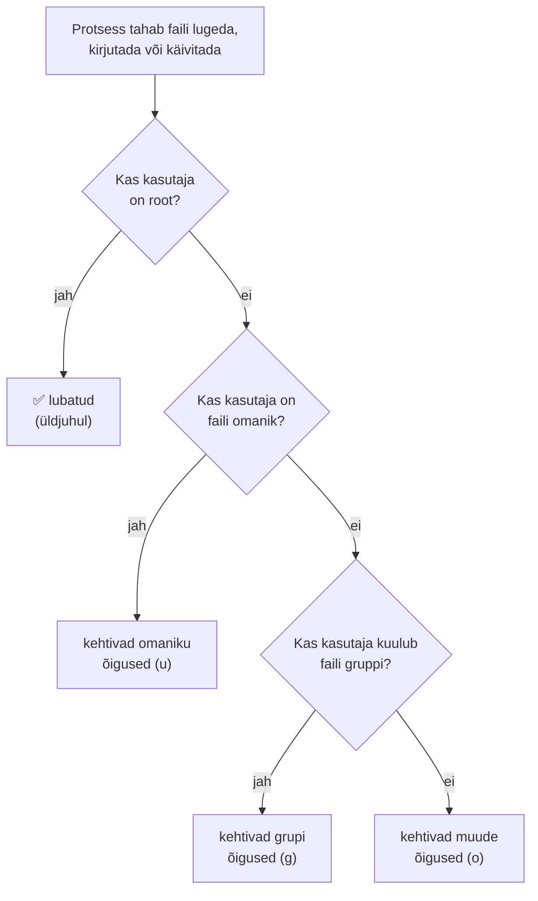
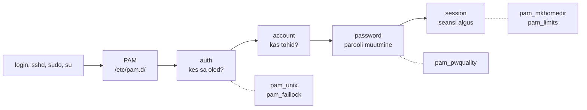

<!-- navigatsioon -->
[← Moodul 2. Enesekontroll](../moodul-02-failid-tekst-torud/enesekontroll.md) · [Sisukord](../../README.md#sisukord) · [Laboritöö 3. Kasutajad, grupid ja jagatud kataloogid →](labor.md)
<!-- /navigatsioon -->

# Moodul 3. Kasutajad, grupid ja õigused

**Maht:** 8 tundi · **Laboritöö:** Ubuntu · **Eeldused:** moodulid 1–2

## Õpiväljundid

Mooduli läbinud õppija:

- selgitab kasutajate, gruppide ja juurkasutaja rolli Linuxis;
- loob, muudab ja kustutab kasutajaid ning gruppe;
- kasutab halduriõigusi turvaliselt käsuga `sudo`;
- loeb ja muudab failide ning kataloogide õigusi sümbolilisel ja numbrilisel kujul;
- muudab failide omanikku ja gruppi;
- selgitab `umask`-i ja eriliste õiguste (SUID, SGID, sticky bit) tähendust;
- seadistab gruppidele jagatud kataloogi;
- rakendab vähima õiguse põhimõtet;
- seadistab uute kasutajate vaikeseaded (`/etc/skel`, `login.defs`) ning paroolipoliitika ja lukustamise PAM-i abil (`pam_pwquality`, `pam_faillock`);
- seadistab süsteemi lokaadi ja klaviatuuripaigutuse.

> [!NOTE]
> **Kuidas seda lehte lugeda:** iga teema algab kastiga **Lühidalt** - seal on kõige tähtsam paari lausega. Käsud ja näited on alati näha. Pikemad selgitused ja taust on peidetud plokkidesse **Loe lähemalt** - ava need, kui tahad teemast rohkem teada või kui laboritöös midagi ei õnnestu.

---

## 3.1 Miks kasutajad ja õigused?

> [!TIP]
> **Lühidalt:** Igal inimesel ja teenusel on oma kasutaja. Õigused määravad, kes võib faile lugeda, muuta ja käivitada. Anna igale ainult nii palju õigusi, kui tööks vaja.

Linux on **mitme kasutajaga** süsteem: ühes masinas võivad korraga töötada paljud inimesed ja teenused. Kasutajad ja õigused tagavad, et:

- kasutajad ei näe ega muuda üksteise faile;
- tavakasutaja ei saa süsteemi kogemata (või meelega) rikkuda;
- iga teenus (veebiserver, andmebaas) töötab oma kasutajana ja häkkeri poolt ülevõetud teenus ei pääse ligi kõigele.

See on **vähima õiguse põhimõte** (*principle of least privilege*): iga kasutaja ja programm saab täpselt need õigused, mida ta oma töö tegemiseks vajab, mitte rohkem.

## 3.2 Kasutajad

> [!TIP]
> **Lühidalt:** Kasutajad on failis `/etc/passwd`, paroolide räsid failis `/etc/shadow`. Käsk `id` näitab sinu kasutajat ja gruppe.

Igal kasutajal on **kasutajanimi** ja numbriline **UID** (*user ID*). Süsteem kasutab sisemiselt just numbrit, nimi on inimeste jaoks.

| UID | Kasutaja liik |
|---|---|
| 0 | **root** - juurkasutaja, piiramatud õigused |
| 1–999 | **Süsteemikasutajad** - teenuste jaoks (nt `www-data`, `sshd`), tavaliselt ei saa sisse logida |
| 1000+ | **Tavakasutajad** - inimesed |

### /etc/passwd

Kasutajate andmed on failis `/etc/passwd`, mida võivad kõik lugeda:

```text
mari:x:1001:1001:Mari Maasikas:/home/mari:/bin/bash
```

| Väli | Näide | Tähendus |
|---|---|---|
| 1 | `mari` | Kasutajanimi |
| 2 | `x` | Parool on failis `/etc/shadow` |
| 3 | `1001` | UID |
| 4 | `1001` | Põhigrupi GID |
| 5 | `Mari Maasikas` | Kirjeldus (tavaliselt täisnimi) |
| 6 | `/home/mari` | Kodukataloog |
| 7 | `/bin/bash` | Sisselogimiskest. `/usr/sbin/nologin` tähendab, et sisse logida ei saa |

### /etc/shadow

Paroolid on salvestatud **räsidena** failis `/etc/shadow`, mida saab lugeda ainult juurkasutaja. Lisaks räsile on seal parooli aegumise info.

```text
mari:$y$j9T$...:20400:0:99999:7:::
```

Kui räsi asemel on `!` või `*`, ei saa selle kasutajaga parooliga sisse logida (konto on lukus).

> [!NOTE]
> Parooli ennast Linux ei salvesta. Sisselogimisel arvutatakse sisestatud paroolist räsi ja võrreldakse seda salvestatuga.

### Kasutaja info

```bash
whoami                 # minu kasutajanimi
id                     # minu UID, GID ja grupid
id mari                # kasutaja mari info
groups                 # minu grupid
who                    # kes on praegu sisse logitud
w                      # kes on sisse logitud ja mida teevad
last                   # viimased sisselogimised
```

## 3.3 Grupid

> [!TIP]
> **Lühidalt:** Grupid lubavad anda õigusi korraga mitmele kasutajale. Igal kasutajal on üks põhigrupp ja võib olla mitu lisagruppi.

**Grupp** koondab kasutajaid, et anda neile ühiseid õigusi. Igal kasutajal on:

- **põhigrupp** (*primary group*) - määratud failis `/etc/passwd`, sellele grupile kuuluvad kasutaja loodud failid. Tavaliselt on see kasutajaga samanimeline grupp;
- **lisagrupid** (*supplementary groups*) - kõik ülejäänud grupid, kuhu kasutaja kuulub.

Grupid on failis `/etc/group`:

```text
tarkvara:x:1010:mari,jaan
```

Väljad: grupi nimi, parooli kohatäide, GID, liikmed (komaga eraldatud).

## 3.4 Juurkasutaja ja sudo

> [!TIP]
> **Lühidalt:** Juurkasutaja `root` võib kõike. Haldustoiminguid tee `sudo`-ga: käsk käivitub juurkasutajana ja jääb logisse.

**Juurkasutaja** (*root*, UID 0) võib süsteemis teha kõike: lugeda kõiki faile, kustutada mida tahes, muuta iga seadistust. Juurkasutajana pidevalt töötamine on ohtlik - üks trükiviga võib süsteemi hävitada.

Seepärast töötatakse tavakasutajana ja halduriõigusi kasutatakse ainult siis, kui neid on vaja.

### sudo

`sudo` käivitab ühe käsu juurkasutaja (või muu kasutaja) õigustes:

```bash
sudo apt update                # käivita käsk juurkasutajana
sudo -u mari whoami            # käivita käsk kasutajana mari
sudo -i                        # ava juurkasutaja kest (lõpeta: exit)
sudo -l                        # milliseid käske mul on lubatud käivitada
```

`sudo` küsib **sinu enda** parooli, mitte juurkasutaja oma. Pärast õiget parooli ei küsita seda mõnda aega uuesti. Kõik `sudo` kasutused logitakse, seega on näha, kes mida tegi.

`sudo` õigused antakse tavaliselt grupi kaudu: Debianis ja Ubuntus grupp `sudo`, AlmaLinuxis grupp `wheel`.

### su

`su` vahetab kasutajat ja küsib **sihtkasutaja** parooli:

```bash
su - mari                      # logi sisse kasutajana mari
su -                           # logi sisse juurkasutajana (vajab root-parooli)
sudo su - mari                 # vaheta kasutajat oma sudo-õigusega
```

Sidekriips `-` tähendab, et laaditakse sihtkasutaja täielik keskkond (kodukataloog, muutujad), nagu oleks ta päriselt sisse loginud.

### sudoers

`sudo` reeglid on failis `/etc/sudoers` ja kataloogis `/etc/sudoers.d/`. **Neid faile ei muudeta kunagi tavalise redaktoriga**, vaid käsuga `visudo`, mis kontrollib enne salvestamist süntaksit. Vigane sudoers-fail võib võtta kõigilt halduriõigused.

```bash
sudo visudo                          # muuda põhifaili
sudo visudo -f /etc/sudoers.d/mari   # loo eraldi reeglifail
```

Reegli näited:

```text
mari    ALL=(ALL:ALL) ALL                        # kõik käsud (nagu grupp sudo)
jaan    ALL=(root) /usr/bin/systemctl restart nginx   # ainult üks käsk
%tugi   ALL=(root) /usr/bin/apt update, /usr/bin/apt upgrade   # grupp tugi, kaks käsku
```

Reegli kuju: `kes  kus=(kellena)  millised_käsud`. Märk `%` tähistab gruppi.

> [!TIP]
> **Hea tava:** lisa oma reeglid eraldi failidena kataloogi `/etc/sudoers.d/`, mitte põhifaili. Nii on neid lihtne hallata ja eemaldada.

## 3.5 Kasutajate ja gruppide haldus

> [!TIP]
> **Lühidalt:** `useradd -m` loob kasutaja, `usermod -aG grupp kasutaja` lisab gruppi, `passwd` muudab parooli, `userdel -r` kustutab.

Kõik haldustoimingud vajavad halduriõigusi (`sudo`).

### Kasutajad

```bash
sudo useradd -m -s /bin/bash -c "Mari Maasikas" mari   # loo kasutaja
sudo passwd mari                       # määra parool
sudo usermod -aG tarkvara mari         # lisa grupi liikmeks
sudo usermod -s /bin/zsh mari          # muuda kesta
sudo usermod -L mari                   # lukusta konto
sudo usermod -U mari                   # ava konto
sudo userdel mari                      # kustuta kasutaja
sudo userdel -r mari                   # kustuta koos kodukataloogiga
```

`useradd` olulised võtmed:

| Võti | Tähendus |
|---|---|
| `-m` | Loo kodukataloog |
| `-s` | Sisselogimiskest |
| `-c` | Kirjeldus |
| `-G` | Lisagrupid (komaga eraldatud) |
| `-u` | Kindel UID |

> [!WARNING]
> **Hoiatus:** `usermod -G grupp` ilma võtmeta `-a` **asendab** kõik kasutaja lisagrupid ühega. Kui eemaldad nii kogemata kasutaja grupist `sudo`, kaotab ta halduriõigused. Kasuta alati `usermod -aG` (*append*).

Grupimuudatused jõustuvad alles **järgmisel sisselogimisel**. Kui lisasid iseenda gruppi, logi välja ja uuesti sisse.

Debianis ja Ubuntus on ka mugavam interaktiivne käsk `adduser`, mis küsib kõik andmed ise:

```bash
sudo adduser mari                      # loo kasutaja (küsib parooli ja andmeid)
sudo adduser mari tarkvara             # lisa olemasolev kasutaja gruppi
```

### Paroolid ja aegumine

```bash
passwd                                 # muuda oma parooli
sudo chage -l mari                     # vaata parooli aegumise infot
sudo chage -d 0 mari                   # sunni järgmisel sisselogimisel parooli vahetama
```

### Grupid

```bash
sudo groupadd tarkvara                 # loo grupp
sudo gpasswd -d mari tarkvara          # eemalda kasutaja grupist
sudo groupdel tarkvara                 # kustuta grupp
getent group tarkvara                  # vaata grupi liikmeid
```

### Uus halduriõigustega kasutaja samm-sammult

Näide: uus kolleeg `mari` peab saama serverisse sisse logida ja kasutada `sudo`-t. Ainuke erinevus distrode vahel on halduri grupi nimi: Debianis ja Ubuntus `sudo`, AlmaLinuxis `wheel`.

1. **Loo kasutaja** koos kodukataloogi ja kestaga:

    ```bash
    sudo useradd -m -s /bin/bash -c "Mari Maasikas" mari
    ```

2. **Määra parool** (või sunni see esimesel sisselogimisel vahetama):

    ```bash
    sudo passwd mari
    sudo chage -d 0 mari                 # valikuline: vaheta parool esimesel sisselogimisel
    ```

3. **Anna halduriõigus** - lisa kasutaja halduri gruppi (`-aG`, mitte `-G`!):

    | Debian, Ubuntu | AlmaLinux |
    |---|---|
    | `sudo usermod -aG sudo mari` | `sudo usermod -aG wheel mari` |

4. **Kontrolli:**

    ```bash
    id mari                              # gruppide seas on sudo või wheel
    sudo -l -U mari                      # mida mari tohib sudo-ga teha
    ```

5. **Proovi uue kasutajana** - teises aknas või `su`-ga:

    ```bash
    su - mari
    sudo whoami                          # küsib mari parooli, vastus: root
    exit
    ```

Kui kolleeg logib sisse SSH-võtmega (moodul 7), kopeerib ta oma avaliku võtme serverisse käsuga `ssh-copy-id mari@server` või lisad selle tema faili `/home/mari/.ssh/authorized_keys`.

**Kasutaja eemaldamine**, kui kolleeg lahkub: lukusta kohe (`sudo usermod -L mari`, `sudo chage -E 0 mari`), andmed varunda ja alles siis kustuta (`sudo userdel -r mari`).

## 3.6 Failiõigused

> [!TIP]
> **Lühidalt:** Igal failil on omanik, grupp ja õigused kolmele: omanik, grupp, teised. `r` - lugemine, `w` - kirjutamine, `x` - käivitamine. Vaata käsuga `ls -l`.

Iga faili ja kataloogi kohta on määratud **omanik** (kasutaja), **grupp** ja **õigused** kolmele kategooriale.

```bash
ls -l
```

```text
-rw-r----- 1 mari tarkvara 2048 jaan 10 09:15 plaan.txt
drwxr-x--- 2 mari tarkvara 4096 jaan 10 09:20 kood
```

```text
-  rw-  r--  ---   mari  tarkvara
│   │    │    │     │      │
│   │    │    │     │      └── grupp
│   │    │    │     └── omanik
│   │    │    └── muud (others) - kõik ülejäänud
│   │    └── grupp (group)
│   └── omanik (user)
└── tüüp: - fail, d kataloog, l viit
```

### Õiguste tähendus

| Õigus | Failil | Kataloogil |
|---|---|---|
| **r** (*read*) | Faili sisu lugemine | Kataloogi sisu loetlemine (`ls`) |
| **w** (*write*) | Faili sisu muutmine | Failide loomine, kustutamine ja ümbernimetamine kataloogis |
| **x** (*execute*) | Faili käivitamine programmina | Kataloogi sisenemine (`cd`) ja sealsetele failidele ligipääs |

> [!WARNING]
> **Tähelepanu:** faili kustutamiseks ei ole vaja õigust failile endale, vaid **kirjutusõigust kataloogile**, kus fail asub.

Kataloogi puhul käivad `r` ja `x` tavaliselt koos: ilma `x`-ta ei pääse kataloogi failidele ligi, isegi kui `r` on olemas.

### Kuidas õigusi kontrollitakse

Linux kontrollib õigusi järjekorras ja kasutab **esimest sobivat**:

1. kui oled faili omanik, kehtivad omaniku õigused;
2. muidu, kui kuulud faili gruppi, kehtivad grupi õigused;
3. muidu kehtivad muude õigused.



Juurkasutajale õiguste kontroll üldjuhul ei kehti.

## 3.7 Õiguste muutmine: chmod

> [!TIP]
> **Lühidalt:** `chmod u+x fail` lisab omanikule käivitusõiguse. Numbrina: `r=4`, `w=2`, `x=1`, nt `chmod 640` = omanik loeb ja kirjutab, grupp loeb, teised mitte midagi.

Õigusi muudab faili omanik või juurkasutaja käsuga `chmod`. Õigusi saab anda kahel kujul.

### Sümboliline kuju

```text
chmod  [kellele][tegevus][õigused]  fail
```

| Kellele | Tegevus | Õigused |
|---|---|---|
| `u` - omanik | `+` - lisa | `r` |
| `g` - grupp | `-` - eemalda | `w` |
| `o` - muud | `=` - määra täpselt | `x` |
| `a` - kõik | | |

```bash
chmod u+x skript.sh            # omanik saab käivitada
chmod g-w plaan.txt            # võta grupilt kirjutusõigus
chmod o= salajane.txt          # võta muudelt kõik õigused
chmod u=rw,g=r,o= plaan.txt    # määra täpselt: rw-r-----
chmod a+r avalik.txt           # kõik saavad lugeda
chmod -R g+w kataloog/         # rekursiivselt
```

### Numbriline kuju

Iga õigus on number ja need liidetakse:

| Õigus | Väärtus |
|---|---|
| `r` | 4 |
| `w` | 2 |
| `x` | 1 |

Kolm numbrit tähistavad järjest omanikku, gruppi ja muid:

```text
rwx r-x r-x  =  (4+2+1)(4+0+1)(4+0+1)  =  755
rw- r-- ---  =  (4+2+0)(4+0+0)(0+0+0)  =  640
```

Levinumad väärtused:

| Number | Õigused | Tüüpiline kasutus |
|---|---|---|
| `644` | `rw-r--r--` | Tavaline fail |
| `600` | `rw-------` | Privaatne fail (nt SSH privaatvõti) |
| `640` | `rw-r-----` | Grupiga jagatud konfiguratsioonifail |
| `755` | `rwxr-xr-x` | Programm, skript või avalik kataloog |
| `750` | `rwxr-x---` | Grupiga jagatud kataloog |
| `700` | `rwx------` | Privaatne kataloog |

```bash
chmod 640 plaan.txt
chmod 755 skript.sh
```

> [!WARNING]
> **Ära kasuta `chmod 777`!** See annab kõigile kõik õigused. Kui midagi „ei tööta õiguste pärast“, otsi õiget lahendust (õige omanik või grupp), mitte ära ava kõike.

## 3.8 Omaniku muutmine: chown ja chgrp

> [!TIP]
> **Lühidalt:** `chown kasutaja:grupp fail` muudab omanikku ja gruppi, `chgrp` ainult gruppi. Kataloogi koos sisuga: `-R`.

Faili omanikku saab muuta ainult juurkasutaja:

```bash
sudo chown mari plaan.txt              # muuda omanikku
sudo chown mari:tarkvara plaan.txt     # muuda omanikku ja gruppi
sudo chown :tarkvara plaan.txt         # muuda ainult gruppi
sudo chown -R www-data:www-data /var/www/sait   # rekursiivselt
chgrp tarkvara plaan.txt               # muuda gruppi (omanik võib anda oma grupile)
```

## 3.9 Vaikimisi õigused: umask

> [!TIP]
> **Lühidalt:** `umask` määrab, millised õigused uutel failidel **puuduvad**. Tavaline `022` annab failidele `644` ja kataloogidele `755`.

Uue faili või kataloogi õigused määrab **umask** - mask, mis näitab, millised õigused vaikimisi **ära võetakse**.

Lähtepunkt on failidel `666` (`rw-rw-rw-`) ja kataloogidel `777` (`rwxrwxrwx`). Sellest eemaldatakse umaski bitid:

| umask | Uus fail | Uus kataloog |
|---|---|---|
| `0022` | `644` (`rw-r--r--`) | `755` (`rwxr-xr-x`) |
| `0002` | `664` (`rw-rw-r--`) | `775` (`rwxrwxr-x`) |
| `0077` | `600` (`rw-------`) | `700` (`rwx------`) |

```bash
umask                  # vaata praegust väärtust
umask 0077             # muuda ainult selles seansis
```

Vaikimisi umask sõltub distrost ja seadistusest. Paljudes süsteemides saavad tavakasutajad, kelle põhigrupp on nendega samanimeline, umaski `0002`, muidu on see `0022`. Kontrolli alati käsuga `umask`.

## 3.10 Erilised õigused

> [!TIP]
> **Lühidalt:** **SUID** käivitab programmi omaniku õigustega, **SGID** kataloogil annab uutele failidele kataloogi grupi, **sticky bit** lubab kustutada ainult enda faile (nt `/tmp`).

Lisaks `rwx`-le on kolm erilist õigust. Neid tähistab numbrilisel kujul neljas, kõige esimene number.

| Õigus | Number | Failil | Kataloogil | `ls -l` |
|---|---|---|---|---|
| **SUID** | 4 | Programm töötab faili omaniku õigustes | - | `rws` omaniku kohal |
| **SGID** | 2 | Programm töötab faili grupi õigustes | Uued failid saavad kataloogi grupi | `rws` grupi kohal |
| **Sticky bit** | 1 | - | Faile saab kustutada ainult nende omanik | `rwt` muude kohal |

Näited süsteemist:

```bash
ls -l /usr/bin/passwd      # -rwsr-xr-x ... SUID: tavakasutaja saab muuta faili /etc/shadow
ls -ld /tmp                # drwxrwxrwt ... sticky: kõik saavad kirjutada, aga mitte teiste faile kustutada
```

Määramine:

```bash
chmod g+s /srv/projekt     # SGID kataloogile
chmod 2770 /srv/projekt    # sama numbriliselt: SGID + rwxrwx---
chmod +t /srv/yhine        # sticky bit
chmod 1777 /srv/yhine      # sama numbriliselt
```

Kui `ls -l` näitab suurtähte (`S` või `T`), on eriline õigus määratud, kuid vastav `x` puudub - tavaliselt on see viga.

> [!WARNING]
> **Turvalisus:** SUID-programmid on häkkeritele huvitav sihtmärk, sest nende kaudu võib saada juurkasutaja õigused. Ära lisa SUID-õigust oma programmidele ja skriptidele. Süsteemi SUID-failid leiad käsuga `find / -perm -4000 -type f 2>/dev/null`.

## 3.11 Grupi jagatud kataloog

> [!TIP]
> **Lühidalt:** Ühise kausta jaoks: grupp, kataloog `chmod 2770` (SGID) ja kasutajad gruppi. Siis kuuluvad kõik uued failid grupile.

Tüüpiline ülesanne: meeskonna liikmed peavad saama ühes kataloogis üksteise faile lugeda ja muuta, kuid teised kasutajad ei tohi sinna ligi pääseda.

```bash
sudo groupadd tarkvara
sudo usermod -aG tarkvara mari
sudo usermod -aG tarkvara jaan
sudo mkdir -p /srv/projektid/tarkvara
sudo chown root:tarkvara /srv/projektid/tarkvara
sudo chmod 2770 /srv/projektid/tarkvara
```

Mida see teeb:

- grupp `tarkvara` saab kataloogis kõike teha (`rwx`), muud ei pääse sinna üldse (`---`);
- SGID (`2`) tagab, et kõik uued failid kuuluvad grupile `tarkvara`, mitte looja isiklikule grupile;
- et grupi liikmed saaksid üksteise faile ka **muuta**, peab failidel olema grupi kirjutusõigus. Seda tagab umask `0002` (või tuleb failidele lisada õigus `chmod g+w`).

## 3.12 Täpsemad õigused: ACL

> [!TIP]
> **Lühidalt:** ACL lubab anda õigusi üksikutele kasutajatele ja gruppidele lisaks omanikule ja grupile: `setfacl -m u:mari:rw fail`, vaata `getfacl`.

Tavalised õigused lubavad määrata ainult ühe omaniku ja ühe grupi. Kui on vaja anda õigus veel kellelegi, saab kasutada **ACL-e** (*Access Control Lists*):

```bash
setfacl -m u:kati:r plaan.txt          # anna kasutajale kati lugemisõigus
setfacl -m g:juhtkond:rw plaan.txt     # anna grupile juhtkond õigused
getfacl plaan.txt                      # vaata ACL-e
setfacl -x u:kati plaan.txt            # eemalda kirje
```

Kui failil on ACL, näitab `ls -l` õiguste järel plussmärki: `-rw-r-----+`. Kui käske `setfacl` ja `getfacl` pole, paigalda pakett `acl`.

ACL-id on kasulikud, kuid teevad õiguste süsteemi keerulisemaks. Kasuta neid ainult siis, kui gruppidega ei saa hakkama.

## 3.13 Kasutajate vaikeseaded ja paroolipoliitika

> [!TIP]
> **Lühidalt:** Uue kasutaja algfailid tulevad kataloogist `/etc/skel`. Paroolinõudeid ja lukustamist valede katsete järel seadistatakse PAM-i moodulitega.

### Uue kasutaja vaikeseaded

Käsk `useradd -m` (ja `adduser`) loob kodukataloogi ning kopeerib sinna kõik kataloogi **`/etc/skel`** failid. Nii saab igale uuele kasutajale anda ühesuguse `.bashrc`-i, juhendi või kataloogistruktuuri:

```bash
ls -la /etc/skel
echo "Tere tulemast kooli serverisse!" | sudo tee /etc/skel/LOEMIND.txt
sudo useradd -m -s /bin/bash testija
ls -la /home/testija
```

Muud vaikeseaded:

| Fail | Mida määrab |
|---|---|
| `/etc/login.defs` | UID/GID vahemikud (`UID_MIN`), parooli aegumine (`PASS_MAX_DAYS`, `PASS_WARN_AGE`), `UMASK` |
| `/etc/default/useradd` | vaikimisi kest, kodukataloogi asukoht, `skel`-kataloog |
| `/etc/adduser.conf` | Debiani/Ubuntu `adduser` seaded |

`login.defs` mõjutab ainult **uusi** kasutajaid; olemasolevatel muudab aegumist `chage` (punkt 3.5).

<details>
<summary>Loe lähemalt: PAM - kuidas sisselogimine töötab</summary>

**PAM** (*Pluggable Authentication Modules*) on raamistik, mille kaudu kõik programmid (`login`, `sshd`, `sudo`, `su`, graafiline sisselogimine) kasutajaid autendivad. Iga programmi seadistus on kataloogis `/etc/pam.d/` ja koosneb **moodulitest**:

| Tüüp | Ülesanne |
|---|---|
| `auth` | kas kasutaja on see, kes ta väidab (parool, võti, 2FA) |
| `account` | kas kontol on lubatud praegu sisse logida (aegumine, kellaaeg, lukustus) |
| `password` | parooli muutmine ja nõuded |
| `session` | mis tehakse sisselogimisel (kodukataloogi loomine, piirangud, logimine) |



Näiteks moodulid: `pam_unix` (tavaline parool), `pam_pwquality` (parooli tugevus), `pam_faillock` (lukustamine valede katsete järel), `pam_limits` (ressursipiirangud, moodul 5), `pam_mkhomedir` (kodukataloog, moodulid 25–26), `pam_sss` (LDAP/AD).

> **Hoiatus:** vigane PAM-i seadistus võib takistada **kõigil** sisselogimist, ka `sudo`-t. Hoia muutmise ajal teises aknas juurkasutaja kest lahti ja testi uues aknas. Debianis ja Ubuntus muuda PAM-i võimalusel käsuga `pam-auth-update`, AlmaLinuxis käsuga `authselect`, mitte faile käsitsi.

</details>

### Parooli tugevus: pam_pwquality

```bash
sudo apt install libpam-pwquality          # Debian, Ubuntu (lisab mooduli common-password faili)
# AlmaLinux: sees vaikimisi
```

`/etc/security/pwquality.conf`:

```text
minlen = 12          # vähemalt 12 märki
minclass = 3         # vähemalt 3 märgiklassi (väiketähed, suurtähed, numbrid, muud)
dictcheck = 1        # mitte sõnastikusõna
usercheck = 1        # ei tohi sisaldada kasutajanime
```

Nõuded kehtivad, kui kasutaja vahetab parooli käsuga `passwd`. Juurkasutaja saab neist mööda minna (saab hoiatuse).

### Lukustamine valede katsete järel: pam_faillock

`/etc/security/faillock.conf`:

```text
deny = 5             # 5 vale parooli järel lukusta
unlock_time = 900    # 15 minutiks
```

```bash
sudo authselect enable-feature with-faillock     # AlmaLinux
# Debian/Ubuntu: pam_faillock tuleb lisada failidesse common-auth ja common-account (vt man pam_faillock)
sudo faillock --user mari                        # ebaõnnestunud katsed
sudo faillock --user mari --reset                # ava lukk
```

> [!NOTE]
> SSH-ga võtmepõhise autentimise korral (moodul 7) PAM-i parooliseadeid ei kasutata; võrgust tulevate rünnakute vastu kasutatakse lisaks fail2ban-i (moodul 12).

## 3.14 Keel, lokaat ja klaviatuur

> [!TIP]
> **Lühidalt:** `localectl` näitab ja muudab süsteemi keelt ja klaviatuuri. Serveris on tavaline inglise keel (`en_US.UTF-8`), kuupäevavorming võib olla eesti oma.

**Lokaat** (*locale*) määrab, millises keeles programmid teateid näitavad ning kuidas vormindatakse kuupäevi, arve ja tähestikulist järjestust. Eesti keele ja tähtede (õ, ä, ö, ü, š, ž) jaoks peab süsteem kasutama **UTF-8** kodeeringut.

```bash
localectl                       # süsteemi lokaat ja klaviatuur
locale                          # praeguse seansi seaded (LANG, LC_*)
locale -a                       # paigaldatud lokaadid
```

Serverites on levinud jätta süsteemi keeleks inglise keel (`en_US.UTF-8` või `C.UTF-8`) - veateateid on siis lihtsam otsida. Kuupäevade ja arvude vorming võib siiski olla eesti oma:

```bash
# Debian ja Ubuntu: lokaadi genereerimine
sudo dpkg-reconfigure locales          # vali et_EE.UTF-8 ja en_US.UTF-8
# AlmaLinux: keelepaketid
sudo dnf install glibc-langpack-et

sudo localectl set-locale LANG=en_US.UTF-8 LC_TIME=et_EE.UTF-8
date                                   # uues seansis eesti kuupäevavorming
```

Ühekordselt saab keelt muuta ühe käsu jaoks: `LANG=et_EE.UTF-8 date`, `LC_ALL=C sort fail.txt` (järjestus baitide järgi - skriptides sageli soovitatav, et tulemus ei sõltuks lokaadist).

**Klaviatuur** konsoolis (füüsiline ekraan või Proxmoxi konsool):

```bash
localectl list-keymaps | grep -i ee
sudo localectl set-keymap ee                   # konsooli paigutus
sudo localectl set-x11-keymap ee               # graafiline (X11) paigutus
```

> [!NOTE]
> SSH-ühenduses määrab klaviatuuri **sinu arvuti**, mitte server. Konsoolis tuleb paigutus seadistada serveris; paigaldusprogramm küsib seda (moodul 1, paigalduslisa).

---

## Distrode erinevused

| | **Debian** | **Ubuntu** | **AlmaLinux** |
|---|---|---|---|
| Halduri grupp | `sudo` | `sudo` | `wheel` |
| Juurkasutaja parool | Määratakse paigaldamisel (võib jätta tühjaks) | Lukus, kasutatakse ainult `sudo` | Määratakse paigaldamisel (võib lukustada) |
| `useradd` loob kodukataloogi | Ainult võtmega `-m` | Ainult võtmega `-m` | Vaikimisi jah |
| `useradd` vaikekest | `/bin/sh` | `/bin/sh` | `/bin/bash` |
| `adduser` | Interaktiivne mugavuskäsk | Interaktiivne mugavuskäsk | Viit käsule `useradd` (küsimusi ei esita) |
| Lisaturvalisus | AppArmor | AppArmor | SELinux |
| Lokaadid | `dpkg-reconfigure locales` | `locale-gen et_EE.UTF-8` | `glibc-langpack-et` |

Seepärast kasuta skriptides ja juhendites alati täielikku kuju `useradd -m -s /bin/bash`, mis töötab kõigis distrodes ühtemoodi. AppArmorit ja SELinuxit käsitleme moodulis 12.

<details>
<summary>Loe lähemalt: Kuidas on see FreeBSD-s?</summary>

Kasutajate ja õiguste põhimõtted (omanik, grupp, `rwx`, `chmod`, `chown`, `umask`, SUID/SGID/sticky bit) on FreeBSD-s samad, sest need pärinevad ühisest Unixi taustast. Erinevad on haldustööriistad:

| | Linux | FreeBSD |
|---|---|---|
| Kasutaja loomine | `useradd -m`, `adduser` | `adduser` (interaktiivne) või `pw useradd mari -m` |
| Gruppi lisamine | `usermod -aG grupp mari` | `pw groupmod grupp -m mari` |
| Paroolide räsid | `/etc/shadow` | `/etc/master.passwd` (muuda käsuga `vipw`) |
| Halduriõigus | `sudo` (grupp `sudo` või `wheel`) | `su` ainult grupi `wheel` liikmetele; `sudo` või `doas` paigalda paketina |
| ACL | `setfacl`, `getfacl` | samad käsud, UFS-il tuleb ACL haakimisel lubada, ZFS-il on NFSv4 ACL-id |

Lähemalt vt moodul 30, punkt 30.7.

</details>

---

## Kokkuvõte

| Käsk või fail | Tegevus |
|---|---|
| `/etc/passwd`, `/etc/shadow`, `/etc/group` | Kasutajad, paroolid, grupid |
| `id`, `groups`, `who`, `last` | Kasutajate info |
| `sudo käsk`, `sudo -i` | Käivita halduriõigustes |
| `visudo` | Muuda sudo reegleid turvaliselt |
| `useradd -m -s /bin/bash`, `passwd` | Loo kasutaja, määra parool |
| `usermod -aG grupp kasutaja` | Lisa kasutaja gruppi |
| `userdel -r` | Kustuta kasutaja koos kodukataloogiga |
| `groupadd`, `gpasswd -d`, `groupdel` | Gruppide haldus |
| `chmod 640`, `chmod g+w` | Muuda õigusi |
| `chown kasutaja:grupp` | Muuda omanikku ja gruppi |
| `umask` | Uute failide vaikimisi õigused |
| `chmod 2770`, `chmod 1777` | SGID, sticky bit |
| `setfacl`, `getfacl` | ACL-id |
| `/etc/skel`, `/etc/login.defs` | Uue kasutaja vaikeseaded |
| `/etc/pam.d/`, `pwquality.conf`, `faillock` | PAM, paroolinõuded, lukustamine |
| `localectl`, `locale`, `dpkg-reconfigure locales` | Lokaat ja klaviatuur |

**Järgmised sammud:** tee [laboritöö](labor.md) ja kontrolli oma teadmisi [enesekontrolli](enesekontroll.md) abil.

## Lisamaterjal

- William Shotts, „The Linux Command Line“ - peatükk õiguste kohta
- Linux Upskill Challenge - kasutajate ja õiguste teemad
- `man 5 passwd`, `man 5 shadow`, `man sudoers`

<!-- navigatsioon -->
---

[← Moodul 2. Enesekontroll](../moodul-02-failid-tekst-torud/enesekontroll.md) · [Sisukord](../../README.md#sisukord) · [Laboritöö 3. Kasutajad, grupid ja jagatud kataloogid →](labor.md)
<!-- /navigatsioon -->
