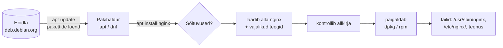

<!-- navigatsioon -->
[← Moodul 3. Enesekontroll](../moodul-03-kasutajad-oigused/enesekontroll.md) · [Sisukord](../../README.md#sisukord) · [Laboritöö 4. Pakihaldus kolmel distrol →](labor.md)
<!-- /navigatsioon -->

# Moodul 4. Tarkvara ja pakihaldus

**Maht:** 6 tundi · **Laboritöö:** Debian, Ubuntu ja AlmaLinux · **Eeldused:** moodulid 1–3

## Õpiväljundid

Mooduli läbinud õppija:

- selgitab, mis on pakett, hoidla ja sõltuvus;
- uuendab süsteemi ning paigaldab, otsib ja eemaldab tarkvara käskudega `apt` ja `dnf`;
- leiab, millisesse paketti fail kuulub ja millised failid paketis on;
- lisab kolmanda osapoole hoidla ja hindab sellega kaasnevaid riske;
- kompileerib lihtsa programmi lähtekoodist;
- selgitab Snapi ja Flatpaki rolli;
- kirjeldab distro uuele väljalaskele uuendamise protsessi ja riske;
- võrdleb Debiani ja Red Hati perekonna pakihaldust.

---

## 4.1 Kuidas Linuxis tarkvara paigaldatakse?

Windowsis laaditakse programm sageli tootja kodulehelt alla ja käivitatakse paigaldusfail. Linuxis paigaldatakse tarkvara peaaegu alati **pakihalduri** abil distro **hoidlast**.

| Mõiste | Selgitus |
|---|---|
| **Pakett** (*package*) | Arhiiv, mis sisaldab programmi faile, metaandmeid (nimi, versioon, kirjeldus) ja paigaldusskripte |
| **Hoidla** (*repository*) | Server, kus asuvad distro pakettide failid ja nende loend |
| **Sõltuvus** (*dependency*) | Teine pakett, mida programm vajab töötamiseks (nt teek) |
| **Pakihaldur** (*package manager*) | Programm, mis laadib paketid hoidlast, lahendab sõltuvused, paigaldab ja uuendab tarkvara |



Pakihalduri eelised:

- **turvalisus** - paketid on distro arendajate poolt allkirjastatud ja pakihaldur kontrollib allkirju;
- **sõltuvused** lahendatakse automaatselt;
- **kogu süsteem uueneb ühe käsuga** - nii operatsioonisüsteem kui ka kõik programmid;
- **puhas eemaldamine** - pakihaldur teab täpselt, millised failid paketti kuuluvad.

> [!TIP]
> **Reegel:** paigalda tarkvara võimalusel alati distro ametlikust hoidlast. Allalaaditud skriptide ja tundmatute paigaldusfailide käivitamine juurkasutajana on üks levinumaid viise süsteemi rikkuda või nakatada.

### Kaks perekonda, kaks süsteemi

| | **Debiani perekond** | **Red Hati perekond** |
|---|---|---|
| Distrod | Debian, Ubuntu | AlmaLinux, RHEL, Rocky, Fedora |
| Paketivorming | `.deb` | `.rpm` |
| Madala taseme tööriist | `dpkg` | `rpm` |
| Kõrge taseme pakihaldur | `apt` | `dnf` |
| Hoidlate seadistus | `/etc/apt/sources.list.d/` | `/etc/yum.repos.d/` |

**Madala taseme tööriist** (`dpkg`, `rpm`) paigaldab üksiku paketifaili, kuid ei lahenda sõltuvusi ega laadi midagi alla. **Kõrge taseme pakihaldur** (`apt`, `dnf`) teeb kõik selle automaatselt. Igapäevatöös kasutatakse peaaegu alati kõrge taseme tööriista.

Kolmas suurem perekond on **SUSE** (openSUSE, SUSE Linux Enterprise): see kasutab samuti `.rpm` pakette, kuid kõrge taseme pakihaldur on **`zypper`** (`zypper refresh`, `zypper install`, `zypper update`, `zypper search`). Selle kursuse distrodes seda ei ole, kuid käsud on sarnased.

## 4.2 apt - Debian ja Ubuntu

### Süsteemi uuendamine

```bash
sudo apt update              # laadi hoidlatest värske pakettide loend
apt list --upgradable        # millised paketid on uuendatavad
sudo apt upgrade             # uuenda paigaldatud pakette
sudo apt full-upgrade        # uuenda, lubades ka pakette eemaldada või lisada
```

> [!WARNING]
> **Tähtis:** `apt update` **ei uuenda tarkvara**, vaid ainult loendi sellest, mis hoidlates saadaval on. Tarkvara uuendab `apt upgrade`. Seepärast käivitatakse need tavaliselt koos: `sudo apt update && sudo apt upgrade`.

### Tarkvara otsimine ja info

```bash
apt search htop              # otsi nime ja kirjelduse järgi
apt show htop                # paketi info: versioon, sõltuvused, kirjeldus
apt list --installed         # kõik paigaldatud paketid
apt policy htop              # paigaldatud ja saadaval versioon ning hoidla
```

### Paigaldamine ja eemaldamine

```bash
sudo apt install htop tree   # paigalda üks või mitu paketti
sudo apt remove htop         # eemalda pakett (seadistusfailid jäävad alles)
sudo apt purge htop          # eemalda koos seadistusfailidega
sudo apt autoremove          # eemalda sõltuvused, mida enam keegi ei vaja
sudo apt install ./pakett.deb   # paigalda allalaaditud .deb fail koos sõltuvustega
```

### dpkg - paigaldatud pakettide uurimine

```bash
dpkg -l                      # kõik paigaldatud paketid
dpkg -l | grep ssh           # otsi paigaldatud pakettide hulgast
dpkg -L openssh-server       # millised failid paketti kuuluvad
dpkg -S /usr/bin/ls          # millisesse paketti fail kuulub
```

### Logid

Kõik `apt` toimingud logitakse failidesse `/var/log/apt/history.log` (mis paigaldati ja millal) ja `/var/log/apt/term.log` (täielik väljund). Nii saab kontrollida, mis süsteemis muutus.

> [!NOTE]
> **apt või apt-get?** `apt` on uuem ja mugavam käsk interaktiivseks kasutamiseks. Vanemates juhendites ja skriptides kasutatakse käske `apt-get` ja `apt-cache`, mis teevad sama, kuid mille väljund on skriptidele stabiilsem.

## 4.3 dnf - AlmaLinux

### Süsteemi uuendamine

```bash
dnf check-update             # millised paketid on uuendatavad
sudo dnf upgrade             # uuenda kõik paketid
```

Erinevalt `apt`-ist värskendab `dnf` hoidlate loendi automaatselt, kui see on vananenud, seega eraldi `update` sammu pole vaja. (Käsk `dnf update` on olemas, kuid tähendab sama mis `dnf upgrade`.)

### Tarkvara otsimine ja info

```bash
dnf search htop              # otsi nime ja kirjelduse järgi
dnf info htop                # paketi info
dnf list --installed         # kõik paigaldatud paketid
dnf provides /usr/bin/dig    # milline pakett sisaldab seda faili (ka paigaldamata)
dnf repolist                 # lubatud hoidlad
```

### Paigaldamine ja eemaldamine

```bash
sudo dnf install htop tree   # paigalda
sudo dnf remove htop         # eemalda
sudo dnf autoremove          # eemalda mittevajalikud sõltuvused
sudo dnf install ./pakett.rpm   # paigalda allalaaditud .rpm fail
sudo dnf group list          # tarkvaragrupid
sudo dnf group install "Development Tools"   # paigalda terve grupp
```

### Ajalugu ja tagasivõtmine

`dnf` peab toimingute ajalugu ja oskab neid tagasi võtta:

```bash
dnf history                  # kõik toimingud
dnf history info 5           # toimingu nr 5 üksikasjad
sudo dnf history undo 5      # võta toiming nr 5 tagasi
```

### rpm - paigaldatud pakettide uurimine

```bash
rpm -qa                      # kõik paigaldatud paketid
rpm -qi openssh-server       # paketi info
rpm -ql openssh-server       # paketi failid
rpm -qf /usr/bin/ls          # millisesse paketti fail kuulub
```

## 4.4 apt ja dnf kõrvuti

| Tegevus | Debian / Ubuntu | AlmaLinux |
|---|---|---|
| Värskenda pakettide loend | `apt update` | (automaatne) `dnf makecache` |
| Uuenda süsteem | `apt upgrade` | `dnf upgrade` |
| Otsi | `apt search nimi` | `dnf search nimi` |
| Paketi info | `apt show nimi` | `dnf info nimi` |
| Paigalda | `apt install nimi` | `dnf install nimi` |
| Eemalda | `apt remove nimi` | `dnf remove nimi` |
| Eemalda koos seadistusega | `apt purge nimi` | (`dnf remove` jätab muudetud seadistusfailid `.rpmsave` nimega alles) |
| Eemalda üleliigsed sõltuvused | `apt autoremove` | `dnf autoremove` |
| Paigaldatud paketid | `apt list --installed` | `dnf list --installed` |
| Paketi failid | `dpkg -L nimi` | `rpm -ql nimi` |
| Faili pakett | `dpkg -S /tee` | `rpm -qf /tee` |
| Ajalugu | `/var/log/apt/history.log` | `dnf history` |

### Pakettide nimed erinevad

Sama tarkvara pakett võib perekondades olla eri nimega. Näiteks:

| Tarkvara | Debian / Ubuntu | AlmaLinux |
|---|---|---|
| Apache veebiserver | `apache2` | `httpd` |
| DNS-tööriistad (`dig`) | `dnsutils` või `bind9-dnsutils` | `bind-utils` |
| Kompileerimise tööriistad | `build-essential` | grupp `"Development Tools"` |
| Vim | `vim` | `vim-enhanced` |

Kui paketti ei leia, otsi seda käsuga `apt search` / `dnf search` või failinime järgi `dnf provides`.

## 4.5 Hoidlad

### Debian ja Ubuntu

Hoidlad on kirjeldatud failides kataloogis `/etc/apt/sources.list.d/`. Uuemates versioonides kasutatakse vormingut **deb822** (failid laiendiga `.sources`):

```text
Types: deb
URIs: http://deb.debian.org/debian
Suites: trixie trixie-updates
Components: main contrib non-free non-free-firmware
Signed-By: /usr/share/keyrings/debian-archive-keyring.gpg
```

Vanemates süsteemides ja juhendites on kasutusel üherealine vorming failis `/etc/apt/sources.list`:

```text
deb http://deb.debian.org/debian bookworm main contrib non-free-firmware
```

Olulised mõisted:

- **Suites** - distro väljalase (nt Debianil koodnimi, Ubuntul `noble`) ja selle uuenduste harud;
- **Components** - hoidla osad. Debianis `main` (vaba tarkvara), `contrib`, `non-free` ja `non-free-firmware` (nt draiverid). Ubuntus `main`, `restricted`, `universe` ja `multiverse`;
- **Signed-By** - võti, millega hoidla allkirja kontrollitakse.

### AlmaLinux

Hoidlad on failides `/etc/yum.repos.d/*.repo`:

```text
[baseos]
name=AlmaLinux $releasever - BaseOS
mirrorlist=https://mirrors.almalinux.org/mirrorlist/$releasever/baseos
enabled=1
gpgcheck=1
gpgkey=file:///etc/pki/rpm-gpg/RPM-GPG-KEY-AlmaLinux
```

Põhihoidlad on **BaseOS** (operatsioonisüsteemi tuum), **AppStream** (rakendused, keeled, andmebaasid) ja **CRB** (*CodeReady Builder*, arendusteegid). AlmaLinux 10.1-st alates on CRB vaikimisi lubatud, vanemates versioonides tuleb see vajadusel ise lubada.

```bash
dnf repolist --all                   # kõik hoidlad, ka keelatud
sudo dnf config-manager --set-enabled crb    # luba hoidla
```

## 4.6 Kolmandate osapoolte hoidlad

Kui vajalikku tarkvara ametlikus hoidlas pole või sealne versioon on liiga vana, saab lisada täiendavaid hoidlaid.

| Hoidla | Distro | Kirjeldus |
|---|---|---|
| **EPEL** (*Extra Packages for Enterprise Linux*) | AlmaLinux, RHEL, Rocky | Fedora kogukonna hoitav lisapakettide hoidla. Väga levinud ja usaldusväärne |
| **PPA** (*Personal Package Archive*) | Ubuntu | Üksikisikute või projektide isiklikud hoidlad |
| **Tootja hoidlad** | Kõik | Nt Docker, PostgreSQL, Microsoft - tarkvaratootja enda hoidla |
| **Debian backports** | Debian | Uuemad tarkvaraversioonid stabiilsele Debianile |

EPEL-i lubamine AlmaLinuxis:

```bash
sudo dnf install epel-release
```

PPA lisamine Ubuntus:

```bash
sudo add-apt-repository ppa:kasutaja/hoidla
sudo apt update
```

> [!WARNING]
> **Riskid:** iga lisatud hoidla saab sinu süsteemis käivitada koodi juurkasutaja õigustes, sest paigaldusskriptid töötavad juurkasutajana. Seepärast:
>
> - lisa ainult usaldusväärseid hoidlaid (distro, tuntud kogukond või tarkvara tootja);
> - eelista ametlikke hoidlaid ja tootja enda hoidlaid juhuslikele PPA-dele;
> - mida rohkem lisahoidlaid, seda suurem on oht, et uuendamisel tekivad pakettide konfliktid;
> - ära kasuta juhendeid, mis paluvad käivitada `curl ... | sudo bash`, kui sa ei tea täpselt, mida skript teeb.

## 4.7 Tarkvara kompileerimine lähtekoodist

Mõnikord tuleb programm ise **lähtekoodist kompileerida**, näiteks kui seda pole üheski hoidlas või on vaja erilisi seadistusi. Klassikaline töövoog on:

```bash
tar -xzf programm-1.0.tar.gz       # paki lähtekood lahti
cd programm-1.0
./configure                        # kontrolli süsteemi ja koosta Makefile
make                               # kompileeri
sudo make install                  # paigalda (vaikimisi kataloogi /usr/local)
```

Selleks on vaja kompilaatorit ja muid tööriistu:

```bash
sudo apt install build-essential                 # Debian, Ubuntu
sudo dnf group install "Development Tools"       # AlmaLinux
```

**Puudused võrreldes paketiga:** pakihaldur programmist ei tea, mistõttu ei uuendata seda automaatselt ega saa seda lihtsalt eemaldada. Turvauuendused tuleb ise jälgida. Seepärast kompileeritakse lähtekoodist ainult siis, kui muud võimalust pole.

Käsitsi paigaldatud tarkvara paigutatakse kataloogi `/usr/local` (või `/opt`), et see ei läheks segi pakihalduri hallatavate failidega kataloogis `/usr`.

### Jagatud teegid

Enamik programme ei sisalda kogu koodi ise, vaid kasutab **jagatud teeke** (*shared libraries*, failid `*.so`, nt `libc.so.6`, `libssl.so.3`). Teek laaditakse mällu programmi käivitamisel ja seda kasutavad korraga paljud programmid. Seepärast parandab näiteks OpenSSL-i turvauuendus kõik seda kasutavad programmid korraga (pärast nende taaskäivitust, punkt 4.9).

```bash
ldd /usr/bin/ssh                       # milliseid teeke programm vajab ja kust need leiti
ldconfig -p | grep libssl              # teekide vahemälu: kas teek on süsteemile teada
```

Teeke otsitakse standardkataloogidest (`/lib`, `/usr/lib` ja nende alamkataloogid) ning failis `/etc/ld.so.conf` ja kataloogis `/etc/ld.so.conf.d/` loetletud kataloogidest. Kui paigaldad lähtekoodist teegi kataloogi `/usr/local/lib` ja programm ei leia seda (`error while loading shared libraries: libxyz.so.1: cannot open shared object file`), lisa kataloog faili `/etc/ld.so.conf.d/kohalik.conf` ja uuenda vahemälu käsuga `sudo ldconfig`. Ajutiselt (testimiseks) saab kataloogi anda keskkonnamuutujaga `LD_LIBRARY_PATH`.

## 4.8 Universaalsed paketid: Snap ja Flatpak

**Snap** ja **Flatpak** on distrost sõltumatud paketivormingud. Pakett sisaldab programmi koos kõigi selle sõltuvustega ja töötab isoleeritult ülejäänud süsteemist.

| | **Snap** | **Flatpak** |
|---|---|---|
| Arendaja | Canonical | Kogukond (freedesktop.org) |
| Kasutus | Ubuntus vaikimisi, ka serverirakendused | Peamiselt töölauarakendused |
| Pood | Snap Store | Flathub |
| Käsud | `snap find`, `snap install`, `snap list`, `snap remove` | `flatpak search`, `flatpak install`, `flatpak list` |

**Eelised:** alati uus versioon, töötab igas distros, isoleeritud.
**Puudused:** suuremad failid, aeglasem käivitumine, sõltuvuste turvauuendused sõltuvad paketi koostajast.

Serverites eelistatakse üldjuhul distro tavapakette. Ubuntu serveris on Snap vaikimisi paigaldatud ja seda kasutatakse mõne tarkvara jaoks.

## 4.9 Uuenduste hea tava

- uuenda süsteeme **regulaarselt**, eriti turvauuendused;
- loe enne uuenduse kinnitamist, mida pakihaldur teha kavatseb, eriti kui midagi **eemaldatakse**;
- tee olulisest serverist enne suurt uuendust **varukoopia või hetktõmmis** (nt Proxmoxis *snapshot*);
- pärast kerneli uuendust on vaja **taaskäivitust**. Ubuntu loob sel juhul faili `/var/run/reboot-required`, AlmaLinuxis aitab käsk `dnf needs-restarting -r`, Debianis tasub pärast kerneli uuendust võrrelda töötavat kernelit (`uname -r`) paigaldatutega;
- automaatseid turvauuendusi (`unattended-upgrades`, `dnf-automatic`) käsitleme moodulis 11;
- väljalaske uuendus (nt Debian 12 → 13) on eraldi protsess, vt punkt 4.10.

### Pärast uuendust: millised teenused vajavad taaskäivitust?

Kui uuendatakse teeki (nt `openssl` või `glibc`), jäävad juba töötavad teenused kasutama **vana koopiat mälus** - turvaparandus hakkab kehtima alles teenuse taaskäivitamisel. Selle leidmiseks on tööriistad:

```bash
sudo needrestart              # Debian/Ubuntu: näitab ja pakub taaskäivitada teenused (Ubuntus vaikimisi paigaldatud)
sudo dnf needs-restarting -s  # AlmaLinux: teenused, mis vajavad taaskäivitust
sudo dnf needs-restarting -r  # AlmaLinux: kas on vaja kogu masina taaskäivitust
```

### Paketi versiooni lukustamine

Mõnikord ei tohi paketti uuendada: uus versioon ei ühildu rakendusega või ootad enne uuendamist testi tulemust. Siis **lukustatakse** paketi versioon (*hold*, *versionlock*). Ära unusta lukku hiljem eemaldada - lukustatud pakett ei saa ka turvauuendusi.

| Tegevus | Debian/Ubuntu | AlmaLinux |
|---|---|---|
| Lukusta | `sudo apt-mark hold nginx` | `sudo dnf versionlock add nginx` |
| Näita lukustatuid | `apt-mark showhold` | `dnf versionlock list` |
| Eemalda lukk | `sudo apt-mark unhold nginx` | `sudo dnf versionlock delete nginx` |

AlmaLinuxis vajab `versionlock` paketti `python3-dnf-plugin-versionlock`. Kerneli uuendamist ei ole tavaliselt vaja lukustada: alles jäetakse mitu vana kerneli versiooni ja alglaadimisel saab valida eelmise (moodul 10).

## 4.10 Väljalaske uuendamine

Tavaline `apt upgrade` või `dnf upgrade` uuendab pakette **sama väljalaske piires**. Uuele väljalaskele (nt Debian 12 *bookworm* → Debian 13 *trixie*) üleminek muudab hoidlaid, sadu pakette ja sageli ka seadistusfailide vormingut. See on eraldi protsess.

Enne iga väljalaske uuendust:

1. loe distro **väljalaskemärkmeid** (*release notes*) - seal on teadaolevad probleemid;
2. tee **hetktõmmis** või varukoopia;
3. uuenda kõigepealt praegune väljalase täielikult ja taaskäivita;
4. kontrolli, et kettal on piisavalt ruumi (`df -h /`, `/var`);
5. eemalda või keela kolmandate osapoolte hoidlad;
6. tee uuendust **konsoolis** (Proxmoxi konsool) või `tmux`/`screen` sessioonis - kui SSH-ühendus katkeb, ei katke uuendus.

### Debian 12 → 13

```bash
sudo apt update && sudo apt full-upgrade     # bookworm lõpuni uuendatud
sudo reboot
sudo sed -i 's/bookworm/trixie/g' /etc/apt/sources.list
sudo sed -i 's/bookworm/trixie/g' /etc/apt/sources.list.d/*.list 2>/dev/null
sudo apt update
sudo apt upgrade --without-new-pkgs          # esimene, ettevaatlik samm
sudo apt full-upgrade                        # ülejäänud
sudo reboot
cat /etc/debian_version
```

Uuenduse ajal küsib `apt`, kas asendada muudetud seadistusfail paki uue versiooniga. Vaikimisi valik (**N** - jäta oma versioon) on tavaliselt õige; vaata erinevusi valikuga **D**.

Debian 13 kasutab hoidlate kirjeldamiseks uut **deb822** vormingut (`/etc/apt/sources.list.d/debian.sources`). Vana `sources.list` saab teisendada käsuga:

```bash
sudo apt modernize-sources
```

Lõpuks eemalda pakid, mida enam ei vajata: `sudo apt autoremove --purge`.

### Ubuntu 22.04 → 24.04

Ubuntul on selleks eraldi tööriist, mis kontrollib eeldusi, muudab hoidlad ja teeb uuenduse:

```bash
sudo apt update && sudo apt full-upgrade
sudo do-release-upgrade
```

LTS-versioonilt pakutakse vaikimisi uuendust järgmisele LTS-ile alles pärast selle esimest punktväljalaset (nt 24.04.1). Seadistus on failis `/etc/update-manager/release-upgrades` (`Prompt=lts`). SSH kaudu käivitades avab `do-release-upgrade` turvalisuse mõttes lisapordi 1022 varuühenduse jaoks.

### AlmaLinux 9 → 10

RHEL-i perekonnas **ei ole väljalaske uuendus tavapärane** - soovitatav on paigaldada uus server ja kolida teenused üle. Kui uuendus on siiski vaja teha, kasutatakse projekti **ELevate** (tööriist `leapp`):

```bash
sudo dnf install -y https://repo.almalinux.org/elevate/elevate-release-latest-el$(rpm --eval %rhel).noarch.rpm
sudo dnf install -y leapp-upgrade leapp-data-almalinux
sudo leapp preupgrade        # analüüs, aruanne /var/log/leapp/leapp-report.txt
sudo leapp upgrade           # pärast probleemide lahendamist
sudo reboot
```

`leapp preupgrade` leiab takistused (nt vanad kerneli moodulid, puuduvad vastused küsimustele failis `/var/log/leapp/answerfile`). Uuendus toimub taaskäivitusel spetsiaalses keskkonnas ja võtab aega.

> [!WARNING]
> **Tähtis:** AlmaLinux 10 nõuab protsessorilt x86-64-v3 tuge (vt [paigalduslisa](../lisad/paigaldus.md)). Kontrolli enne uuendust Proxmoxis VM-i protsessori tüüpi.

---

## Distrode erinevused

| | **Debian** | **Ubuntu** | **AlmaLinux** |
|---|---|---|---|
| Pakihaldur | `apt`, `dpkg` | `apt`, `dpkg` | `dnf`, `rpm` |
| Hoidlate seadistus | `/etc/apt/sources.list.d/debian.sources` (uuemad) või `/etc/apt/sources.list` | `/etc/apt/sources.list.d/ubuntu.sources` | `/etc/yum.repos.d/*.repo` |
| Hoidla osad | `main`, `contrib`, `non-free`, `non-free-firmware` | `main`, `restricted`, `universe`, `multiverse` | BaseOS, AppStream, CRB, extras |
| Lisahoidlad | backports, tootja hoidlad | PPA, tootja hoidlad | EPEL, tootja hoidlad |
| Snap vaikimisi | Ei | Jah | Ei |
| Toimingute tagasivõtmine | Ei ole sisseehitatud | Ei ole sisseehitatud | `dnf history undo` |
| Väljalaske uuendus | hoidlate muutmine + `apt full-upgrade` | `do-release-upgrade` | ELevate (`leapp`), soovitatav uus paigaldus |

---

## Kokkuvõte

| Tegevus | Debian / Ubuntu | AlmaLinux |
|---|---|---|
| Uuenda süsteem | `sudo apt update && sudo apt upgrade` | `sudo dnf upgrade` |
| Otsi | `apt search` | `dnf search` |
| Paigalda | `sudo apt install` | `sudo dnf install` |
| Eemalda | `sudo apt remove` / `purge` | `sudo dnf remove` |
| Faili pakett | `dpkg -S` | `rpm -qf`, `dnf provides` |
| Paketi failid | `dpkg -L` | `rpm -ql` |
| Lisahoidla | PPA, backports | `dnf install epel-release` |
| Kompileerimine | `./configure && make && sudo make install` | sama |
| Väljalaske uuendus | `apt full-upgrade` uute hoidlatega / `do-release-upgrade` | `leapp preupgrade`, `leapp upgrade` |

**Järgmised sammud:** tee [laboritöö](labor.md) ja kontrolli oma teadmisi [enesekontrolli](enesekontroll.md) abil.

## Lisamaterjal

- Debian Reference - pakihalduse peatükk (debian.org/doc)
- Ubuntu Server dokumentatsioon - pakihaldus (documentation.ubuntu.com)
- AlmaLinux Wiki (wiki.almalinux.org) ja EPEL-i dokumentatsioon (docs.fedoraproject.org/en-US/epel)

<!-- navigatsioon -->
---

[← Moodul 3. Enesekontroll](../moodul-03-kasutajad-oigused/enesekontroll.md) · [Sisukord](../../README.md#sisukord) · [Laboritöö 4. Pakihaldus kolmel distrol →](labor.md)
<!-- /navigatsioon -->
