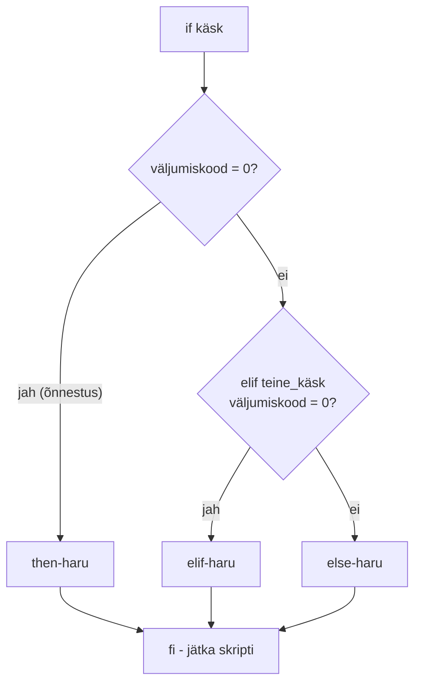
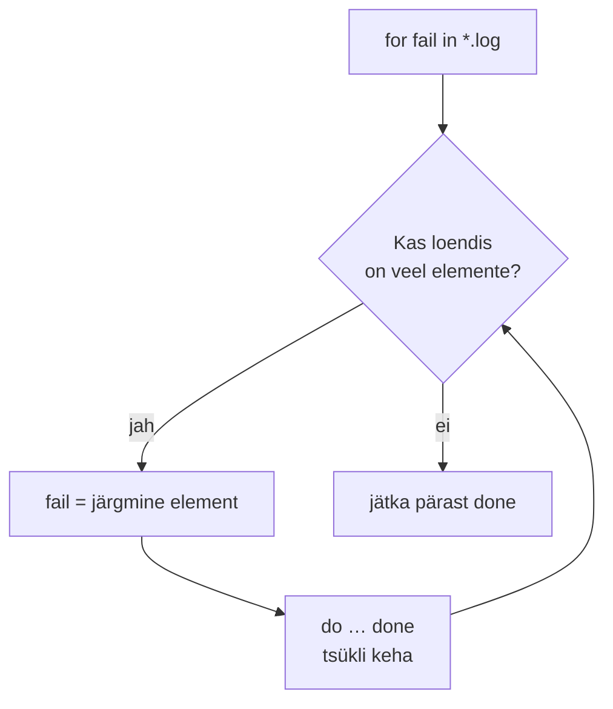
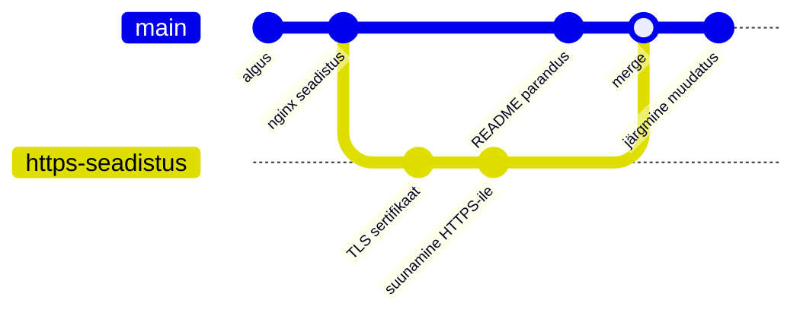

<!-- navigatsioon -->
[← Moodul 5. Enesekontroll](../moodul-05-protsessid-teenused/enesekontroll.md) · [Sisukord](../../README.md#sisukord) · [Laboritöö 6. Halduskriptid ja Git →](labor.md)
<!-- /navigatsioon -->

# Moodul 6. Bashi skriptimine ja Git

**Maht:** 16 tundi · **Laboritöö:** Debian · **Eeldused:** moodulid 1–5

> [!NOTE]
> **Süsteemihalduri vaade skriptimisele.** See moodul õpetab Bashi skriptimist nii palju, kui süsteemihaldur igapäevatöös vajab: korduvate tegevuste automatiseerimine, töökindlad hooldus- ja varundusskriptid, nende ajastamine ning skriptide ja seadistusfailide hoidmine Gitis. Eesmärk on kirjutada lühikesi praktilisi skripte ja lugeda teiste omi - mitte programmeerimise ega skriptimise täielik valdamine.
>
> **HKHK õppijale:** skriptimist, sealhulgas Pythonit, käsitletakse põhjalikult eraldi skriptimise aines. See moodul annab Linuxi serverite haldamiseks vajaliku aluse ja seob skriptimise kursuse teiste teemadega.

## Õpiväljundid

Mooduli läbinud õppija:

- selgitab kestade erinevusi ja POSIX-ühilduvust ning vahetab sisselogimiskesta;
- loob ja käivitab Bashi skripte;
- kasutab muutujaid, keskkonnamuutujaid ja käskude asendust;
- kasutab jutumärke õigesti;
- töötleb skripti argumente ja kontrollib sisendit;
- kasutab väljumiskoode, tingimusi, tsükleid ja funktsioone;
- loeb sisendit kasutajalt ja failist;
- kirjutab töökindlaid skripte (`set -euo pipefail`, veakontroll, ShellCheck);
- silub skripte ja ajastab nende käivitamise;
- versioonib skripte ja seadistusfaile Gitiga (sissekanded, harud, konfliktid, kaughoidla).

> [!NOTE]
> **Kuidas seda lehte lugeda:** iga teema algab kastiga **Lühidalt** - seal on kõige tähtsam paari lausega. Käsud ja näited on alati näha. Pikemad selgitused ja taust on peidetud plokkidesse **Loe lähemalt** - ava need, kui tahad teemast rohkem teada või kui laboritöös midagi ei õnnestu.

---

## 6.1 Mis on skript?

> [!TIP]
> **Lühidalt:** Skript on tekstifail käskudega. Esimene rida `#!/bin/bash` ütleb, millise kestaga see käivitada. Käivitamiseks: `chmod +x skript.sh` ja `./skript.sh`.

**Skript** on tekstifail, mis sisaldab kesta käske, mida täidetakse järjest. Kõik, mida saad kirjutada käsureale, saad panna ka skripti. Skriptid on süsteemiadministraatori põhitööriist korduvate tööde automatiseerimiseks: varundus, kasutajate loomine, logide analüüs, seire.

> [!TIP]
> **Millal skript, millal midagi muud?** Bash sobib hästi käskude ühendamiseks ja failidega töötamiseks. Kui skript kasvab üle paarisaja rea või vajab keerulisi andmestruktuure, on parem kasutada Pythonit. Mitme serveri seadistamiseks sobib Ansible (moodul 19).

<details>
<summary>Loe lähemalt: Kestad: bash, sh, zsh, fish</summary>

Kest on tavaline programm ja neid on mitu. Igal kasutajal on oma **sisselogimiskest** (failis `/etc/passwd` viimane väli), mille ta saab ise valida.

| Kest | POSIX-ühilduv | Kus vaikimisi | Iseloomustus |
|---|---|---|---|
| **`bash`** | jah (+ laiendused) | Debian, Ubuntu, AlmaLinux kasutajatel | Linuxi standard; selle mooduli skriptid |
| **`sh`** / **`dash`** | jah (ainult POSIX) | Debiani ja Ubuntu `/bin/sh` | Väike ja kiire; süsteemiskriptid |
| **`zsh`** | peaaegu (+ omad laiendused) | macOS, Kali | Väga hea automaatne lõpetamine, pluginad (nt Oh My Zsh) |
| **`fish`** | **ei** | - | Kõige kasutajasõbralikum: soovitused, värvid ja lõpetamine ilma seadistamata, kuid oma süntaks |
| **`ksh`**, **`tcsh`** | `ksh` jah, `tcsh` ei | vanemad Unixid, FreeBSD juurkasutaja (`tcsh` kuni 13. versioonini) | Ajaloolised, kohtab vanades süsteemides |

**POSIX-ühilduvus** tähendab, et kest mõistab standardiga (punkt 2.1 moodulis 2) kirjeldatud süntaksit: muutujad `nimi=väärtus`, `if … then … fi`, `for … do … done`, `$(käsk)`, `&&`, `||`, torud ja ümbersuunamised. POSIX-süntaksis kirjutatud skript töötab igas POSIX-kestas - `dash`-is, `bash`-is, `zsh`-is, FreeBSD `sh`-s ja BusyBoxis. Bashi laiendused (`[[ ]]`, massiivid, `{1..5}`, `(( ))`) töötavad ainult `bash`-is ja osaliselt `zsh`-is.

`fish` ei ole POSIX-ühilduv: muutuja omistatakse käsuga `set nimi väärtus`, tingimus lõpeb sõnaga `end`, `&&` asemel on vanemates versioonides `; and`. Internetist kopeeritud Bashi käsurida ei pruugi `fish`-is töötada.

> **Interaktiivne kest ja skriptikest on eri asjad.** Igapäevatööks võid valida endale meeldiva kesta (`zsh`, `fish`), kuid **skriptid kirjuta Bashis või POSIX `sh`-s** ja määra kest skripti esimesel real (`#!/bin/bash`). Skripti käivitab see kest, mis on esimesel real, mitte sinu sisselogimiskest. Süsteemikasutajatele ja juurkasutajale jäta vaikekest.

</details>

### Kesta vahetamine

```bash
echo $SHELL                 # sisselogimiskest (failist /etc/passwd)
echo $0                     # praegu töötav kest
ps -p $$                    # sama protsessi järgi ($$ = kesta PID)
cat /etc/shells             # lubatud sisselogimiskestad

sudo apt install zsh fish   # paigalda (AlmaLinuxis zsh hoidlast, fish EPEL-ist)
zsh                         # proovi: käivita uus kest olemasoleva sees, välju käsuga exit
chsh -s /usr/bin/zsh        # muuda oma sisselogimiskest (küsib parooli), kehtib järgmisest sisselogimisest
sudo usermod -s /bin/bash mari   # administraator muudab teise kasutaja kesta (moodul 3)
```

`chsh` lubab ainult faili `/etc/shells` loetletud kestasid. Paigaldamisel lisab pakett oma kesta sinna ise.

> [!WARNING]
> **Ära muuda juurkasutaja ega süsteemikasutajate kesta mitte-POSIX-kestaks** (nt `fish`). Mõned hooldusskriptid ja `su -c` eeldavad POSIX-kesta ning kui kest on vigane või eemaldatakse, ei pääse sa kasutajana enam sisse. Proovi uut kesta kõigepealt käsuga `zsh` või `fish`, enne kui teed selle sisselogimiskestaks.

<details>
<summary>Loe lähemalt: Kesta seadistusfailid</summary>

Kest loeb käivitumisel seadistusfaile. Millised, sõltub sellest, kas tegu on **sisselogimiskestaga** (SSH, konsool, `su -`) või tavalise **interaktiivse kestaga** (uus terminaliaken, käsk `bash`):

| Kest | Sisselogimisel | Iga interaktiivne kest |
|---|---|---|
| `bash` | `/etc/profile`, seejärel `~/.bash_profile` või `~/.profile` | `/etc/bash.bashrc` (Debian, Ubuntu) või `/etc/bashrc` (AlmaLinux), `~/.bashrc` |
| `zsh` | `~/.zprofile` | `~/.zshrc` |
| `fish` | - | `~/.config/fish/config.fish` |

Debiani ja Ubuntu `~/.profile` loeb omakorda `~/.bashrc`-i, seega piisab tavaliselt sellest, kui kirjutad aliased ja muutujad faili `~/.bashrc` (punkt 6.2). Uute kasutajate algfailid tulevad kataloogist `/etc/skel` (moodul 3). Muudatuse rakendamiseks avatud kestas: `source ~/.bashrc`.

</details>

### Esimene skript

```bash
nano tere.sh
```

```bash
#!/bin/bash
# Minu esimene skript
echo "Tere, $USER!"
echo "Täna on $(date +%A)."
echo "Oled kataloogis $PWD."
```

- Esimene rida `#!/bin/bash` on **shebang**. See ütleb süsteemile, millise programmiga skripti käivitada. See peab olema faili päris esimene rida.
- `#`-ga algavad read on kommentaarid.

Skripti käivitamiseks peab sellel olema käivitusõigus:

```bash
chmod +x tere.sh
./tere.sh
```

`./` on vajalik, sest praegune kataloog ei ole muutujas `PATH`. Skripti saab käivitada ka otse kestaga, ilma käivitusõiguseta: `bash tere.sh`.

### Kuhu skriptid panna?

| Asukoht | Kasutus |
|---|---|
| `~/bin` või `~/.local/bin` | Isiklikud skriptid. Debianis ja Ubuntus lisatakse need kataloogid automaatselt muutujasse `PATH`, kui need sisselogimisel olemas on |
| `/usr/local/bin` | Kõigile kasutajatele mõeldud skriptid |
| `/usr/local/sbin` | Halduskriptid, mida käivitab juurkasutaja |

Kui skript on `PATH`-is, saab seda käivitada nime järgi nagu tavalist käsku.

## 6.2 Muutujad

> [!TIP]
> **Lühidalt:** Muutuja omistatakse ilma tühikuteta: `nimi=Mari`, kasutatakse `$nimi`-ga. Käsu väljund muutujasse: `kuupaev=$(date +%F)`.

```bash
nimi="Mari"
vanus=17
echo "Tere, $nimi! Oled $vanus aastat vana."
echo "Failinimi: ${nimi}_aruanne.txt"
```

Reeglid:

- **võrdusmärgi ümber ei tohi olla tühikuid**: `nimi = "Mari"` on viga (kest arvab, et `nimi` on käsk);
- muutuja väärtuse kasutamiseks pane nime ette `$`;
- loogelised sulud `${nimi}` eraldavad muutuja nime ümbritsevast tekstist;
- muutujate nimed on tõstutundlikud. Kokkuleppe järgi kasutatakse oma muutujate jaoks väiketähti ja keskkonnamuutujate jaoks suurtähti.

### Keskkonnamuutujad

Mõned muutujad on alati olemas:

| Muutuja | Sisu |
|---|---|
| `$USER` | Kasutajanimi |
| `$HOME` | Kodukataloog |
| `$PWD` | Praegune kataloog |
| `$PATH` | Kataloogid, kust käske otsitakse |
| `$SHELL` | Kasutaja kest |
| `$HOSTNAME` | Masina nimi |
| `$RANDOM` | Juhuslik arv 0–32767 |

```bash
env                          # kõik keskkonnamuutujad
echo $PATH
export MINU_SEADE="väärtus"  # muutuja pärandatakse ka käivitatavatele programmidele
```

Ilma `export`-ita on muutuja nähtav ainult praeguses kestas, mitte sealt käivitatud programmides ja skriptides.

Püsivad muutujad ja aliased kirjutatakse faili `~/.bashrc`:

```bash
alias ll='ls -lh'
export EDITOR=nano
```

### Käskude asendus

Käsu väljundi saab salvestada muutujasse:

```bash
tana=$(date +%F)
failide_arv=$(ls /etc | wc -l)
echo "Täna on $tana ja kataloogis /etc on $failide_arv kirjet."
```

Vanemates skriptides kasutatakse tagurpidi ülakomasid `` `date` ``, kuid `$( )` on loetavam ja seda saab pesastada.

### Aritmeetika

```bash
a=7
b=3
echo $((a + b))              # 10
echo $((a * b))              # 21
echo $((a / b))              # 2 (täisarvuline jagamine)
echo $((a % b))              # 1 (jääk)
loendur=$((loendur + 1))     # suurenda ühe võrra
((loendur++))                # sama lühemalt
```

Bash oskab ainult täisarve. Komakohtadega arvutamiseks kasuta näiteks `bc`-d: `echo "scale=2; 7/3" | bc`.

Kaks lõksu:

- arvud, mis algavad nulliga, tõlgendatakse kaheksandarvudena. `$((08))` annab vea - see juhtub näiteks käsu `date +%H` väljundiga kell 8 ja 9. Lahendus: `$((10#$tund))`;
- `((loendur++))` tagastab väljumiskoodi 1, kui muutuja väärtus oli 0. Koos seadega `set -e` (vt punkt 6.11) lõpetab see skripti. Kasuta sel juhul `loendur=$((loendur + 1))`.

## 6.3 Jutumärgid

> [!TIP]
> **Lühidalt:** Kasuta muutujate ümber alati **jutumärke**: `"$fail"`. Ühekordsed `'...'` ei asenda midagi, kahekordsed `"..."` asendavad muutujad.

Jutumärkide õige kasutamine on Bashi skriptides **kõige olulisem** ja kõige sagedasemate vigade allikas.

| Kuju | Mis juhtub | Näide | Tulemus |
|---|---|---|---|
| `"..."` | Muutujad ja `$( )` asendatakse, tühikud säilivad | `echo "Tere, $USER"` | `Tere, mari` |
| `'...'` | Kõik jääb täpselt nii, nagu on kirjutatud | `echo 'Tere, $USER'` | `Tere, $USER` |
| ilma | Muutujad asendatakse, tulemus **jagatakse tühikute kohalt** osadeks ja metamärgid laiendatakse | `rm $fail` | ohtlik! |

Näide, miks see oluline on:

```bash
fail="minu aruanne.txt"
rm $fail          # proovib kustutada kaks faili: "minu" ja "aruanne.txt"
rm "$fail"        # kustutab faili "minu aruanne.txt"
```

> [!TIP]
> **Reegel:** pane muutujad **alati** jutumärkidesse: `"$muutuja"`, `"$1"`, `"$@"`. Erandeid on vähe ja kui sa pole kindel, kasuta jutumärke.

## 6.4 Argumendid

> [!TIP]
> **Lühidalt:** `$1`, `$2` … on skripti argumendid, `$#` nende arv, `"$@"` kõik argumendid. Kontrolli alati, et vajalik argument on antud.

Skriptile käsurealt antud väärtused on erimuutujates:

| Muutuja | Sisu |
|---|---|
| `$0` | Skripti nimi |
| `$1`, `$2`, … | Esimene, teine jne argument |
| `$#` | Argumentide arv |
| `"$@"` | Kõik argumendid eraldi sõnadena (kasuta seda) |
| `$?` | Viimase käsu väljumiskood |
| `$$` | Skripti PID |

```bash
#!/bin/bash
echo "Skript: $0"
echo "Argumente: $#"
echo "Esimene: $1"
echo "Kõik: $@"
```

```bash
./argumendid.sh üks "kaks kolm" neli
```

```text
Skript: ./argumendid.sh
Argumente: 3
Esimene: üks
Kõik: üks kaks kolm neli
```

### Vaikeväärtused

```bash
kataloog="${1:-$HOME}"       # kui $1 puudub või on tühi, kasuta $HOME
arv="${2:-5}"                # vaikimisi 5
```

`shift` nihutab argumente vasakule: pärast `shift`-i saab `$2`-st `$1` jne. Seda kasutatakse võtmete töötlemisel.

## 6.5 Väljumiskoodid

> [!TIP]
> **Lühidalt:** Iga käsk lõpetab koodiga: `0` - õnnestus, muu - viga. Viimase käsu kood on `$?`. Skript lõpetab koodiga `exit 1` vea korral.

Iga käsk lõpetab **väljumiskoodiga** (*exit code*): **0 tähendab edu**, kõik muu viga. Viimase käsu väljumiskood on muutujas `$?`.

```bash
ls /etc > /dev/null
echo $?                      # 0
ls /olematu 2> /dev/null
echo $?                      # 2
```

Skript määrab oma väljumiskoodi käsuga `exit`:

```bash
exit 0                       # edukas lõpp
exit 1                       # viga
```

Väljumiskoodide põhjal saab käske tingimuslikult ühendada:

```bash
mkdir varu && cp fail.txt varu/      # kopeeri ainult siis, kui mkdir õnnestus
cd /olematu || exit 1                # kui cd ebaõnnestus, lõpeta skript
ping -c1 server >/dev/null && echo "Üleval" || echo "Maas"
```

### Väljund ja veateated

Hea skript kirjutab tavaväljundi standardväljundisse ja veateated **standardveaväljundisse**:

```bash
echo "Kõik korras"
echo "VIGA: faili ei leitud" >&2     # >&2 suunab veaväljundisse
```

Nii saab skripti kasutaja väljundi ja vead eraldi suunata (vt moodul 2).

## 6.6 Tingimused

> [!TIP]
> **Lühidalt:** `if [[ tingimus ]]; then … fi` - nt `[[ -f fail ]]` (fail on olemas), `[[ $a -gt 5 ]]` (arv on suurem). Mitme valiku jaoks `case`.

### if

```text
if käsk; then
    # kui käsk õnnestus (väljumiskood 0)
elif teine_käsk; then
    # kui teine käsk õnnestus
else
    # muidu
fi
```



`if` kontrollib käsu väljumiskoodi. Väga sageli on see käsk `test`, mida kirjutatakse nurksulgudes `[ ]`:

```bash
if [ "$#" -eq 0 ]; then
    echo "Kasutus: $0 FAIL" >&2
    exit 1
fi

if [ -f "/etc/os-release" ]; then
    echo "Fail on olemas"
fi

if grep -q "mari" /etc/passwd; then
    echo "Kasutaja mari on olemas"
fi
```

> [!WARNING]
> **Tühikud on kohustuslikud!** `[ "$a" = "$b" ]` töötab, `["$a"="$b"]` ei tööta. `[` on tegelikult käsk ja selle osad on argumendid.

### Võrdlused

| Arvud | Tekst | Failid |
|---|---|---|
| `-eq` võrdne | `=` võrdne | `-e` on olemas |
| `-ne` mittevõrdne | `!=` mittevõrdne | `-f` tavaline fail |
| `-lt` väiksem | `-z` tühi | `-d` kataloog |
| `-le` väiksem või võrdne | `-n` mittetühi | `-r` loetav |
| `-gt` suurem | | `-w` kirjutatav |
| `-ge` suurem või võrdne | | `-x` käivitatav |
| | | `-s` mittetühi fail |

Tingimuste ühendamine: `[ -f "$f" ] && [ -r "$f" ]` (ja), `[ -z "$a" ] || [ -z "$b" ]` (või), `! [ -d "$k" ]` (ei).

### [[ ]] - Bashi täiustatud test

Bashis on ka võimsam kuju `[[ ]]`:

```bash
if [[ "$vastus" == [jJ]* ]]; then          # mustriga võrdlus
    echo "Vastasid jah"
fi

if [[ "$arv" =~ ^[0-9]+$ ]]; then          # regulaaravaldis
    echo "On täisarv"
fi

if [[ -f "$fail" && -r "$fail" ]]; then    # && ja || sulgude sees
    echo "Fail on loetav"
fi
```

`[[ ]]` on vähem vigadele altis (muutujaid ei jagata tühikute kohalt), kuid töötab ainult Bashis, mitte kõigis kestades. Kuna kirjutame Bashi skripte (`#!/bin/bash`), võib seda julgelt kasutada.

Arvude võrdlemiseks on ka `(( ))`: `if (( arv > 10 )); then ...`

### case

Kui ühte muutujat on vaja võrrelda paljude väärtustega, on `case` loetavam kui pikk `if`-`elif`-ahel:

```bash
case "$1" in
    start)
        echo "Käivitan..."
        ;;
    stop)
        echo "Peatan..."
        ;;
    status|olek)
        echo "Olek..."
        ;;
    *)
        echo "Kasutus: $0 {start|stop|status}" >&2
        exit 1
        ;;
esac
```

Iga haru lõpeb kahe semikooloniga `;;`. `*` sobib kõigega ja on vaikeharu. `|` tähendab „või“.

## 6.7 Tsüklid

> [!TIP]
> **Lühidalt:** `for f in *.log; do … done` kordab iga elemendi kohta, `while` kordab, kuni tingimus kehtib. Faili ridade lugemiseks `while read -r rida`.

### for

```bash
for nimi in Mari Jaan Kati; do
    echo "Tere, $nimi!"
done

for fail in /etc/*.conf; do           # metamärgid
    echo "Leidsin: $fail"
done

for arg in "$@"; do                   # kõik argumendid
    echo "Argument: $arg"
done

for i in {1..5}; do                   # vahemik
    echo "Ring $i"
done

for ((i = 1; i <= 10; i++)); do       # C-stiilis tsükkel
    echo "$i"
done
```

> [!WARNING]
> **Ära kasuta `for f in $(ls)`!** See läheb katki tühikutega failinimede korral. Kasuta metamärke: `for f in *.txt`.

Kuidas `for`-tsükkel töötab:



### while

`while` kordab, kuni tingimus on tõene:

```bash
loendur=1
while [ "$loendur" -le 5 ]; do
    echo "Ring $loendur"
    loendur=$((loendur + 1))
done
```

Lõputu tsükkel (nt seireskriptides, vt moodul 5):

```bash
while true; do
    date
    sleep 60
done
```

`break` lõpetab tsükli, `continue` jätkab järgmise ringiga.

### Faili lugemine rea kaupa

```bash
while IFS= read -r rida; do
    echo "Rida: $rida"
done < fail.txt
```

Eraldajaga failist (nt CSV) väljade lugemine:

```bash
while IFS=, read -r kasutaja nimi grupp; do
    echo "Kasutaja $kasutaja ($nimi), grupp $grupp"
done < kasutajad.csv
```

`IFS` (*Internal Field Separator*) määrab väljade eraldaja ja `read -r` hoiab ära kaldkriipsude tõlgendamise. Kasuta `read`-iga alati võtit `-r`.

Käsu väljundi lugemiseks rea kaupa:

```bash
while read -r kasutaja; do
    echo "Kasutaja: $kasutaja"
done < <(cut -d: -f1 /etc/passwd)
```

`<( )` (*process substitution*) laseb kasutada käsu väljundit nagu faili.

## 6.8 Kasutaja sisend

> [!TIP]
> **Lühidalt:** `read -p "Nimi: " nimi` küsib kasutajalt sisendit muutujasse.

```bash
read -r -p "Sisesta oma nimi: " nimi
echo "Tere, $nimi!"

read -r -s -p "Parool: " parool       # -s: ära kuva sisestust
echo

read -r -p "Kas jätkata? (j/e) " vastus
if [[ "$vastus" != [jJ]* ]]; then
    echo "Katkestan."
    exit 0
fi
```

> [!NOTE]
> Halduskriptid peaksid töötama ka **ilma kasutajata** (nt cron'ist või taimerist käivitades). Seepärast eelista argumente ja seadistusfaile ning kasuta `read`-i ainult siis, kui see on tõesti vajalik (nt ohtliku toimingu kinnitamiseks).

## 6.9 Funktsioonid

> [!TIP]
> **Lühidalt:** Funktsioon on korduvkasutatav käskude plokk: `nimi() { … }`. Kohalikud muutujad märgi `local`-iga.

Funktsioon on korduvkasutatav koodiplokk:

```bash
tervita() {
    local nimi="$1"
    echo "Tere, $nimi!"
}

tervita "Mari"
tervita "Jaan"
```

- funktsioon peab olema **defineeritud enne** selle kasutamist;
- funktsiooni argumendid on samuti `$1`, `$2`, `$@`, `$#`;
- `local` muudab muutuja funktsiooni sisemiseks, et see ei mõjutaks ülejäänud skripti;
- `return` määrab funktsiooni väljumiskoodi (0–255). Väärtuse tagastamiseks kasutatakse `echo`-t ja käskude asendust.

```bash
on_juurkasutaja() {
    [ "$(id -u)" -eq 0 ]
}

ruut() {
    echo $(( $1 * $1 ))
}

if ! on_juurkasutaja; then
    echo "Käivita skript sudo-ga" >&2
    exit 1
fi

tulemus=$(ruut 7)
echo "7 ruudus on $tulemus"
```

Tüüpilised abifunktsioonid, mida tasub igasse suuremasse skripti panna:

```bash
logi() {
    echo "$(date '+%F %T') $*"
}

viga() {
    logi "VIGA: $*" >&2
    exit 1
}

[ -d "$siht" ] || viga "Kataloogi $siht ei ole"
```

## 6.10 Massiivid

> [!TIP]
> **Lühidalt:** Massiiv hoiab mitut väärtust: `serverid=(web1 web2)`, kõik elemendid `"${serverid[@]}"`.

```bash
serverid=("web1" "web2" "db1")
echo "${serverid[0]}"          # esimene element: web1
echo "${serverid[@]}"          # kõik elemendid
echo "${#serverid[@]}"         # elementide arv: 3
serverid+=("db2")              # lisa element

for s in "${serverid[@]}"; do
    echo "Kontrollin serverit $s"
done
```

## 6.11 Töökindlad skriptid

> [!TIP]
> **Lühidalt:** Alusta skripti reaga `set -euo pipefail` - skript peatub vea korral. Kontrolli skripti tööriistaga `shellcheck`.

### set -euo pipefail

Vaikimisi jätkab Bash pärast vigu järgmise käsuga, mis võib viia katastroofini:

```bash
cd /var/www/vana_sait
rm -rf *                     # kui cd ebaõnnestus, kustutatakse praeguse kataloogi sisu!
```

Seepärast alustatakse halduskripte sageli nii:

```bash
#!/bin/bash
set -euo pipefail
```

| Seade | Tähendus |
|---|---|
| `-e` | Lõpeta skript, kui mõni käsk ebaõnnestub |
| `-u` | Lõpeta skript, kui kasutatakse defineerimata muutujat (kaitseb trükivigade eest) |
| `-o pipefail` | Toru ebaõnnestub, kui ükskõik milline selle käsk ebaõnnestub (mitte ainult viimane) |

`set -e` ei ole täiuslik (näiteks `if`-tingimuses ja `&&`/`||` ahelates olevad käsud ei lõpeta skripti), seega oluliste käskude järel kontrolli tulemust ka ise: `cd "$kataloog" || exit 1`.

Kui `set -u` on sees, kasuta valikuliste argumentide jaoks vaikeväärtust: `"${1:-}"`.

### trap - koristamine lõpus

`trap` käivitab käsu, kui skript lõpeb või saab signaali. Sellega saab näiteks ajutised failid alati ära kustutada:

```bash
ajutine=$(mktemp)
trap 'rm -f "$ajutine"' EXIT

# ... töö ajutise failiga ...
```

`mktemp` loob turvalise unikaalse nimega ajutise faili.

### ShellCheck

**ShellCheck** on tööriist, mis leiab skriptidest levinud vigu: jutumärkide puudumise, ohtlikud konstruktsioonid, süntaksivead.

```bash
sudo apt install shellcheck
shellcheck minu_skript.sh
```

Iga hoiatus sisaldab koodi (nt `SC2086`), mille selgituse leiad aadressilt `https://www.shellcheck.net/wiki/SC2086`. **Kontrolli iga skripti ShellCheckiga** - see õpetab ka häid tavasid.

### Hea skripti tunnused

1. shebang ja lühike kommentaar, mida skript teeb ja kuidas seda kasutada;
2. `set -euo pipefail`;
3. kõik muutujad jutumärkides;
4. argumentide kontroll ja kasutusjuhend (`Kasutus: ...`), kui argumendid on valed;
5. veateated standardveaväljundisse ja väljumiskood ≠ 0 vea korral;
6. seadistatavad väärtused (teed, piirid) skripti alguses muutujates;
7. korduv kood funktsioonides;
8. ohtlike toimingute jaoks proovirežiim (*dry run*), mis näitab, mida tehtaks;
9. ShellCheck ei anna hoiatusi.

## 6.12 Silumine

> [!TIP]
> **Lühidalt:** `bash -x skript.sh` näitab iga käsku enne käivitamist - nii leiad, kus skript valesti läheb.

```bash
bash -x skript.sh            # näita iga käsku enne käivitamist
bash -n skript.sh            # kontrolli ainult süntaksit, ära käivita
```

Skripti sees saab silumise sisse ja välja lülitada:

```bash
set -x                       # silumine sisse
probleemne_osa
set +x                       # silumine välja
```

## 6.13 Skriptide ajastamine

> [!TIP]
> **Lühidalt:** Skripti saab ajastada cron'i või systemd taimeriga (moodul 5). Kasuta täisteid ja kirjuta tulemus logisse.

Valmis skripti saab ajastada cron'i või systemd taimeriga (vt moodul 5). Pea meeles:

- kasuta skriptis täielikke teid või määra `PATH` skripti alguses;
- skript ei tohi oodata kasutaja sisendit;
- suuna väljund logifaili (cron) või lase systemd-l see journal'isse salvestada (taimer);
- testi skripti enne ajastamist käsitsi.

## 6.14 Git

> [!TIP]
> **Lühidalt:** Git hoiab failide ajalugu: `git add`, `git commit -m`, `git log`, `git diff`. Skriptid ja seadistusfailid hoia Gitis - nii näed, mis ja millal muutus.

**Git** on versioonihaldussüsteem, mille lõi Linus Torvalds 2005. aastal Linuxi kerneli arenduse jaoks (vt [ajalugu](../lisad/ajalugu.md)). Git salvestab failide muudatuste ajaloo: iga muudatuse kohta on teada, kes, millal ja miks selle tegi, ning alati saab minna tagasi mis tahes varasemasse olekusse.

Git ei ole ainult programmeerijatele. Süsteemiadministraator hoiab Gitis skripte, seadistusfaile, Ansible'i mänguraamatuid ja dokumentatsiooni. Seepärast õpime Giti koos skriptimisega: iga skript, mille sellest moodulist alates kirjutad, kuulub Git-hoidlasse.

### Põhimõisted

| Mõiste | Tähendus |
|---|---|
| **Hoidla** (*repository*, *repo*) | Projekti kataloog koos kogu muudatuste ajalooga (peidetud kataloog `.git`) |
| **Sissekanne** (*commit*) | Salvestatud hetkeseis koos kirjeldusega |
| **Ettevalmistusala** (*staging area*, *index*) | Muudatused, mis lähevad järgmisse sissekandesse |
| **Haru** (*branch*) | Eraldi arendusliin, nt uue funktsiooni katsetamiseks |
| **Kaughoidla** (*remote*) | Hoidla koopia serveris (GitHub, GitLab, oma server) |


### Seadistamine

```bash
sudo dnf install git                         # AlmaLinux (Debian/Ubuntu: apt install git)
git config --global user.name "Mari Maasikas"
git config --global user.email "mari@hkhk.edu.ee"
git config --global init.defaultBranch main
git config --global core.editor nano
git config --list
```

### Igapäevane töö

```bash
mkdir ~/serverid && cd ~/serverid
git init                                     # loo uus hoidla
echo "# Kooli serverid" > README.md
git status                                   # mis on muutunud
git add README.md                            # lisa ettevalmistusalasse (git add . - kõik)
git commit -m "Lisa README"                  # salvesta sissekanne
git log --oneline                            # ajalugu
git diff                                     # muudatused, mida pole veel lisatud
git diff --staged                            # muudatused, mis on lisatud, kuid salvestamata
```

**Hea sissekande kirjeldus** ütleb lühidalt, **mida ja miks** muudeti: `Lisa nginx-i HTTPS-suunamine`, mitte `muudatused` või `parandus`.

### Muudatuste tagasivõtmine

```bash
git restore fail.txt                         # võta tagasi salvestamata muudatused failis
git restore --staged fail.txt                # eemalda ettevalmistusalast
git show <commit>                            # ühe sissekande sisu
git revert <commit>                          # loo uus sissekanne, mis tühistab vana
git checkout <commit> -- fail.txt            # too fail vanast versioonist
```

### .gitignore

Fail `.gitignore` ütleb, milliseid faile Git ei jälgi:

```text
*.log
*.tmp
.venv/
salasõnad.txt
```

> [!WARNING]
> **Ära pane Giti paroole, privaatvõtmeid ega API-võtmeid!** Kord sisse kantud fail jääb ajalukku ka pärast kustutamist. Kui see juhtub ja hoidla on avalik, tuleb saladus kohe vahetada.

### Harud

```bash
git switch -c https-seadistus                # loo uus haru ja liigu sinna
# ... muuda faile, git add, git commit ...
git switch main                              # tagasi põhiharusse
git merge https-seadistus                    # liida muudatused
git branch -d https-seadistus                # kustuta haru
```



Kui samas failis on mõlemas harus sama koht muudetud, tekib **konflikt**. Git märgib konfliktsed read failis märkidega `<<<<<<<`, `=======` ja `>>>>>>>`. Paranda fail käsitsi, seejärel `git add` ja `git commit`.

### Kaughoidla (GitHub)

GitHubi (või GitLabi, Codebergi) hoidlaga suheldakse tavaliselt SSH-võtmega (vt moodul 7): lisa oma avalik võti GitHubi seadistustes (*Settings → SSH and GPG keys*).

```bash
ssh -T git@github.com                                   # kontrolli ühendust
git remote add origin git@github.com:kasutaja/serverid.git
git push -u origin main                                 # saada muudatused
git pull                                                # too teiste muudatused
git clone git@github.com:kasutaja/serverid.git          # kopeeri hoidla
```

Meeskonnatöös tehakse muudatused tavaliselt eraldi harus ja liidetakse põhiharuga **liitmistaotluse** (*pull request*, *merge request*) kaudu, kus kolleeg saab muudatuse enne üle vaadata.

---

## Distrode erinevused

Bashi skriptimine on kõigis distrodes sama. Erinevused on käskudes, mida skript kasutab:

| | **Debian** | **Ubuntu** | **AlmaLinux** |
|---|---|---|---|
| `/bin/sh` on | `dash` | `dash` | `bash` |
| Isiklik `~/bin` lisatakse `PATH`-i | Jah (`~/.profile`) | Jah (`~/.profile`) | `~/.local/bin` ja `~/bin` (`~/.bashrc`) |
| ShellCheck | `apt install shellcheck` | `apt install shellcheck` | EPEL-ist `dnf install ShellCheck` |
| Pakihaldus skriptis | `apt-get -y install` | `apt-get -y install` | `dnf -y install` |

> [!WARNING]
> **`#!/bin/sh` ei ole sama mis `#!/bin/bash`!** Debianis ja Ubuntus on `/bin/sh` väike ja kiire kest `dash`, mis ei toeta Bashi laiendusi (nt `[[ ]]`, massiivid, `{1..5}`, `(( ))` ja `<( )`). Kui kasutad Bashi võimalusi, kirjuta alati `#!/bin/bash`. AlmaLinuxis on `/bin/sh` viit Bashile, mistõttu seal töötav `sh`-skript võib Debianis katki minna.

Distrost sõltuvat skripti saab kirjutada faili `/etc/os-release` põhjal:

```bash
. /etc/os-release
case "$ID" in
    debian|ubuntu) sudo apt-get -y install htop ;;
    almalinux|rocky|rhel) sudo dnf -y install htop ;;
    *) echo "Tundmatu distro: $ID" >&2; exit 1 ;;
esac
```

<details>
<summary>Loe lähemalt: Kuidas on see FreeBSD-s?</summary>

FreeBSD vaikekest on `/bin/sh` - POSIX-ühilduv kest, mis on `dash`-iga sama perekonnast. Alates FreeBSD 14-st on `sh` ka juurkasutaja kest (varem `tcsh`). **Bashi baassüsteemis pole**: see paigaldatakse paketina ja asub kataloogis `/usr/local/bin/bash`.

```sh
pkg install bash
chsh -s /usr/local/bin/bash      # vaheta oma kest
```

Seepärast:

- rida `#!/bin/bash` FreeBSD-s ei tööta (faili `/bin/bash` pole). Kasuta `#!/usr/bin/env bash` - `env` leiab bashi `PATH`-ist igas süsteemis;
- kui skript peab töötama nii Linuxis kui ka FreeBSD-s ilma lisapaketita, kirjuta see POSIX-süntaksis ja alusta reaga `#!/bin/sh`. Kontrolli seda käsuga `shellcheck -s sh skript.sh`;
- skriptis kasutatavad käsud võivad erineda (GNU ja BSD tööriistad, vt moodul 2), nt `sed -i` ja `date -d`.

Distro järgi hargnev skript saab FreeBSD ära tunda käsuga `uname -s` (väljund `FreeBSD`), sest faili `/etc/os-release` seal tavaliselt ei kasutata.

</details>

---

## Kokkuvõte

| Konstruktsioon | Näide |
|---|---|
| Shebang | `#!/bin/bash` |
| Muutuja | `nimi="Mari"`, `"$nimi"`, `"${nimi}"` |
| Käskude asendus | `tana=$(date +%F)` |
| Aritmeetika | `$((a + b))` |
| Argumendid | `$1`, `$#`, `"$@"`, `${1:-vaikimisi}` |
| Väljumiskood | `$?`, `exit 1`, `käsk && ...`, `käsk \|\| ...` |
| Tingimus | `if [ -f "$f" ]; then ... fi`, `[[ "$a" =~ regex ]]` |
| Valik | `case "$1" in a) ... ;; *) ... ;; esac` |
| Tsükkel | `for f in *.txt; do ... done`, `while ...; do ... done` |
| Faili lugemine | `while IFS= read -r rida; do ... done < fail` |
| Sisend | `read -r -p "Küsimus: " vastus` |
| Funktsioon | `nimi() { local x="$1"; ... }` |
| Töökindlus | `set -euo pipefail`, `trap '...' EXIT`, `shellcheck` |
| Silumine | `bash -x skript.sh` |
| Git | `git init`, `add`, `commit -m`, `status`, `log --oneline`, `diff` |
| Giti harud ja kaughoidla | `git switch -c`, `merge`, `remote add`, `push`, `pull`, `clone` |

**Järgmised sammud:** tee [laboritöö](labor.md) ja kontrolli oma teadmisi [enesekontrolli](enesekontroll.md) abil.

## Lisamaterjal

- William Shotts, „The Linux Command Line“ - IV osa „Writing Shell Scripts“
- Greg's Wiki - BashGuide ja BashPitfalls (mywiki.wooledge.org)
- ShellCheck (shellcheck.net) - veebis saab skripte ka ilma paigaldamata kontrollida
- MIT Missing Semester - „Shell Tools and Scripting“ ja „Version Control (Git)“
- Pro Git (git-scm.com/book) - tasuta raamat

<!-- navigatsioon -->
---

[← Moodul 5. Enesekontroll](../moodul-05-protsessid-teenused/enesekontroll.md) · [Sisukord](../../README.md#sisukord) · [Laboritöö 6. Halduskriptid ja Git →](labor.md)
<!-- /navigatsioon -->
