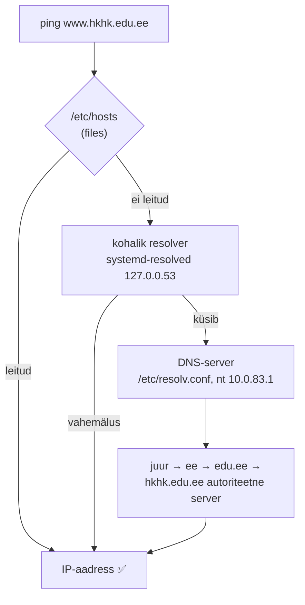
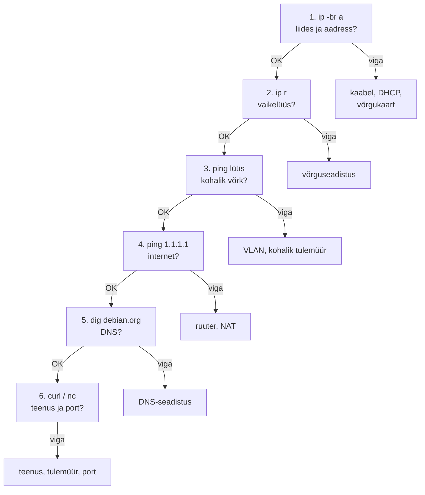
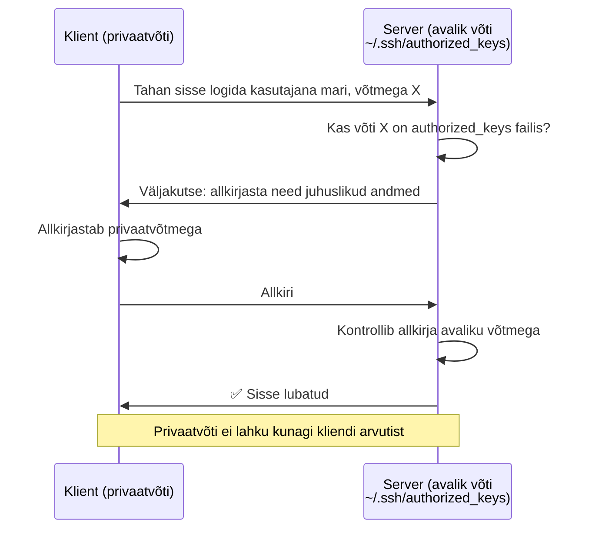
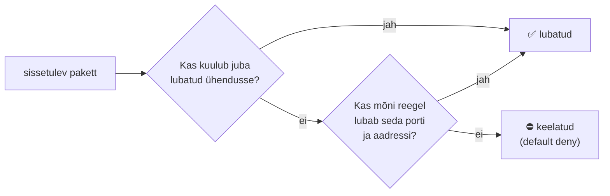
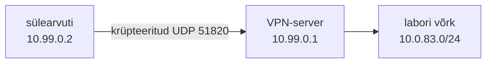

<!-- navigatsioon -->
[← Moodul 6. Enesekontroll](../moodul-06-bash/enesekontroll.md) · [Sisukord](../../README.md#sisukord) · [Laboritöö 7. Võrk, SSH ja tulemüür →](labor.md)
<!-- /navigatsioon -->

# Moodul 7. Võrk ja SSH

**Maht:** 12 tundi · **Laboritöö:** Ubuntu · **Eeldused:** moodulid 1–6, võrgu alused (IP-aadress, alamvõrk, vaikelüüs)

## Õpiväljundid

Mooduli läbinud õppija:

- kuvab ja tõlgendab võrguliideste, aadresside ja marsruutide seadistust;
- seadistab püsiva IP-aadressi Debianis, Ubuntus ja AlmaLinuxis;
- selgitab nimelahenduse toimimist ja kasutab DNS-i diagnostikavahendeid;
- leiab, millised teenused millistel portidel kuulavad;
- diagnoosib võrguprobleeme süstemaatiliselt;
- kasutab SSH võtmepõhist autentimist ja kliendi seadistusfaili;
- karastab SSH-serveri seadistust;
- kopeerib faile käskudega `scp` ja `rsync`;
- seadistab tulemüüri (`ufw`, `firewalld`, `nftables`);
- seadistab ajavööndi ja ajasünkroonimise (systemd-timesyncd, chrony) ning sisevõrgu ajaserveri;
- seadistab süsteemi lokaadi ja klaviatuuripaigutuse;
- loob WireGuardiga VPN-tunneli;
- kasutab SSH hüppeserverit (`ProxyJump`);
- selgitab IPv6 aadresside põhimõtteid ning seadistab silla, VLAN-i ja bond-liidese.

---

## 7.1 Võrguliidesed ja aadressid

Võrgu seadistust vaadatakse ja muudetakse käsuga **`ip`** (pakett `iproute2`). Vanemates juhendites kasutatav `ifconfig` on aegunud ega pruugi olla paigaldatud.

```bash
ip address                   # kõik liidesed ja aadressid (lühidalt: ip a)
ip -br address               # lühike ülevaade
ip link                      # liidesed ja nende olek
ip route                     # marsruudid (lühidalt: ip r)
ip neigh                     # ARP-tabel: naabrite MAC-aadressid
```

`ip -br a` väljund:

```text
lo               UNKNOWN        127.0.0.1/8 ::1/128
ens18            UP             10.0.83.54/24 fe80::be24:11ff:fe2a:1b3c/64
```

| Osa | Tähendus |
|---|---|
| `lo` | Tagasisidestusliides (*loopback*): masin räägib iseendaga, aadress `127.0.0.1` |
| `ens18` | Võrgukaart. Nime annab süsteem riistvara asukoha järgi (Proxmoxi VirtIO kaart on sageli `ens18`) |
| `UP` | Liides on aktiivne |
| `10.0.83.54/24` | IPv4-aadress ja võrgumask (`/24` = `255.255.255.0`) |
| `fe80::...` | IPv6 lingikohalik aadress |

### Marsruudid

```bash
ip route
```

```text
default via 10.0.83.1 dev ens18 proto dhcp src 10.0.83.54 metric 100
10.0.83.0/24 dev ens18 proto kernel scope link src 10.0.83.54
```

- `default via 10.0.83.1` - **vaikelüüs**: kõik paketid, mis ei lähe kohalikku võrku, saadetakse sellele ruuterile;
- `10.0.83.0/24 dev ens18` - kohalik võrk on otse liidese `ens18` taga.

### Ajutised muudatused

`ip` käsuga tehtud muudatused kehtivad **ainult taaskäivituseni**. Need sobivad testimiseks:

```bash
sudo ip address add 10.0.83.60/24 dev ens18    # lisa aadress
sudo ip address del 10.0.83.60/24 dev ens18    # eemalda aadress
sudo ip link set ens18 down                       # lülita liides välja (ettevaatust SSH kaudu!)
sudo ip route add 10.0.0.0/8 via 10.0.83.254   # lisa marsruut
```

> [!WARNING]
> **Hoiatus:** kui muudad SSH kaudu selle liidese seadistust, mille kaudu oled ühendatud, võid ühenduse kaotada. Hoia käepärast konsool (nt Proxmoxi veebiliidese konsool).

### Iga masin vajab oma aadressi

Samas alamvõrgus ei tohi kahel masinal olla **sama IP-aadress**. Kui kaks masinat kasutavad sama aadressi (*IP address conflict*), ei tea ülejäänud võrk, kummale pakette saata: ühendused katkevad juhuslikult, SSH ühendub vahel valesse masinasse ja viga on raske leida. DHCP-server jälgib, et ta ei jagaks sama aadressi kaks korda, kuid **staatilise aadressi** eest vastutad sina.

Kursuse laboris on igal masinal oma aadress (vt lisa [Laborikeskkond ja paigaldus](../lisad/paigaldus.md)):

| Masin | Aadress |
|---|---|
| `debian1` | `10.0.83.52/24` |
| `debian2` | `10.0.83.53/24` |
| `ubuntusrv` | `10.0.83.54/24` |
| `alma` | `10.0.83.55/24` |

Kõik masinad on samas alamvõrgus `10.0.83.0/24` ja kasutavad sama vaikelüüsi `10.0.83.1`, kuid aadressi viimane osa on igal masinal erinev. Selle mooduli näidetes kasutame samu aadresse: Ubuntu näited `.54`, Debiani näited `.52` ja AlmaLinuxi näited `.55`.

> [!IMPORTANT]
> **Enne staatilise aadressi kasutuselevõttu kontrolli, et see on vaba.** Kooli laboris annab aadressi õpetaja; ära võta suvalist aadressi. Kontrolli teisest masinast samas võrgus:
>
> ```bash
> ping -c2 10.0.83.60                       # vastus = aadress on juba kasutusel
> ip neigh show 10.0.83.60                  # kas aadressil on MAC-aadress (naabertabelis)?
> sudo arping -D -I ens18 -c2 10.0.83.60    # duplikaadi tuvastus (pakett iputils-arping)
> ```
>
> Ka `ping`-ile mittevastav aadress võib olla kasutusel (tulemüür, väljalülitatud masin), seega kontrolli kindlasti ka aadressiplaani.

### Masina nimi

```bash
hostnamectl                               # vaata
sudo hostnamectl set-hostname ubuntusrv       # muuda püsivalt
```

Uus nimi tuleks lisada ka faili `/etc/hosts`.

## 7.2 Püsiv võrguseadistus

Püsiva seadistuse viis erineb distrode kaupa - see on üks suurimaid erinevusi Debiani, Ubuntu ja AlmaLinuxi vahel.

| Distro | Vahend | Seadistus |
|---|---|---|
| Debian (server) | ifupdown | `/etc/network/interfaces` |
| Ubuntu | Netplan (+ systemd-networkd) | `/etc/netplan/*.yaml` |
| AlmaLinux | NetworkManager | `nmcli`, `nmtui`, `/etc/NetworkManager/system-connections/` |

Igas näites on vaikelüüs ja DNS-server `10.0.83.1`, kuid **aadress on igal masinal oma**: Ubuntu (`ubuntusrv`) `10.0.83.54/24`, Debian (`debian1`) `10.0.83.52/24` ja AlmaLinux (`alma`) `10.0.83.55/24`. Kui kopeerid näite, muuda aadress oma masina omaks.

### Ubuntu: Netplan

Netplan loeb YAML-vormingus faile kataloogist `/etc/netplan/` ja genereerib nende põhjal seadistuse.

```yaml
# /etc/netplan/50-staatiline.yaml
network:
  version: 2
  ethernets:
    ens18:
      dhcp4: false
      addresses:
        - 10.0.83.54/24
      routes:
        - to: default
          via: 10.0.83.1
      nameservers:
        addresses: [10.0.83.1, 1.1.1.1]
        search: [lab.example]
```

```bash
sudo chmod 600 /etc/netplan/50-staatiline.yaml
sudo netplan try                 # rakenda; kui 120 s jooksul ei kinnitata, võetakse tagasi
sudo netplan apply               # rakenda püsivalt
```

> [!WARNING]
> **YAML-is on taanded olulised!** Kasuta tühikuid, mitte tabulaatoreid, ja hoia sama tase sama kaugel. Üks vale tühik muudab faili vigaseks.

**`netplan try` on SSH kaudu töötades kohustuslik:** kui uus seadistus katkestab ühenduse, taastatakse vana automaatselt. Vanemates juhendites kasutatav võti `gateway4` on aegunud, selle asemel kasutatakse `routes`.

### Debian: /etc/network/interfaces

```text
# /etc/network/interfaces
auto lo
iface lo inet loopback

auto ens18
iface ens18 inet static
    address 10.0.83.52/24
    gateway 10.0.83.1
```

DNS-serverid kirjutatakse faili `/etc/resolv.conf`:

```text
nameserver 10.0.83.1
search lab.example
```

Muudatuse rakendamiseks: `sudo systemctl restart networking` või taaskäivitus. DHCP jaoks on rida `iface ens18 inet dhcp`.

### AlmaLinux: NetworkManager

NetworkManager haldab **ühendusi** (*connections*), mis on seotud liidestega.

```bash
nmcli device                         # liidesed ja nende ühendused
nmcli connection show                # kõik ühendused
nmcli connection show ens18          # ühenduse kõik seaded

sudo nmcli connection modify ens18 \
    ipv4.method manual \
    ipv4.addresses 10.0.83.55/24 \
    ipv4.gateway 10.0.83.1 \
    ipv4.dns "10.0.83.1 1.1.1.1" \
    ipv4.dns-search lab.example

sudo nmcli connection up ens18       # rakenda
```

DHCP-le tagasi: `sudo nmcli connection modify ens18 ipv4.method auto ipv4.addresses "" ipv4.gateway ""`.

Menüüpõhine tööriist **`nmtui`** on mugav, kui `nmcli` süntaksit ei mäleta. Ühenduste failid on kataloogis `/etc/NetworkManager/system-connections/`.

## 7.3 Nimelahendus ja DNS

Kui kirjutad `ping www.hkhk.edu.ee`, peab süsteem nime kõigepealt IP-aadressiks teisendama. Järjekorra määrab fail `/etc/nsswitch.conf`:

```text
hosts: files dns
```

1. **files** - kõigepealt vaadatakse faili `/etc/hosts`;
2. **dns** - siis küsitakse DNS-serverilt, mis on kirjas failis `/etc/resolv.conf`.



### /etc/hosts

```text
127.0.0.1       localhost
127.0.1.1       ubuntusrv
10.0.83.52   debian1 debian1.lab.example
```

Fail on kasulik väikeses laboris või testimisel. Suuremas võrgus kasutatakse DNS-i.

### /etc/resolv.conf ja systemd-resolved

```text
nameserver 10.0.83.1
search lab.example
```

`search` tähendab, et lühinimele `debian1` lisatakse otsimisel automaatselt `.lab.example`.

**Ubuntus** haldab nimelahendust teenus **systemd-resolved**. Siis on failis `/etc/resolv.conf` kirjas `nameserver 127.0.0.53` - see on kohalik vahendaja, mis edastab päringud tegelikele DNS-serveritele. Tegelikke servereid näeb käsuga:

```bash
resolvectl status
```

Ubuntus **ei muudeta faili `/etc/resolv.conf` käsitsi** - muudatus kirjutatakse üle. DNS-serverid määratakse Netplanis.

### DNS-i diagnostika

```bash
getent hosts www.debian.org          # lahenda nimi nagu süsteem (arvestab /etc/hosts-i)
dig www.debian.org                   # DNS-päring koos üksikasjadega
dig +short www.debian.org            # ainult vastus
dig @1.1.1.1 www.debian.org          # küsi kindlalt serverilt
dig MX hkhk.edu.ee                   # e-posti serverid
dig -x 8.8.8.8                       # pöördpäring: IP → nimi
host www.debian.org                  # lihtne päring
```

`dig` on paketis `bind9-dnsutils` (Debian, Ubuntu) või `bind-utils` (AlmaLinux).

## 7.4 Pordid ja ühendused

Võrguteenus kuulab kindlat **porti**. IP-aadress ütleb, millise masinaga ühenduda, port ütleb, millise teenusega.

| Port | Protokoll | Teenus |
|---|---|---|
| 22 | TCP | SSH |
| 25 | TCP | SMTP (e-post) |
| 53 | UDP/TCP | DNS |
| 67/68 | UDP | DHCP |
| 80 | TCP | HTTP |
| 123 | UDP | NTP (ajasünkroniseerimine) |
| 443 | TCP | HTTPS |
| 3306 | TCP | MySQL/MariaDB |
| 5432 | TCP | PostgreSQL |
| 8006 | TCP | Proxmox VE veebiliides |

Pordid alla 1024 on **privilegeeritud** - neid saab avada ainult juurkasutaja õigustes käivitatud programm. Täielik loend on failis `/etc/services`.

### ss - kuulavad pordid ja ühendused

```bash
ss -tulpn                    # kuulavad TCP- ja UDP-pordid koos programmidega
ss -tn                       # aktiivsed TCP-ühendused
ss -tn state established '( dport = :22 or sport = :22 )'   # SSH-ühendused
```

| Võti | Tähendus |
|---|---|
| `-t` / `-u` | TCP / UDP |
| `-l` | Ainult kuulavad (*listening*) |
| `-p` | Näita programmi (vajab `sudo`-t teiste kasutajate protsesside nägemiseks) |
| `-n` | Numbrid, mitte nimed |

```text
Netid State  Local Address:Port  Peer Address:Port Process
tcp   LISTEN 0.0.0.0:22          0.0.0.0:*         users:(("sshd",pid=812,fd=3))
tcp   LISTEN 127.0.0.1:3306      0.0.0.0:*         users:(("mariadbd",pid=950,fd=20))
```

**Kuulamisaadress on oluline:** `0.0.0.0` (või `*`, `[::]`) tähendab, et teenus on kättesaadav kõigist võrkudest. `127.0.0.1` tähendab, et teenusega saab ühenduda ainult samast masinast. Andmebaas peaks tavaliselt kuulama ainult `127.0.0.1`-l.

Vanemates juhendites kasutatav `netstat` (pakett `net-tools`) teeb sama, kuid on aegunud.

## 7.5 Võrguprobleemide diagnoosimine

Kui „internet ei tööta“, liigu **altpoolt üles**, kihthaaval. Iga samm kontrollib üht asja:

| Samm | Käsk | Kui ei tööta, siis probleem on… |
|---|---|---|
| 1. Kas liides on üleval ja aadress olemas? | `ip -br a` | Kaabel, virtuaalne võrgukaart, DHCP |
| 2. Kas vaikelüüs on olemas? | `ip r` | Võrguseadistus |
| 3. Kas lüüs vastab? | `ping -c3 10.0.83.1` | Kohalik võrk, VLAN, tulemüür |
| 4. Kas internet vastab IP-aadressiga? | `ping -c3 1.1.1.1` | Ruuter, NAT |
| 5. Kas nimelahendus töötab? | `getent hosts debian.org`, `dig debian.org` | DNS-seadistus |
| 6. Kas teenus vastab? | `curl -I https://debian.org`, `nc -zv host 443` | Teenus, tulemüür, port |



Täiendavad tööriistad:

```bash
tracepath debian.org             # näita teed sihtkohani (ruuterid vahel)
mtr debian.org                   # tracepath + ping reaalajas (pakett mtr)
curl -v http://localhost         # HTTP-päring koos üksikasjadega
nc -zv 10.0.83.52 22          # kas port on avatud (pakett netcat)
sudo tcpdump -i ens18 port 53    # vaata võrguliiklust (pakett tcpdump)
```

> [!TIP]
> **Pea meeles:** `ping` võib olla tulemüüriga keelatud. Kui `ping` ei vasta, kuid `curl` töötab, on võrk korras.

## 7.6 SSH lähemalt

SSH-d oled kasutanud alates 1. moodulist. Nüüd vaatame, kuidas seda turvaliselt ja mugavalt kasutada.

### Võtmepõhine autentimine

Paroolide asemel on turvalisem ja mugavam kasutada **võtmepaari**:

- **privaatvõti** (*private key*) - jääb sinu arvutisse ja on salajane. Seda ei anta kunagi kellelegi;
- **avalik võti** (*public key*) - kopeeritakse serverisse. Seda võib vabalt jagada.

Server kontrollib ühendumisel, kas sul on avalikule võtmele vastav privaatvõti, ilma et privaatvõti kunagi üle võrgu liiguks.



**1. Loo võtmepaar** (oma arvutis):

```bash
ssh-keygen -t ed25519 -C "mari@sülearvuti"
```

Võtmed salvestatakse failidesse `~/.ssh/id_ed25519` (privaatne) ja `~/.ssh/id_ed25519.pub` (avalik). **Määra võtmele parool** (*passphrase*) - kui keegi su privaatvõtme varastab, ei saa ta seda ilma paroolita kasutada.

**2. Kopeeri avalik võti serverisse:**

```bash
ssh-copy-id mari@10.0.83.54
```

Windowsis käsku `ssh-copy-id` ei ole. PowerShellis saab sama teha nii:

```powershell
type $env:USERPROFILE\.ssh\id_ed25519.pub | ssh mari@10.0.83.54 "mkdir -p ~/.ssh && chmod 700 ~/.ssh && cat >> ~/.ssh/authorized_keys && chmod 600 ~/.ssh/authorized_keys"
```

Avalik võti lisatakse serveris faili `~/.ssh/authorized_keys`.

**3. Ühendu** - nüüd küsitakse privaatvõtme parooli (kui määrasid), mitte serveri kasutaja parooli.

> [!WARNING]
> **Õigused on olulised:** SSH keeldub võtmeid kasutamast, kui kataloogi `~/.ssh` või faili `authorized_keys` õigused on liiga avarad. Õiged õigused: `~/.ssh` - `700`, `authorized_keys` ja privaatvõti - `600`.

### ssh-agent

Et privaatvõtme parooli ei peaks iga kord sisestama, hoiab **ssh-agent** avatud võtit mälus:

```bash
eval "$(ssh-agent)"
ssh-add ~/.ssh/id_ed25519
```

Paljudes töölaudades (ka Windowsis teenusena) käivitub agent automaatselt.

### Kliendi seadistusfail ~/.ssh/config

Pikkade käskude asemel saab ühendused kirjeldada failis `~/.ssh/config`:

```text
Host ubuntusrv
    HostName 10.0.83.54
    User mari
    IdentityFile ~/.ssh/id_ed25519

Host debian1
    HostName 10.0.83.52
    User mari
    Port 2222

Host *.lab.example
    User admin
```

Nüüd piisab käsust `ssh ubuntusrv`. Sama nimi töötab ka käskudes `scp` ja `rsync`.

### known_hosts

Esimesel ühendumisel salvestab klient serveri võtme sõrmejälje faili `~/.ssh/known_hosts`. Kui serveri võti hiljem muutub, näed hoiatust:

```text
@    WARNING: REMOTE HOST IDENTIFICATION HAS CHANGED!     @
```

See võib tähendada rünnakut (keegi on sinu ja serveri vahel), kuid laboris tähendab see tavaliselt, et virtuaalmasin paigaldati uuesti. Kui oled kindel, et muudatus on oodatud, eemalda vana kirje:

```bash
ssh-keygen -R 10.0.83.54
```

### Failide kopeerimine: scp ja rsync

```bash
scp fail.txt ubuntusrv:/tmp/                  # kopeeri serverisse
scp ubuntusrv:/var/log/syslog .               # kopeeri serverist
scp -r kataloog/ ubuntusrv:~/                 # kopeeri kataloog
```

**rsync** kopeerib ainult muutunud failide osad, mistõttu on see suurte kataloogide ja korduva sünkroniseerimise jaoks palju parem:

```bash
rsync -av kataloog/ ubuntusrv:~/kataloog/            # sünkroniseeri
rsync -av --delete kataloog/ ubuntusrv:~/kataloog/   # kustuta sihtkohast ka allikas puuduvad failid
rsync -avn --delete kataloog/ ubuntusrv:~/kataloog/  # -n: proovirežiim, näita ainult, mida tehtaks
rsync -avz ubuntusrv:/var/www/ ./veebi-varu/         # -z: paki ülekandmisel
```

> [!WARNING]
> **Kaldkriips on oluline!** `rsync -av kataloog/ siht/` kopeerib kataloogi **sisu** sihtkohta. `rsync -av kataloog siht/` kopeerib kataloogi **enda** (tulemuseks `siht/kataloog/`). Kasuta `--delete` alati koos `-n` proovirežiimiga enne päris käivitamist.

Mõlemad nõuavad, et `rsync` oleks paigaldatud mõlemas masinas.

### Tunnelid

SSH abil saab suunata võrguliiklust turvalise ühenduse kaudu:

```bash
ssh -L 8080:localhost:80 ubuntusrv
```

Nüüd avab sinu arvutis aadress `http://localhost:8080` serveri `ubuntusrv` pordi 80 - isegi kui tulemüür laseb serverisse ainult SSH-d. Sama moodi saab turvaliselt ühenduda näiteks andmebaasiga, mis kuulab ainult `127.0.0.1`-l.

### Hüppeserver: ProxyJump

Sageli ei ole sisevõrgu masinad otse ligipääsetavad, vaid ainult läbi **hüppeserveri** (*bastion*, *jump host*). Selle asemel, et logida esmalt hüppeserverisse ja sealt edasi, teeb SSH seda ühe käsuga:

```bash
ssh -J kasutaja@hupe.kool.ee kasutaja@10.0.83.52
scp -J kasutaja@hupe.kool.ee fail.txt kasutaja@10.0.83.52:/tmp/
```

`~/.ssh/config`:

```text
Host hupe
    HostName hupe.kool.ee
    User kasutaja

Host labor-*
    ProxyJump hupe
    User kasutaja

Host labor-debian1
    HostName 10.0.83.52
```

Nüüd `ssh labor-debian1` ühendub läbi hüppeserveri. Privaatvõti jääb sinu arvutisse - hüppeserver ainult edastab krüpteeritud ühenduse (erinevalt `ssh -A` agendi edastamisest, mida tasub vältida).

## 7.7 SSH-serveri karastamine

SSH-serveri seadistus on failis `/etc/ssh/sshd_config`. Tänapäevastes distrodes loetakse lisaks faile kataloogist **`/etc/ssh/sshd_config.d/*.conf`** - oma muudatused on parem kirjutada sinna eraldi faili.

```text
# /etc/ssh/sshd_config.d/10-karastamine.conf
PermitRootLogin no
PasswordAuthentication no
KbdInteractiveAuthentication no
PubkeyAuthentication yes
MaxAuthTries 3
AllowGroups ssh-kasutajad
```

| Seade | Tähendus |
|---|---|
| `PermitRootLogin no` | Juurkasutaja ei saa SSH kaudu sisse logida |
| `PasswordAuthentication no` | Ainult võtmepõhine sisselogimine |
| `KbdInteractiveAuthentication no` | Keela ka interaktiivne paroolipäring |
| `MaxAuthTries 3` | Maksimaalne katsete arv ühenduse kohta |
| `AllowGroups` / `AllowUsers` | Ainult nende gruppide/kasutajate sisselogimine on lubatud |
| `Port 2222` | Muu port (vähendab automaatrünnakute müra, kuid ei ole turvameede iseenesest) |

> [!WARNING]
> **Esimene väärtus jääb kehtima!** `sshd` kasutab iga seade puhul **esimest** leitud väärtust ja `sshd_config.d` failid loetakse tähestiku järjekorras. Näiteks Ubuntu pilvepiltides on fail `50-cloud-init.conf` reaga `PasswordAuthentication yes`. Kui sinu fail on nimega `60-...`, jääb kehtima pilvefaili väärtus. Seepärast pane oma failile väike number (nt `10-`).

Muudatuste rakendamine **turvaliselt**:

```bash
sudo sshd -t                         # kontrolli süntaksit - väljund puudub, kui kõik on korras
sudo systemctl reload ssh            # Debian/Ubuntu (AlmaLinuxis: sshd)
sudo sshd -T | grep -i passwordauth  # vaata tegelikult kehtivat väärtust
```

> [!WARNING]
> **Ära lukusta ennast välja!**
>
> 1. Enne `PasswordAuthentication no` seadmist kontrolli, et võtmega sisselogimine **töötab**.
> 2. Hoia muudatuste tegemise ajal **teine SSH-seanss avatuna**. Olemasolevad seansid jäävad pärast `reload`-i alles.
> 3. Testi uut seadistust **uues** aknas enne vanast väljumist.
> 4. Hoia käepärast konsool (Proxmoxi veebiliides), juhuks kui kõik läheb valesti.

### SFTP-kasutajad oma kataloogis (chroot)

Sageli on vaja anda kellelegi ainult **failide üleslaadimise** õigus (nt veebilehe sisu, partneri aruanded), ilma käsurea ja ilma ligipääsuta ülejäänud failisüsteemile. Seda teeb SSH-server ise: grupi liikmed saavad kasutada ainult SFTP-d ja `chroot` lukustab nad oma kataloogi, kus `/` on nende jaoks kataloog `/srv/sftp/<kasutaja>`.

```text
# /etc/ssh/sshd_config.d/20-sftp.conf
Match Group sftp-kasutajad
    ChrootDirectory /srv/sftp/%u
    ForceCommand internal-sftp
    AllowTcpForwarding no
    X11Forwarding no
```

```bash
sudo groupadd sftp-kasutajad
sudo useradd -M -s /usr/sbin/nologin -G sftp-kasutajad partner
sudo passwd partner                             # või lisa võti, kui paroolid on keelatud
sudo mkdir -p /srv/sftp/partner/failid
sudo chown root:root /srv/sftp /srv/sftp/partner          # chroot-kataloog: omanik root
sudo chmod 755 /srv/sftp /srv/sftp/partner                # teised ei tohi sinna kirjutada
sudo chown partner:partner /srv/sftp/partner/failid       # kasutaja kirjutab alamkataloogi
sudo sshd -t && sudo systemctl reload ssh
```

> [!IMPORTANT]
> **`ChrootDirectory` ja kõik selle ülemkataloogid peavad kuuluma juurkasutajale ja keegi teine ei tohi neisse kirjutada.** Muidu keeldub `sshd` ühendusest (logis `bad ownership or modes for chroot directory`). Seepärast kirjutab kasutaja alamkataloogi `failid`, mitte otse chroot-kataloogi.

Kontrolli: `sftp partner@ubuntusrv` töötab ja `ls /` näitab ainult kataloogi `failid`; `ssh partner@ubuntusrv` aga ei ava käsurida (*This service allows sftp connections only*). Kui sul on `AllowGroups`, lisa sinna ka `sftp-kasutajad`. Kehtivaid seadeid konkreetsele kasutajale näeb käsuga `sudo sshd -T -C user=partner,host=x,addr=10.0.83.52 | grep -i chroot`.

### Kaheastmeline autentimine (TOTP)

Võtmepõhine sisselogimine on juba tugev. Eriti oluliste serverite (nt internetist kättesaadav hüppeserver) puhul lisatakse **teine tegur**: lisaks võtmele küsitakse telefoni rakenduse (nt Aegis, Google Authenticator, Microsoft Authenticator) näidatud **ühekordset koodi** (*TOTP, Time-based One-Time Password*). Kood muutub iga 30 sekundi järel ja arvutatakse ühisest saladusest ning kellaajast, seega peab serveri kell olema täpne (punkt 7.9).

Näide Ubuntus (AlmaLinuxis pakett `google-authenticator` EPEL-ist, PAM-fail `/etc/pam.d/sshd` on sama):

```bash
sudo apt install libpam-google-authenticator
google-authenticator             # käivita OMA kasutajana, mitte sudo-ga: loob ~/.google_authenticator
                                 # skaneeri QR-kood telefoniga ja kirjuta varukoodid üles
```

```text
# /etc/pam.d/sshd - lisa faili lõppu:
auth required pam_google_authenticator.so nullok

# ja kommenteeri välja rida, mis küsiks lisaks kasutaja parooli:
# @include common-auth
```

```text
# /etc/ssh/sshd_config.d/05-totp.conf
UsePAM yes
KbdInteractiveAuthentication yes
AuthenticationMethods publickey,keyboard-interactive
```

```bash
sudo sshd -t && sudo systemctl reload ssh
ssh mari@ubuntusrv               # UUES aknas: kõigepealt võti, siis küsitakse "Verification code"
```

> [!WARNING]
> **Esimene väärtus jääb kehtima.** Punkti 7.7 karastamise failis `10-karastamine.conf` on `KbdInteractiveAuthentication no`. Seepärast on TOTP-faili nimi `05-...`, et see loetaks enne. Hoia muudatuse ajal teine seanss lahti ja testi uues aknas.

`nullok` lubab kasutajatel, kellel TOTP pole veel seadistatud, sisse logida ainult võtmega - nii saab TOTP-i järk-järgult kasutusele võtta. Kui kõik kasutajad on selle seadistanud, eemalda `nullok`. Kaota telefon → kasuta varukoodi või logi sisse konsoolist.

## 7.8 Tulemüür

Linuxi kernelis on pakettide filtreerimise raamistik **netfilter**. Selle reegleid hallatakse tänapäeval tööriistaga **nftables** (`nft`), vanemates süsteemides **iptables**-iga. Enamik administraatoreid kasutab aga lihtsamaid kasutajaliideseid:

| Distro | Vaikimisi tööriist | Vaikimisi olek |
|---|---|---|
| Debian | `nftables` (otse) | Tulemüür ei ole aktiivne. Vajadusel paigalda pakett `nftables` |
| Ubuntu | `ufw` | Paigaldatud, kuid välja lülitatud |
| AlmaLinux | `firewalld` | Sisse lülitatud, lubatud on SSH (ja Cockpit) |

**Põhimõte:** keela kõik sissetulev liiklus ja luba ainult vajalik (*default deny*).



### ufw (Ubuntu)

```bash
sudo ufw status verbose                   # olek
sudo ufw default deny incoming            # keela vaikimisi sissetulev
sudo ufw default allow outgoing           # luba väljaminev
sudo ufw allow OpenSSH                    # luba SSH (rakenduse profiil)
sudo ufw enable                           # lülita sisse
```

> [!WARNING]
> **Luba SSH enne `ufw enable` käivitamist!** Muidu katkestab tulemüür sinu SSH-ühenduse.

Reeglite haldus:

```bash
sudo ufw allow 80/tcp                                 # luba port
sudo ufw allow from 10.0.83.0/24 to any port 22    # luba ainult kindlast võrgust
sudo ufw deny 23                                      # keela port
sudo ufw app list                                     # rakenduste profiilid (nt "Nginx Full")
sudo ufw status numbered                              # reeglid koos numbritega
sudo ufw delete 3                                     # kustuta reegel nr 3
sudo ufw disable                                      # lülita välja
```

### firewalld (AlmaLinux)

firewalld jaotab liidesed **tsoonidesse** (nt `public`, `internal`, `trusted`), igal tsoonil on oma reeglid. Vaikimisi on liidesed tsoonis `public`.

```bash
sudo firewall-cmd --state                             # kas töötab
sudo firewall-cmd --get-active-zones                  # aktiivsed tsoonid ja liidesed
sudo firewall-cmd --list-all                          # vaiketsooni reeglid
sudo firewall-cmd --add-service=http                  # luba (kuni taaskäivituseni)
sudo firewall-cmd --add-service=http --permanent      # luba püsivalt
sudo firewall-cmd --reload                            # laadi püsiv seadistus
sudo firewall-cmd --add-port=8080/tcp --permanent     # luba port
sudo firewall-cmd --remove-service=http --permanent   # eemalda
sudo firewall-cmd --get-services                      # teadaolevad teenused
```

> [!NOTE]
> **Ajutine ja püsiv:** ilma võtmeta `--permanent` kehtib muudatus ainult kuni `firewalld` taaskäivituseni. Võtmega `--permanent` salvestatakse see, kuid rakendub alles pärast `--reload`-i. Levinud töövõte: tee muudatus ilma `--permanent`-ita, testi, ja kui töötab, salvesta käsuga `sudo firewall-cmd --runtime-to-permanent`.

### nftables (Debian)

Debianis kirjutatakse reeglid faili `/etc/nftables.conf`:

```text
#!/usr/sbin/nft -f
flush ruleset

table inet filter {
    chain input {
        type filter hook input priority 0; policy drop;
        iif lo accept
        ct state established,related accept
        ct state invalid drop
        meta l4proto { icmp, ipv6-icmp } accept
        tcp dport 22 accept
        tcp dport { 80, 443 } accept
    }
    chain forward {
        type filter hook forward priority 0; policy drop;
    }
    chain output {
        type filter hook output priority 0; policy accept;
    }
}
```

```bash
sudo nft -c -f /etc/nftables.conf        # kontrolli süntaksit
sudo systemctl enable --now nftables     # rakenda ja käivita alglaadimisel
sudo nft list ruleset                    # vaata kehtivaid reegleid
```

Rida `ct state established,related accept` on oluline: see lubab vastused ühendustele, mille masin ise algatas (nt `apt update`).

Soovi korral saab ka Debianis kasutada `ufw`-d (`sudo apt install ufw`). **Kasuta ühes masinas ainult üht tulemüüritööriista** - mitu korraga tekitab vastuolulisi reegleid.

## 7.9 Kellaaeg ja ajasünkroonimine (NTP)

Õige kellaaeg ei ole ainult mugavus. Kui serverite kellad erinevad:

- logide sündmusi ei saa eri masinate vahel ajaliselt kõrvutada;
- TLS-sertifikaate peetakse kehtetuks („not yet valid“ või „expired“);
- Kerberos ja Active Directory keelduvad autentimast, kui erinevus on üle 5 minuti (valikmoodul 21);
- ajastatud tööd (cron, systemd taimerid) käivituvad valel ajal;
- failide muutmisajad, varundus ja replikatsioon lähevad sassi.

Riistvara kell (*RTC*) triivib päevas sekundeid; virtuaalmasina kell võib pärast hetktõmmise taastamist või peatamist olla tunde vales. Seepärast sünkroniseeritakse kell võrgust protokolliga **NTP** (*Network Time Protocol*, port **123/udp**).

### Kellaaja ja ajavööndi vaatamine

```bash
timedatectl
```

```text
               Local time: P 2026-11-08 20:15:03 EET
           Universal time: P 2026-11-08 18:15:03 UTC
                 RTC time: P 2026-11-08 18:15:03
                Time zone: Europe/Tallinn (EET, +0200)
System clock synchronized: yes
              NTP service: active
          RTC in local TZ: no
```

```bash
timedatectl list-timezones | grep Tallinn
sudo timedatectl set-timezone Europe/Tallinn
```

> [!NOTE]
> **Serverites** hoitakse riistvara kella UTC-s (`RTC in local TZ: no`) ja logides kasutatakse sageli UTC-d - siis ei teki suveaja vahetusel segadust. Ajavöönd mõjutab ainult seda, kuidas aega kuvatakse.

### NTP kliendid

| Klient | Kus vaikimisi | Omadused |
|---|---|---|
| **systemd-timesyncd** | Debian, Ubuntu 24.04 | lihtne SNTP klient, ainult sünkroniseerib, ei saa olla server |
| **chrony** | AlmaLinux, uuemad Ubuntud | täielik NTP: kiire korrigeerimine, katkendlik võrk, võib olla ka **server** |
| **ntpd** / **ntpsec** | vanemad süsteemid | klassikaline NTP-teenus |

**systemd-timesyncd** (Debian, Ubuntu): serverid failis `/etc/systemd/timesyncd.conf`:

```ini
[Time]
NTP=10.0.83.1
FallbackNTP=ee.pool.ntp.org
```

```bash
sudo systemctl restart systemd-timesyncd
timedatectl timesync-status
```

**chrony** (AlmaLinux; Debianis ja Ubuntus `sudo apt install chrony`, mis asendab timesyncd): seadistus `/etc/chrony.conf` (AlmaLinux) või `/etc/chrony/chrony.conf` (Debian, Ubuntu):

```text
pool ee.pool.ntp.org iburst
# või sisevõrgu server:
# server 10.0.83.1 iburst
```

```bash
sudo systemctl restart chronyd          # Debianis/Ubuntus: chrony
chronyc sources -v                       # serverid; * = valitud allikas
chronyc tracking                         # kella nihe ja täpsus
sudo chronyc makestep                    # paranda suur viga kohe (muidu korrigeeritakse sujuvalt)
```

`pool.ntp.org` on vabatahtlike ajaserverite kogum; `ee.pool.ntp.org` annab Eestis asuvad serverid. Distrod kasutavad vaikimisi oma kogumeid (`debian.pool.ntp.org`, `ntp.ubuntu.com`, `2.almalinux.pool.ntp.org`).

### Oma ajaserver sisevõrgule

Suuremas võrgus ei küsi iga masin aega internetist, vaid üks-kaks sisevõrgu serverit sünkroniseerivad end välisallikatega ja ülejäänud masinad küsivad neilt. Laboris sobib selleks OPNsense (*Services* → *Network Time*) või Linuxi server chronyga:

```text
# /etc/chrony/chrony.conf (server)
pool ee.pool.ntp.org iburst
allow 10.0.83.0/24          # luba laborivõrgul aega küsida
local stratum 10            # anna aega ka siis, kui internet on maas
```

```bash
sudo ufw allow from 10.0.83.0/24 to any port 123 proto udp
chronyc clients             # kes on aega küsinud
```

Kliendid saavad ajaserveri aadressi ka DHCP-st (valik 42, valikmoodul 19).

> [!NOTE]
> **Virtuaalmasinad:** Proxmoxi VM-ides tuleb NTP klient hoida tööl ka siis, kui kasutatakse QEMU agenti. Pärast hetktõmmise taastamist võib kell olla väga vale - chrony parandab selle (`makestep` seadistusfailis lubab suure hüppe esimestel uuendustel).

## 7.10 Keel, lokaat ja klaviatuur

**Lokaat** (*locale*) määrab, millises keeles programmid teateid näitavad ning kuidas vormindatakse kuupäevi, arve ja tähestikulist järjestust. Eesti keele ja tähtede (õ, ä, ö, ü, š, ž) jaoks peab süsteem kasutama **UTF-8** kodeeringut.

```bash
localectl                       # süsteemi lokaat ja klaviatuur
locale                          # praeguse seansi seaded (LANG, LC_*)
locale -a                       # paigaldatud lokaadid
```

Serverites on levinud jätta süsteemi keeleks inglise keel (`en_US.UTF-8` või `C.UTF-8`) - veateateid on siis lihtsam otsida. Kuupäevade ja arvude vorming võib siiski olla eesti oma:

```bash
# Debian ja Ubuntu: lokaadi genereerimine
sudo dpkg-reconfigure locales          # vali et_EE.UTF-8 ja en_US.UTF-8
# AlmaLinux: keelepaketid
sudo dnf install glibc-langpack-et

sudo localectl set-locale LANG=en_US.UTF-8 LC_TIME=et_EE.UTF-8
date                                   # uues seansis eesti kuupäevavorming
```

Ühekordselt saab keelt muuta ühe käsu jaoks: `LANG=et_EE.UTF-8 date`, `LC_ALL=C sort fail.txt` (järjestus baitide järgi - skriptides sageli soovitatav, et tulemus ei sõltuks lokaadist).

**Klaviatuur** konsoolis (füüsiline ekraan või Proxmoxi konsool):

```bash
localectl list-keymaps | grep -i ee
sudo localectl set-keymap ee                   # konsooli paigutus
sudo localectl set-x11-keymap ee               # graafiline (X11) paigutus
```

> [!NOTE]
> SSH-ühenduses määrab klaviatuuri **sinu arvuti**, mitte server. Konsoolis tuleb paigutus seadistada serveris; paigaldusprogramm küsib seda (moodul 1, paigalduslisa).

## 7.11 VPN: WireGuard

**VPN** (*Virtual Private Network*) loob kahe võrgu või seadme vahele krüpteeritud tunneli üle interneti. Nii pääseb nt kodust turvaliselt kooli labori sisevõrku, kuigi labori masinatel pole avalikke aadresse.

**WireGuard** on Linuxi kernelis sisalduv kaasaegne VPN: väike, kiire ja lihtsa seadistusega. Iga osapool (*peer*) on tuvastatud **võtmepaariga** (nagu SSH-võtmed).



Võtmed (mõlemas masinas):

```bash
sudo apt install wireguard-tools         # AlmaLinux: sudo dnf install wireguard-tools
umask 077
wg genkey | tee privaat.key | wg pubkey > avalik.key
```

Server, `/etc/wireguard/wg0.conf`:

```ini
[Interface]
Address = 10.99.0.1/24
ListenPort = 51820
PrivateKey = <serveri privaatvõti>
# luba VPN-i klientidel labori võrku pääseda:
PostUp = sysctl -w net.ipv4.ip_forward=1; iptables -t nat -A POSTROUTING -s 10.99.0.0/24 -o ens18 -j MASQUERADE
PostDown = iptables -t nat -D POSTROUTING -s 10.99.0.0/24 -o ens18 -j MASQUERADE

[Peer]
# Mari sülearvuti
PublicKey = <kliendi avalik võti>
AllowedIPs = 10.99.0.2/32
```

Klient, `/etc/wireguard/wg0.conf` (Windowsis ja telefonis sama sisuga fail WireGuardi rakendusse):

```ini
[Interface]
Address = 10.99.0.2/24
PrivateKey = <kliendi privaatvõti>

[Peer]
PublicKey = <serveri avalik võti>
Endpoint = vpn.example.ee:51820
AllowedIPs = 10.99.0.0/24, 10.0.83.0/24     # mis liiklus läheb tunnelisse
PersistentKeepalive = 25
```

```bash
sudo systemctl enable --now wg-quick@wg0
sudo wg show                          # partnerid, viimane ühenduse kinnitus (handshake), liiklus
ping 10.99.0.1
```

Serveri tulemüüris ava **51820/udp** (`sudo ufw allow 51820/udp`). `AllowedIPs` on korraga marsruutimistabel ja juurdepääsukontroll: server võtab partnerilt vastu ainult nende aadresside pakette.

> [!NOTE]
> OPNsense'is (moodul 18) on WireGuard veebiliideses (*VPN* → *WireGuard*). Kooli võrgust välja ühendudes järgi alati asutuse IT-reegleid - ära ava omavoliliselt tunneleid sisevõrku.

## 7.12 Võrgu süvendus: IPv6, sild, VLAN ja bond

### IPv6 põhitõed

IPv4-aadressid on otsas; **IPv6** aadressid on 128-bitised ja kirjutatakse kuueteistkümnendsüsteemis (`2001:db8:83::52`). Järjestikused nullid võib asendada `::`-ga (ühes kohas).

| Aadress | Tähendus |
|---|---|
| `::1` | localhost |
| `fe80::/10` | **link-local** - igal liidesel automaatselt, töötab ainult samas võrgulõigus |
| `2000::/3` | globaalne (avalik) aadress |
| `fd00::/8` | ULA - privaatvõrk (nagu `10.0.0.0/8`) |
| `/64` | tavaline alamvõrgu suurus |

Aadressi saab masin sageli ise ruuteri teadete järgi (**SLAAC**) või DHCPv6-st. NAT-i IPv6-s tavaliselt ei kasutata - iga masin on otse adresseeritav, seega **tulemüür on veel olulisem**.

```bash
ip -6 address
ip -6 route
ping -6 -c2 ipv6.google.com
ss -6 -tlpn
dig AAAA debian.org
```

Netplan (staatiline IPv6): `addresses: [10.0.83.54/24, "fd83::54/64"]`. Veebiserveris `listen [::]:80;` (moodul 13).

### Sild (bridge)

**Sild** on tarkvaraline kommutaator: ühendab mitu liidest (või virtuaalmasinat) samasse võrgulõiku. Seda kasutavad hüperviisorid (moodul 23) ja konteinerid.

```bash
# NetworkManager (AlmaLinux)
sudo nmcli con add type bridge ifname br0 con-name br0 ipv4.method manual ipv4.addresses 10.0.83.55/24
sudo nmcli con add type bridge-slave ifname ens19 master br0
bridge link
```

### VLAN

**VLAN** (802.1Q) jagab ühe füüsilise võrgu mitmeks loogiliseks võrguks. Kommutaatori pordist tulevad märgistatud (*tagged*) kaadrid; Linux loob iga VLAN-i jaoks eraldi liidese:

```bash
sudo nmcli con add type vlan con-name vlan20 dev ens18 id 20 \
    ipv4.method manual ipv4.addresses 10.20.0.5/24
ip -d link show ens18.20
```

### Bond (liideste koondamine)

**Bond** (ka *teaming*, *LACP*) ühendab mitu võrgukaarti üheks loogiliseks liideseks: kaabli või kaardi rikke korral jätkub ühendus (`active-backup`) või liiklus jaotatakse (`802.3ad`/LACP, vajab kommutaatori tuge).

```bash
sudo nmcli con add type bond con-name bond0 ifname bond0 \
    bond.options "mode=active-backup,miimon=100" ipv4.method manual ipv4.addresses 10.0.83.55/24
sudo nmcli con add type ethernet ifname ens18 master bond0
sudo nmcli con add type ethernet ifname ens19 master bond0
cat /proc/net/bonding/bond0
```

Netplanis (Ubuntu) kirjeldatakse samad asjad jaotistes `bridges:`, `vlans:` ja `bonds:`:

```yaml
network:
  version: 2
  ethernets:
    ens18: {}
    ens19: {}
  bonds:
    bond0:
      interfaces: [ens18, ens19]
      parameters: {mode: active-backup, mii-monitor-interval: 100}
  vlans:
    vlan20:
      id: 20
      link: bond0
      addresses: [10.20.0.5/24]
```

Debianis (`ifupdown`) on vastavad read `bridge-ports`, `vlan-raw-device` ja `bond-slaves` failis `/etc/network/interfaces` (paketid `bridge-utils`, `vlan`, `ifenslave`).

> [!NOTE]
> Virtuaalmasinas on bond'il ja VLAN-il vähe mõtet (hüperviisor teeb selle juba ära), kuid füüsilistes serverites on need tavalised. Harjutamiseks lisa Proxmoxis VM-ile teine võrguliides.

---

## Distrode erinevused

| | **Debian** | **Ubuntu** | **AlmaLinux** |
|---|---|---|---|
| Võrguseadistus | `/etc/network/interfaces` (ifupdown) | Netplan, `/etc/netplan/*.yaml` | NetworkManager, `nmcli`, `nmtui` |
| DNS-i seadistus | `/etc/resolv.conf` | Netplan → systemd-resolved (`resolvectl`) | `nmcli ... ipv4.dns` |
| SSH teenus | `ssh` | `ssh` (käivitub vajadusel `ssh.socket` kaudu) | `sshd` |
| Tulemüür | Vaikimisi puudub, soovitatav `nftables` | `ufw` (vaikimisi väljas) | `firewalld` (vaikimisi sees) |
| `dig` pakett | `bind9-dnsutils` | `bind9-dnsutils` | `bind-utils` |
| Ajasünkroonimine | `systemd-timesyncd` | `systemd-timesyncd` (24.04) | `chronyd` |
| Lokaadid | `dpkg-reconfigure locales` | `locale-gen et_EE.UTF-8` | `glibc-langpack-et` |

> [!NOTE]
> **Ubuntu ja SSH pordi muutmine:** Ubuntu uuemates versioonides käivitab SSH-serveri vajadusel `ssh.socket`. Kui muudad SSH porti, tuleb pärast seadistuse muutmist käivitada `sudo systemctl daemon-reload` ja `sudo systemctl restart ssh.socket`, muidu jääb kuulama vana port.

---

## Kokkuvõte

| Käsk | Tegevus |
|---|---|
| `ip -br a`, `ip r` | Aadressid, marsruudid |
| `netplan try` / `nmcli` / `/etc/network/interfaces` | Püsiv võrguseadistus |
| `resolvectl status`, `/etc/resolv.conf`, `/etc/hosts` | Nimelahendus |
| `dig`, `getent hosts` | DNS-i diagnostika |
| `ss -tulpn` | Kuulavad pordid |
| `ping`, `tracepath`, `curl`, `nc -zv` | Ühenduvuse kontroll |
| `ssh-keygen -t ed25519`, `ssh-copy-id` | SSH-võtmed |
| `~/.ssh/config` | SSH kliendi seadistus |
| `/etc/ssh/sshd_config.d/`, `sshd -t` | SSH-serveri seadistus |
| `scp`, `rsync -av` | Failide kopeerimine |
| `ufw`, `firewall-cmd`, `nft` | Tulemüür |
| `timedatectl`, `chronyc sources`, `chronyc tracking` | Kellaaeg ja NTP |
| `localectl`, `locale`, `dpkg-reconfigure locales` | Lokaat ja klaviatuur |
| `wg genkey`, `/etc/wireguard/wg0.conf`, `wg-quick@wg0`, `wg show` | WireGuard VPN |
| `ssh -J`, `ProxyJump` | Hüppeserver |
| `ip -6 a`, `ping -6`, `dig AAAA` | IPv6 |
| `nmcli con add type bridge/vlan/bond`, Netplani `bridges/vlans/bonds` | Sild, VLAN, bond |

**Järgmised sammud:** tee [laboritöö](labor.md) ja kontrolli oma teadmisi [enesekontrolli](enesekontroll.md) abil.

## Lisamaterjal

- Ubuntu Server dokumentatsioon - Networking, OpenSSH (documentation.ubuntu.com)
- Netplan dokumentatsioon (netplan.readthedocs.io)
- Arch Wiki - Network configuration, OpenSSH, nftables (wiki.archlinux.org)
- Linux Upskill Challenge - SSH ja tulemüüri päevad

<!-- navigatsioon -->
---

[← Moodul 6. Enesekontroll](../moodul-06-bash/enesekontroll.md) · [Sisukord](../../README.md#sisukord) · [Laboritöö 7. Võrk, SSH ja tulemüür →](labor.md)
<!-- /navigatsioon -->
