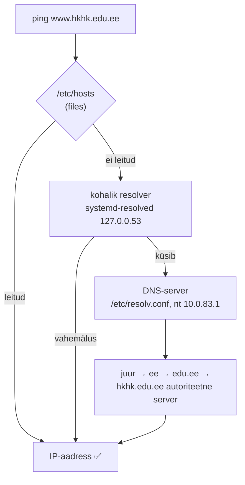
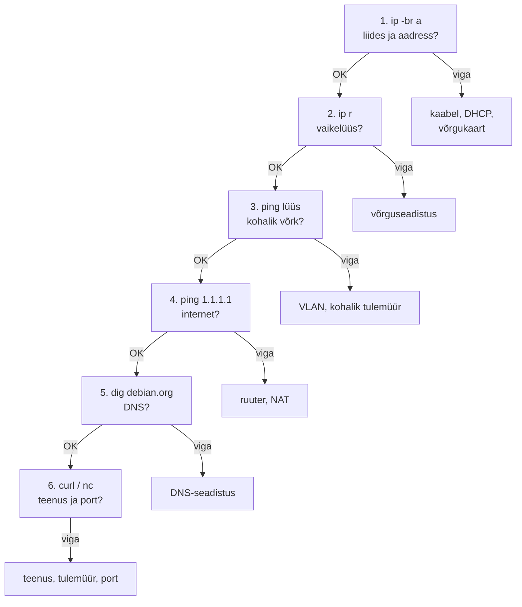
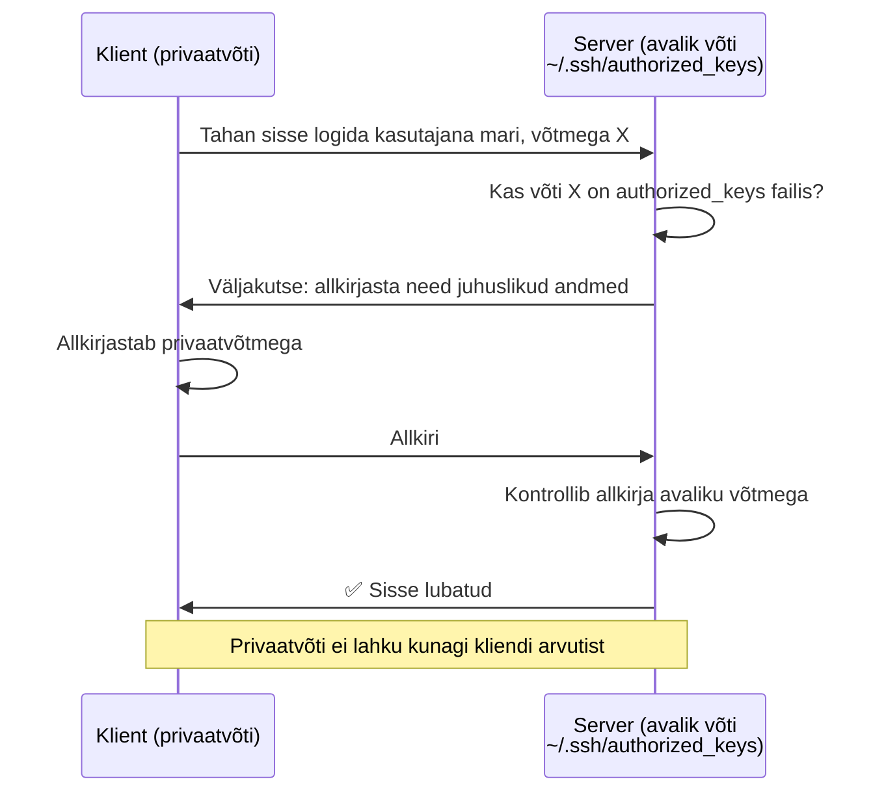
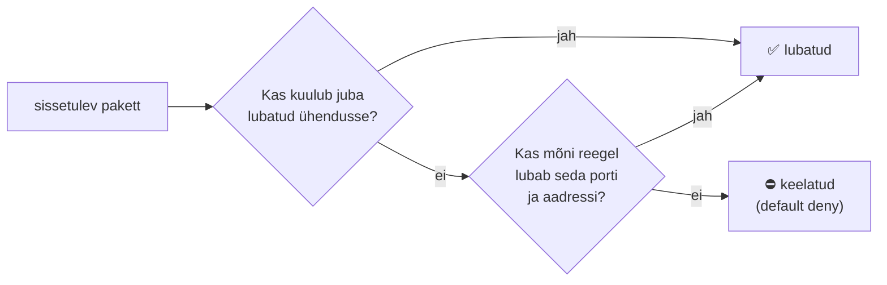

<!-- navigatsioon -->
[← Moodul 6. Enesekontroll](../moodul-06-bash/enesekontroll.md) · [Sisukord](../../README.md#sisukord) · [Laboritöö 7. Võrk, SSH ja tulemüür →](labor.md)
<!-- /navigatsioon -->

# Moodul 7. Võrk ja SSH

**Maht:** 10 tundi · **Laboritöö:** Ubuntu · **Eeldused:** moodulid 1–6, võrgu alused (IP-aadress, alamvõrk, vaikelüüs)

## Õpiväljundid

Mooduli läbinud õppija:

- kuvab ja tõlgendab võrguliideste, aadresside ja marsruutide seadistust;
- seadistab püsiva IP-aadressi Debianis, Ubuntus ja AlmaLinuxis;
- selgitab nimelahenduse toimimist ja kasutab DNS-i diagnostikavahendeid;
- leiab, millised teenused millistel portidel kuulavad;
- diagnoosib võrguprobleeme süstemaatiliselt;
- kasutab SSH võtmepõhist autentimist ja kliendi seadistusfaili;
- karastab SSH-serveri seadistust;
- kopeerib faile käskudega `scp` ja `rsync`;
- seadistab tulemüüri (`ufw`, `firewalld`, `nftables`);
- seadistab ajavööndi ja ajasünkroonimise (systemd-timesyncd, chrony) ning sisevõrgu ajaserveri;
- kasutab SSH hüppeserverit (`ProxyJump`).

> [!NOTE]
> **Kuidas seda lehte lugeda:** iga teema algab kastiga **Lühidalt** - seal on kõige tähtsam paari lausega. Käsud ja näited on alati näha. Pikemad selgitused ja taust on peidetud plokkidesse **Loe lähemalt** - ava need, kui tahad teemast rohkem teada või kui laboritöös midagi ei õnnestu.

---

## 7.1 Võrguliidesed ja aadressid

> [!TIP]
> **Lühidalt:** `ip -br a` näitab liideseid ja aadresse, `ip r` marsruute ja vaikelüüsi. Samas võrgus ei tohi kahel masinal olla sama IP-aadress.

Võrgu seadistust vaadatakse ja muudetakse käsuga **`ip`** (pakett `iproute2`). Vanemates juhendites kasutatav `ifconfig` on aegunud ega pruugi olla paigaldatud.

```bash
ip address                   # kõik liidesed ja aadressid (lühidalt: ip a)
ip -br address               # lühike ülevaade
ip link                      # liidesed ja nende olek
ip route                     # marsruudid (lühidalt: ip r)
ip neigh                     # ARP-tabel: naabrite MAC-aadressid
```

`ip -br a` väljund:

```text
lo               UNKNOWN        127.0.0.1/8 ::1/128
ens18            UP             10.0.83.54/24 fe80::be24:11ff:fe2a:1b3c/64
```

| Osa | Tähendus |
|---|---|
| `lo` | Tagasisidestusliides (*loopback*): masin räägib iseendaga, aadress `127.0.0.1` |
| `ens18` | Võrgukaart. Nime annab süsteem riistvara asukoha järgi (Proxmoxi VirtIO kaart on sageli `ens18`) |
| `UP` | Liides on aktiivne |
| `10.0.83.54/24` | IPv4-aadress ja võrgumask (`/24` = `255.255.255.0`) |
| `fe80::...` | IPv6 lingikohalik aadress |

### Marsruudid

```bash
ip route
```

```text
default via 10.0.83.1 dev ens18 proto dhcp src 10.0.83.54 metric 100
10.0.83.0/24 dev ens18 proto kernel scope link src 10.0.83.54
```

- `default via 10.0.83.1` - **vaikelüüs**: kõik paketid, mis ei lähe kohalikku võrku, saadetakse sellele ruuterile;
- `10.0.83.0/24 dev ens18` - kohalik võrk on otse liidese `ens18` taga.

### Ajutised muudatused

`ip` käsuga tehtud muudatused kehtivad **ainult taaskäivituseni**. Need sobivad testimiseks:

```bash
sudo ip address add 10.0.83.60/24 dev ens18    # lisa aadress
sudo ip address del 10.0.83.60/24 dev ens18    # eemalda aadress
sudo ip link set ens18 down                       # lülita liides välja (ettevaatust SSH kaudu!)
sudo ip route add 10.0.0.0/8 via 10.0.83.254   # lisa marsruut
```

> [!WARNING]
> **Hoiatus:** kui muudad SSH kaudu selle liidese seadistust, mille kaudu oled ühendatud, võid ühenduse kaotada. Hoia käepärast konsool (nt Proxmoxi veebiliidese konsool).

### Iga masin vajab oma aadressi

Samas alamvõrgus ei tohi kahel masinal olla **sama IP-aadress**. Kui kaks masinat kasutavad sama aadressi (*IP address conflict*), ei tea ülejäänud võrk, kummale pakette saata: ühendused katkevad juhuslikult, SSH ühendub vahel valesse masinasse ja viga on raske leida. DHCP-server jälgib, et ta ei jagaks sama aadressi kaks korda, kuid **staatilise aadressi** eest vastutad sina.

Kursuse laboris on igal masinal oma aadress (vt lisa [Laborikeskkond ja paigaldus](../lisad/paigaldus.md)):

| Masin | Aadress |
|---|---|
| `debian1` | `10.0.83.52/24` |
| `debian2` | `10.0.83.53/24` |
| `ubuntusrv` | `10.0.83.54/24` |
| `alma` | `10.0.83.55/24` |

Kõik masinad on samas alamvõrgus `10.0.83.0/24` ja kasutavad sama vaikelüüsi `10.0.83.1`, kuid aadressi viimane osa on igal masinal erinev. Selle mooduli näidetes kasutame samu aadresse: Ubuntu näited `.54`, Debiani näited `.52` ja AlmaLinuxi näited `.55`.

> [!IMPORTANT]
> **Enne staatilise aadressi kasutuselevõttu kontrolli, et see on vaba.** Kooli laboris annab aadressi õpetaja; ära võta suvalist aadressi. Kontrolli teisest masinast samas võrgus:
>
> ```bash
> ping -c2 10.0.83.60                       # vastus = aadress on juba kasutusel
> ip neigh show 10.0.83.60                  # kas aadressil on MAC-aadress (naabertabelis)?
> sudo arping -D -I ens18 -c2 10.0.83.60    # duplikaadi tuvastus (pakett iputils-arping)
> ```
>
> Ka `ping`-ile mittevastav aadress võib olla kasutusel (tulemüür, väljalülitatud masin), seega kontrolli kindlasti ka aadressiplaani.

### Masina nimi

```bash
hostnamectl                               # vaata
sudo hostnamectl set-hostname ubuntusrv       # muuda püsivalt
```

Uus nimi tuleks lisada ka faili `/etc/hosts`.

## 7.2 Püsiv võrguseadistus

> [!TIP]
> **Lühidalt:** `ip` käsuga tehtud muudatus kaob taaskäivitusel. Püsiv seadistus käib igas distros erinevalt: Ubuntus fail `/etc/netplan/*.yaml`, Debianis fail `/etc/network/interfaces`, AlmaLinuxis käsk `nmcli` või menüü `nmtui`. Töökäik on alati sama: vaata praegust seadistust → tee varukoopia → muuda → rakenda → kontrolli.

| Distro | Võrguhaldur | Kus seadistus on | Kuidas rakendada |
|---|---|---|---|
| Ubuntu | Netplan | `/etc/netplan/*.yaml` | `sudo netplan try` |
| Debian (server) | ifupdown | `/etc/network/interfaces`, DNS `/etc/resolv.conf` | `sudo ifdown ens18 && sudo ifup ens18` |
| AlmaLinux | NetworkManager | `nmcli` või `nmtui` | `sudo nmcli connection up ens18` |

Näidetes on igal masinal oma aadress (punkt 7.1): Ubuntu (`ubuntusrv`) `10.0.83.54/24`, Debian (`debian1`) `10.0.83.52/24` ja AlmaLinux (`alma`) `10.0.83.55/24`. Vaikelüüs ja DNS-server on `10.0.83.1`, domeen `lab.example`. **Kui kopeerid näite, kirjuta sinna oma masina aadress ja liidese nimi.**

**Kiirviited:**

| | Staatiline IP | DHCP |
|---|---|---|
| **Ubuntu** (Netplan) | [Ubuntu: staatiline IP](#ubuntu-staatiline-ip) | [Ubuntu: DHCP](#ubuntu-dhcp) |
| **Debian** (ifupdown) | [Debian: staatiline IP](#debian-staatiline-ip) | [Debian: DHCP](#debian-dhcp) |
| **AlmaLinux** (NetworkManager) | [nmcli](#almalinux-staatiline-ip-nmcli) või [nmtui](#almalinux-nmtui) | [nmcli](#almalinux-dhcp-nmcli) |

Pärast igat muudatust: [Kontrolli tulemust](#kontrolli-tulemust).

### Enne alustamist

1. **Hoia konsool lahti.** Kui muudad aadressi SSH kaudu, katkeb ühendus. Tee muudatus Proxmoxi konsoolist või ole valmis uue aadressiga uuesti ühenduma.
2. **Leia liidese nimi ja praegune seadistus:**

    ```bash
    ip -br a             # liidese nimi (nt ens18) ja praegune aadress
    ip r                 # praegune vaikelüüs
    ```

3. **Vaata, milline võrguhaldur masinas töötab.** Tavaliselt määrab selle distro (tabel ülal), kuid näiteks töölauaga Debianis on kasutusel NetworkManager - siis kasuta AlmaLinuxi juhendit.

    ```bash
    ls /etc/netplan/                       # failid olemas → Netplan (Ubuntu)
    systemctl is-active NetworkManager     # active → NetworkManager (AlmaLinux, töölauad)
    cat /etc/network/interfaces            # liidese plokk olemas → ifupdown (Debian)
    ```

4. **Kontrolli, et uus aadress on vaba** (punkt 7.1) ja et tead vaikelüüsi ning DNS-serverit.

### Ubuntu: Netplan

Netplan loeb kõik `.yaml` failid kataloogist `/etc/netplan/` ja paneb need kokku. Paigaldaja on sinna juba ühe faili teinud. Liidese põhiseadistuse (DHCP või staatiline aadress) muutmiseks **muuda seda faili** - kui kirjutad sama liidese kohta teise faili vastupidise seadistuse, hakkavad failid teineteist segama (üks tahab DHCP-d, teine staatilist aadressi). Eraldi faili võib lisada siis, kui see **täiendab** olemasolevat: lisa-aadress, uus liides või VLAN (nii teeme laboritöödes).

#### Ubuntu: staatiline IP

1. Vaata, mis fail seal on ja mida see sisaldab:

    ```bash
    ls /etc/netplan/                  # nt 50-cloud-init.yaml (24.04) või 00-installer-config.yaml (22.04)
    sudo cat /etc/netplan/50-cloud-init.yaml
    ```

2. Tee varukoopia **väljapoole** kataloogi (Netplan loeb kõiki `.yaml` faile, ka koopiaid):

    ```bash
    sudo cp /etc/netplan/50-cloud-init.yaml /root/netplan-varu.yaml
    ```

3. Ava fail (`sudo nano /etc/netplan/50-cloud-init.yaml`) ja kirjuta sisu selliseks:

    ```yaml
    network:
      version: 2
      ethernets:
        ens18:
          dhcp4: false
          addresses:
            - 10.0.83.54/24
          routes:
            - to: default
              via: 10.0.83.1
          nameservers:
            addresses: [10.0.83.1, 1.1.1.1]
            search: [lab.example]
    ```

4. Rakenda ja testi:

    ```bash
    sudo netplan try        # rakendab; vajuta 120 s jooksul Enter, muidu võetakse tagasi
    ```

    Kui `netplan try` annab vea, on viga failis (enamasti taanded). Kui uus seadistus katkestab SSH-ühenduse, siis ära vajuta midagi - 120 sekundi pärast taastatakse vana seadistus.

5. Kontrolli (vt [Kontrolli tulemust](#kontrolli-tulemust)).

> [!WARNING]
> **YAML-is on taanded olulised!** Kasuta ainult tühikuid (mitte tabulaatoreid) ja hoia sama tase sama kaugel. Vanemates juhendites kasutatav `gateway4` on aegunud - kasuta `routes`.

> [!NOTE]
> **Fail `50-cloud-init.yaml`.** Kui masin on tehtud pilvepildist (nt Proxmoxi cloud-init mall), võib cloud-init selle faili taaskäivitusel üle kirjutada. Siis keela cloud-init võrguseadistus: `echo 'network: {config: disabled}' | sudo tee /etc/cloud/cloud.cfg.d/99-disable-network-config.cfg`. Failiõigused peavad olema `600` (`sudo chmod 600 /etc/netplan/*.yaml`), muidu hoiatab Netplan.

#### Ubuntu: DHCP

Aadress tuleb automaatselt DHCP-serverilt. Sama fail, kuid liidese all on ainult üks rida:

```yaml
network:
  version: 2
  ethernets:
    ens18:
      dhcp4: true
```

Rakenda samamoodi: `sudo netplan try`.

### Debian: /etc/network/interfaces

Debiani serveris (ilma töölauata) seadistab võrku **ifupdown** failist `/etc/network/interfaces`. DNS-serverid on eraldi failis `/etc/resolv.conf`.

#### Debian: staatiline IP

1. Tee varukoopia ja ava fail:

    ```bash
    sudo cp /etc/network/interfaces /root/interfaces-varu
    sudo nano /etc/network/interfaces
    ```

2. Paigaldaja on teinud DHCP seadistuse (`iface ens18 inet dhcp`). Muuda liidese plokk selliseks - **`dhcp` asemel `static`** ja lisa aadress ning lüüs:

    ```text
    # /etc/network/interfaces
    auto lo
    iface lo inet loopback

    auto ens18
    iface ens18 inet static
        address 10.0.83.52/24
        gateway 10.0.83.1
    ```

    Maski võib kirjutada ka eraldi reale: `address 10.0.83.52` ja `netmask 255.255.255.0`.

3. Kirjuta DNS-serverid faili `/etc/resolv.conf` (`sudo nano /etc/resolv.conf`):

    ```text
    nameserver 10.0.83.1
    nameserver 1.1.1.1
    search lab.example
    ```

4. Rakenda - lülita liides välja ja kohe uuesti sisse (ühel real, et see toimiks ka SSH kaudu):

    ```bash
    sudo ifdown ens18 && sudo ifup ens18
    ```

    Teine võimalus: `sudo systemctl restart networking` või taaskäivitus.

5. Kontrolli (vt [Kontrolli tulemust](#kontrolli-tulemust)).

#### Debian: DHCP

Liidese plokk on lühike, lüüsi ja DNS-i annab DHCP-server ise:

```text
allow-hotplug ens18
iface ens18 inet dhcp
```

Rakenda samamoodi: `sudo ifdown ens18 && sudo ifup ens18`.

### AlmaLinux: NetworkManager

NetworkManager hoiab seadeid **ühendustes** (*connection*). Ühendusel on nimi ja see on seotud liidesega. AlmaLinuxis on ühenduse nimi tavaliselt sama mis liidesel (`ens18`), kuid võib olla ka nt `Wired connection 1` - vaata see kõigepealt järele.

```bash
nmcli device                   # liides → ühenduse nimi (veerg CONNECTION)
nmcli connection show          # kõik ühendused
```

#### AlmaLinux: staatiline IP (nmcli)

1. Muuda ühenduse seaded (kõik ühe käsuga):

    ```bash
    sudo nmcli connection modify ens18 \
        ipv4.method manual \
        ipv4.addresses 10.0.83.55/24 \
        ipv4.gateway 10.0.83.1 \
        ipv4.dns "10.0.83.1 1.1.1.1" \
        ipv4.dns-search lab.example
    ```

2. Rakenda:

    ```bash
    sudo nmcli connection up ens18
    ```

3. Kontrolli (vt [Kontrolli tulemust](#kontrolli-tulemust)) ja vaata seaded üle: `nmcli connection show ens18 | grep ipv4`.

#### AlmaLinux: DHCP (nmcli)

`method auto` ja tühjenda käsitsi pandud väärtused:

```bash
sudo nmcli connection modify ens18 ipv4.method auto ipv4.addresses "" ipv4.gateway "" ipv4.dns "" ipv4.dns-search ""
sudo nmcli connection up ens18
```

#### AlmaLinux: nmtui

Menüüga tööriist on mugav, kui `nmcli` süntaksit ei mäleta:

1. `sudo nmtui` → **Edit a connection** → vali ühendus (nt `ens18`) → **Edit**.
2. **IPv4 CONFIGURATION**: muuda `<Automatic>` → `<Manual>` ja vali `<Show>`.
3. Täida väljad: **Addresses** `10.0.83.55/24`, **Gateway** `10.0.83.1`, **DNS servers** `10.0.83.1`, **Search domains** `lab.example`. Liigu väljade vahel **Tab**-iga.
4. **OK** → **Back** → **Activate a connection** → vali ühendus ja tee **Deactivate**, seejärel **Activate**, et muudatus jõustuks.
5. **Quit** ja kontrolli.

DHCP jaoks vali punktis 2 `<Automatic>` ja kustuta väljadelt käsitsi pandud väärtused.

<!-- PILT: ../pildid/m07-nmtui-ipv4.png | nmtui ühenduse muutmise aken, IPv4 CONFIGURATION <Manual> ja täidetud väljad -->

### Kontrolli tulemust

Kontrolli pärast iga muudatust samade käskudega - igas distros ühtemoodi:

```bash
ip -br a                       # kas liidesel on õige aadress?
ip r                           # kas vaikelüüs on õige (default via 10.0.83.1)?
ping -c3 10.0.83.1             # kas lüüs vastab?
ping -c3 1.1.1.1               # kas internet vastab IP-aadressiga?
getent hosts www.debian.org    # kas nimelahendus töötab?
```

Kui `ping 1.1.1.1` töötab, aga nimega mitte, on viga DNS-i seadistuses (punkt 7.3). Kui midagi ei tööta, otsi viga punkti 7.5 sammude järgi. Lõpuks **taaskäivita masin** (`sudo reboot`) ja kontrolli uuesti - alles siis tead, et seadistus on püsiv.

<details>
<summary>Loe lähemalt: Püsivad staatilised marsruudid</summary>

Vaikelüüs saadab kõik paketid, mille sihtvõrku masin ei tunne, ühte ruuterisse. Kui mõni võrk on kättesaadav **teise ruuteri** kaudu (nt haldusvõrk `10.10.0.0/16` ruuteri `10.0.83.254` taga), lisatakse **staatiline marsruut**. `ip route add` (punkt 7.1) kaob taaskäivitusel; püsivaks tuleb see kirjutada võrguseadistusse:

```yaml
# Ubuntu: Netplani fail (nt /etc/netplan/50-cloud-init.yaml), liidese ens18 all
      routes:
        - to: default
          via: 10.0.83.1
        - to: 10.10.0.0/16
          via: 10.0.83.254
```

```text
# Debian: /etc/network/interfaces, liidese ens18 plokis
    up ip route add 10.10.0.0/16 via 10.0.83.254
    down ip route del 10.10.0.0/16 via 10.0.83.254
```

```bash
# AlmaLinux: NetworkManager (+ lisab olemasolevatele marsruutidele)
sudo nmcli connection modify ens18 +ipv4.routes "10.10.0.0/16 10.0.83.254"
sudo nmcli connection up ens18
```

Kontrolli: `ip route` (marsruut on tabelis) ja `ip route get 10.10.1.5` (milline marsruut ja liides valitakse). IPv6 marsruudid lisatakse samamoodi (`ipv6.routes`, Netplanis `to: 2001:db8::/32`).

</details>

## 7.3 Nimelahendus ja DNS

> [!TIP]
> **Lühidalt:** Nimi lahendatakse kõigepealt failist `/etc/hosts`, siis DNS-ist. `getent hosts nimi` lahendab nagu programmid, `dig nimi` küsib ainult DNS-ilt.

Kui kirjutad `ping www.hkhk.edu.ee`, peab süsteem nime kõigepealt IP-aadressiks teisendama. Järjekorra määrab fail `/etc/nsswitch.conf`:

```text
hosts: files dns
```

1. **files** - kõigepealt vaadatakse faili `/etc/hosts`;
2. **dns** - siis küsitakse DNS-serverilt, mis on kirjas failis `/etc/resolv.conf`.



### /etc/hosts

```text
127.0.0.1       localhost
127.0.1.1       ubuntusrv
10.0.83.52   debian1 debian1.lab.example
```

Fail on kasulik väikeses laboris või testimisel. Suuremas võrgus kasutatakse DNS-i.

### /etc/resolv.conf ja systemd-resolved

```text
nameserver 10.0.83.1
search lab.example
```

`search` tähendab, et lühinimele `debian1` lisatakse otsimisel automaatselt `.lab.example`.

**Ubuntus** haldab nimelahendust teenus **systemd-resolved**. Siis on failis `/etc/resolv.conf` kirjas `nameserver 127.0.0.53` - see on kohalik vahendaja, mis edastab päringud tegelikele DNS-serveritele. Tegelikke servereid näeb käsuga:

```bash
resolvectl status
```

Ubuntus **ei muudeta faili `/etc/resolv.conf` käsitsi** - muudatus kirjutatakse üle. DNS-serverid määratakse Netplanis.

### DNS-i diagnostika

```bash
getent hosts www.debian.org          # lahenda nimi nagu süsteem (arvestab /etc/hosts-i)
dig www.debian.org                   # DNS-päring koos üksikasjadega
dig +short www.debian.org            # ainult vastus
dig @1.1.1.1 www.debian.org          # küsi kindlalt serverilt
dig MX hkhk.edu.ee                   # e-posti serverid
dig -x 8.8.8.8                       # pöördpäring: IP → nimi
host www.debian.org                  # lihtne päring
```

`dig` on paketis `bind9-dnsutils` (Debian, Ubuntu) või `bind-utils` (AlmaLinux).

## 7.4 Pordid ja ühendused

> [!TIP]
> **Lühidalt:** Teenus kuulab **pordil** (SSH 22, HTTP 80, HTTPS 443). `sudo ss -tulpn` näitab, millised programmid millistel portidel kuulavad.

Võrguteenus kuulab kindlat **porti**. IP-aadress ütleb, millise masinaga ühenduda, port ütleb, millise teenusega.

| Port | Protokoll | Teenus |
|---|---|---|
| 22 | TCP | SSH |
| 25 | TCP | SMTP (e-post) |
| 53 | UDP/TCP | DNS |
| 67/68 | UDP | DHCP |
| 80 | TCP | HTTP |
| 123 | UDP | NTP (ajasünkroniseerimine) |
| 443 | TCP | HTTPS |
| 3306 | TCP | MySQL/MariaDB |
| 5432 | TCP | PostgreSQL |
| 8006 | TCP | Proxmox VE veebiliides |

Pordid alla 1024 on **privilegeeritud** - neid saab avada ainult juurkasutaja õigustes käivitatud programm. Täielik loend on failis `/etc/services`.

### ss - kuulavad pordid ja ühendused

```bash
ss -tulpn                    # kuulavad TCP- ja UDP-pordid koos programmidega
ss -tn                       # aktiivsed TCP-ühendused
ss -tn state established '( dport = :22 or sport = :22 )'   # SSH-ühendused
```

| Võti | Tähendus |
|---|---|
| `-t` / `-u` | TCP / UDP |
| `-l` | Ainult kuulavad (*listening*) |
| `-p` | Näita programmi (vajab `sudo`-t teiste kasutajate protsesside nägemiseks) |
| `-n` | Numbrid, mitte nimed |

```text
Netid State  Local Address:Port  Peer Address:Port Process
tcp   LISTEN 0.0.0.0:22          0.0.0.0:*         users:(("sshd",pid=812,fd=3))
tcp   LISTEN 127.0.0.1:3306      0.0.0.0:*         users:(("mariadbd",pid=950,fd=20))
```

**Kuulamisaadress on oluline:** `0.0.0.0` (või `*`, `[::]`) tähendab, et teenus on kättesaadav kõigist võrkudest. `127.0.0.1` tähendab, et teenusega saab ühenduda ainult samast masinast. Andmebaas peaks tavaliselt kuulama ainult `127.0.0.1`-l.

Vanemates juhendites kasutatav `netstat` (pakett `net-tools`) teeb sama, kuid on aegunud.

## 7.5 Võrguprobleemide diagnoosimine

> [!TIP]
> **Lühidalt:** Otsi viga kihtide kaupa alt üles: liides ja aadress → lüüs (`ping`) → internet → DNS (`dig`) → teenus ja port (`curl`, `nc`).

Kui „internet ei tööta“, liigu **altpoolt üles**, kihthaaval. Iga samm kontrollib üht asja:

| Samm | Käsk | Kui ei tööta, siis probleem on… |
|---|---|---|
| 1. Kas liides on üleval ja aadress olemas? | `ip -br a` | Kaabel, virtuaalne võrgukaart, DHCP |
| 2. Kas vaikelüüs on olemas? | `ip r` | Võrguseadistus |
| 3. Kas lüüs vastab? | `ping -c3 10.0.83.1` | Kohalik võrk, VLAN, tulemüür |
| 4. Kas internet vastab IP-aadressiga? | `ping -c3 1.1.1.1` | Ruuter, NAT |
| 5. Kas nimelahendus töötab? | `getent hosts debian.org`, `dig debian.org` | DNS-seadistus |
| 6. Kas teenus vastab? | `curl -I https://debian.org`, `nc -zv host 443` | Teenus, tulemüür, port |



Täiendavad tööriistad:

```bash
tracepath debian.org             # näita teed sihtkohani (ruuterid vahel)
mtr debian.org                   # tracepath + ping reaalajas (pakett mtr)
curl -v http://localhost         # HTTP-päring koos üksikasjadega
nc -zv 10.0.83.52 22          # kas port on avatud (pakett netcat)
sudo tcpdump -i ens18 port 53    # vaata võrguliiklust (pakett tcpdump)
```

> [!TIP]
> **Pea meeles:** `ping` võib olla tulemüüriga keelatud. Kui `ping` ei vasta, kuid `curl` töötab, on võrk korras.

## 7.6 SSH lähemalt

> [!TIP]
> **Lühidalt:** Logi sisse **SSH-võtmega**, mitte parooliga: `ssh-keygen -t ed25519`, siis `ssh-copy-id kasutaja@server`. Faile kopeerivad `scp` ja `rsync`.

SSH-d oled kasutanud alates 1. moodulist. Nüüd vaatame, kuidas seda turvaliselt ja mugavalt kasutada.

### Võtmepõhine autentimine

Paroolide asemel on turvalisem ja mugavam kasutada **võtmepaari**:

- **privaatvõti** (*private key*) - jääb sinu arvutisse ja on salajane. Seda ei anta kunagi kellelegi;
- **avalik võti** (*public key*) - kopeeritakse serverisse. Seda võib vabalt jagada.

Server kontrollib ühendumisel, kas sul on avalikule võtmele vastav privaatvõti, ilma et privaatvõti kunagi üle võrgu liiguks.



**1. Loo võtmepaar** (oma arvutis):

```bash
ssh-keygen -t ed25519 -C "mari@sülearvuti"
```

Võtmed salvestatakse failidesse `~/.ssh/id_ed25519` (privaatne) ja `~/.ssh/id_ed25519.pub` (avalik). **Määra võtmele parool** (*passphrase*) - kui keegi su privaatvõtme varastab, ei saa ta seda ilma paroolita kasutada.

**2. Kopeeri avalik võti serverisse:**

```bash
ssh-copy-id mari@10.0.83.54
```

Windowsis käsku `ssh-copy-id` ei ole. PowerShellis saab sama teha nii:

```powershell
type $env:USERPROFILE\.ssh\id_ed25519.pub | ssh mari@10.0.83.54 "mkdir -p ~/.ssh && chmod 700 ~/.ssh && cat >> ~/.ssh/authorized_keys && chmod 600 ~/.ssh/authorized_keys"
```

Avalik võti lisatakse serveris faili `~/.ssh/authorized_keys`.

**3. Ühendu** - nüüd küsitakse privaatvõtme parooli (kui määrasid), mitte serveri kasutaja parooli.

> [!WARNING]
> **Õigused on olulised:** SSH keeldub võtmeid kasutamast, kui kataloogi `~/.ssh` või faili `authorized_keys` õigused on liiga avarad. Õiged õigused: `~/.ssh` - `700`, `authorized_keys` ja privaatvõti - `600`.

### ssh-agent

Et privaatvõtme parooli ei peaks iga kord sisestama, hoiab **ssh-agent** avatud võtit mälus:

```bash
eval "$(ssh-agent)"
ssh-add ~/.ssh/id_ed25519
```

Paljudes töölaudades (ka Windowsis teenusena) käivitub agent automaatselt.

### Kliendi seadistusfail ~/.ssh/config

Pikkade käskude asemel saab ühendused kirjeldada failis `~/.ssh/config`:

```text
Host ubuntusrv
    HostName 10.0.83.54
    User mari
    IdentityFile ~/.ssh/id_ed25519

Host debian1
    HostName 10.0.83.52
    User mari
    Port 2222

Host *.lab.example
    User admin
```

Nüüd piisab käsust `ssh ubuntusrv`. Sama nimi töötab ka käskudes `scp` ja `rsync`.

### known_hosts

Esimesel ühendumisel salvestab klient serveri võtme sõrmejälje faili `~/.ssh/known_hosts`. Kui serveri võti hiljem muutub, näed hoiatust:

```text
@    WARNING: REMOTE HOST IDENTIFICATION HAS CHANGED!     @
```

See võib tähendada rünnakut (keegi on sinu ja serveri vahel), kuid laboris tähendab see tavaliselt, et virtuaalmasin paigaldati uuesti. Kui oled kindel, et muudatus on oodatud, eemalda vana kirje:

```bash
ssh-keygen -R 10.0.83.54
```

### Failide kopeerimine: scp ja rsync

```bash
scp fail.txt ubuntusrv:/tmp/                  # kopeeri serverisse
scp ubuntusrv:/var/log/syslog .               # kopeeri serverist
scp -r kataloog/ ubuntusrv:~/                 # kopeeri kataloog
```

**rsync** kopeerib ainult muutunud failide osad, mistõttu on see suurte kataloogide ja korduva sünkroniseerimise jaoks palju parem:

```bash
rsync -av kataloog/ ubuntusrv:~/kataloog/            # sünkroniseeri
rsync -av --delete kataloog/ ubuntusrv:~/kataloog/   # kustuta sihtkohast ka allikas puuduvad failid
rsync -avn --delete kataloog/ ubuntusrv:~/kataloog/  # -n: proovirežiim, näita ainult, mida tehtaks
rsync -avz ubuntusrv:/var/www/ ./veebi-varu/         # -z: paki ülekandmisel
```

> [!WARNING]
> **Kaldkriips on oluline!** `rsync -av kataloog/ siht/` kopeerib kataloogi **sisu** sihtkohta. `rsync -av kataloog siht/` kopeerib kataloogi **enda** (tulemuseks `siht/kataloog/`). Kasuta `--delete` alati koos `-n` proovirežiimiga enne päris käivitamist.

Mõlemad nõuavad, et `rsync` oleks paigaldatud mõlemas masinas.

<details>
<summary>Loe lähemalt: Tunnelid</summary>

SSH abil saab suunata võrguliiklust turvalise ühenduse kaudu:

```bash
ssh -L 8080:localhost:80 ubuntusrv
```

Nüüd avab sinu arvutis aadress `http://localhost:8080` serveri `ubuntusrv` pordi 80 - isegi kui tulemüür laseb serverisse ainult SSH-d. Sama moodi saab turvaliselt ühenduda näiteks andmebaasiga, mis kuulab ainult `127.0.0.1`-l.

</details>

<details>
<summary>Loe lähemalt: Hüppeserver: ProxyJump</summary>

Sageli ei ole sisevõrgu masinad otse ligipääsetavad, vaid ainult läbi **hüppeserveri** (*bastion*, *jump host*). Selle asemel, et logida esmalt hüppeserverisse ja sealt edasi, teeb SSH seda ühe käsuga:

```bash
ssh -J kasutaja@hupe.kool.ee kasutaja@10.0.83.52
scp -J kasutaja@hupe.kool.ee fail.txt kasutaja@10.0.83.52:/tmp/
```

`~/.ssh/config`:

```text
Host hupe
    HostName hupe.kool.ee
    User kasutaja

Host labor-*
    ProxyJump hupe
    User kasutaja

Host labor-debian1
    HostName 10.0.83.52
```

Nüüd `ssh labor-debian1` ühendub läbi hüppeserveri. Privaatvõti jääb sinu arvutisse - hüppeserver ainult edastab krüpteeritud ühenduse (erinevalt `ssh -A` agendi edastamisest, mida tasub vältida).

</details>

## 7.7 SSH-serveri karastamine

> [!TIP]
> **Lühidalt:** Karasta SSH-server: keela juurkasutaja sisselogimine ja paroolid, luba ainult võtmed. Testi uues aknas, enne kui vana ühenduse sulged.

SSH-serveri seadistus on failis `/etc/ssh/sshd_config`. Tänapäevastes distrodes loetakse lisaks faile kataloogist **`/etc/ssh/sshd_config.d/*.conf`** - oma muudatused on parem kirjutada sinna eraldi faili.

```text
# /etc/ssh/sshd_config.d/10-karastamine.conf
PermitRootLogin no
PasswordAuthentication no
KbdInteractiveAuthentication no
PubkeyAuthentication yes
MaxAuthTries 3
AllowGroups ssh-kasutajad
```

| Seade | Tähendus |
|---|---|
| `PermitRootLogin no` | Juurkasutaja ei saa SSH kaudu sisse logida |
| `PasswordAuthentication no` | Ainult võtmepõhine sisselogimine |
| `KbdInteractiveAuthentication no` | Keela ka interaktiivne paroolipäring |
| `MaxAuthTries 3` | Maksimaalne katsete arv ühenduse kohta |
| `AllowGroups` / `AllowUsers` | Ainult nende gruppide/kasutajate sisselogimine on lubatud |
| `Port 2222` | Muu port (vähendab automaatrünnakute müra, kuid ei ole turvameede iseenesest) |

> [!WARNING]
> **Esimene väärtus jääb kehtima!** `sshd` kasutab iga seade puhul **esimest** leitud väärtust ja `sshd_config.d` failid loetakse tähestiku järjekorras. Näiteks Ubuntu pilvepiltides on fail `50-cloud-init.conf` reaga `PasswordAuthentication yes`. Kui sinu fail on nimega `60-...`, jääb kehtima pilvefaili väärtus. Seepärast pane oma failile väike number (nt `10-`).

Muudatuste rakendamine **turvaliselt**:

```bash
sudo sshd -t                         # kontrolli süntaksit - väljund puudub, kui kõik on korras
sudo systemctl reload ssh            # Debian/Ubuntu (AlmaLinuxis: sshd)
sudo sshd -T | grep -i passwordauth  # vaata tegelikult kehtivat väärtust
```

> [!WARNING]
> **Ära lukusta ennast välja!**
>
> 1. Enne `PasswordAuthentication no` seadmist kontrolli, et võtmega sisselogimine **töötab**.
> 2. Hoia muudatuste tegemise ajal **teine SSH-seanss avatuna**. Olemasolevad seansid jäävad pärast `reload`-i alles.
> 3. Testi uut seadistust **uues** aknas enne vanast väljumist.
> 4. Hoia käepärast konsool (Proxmoxi veebiliides), juhuks kui kõik läheb valesti.

<details>
<summary>Loe lähemalt: SFTP-kasutajad oma kataloogis (chroot)</summary>

Sageli on vaja anda kellelegi ainult **failide üleslaadimise** õigus (nt veebilehe sisu, partneri aruanded), ilma käsurea ja ilma ligipääsuta ülejäänud failisüsteemile. Seda teeb SSH-server ise: grupi liikmed saavad kasutada ainult SFTP-d ja `chroot` lukustab nad oma kataloogi, kus `/` on nende jaoks kataloog `/srv/sftp/<kasutaja>`.

```text
# /etc/ssh/sshd_config.d/20-sftp.conf
Match Group sftp-kasutajad
    ChrootDirectory /srv/sftp/%u
    ForceCommand internal-sftp
    AllowTcpForwarding no
    X11Forwarding no
```

```bash
sudo groupadd sftp-kasutajad
sudo useradd -M -s /usr/sbin/nologin -G sftp-kasutajad partner
sudo passwd partner                             # või lisa võti, kui paroolid on keelatud
sudo mkdir -p /srv/sftp/partner/failid
sudo chown root:root /srv/sftp /srv/sftp/partner          # chroot-kataloog: omanik root
sudo chmod 755 /srv/sftp /srv/sftp/partner                # teised ei tohi sinna kirjutada
sudo chown partner:partner /srv/sftp/partner/failid       # kasutaja kirjutab alamkataloogi
sudo sshd -t && sudo systemctl reload ssh
```

> **`ChrootDirectory` ja kõik selle ülemkataloogid peavad kuuluma juurkasutajale ja keegi teine ei tohi neisse kirjutada.** Muidu keeldub `sshd` ühendusest (logis `bad ownership or modes for chroot directory`). Seepärast kirjutab kasutaja alamkataloogi `failid`, mitte otse chroot-kataloogi.

Kontrolli: `sftp partner@ubuntusrv` töötab ja `ls /` näitab ainult kataloogi `failid`; `ssh partner@ubuntusrv` aga ei ava käsurida (*This service allows sftp connections only*). Kui sul on `AllowGroups`, lisa sinna ka `sftp-kasutajad`. Kehtivaid seadeid konkreetsele kasutajale näeb käsuga `sudo sshd -T -C user=partner,host=x,addr=10.0.83.52 | grep -i chroot`.

</details>

<details>
<summary>Loe lähemalt: Kaheastmeline autentimine (TOTP)</summary>

Võtmepõhine sisselogimine on juba tugev. Eriti oluliste serverite (nt internetist kättesaadav hüppeserver) puhul lisatakse **teine tegur**: lisaks võtmele küsitakse telefoni rakenduse (nt Aegis, Google Authenticator, Microsoft Authenticator) näidatud **ühekordset koodi** (*TOTP, Time-based One-Time Password*). Kood muutub iga 30 sekundi järel ja arvutatakse ühisest saladusest ning kellaajast, seega peab serveri kell olema täpne (punkt 7.9).

Näide Ubuntus (AlmaLinuxis pakett `google-authenticator` EPEL-ist, PAM-fail `/etc/pam.d/sshd` on sama):

```bash
sudo apt install libpam-google-authenticator
google-authenticator             # käivita OMA kasutajana, mitte sudo-ga: loob ~/.google_authenticator
                                 # skaneeri QR-kood telefoniga ja kirjuta varukoodid üles
```

```text
# /etc/pam.d/sshd - lisa faili lõppu:
auth required pam_google_authenticator.so nullok

# ja kommenteeri välja rida, mis küsiks lisaks kasutaja parooli:
# @include common-auth
```

```text
# /etc/ssh/sshd_config.d/05-totp.conf
UsePAM yes
KbdInteractiveAuthentication yes
AuthenticationMethods publickey,keyboard-interactive
```

```bash
sudo sshd -t && sudo systemctl reload ssh
ssh mari@ubuntusrv               # UUES aknas: kõigepealt võti, siis küsitakse "Verification code"
```

> **Esimene väärtus jääb kehtima.** Punkti 7.7 karastamise failis `10-karastamine.conf` on `KbdInteractiveAuthentication no`. Seepärast on TOTP-faili nimi `05-...`, et see loetaks enne. Hoia muudatuse ajal teine seanss lahti ja testi uues aknas.

`nullok` lubab kasutajatel, kellel TOTP pole veel seadistatud, sisse logida ainult võtmega - nii saab TOTP-i järk-järgult kasutusele võtta. Kui kõik kasutajad on selle seadistanud, eemalda `nullok`. Kaota telefon → kasuta varukoodi või logi sisse konsoolist.

</details>

## 7.8 Tulemüür

> [!TIP]
> **Lühidalt:** Tulemüür lubab ainult vajalikud pordid: Ubuntus `ufw`, AlmaLinuxis `firewalld`, Debianis `nftables`. Luba SSH **enne** tulemüüri sisselülitamist.

Linuxi kernelis on pakettide filtreerimise raamistik **netfilter**. Selle reegleid hallatakse tänapäeval tööriistaga **nftables** (`nft`), vanemates süsteemides **iptables**-iga. Enamik administraatoreid kasutab aga lihtsamaid kasutajaliideseid:

| Distro | Vaikimisi tööriist | Vaikimisi olek |
|---|---|---|
| Debian | `nftables` (otse) | Tulemüür ei ole aktiivne. Vajadusel paigalda pakett `nftables` |
| Ubuntu | `ufw` | Paigaldatud, kuid välja lülitatud |
| AlmaLinux | `firewalld` | Sisse lülitatud, lubatud on SSH (ja Cockpit) |

**Põhimõte:** keela kõik sissetulev liiklus ja luba ainult vajalik (*default deny*).

**Kiirjuhend** - sama ülesanne kolme tööriistaga (üksikasjad allpool):

| Ülesanne | Ubuntu: `ufw` | AlmaLinux: `firewalld` | Debian: `nftables` |
|---|---|---|---|
| Kas tulemüür töötab? | `sudo ufw status verbose` | `sudo firewall-cmd --state` | `sudo nft list ruleset` |
| Luba SSH | `sudo ufw allow OpenSSH` | lubatud vaikimisi | rida `tcp dport 22 accept` failis `/etc/nftables.conf` |
| Lülita sisse (püsivalt) | `sudo ufw enable` | `sudo systemctl enable --now firewalld` | `sudo systemctl enable --now nftables` |
| Luba HTTP ja HTTPS püsivalt | `sudo ufw allow 80,443/tcp` | `sudo firewall-cmd --permanent --add-service={http,https}` ja `sudo firewall-cmd --reload` | lisa `tcp dport { 80, 443 } accept`, siis `sudo systemctl reload nftables` |
| Luba port ainult laborivõrgust | `sudo ufw allow from 10.0.83.0/24 to any port 3306` | `sudo firewall-cmd --permanent --add-rich-rule='rule family=ipv4 source address=10.0.83.0/24 port port=3306 protocol=tcp accept'` | `ip saddr 10.0.83.0/24 tcp dport 3306 accept` |
| Vaata reegleid | `sudo ufw status numbered` | `sudo firewall-cmd --list-all` | `sudo nft list ruleset` |
| Eemalda reegel | `sudo ufw delete <nr>` | `sudo firewall-cmd --permanent --remove-service=http` + `--reload` | kustuta rida failist, `sudo systemctl reload nftables` |

Kontrolli alati **teisest masinast**, kas port on avatud või suletud: `nc -zv 10.0.83.54 80`.



### ufw (Ubuntu)

```bash
sudo ufw status verbose                   # olek
sudo ufw default deny incoming            # keela vaikimisi sissetulev
sudo ufw default allow outgoing           # luba väljaminev
sudo ufw allow OpenSSH                    # luba SSH (rakenduse profiil)
sudo ufw enable                           # lülita sisse
```

> [!WARNING]
> **Luba SSH enne `ufw enable` käivitamist!** Muidu katkestab tulemüür sinu SSH-ühenduse.

Reeglite haldus:

```bash
sudo ufw allow 80/tcp                                 # luba port
sudo ufw allow from 10.0.83.0/24 to any port 22    # luba ainult kindlast võrgust
sudo ufw deny 23                                      # keela port
sudo ufw app list                                     # rakenduste profiilid (nt "Nginx Full")
sudo ufw status numbered                              # reeglid koos numbritega
sudo ufw delete 3                                     # kustuta reegel nr 3
sudo ufw disable                                      # lülita välja
```

### firewalld (AlmaLinux)

firewalld jaotab liidesed **tsoonidesse** (nt `public`, `internal`, `trusted`), igal tsoonil on oma reeglid. Vaikimisi on liidesed tsoonis `public`.

```bash
sudo firewall-cmd --state                             # kas töötab
sudo firewall-cmd --get-active-zones                  # aktiivsed tsoonid ja liidesed
sudo firewall-cmd --list-all                          # vaiketsooni reeglid
sudo firewall-cmd --add-service=http                  # luba (kuni taaskäivituseni)
sudo firewall-cmd --add-service=http --permanent      # luba püsivalt
sudo firewall-cmd --reload                            # laadi püsiv seadistus
sudo firewall-cmd --add-port=8080/tcp --permanent     # luba port
sudo firewall-cmd --remove-service=http --permanent   # eemalda
sudo firewall-cmd --get-services                      # teadaolevad teenused
```

> [!NOTE]
> **Ajutine ja püsiv:** ilma võtmeta `--permanent` kehtib muudatus ainult kuni `firewalld` taaskäivituseni. Võtmega `--permanent` salvestatakse see, kuid rakendub alles pärast `--reload`-i. Levinud töövõte: tee muudatus ilma `--permanent`-ita, testi, ja kui töötab, salvesta käsuga `sudo firewall-cmd --runtime-to-permanent`.

### nftables (Debian)

Debianis kirjutatakse reeglid faili `/etc/nftables.conf`:

```text
#!/usr/sbin/nft -f
flush ruleset

table inet filter {
    chain input {
        type filter hook input priority 0; policy drop;
        iif lo accept
        ct state established,related accept
        ct state invalid drop
        meta l4proto { icmp, ipv6-icmp } accept
        tcp dport 22 accept
        tcp dport { 80, 443 } accept
    }
    chain forward {
        type filter hook forward priority 0; policy drop;
    }
    chain output {
        type filter hook output priority 0; policy accept;
    }
}
```

```bash
sudo nft -c -f /etc/nftables.conf        # kontrolli süntaksit
sudo systemctl enable --now nftables     # rakenda ja käivita alglaadimisel
sudo nft list ruleset                    # vaata kehtivaid reegleid
```

Rida `ct state established,related accept` on oluline: see lubab vastused ühendustele, mille masin ise algatas (nt `apt update`).

Soovi korral saab ka Debianis kasutada `ufw`-d (`sudo apt install ufw`). **Kasuta ühes masinas ainult üht tulemüüritööriista** - mitu korraga tekitab vastuolulisi reegleid.

## 7.9 Kellaaeg ja ajasünkroonimine (NTP)

> [!TIP]
> **Lühidalt:** Serverite kell peab olema täpne (logid, sertifikaadid, Kerberos). `timedatectl` näitab ajavööndit ja sünkroonimist, kella hoiavad õigena `chrony` või `systemd-timesyncd`.

Õige kellaaeg ei ole ainult mugavus. Kui serverite kellad erinevad:

- logide sündmusi ei saa eri masinate vahel ajaliselt kõrvutada;
- TLS-sertifikaate peetakse kehtetuks („not yet valid“ või „expired“);
- Kerberos ja Active Directory keelduvad autentimast, kui erinevus on üle 5 minuti (valikmoodul 26);
- ajastatud tööd (cron, systemd taimerid) käivituvad valel ajal;
- failide muutmisajad, varundus ja replikatsioon lähevad sassi.

Riistvara kell (*RTC*) triivib päevas sekundeid; virtuaalmasina kell võib pärast hetktõmmise taastamist või peatamist olla tunde vales. Seepärast sünkroniseeritakse kell võrgust protokolliga **NTP** (*Network Time Protocol*, port **123/udp**).

### Kellaaja ja ajavööndi vaatamine

```bash
timedatectl
```

```text
               Local time: P 2026-11-08 20:15:03 EET
           Universal time: P 2026-11-08 18:15:03 UTC
                 RTC time: P 2026-11-08 18:15:03
                Time zone: Europe/Tallinn (EET, +0200)
System clock synchronized: yes
              NTP service: active
          RTC in local TZ: no
```

```bash
timedatectl list-timezones | grep Tallinn
sudo timedatectl set-timezone Europe/Tallinn
```

> [!NOTE]
> **Serverites** hoitakse riistvara kella UTC-s (`RTC in local TZ: no`) ja logides kasutatakse sageli UTC-d - siis ei teki suveaja vahetusel segadust. Ajavöönd mõjutab ainult seda, kuidas aega kuvatakse.

### NTP kliendid

| Klient | Kus vaikimisi | Omadused |
|---|---|---|
| **systemd-timesyncd** | Debian, Ubuntu 24.04 | lihtne SNTP klient, ainult sünkroniseerib, ei saa olla server |
| **chrony** | AlmaLinux, uuemad Ubuntud | täielik NTP: kiire korrigeerimine, katkendlik võrk, võib olla ka **server** |
| **ntpd** / **ntpsec** | vanemad süsteemid | klassikaline NTP-teenus |

**systemd-timesyncd** (Debian, Ubuntu): serverid failis `/etc/systemd/timesyncd.conf`:

```ini
[Time]
NTP=10.0.83.1
FallbackNTP=ee.pool.ntp.org
```

```bash
sudo systemctl restart systemd-timesyncd
timedatectl timesync-status
```

**chrony** (AlmaLinux; Debianis ja Ubuntus `sudo apt install chrony`, mis asendab timesyncd): seadistus `/etc/chrony.conf` (AlmaLinux) või `/etc/chrony/chrony.conf` (Debian, Ubuntu):

```text
pool ee.pool.ntp.org iburst
# või sisevõrgu server:
# server 10.0.83.1 iburst
```

```bash
sudo systemctl restart chronyd          # Debianis/Ubuntus: chrony
chronyc sources -v                       # serverid; * = valitud allikas
chronyc tracking                         # kella nihe ja täpsus
sudo chronyc makestep                    # paranda suur viga kohe (muidu korrigeeritakse sujuvalt)
```

`pool.ntp.org` on vabatahtlike ajaserverite kogum; `ee.pool.ntp.org` annab Eestis asuvad serverid. Distrod kasutavad vaikimisi oma kogumeid (`debian.pool.ntp.org`, `ntp.ubuntu.com`, `2.almalinux.pool.ntp.org`).

<details>
<summary>Loe lähemalt: Oma ajaserver sisevõrgule</summary>

Suuremas võrgus ei küsi iga masin aega internetist, vaid üks-kaks sisevõrgu serverit sünkroniseerivad end välisallikatega ja ülejäänud masinad küsivad neilt. Laboris sobib selleks OPNsense (*Services* → *Network Time*) või Linuxi server chronyga:

```text
# /etc/chrony/chrony.conf (server)
pool ee.pool.ntp.org iburst
allow 10.0.83.0/24          # luba laborivõrgul aega küsida
local stratum 10            # anna aega ka siis, kui internet on maas
```

```bash
sudo ufw allow from 10.0.83.0/24 to any port 123 proto udp
chronyc clients             # kes on aega küsinud
```

Kliendid saavad ajaserveri aadressi ka DHCP-st (valik 42, moodul 18).

> **Virtuaalmasinad:** Proxmoxi VM-ides tuleb NTP klient hoida tööl ka siis, kui kasutatakse QEMU agenti. Pärast hetktõmmise taastamist võib kell olla väga vale - chrony parandab selle (`makestep` seadistusfailis lubab suure hüppe esimestel uuendustel).

</details>

---

## Distrode erinevused

| | **Debian** | **Ubuntu** | **AlmaLinux** |
|---|---|---|---|
| Võrguseadistus | `/etc/network/interfaces` (ifupdown) | Netplan, `/etc/netplan/*.yaml` | NetworkManager, `nmcli`, `nmtui` |
| DNS-i seadistus | `/etc/resolv.conf` | Netplan → systemd-resolved (`resolvectl`) | `nmcli ... ipv4.dns` |
| SSH teenus | `ssh` | `ssh` (käivitub vajadusel `ssh.socket` kaudu) | `sshd` |
| Tulemüür | Vaikimisi puudub, soovitatav `nftables` | `ufw` (vaikimisi väljas) | `firewalld` (vaikimisi sees) |
| `dig` pakett | `bind9-dnsutils` | `bind9-dnsutils` | `bind-utils` |
| Ajasünkroonimine | `systemd-timesyncd` | `systemd-timesyncd` (24.04) | `chronyd` |

> [!NOTE]
> **Ubuntu ja SSH pordi muutmine:** Ubuntu uuemates versioonides käivitab SSH-serveri vajadusel `ssh.socket`. Kui muudad SSH porti, tuleb pärast seadistuse muutmist käivitada `sudo systemctl daemon-reload` ja `sudo systemctl restart ssh.socket`, muidu jääb kuulama vana port.

<details>
<summary>Loe lähemalt: Kuidas on see FreeBSD-s?</summary>

Võrgu põhimõtted (aadress, mask, lüüs, DNS, pordid) ja OpenSSH on FreeBSD-s samad - OpenSSH ongi pärit OpenBSD projektist. Käsud ja seadistusfailid on teised (vt moodul 30, punktid 30.8 ja 29.10):

| | Linux | FreeBSD |
|---|---|---|
| Liidesed ja aadressid | `ip -br a` | `ifconfig` |
| Marsruudid | `ip r` | `netstat -rn` |
| Kuulavad pordid | `ss -tulpn` | `sockstat -4l` |
| Liidese nimi VM-is | `ens18`, `eth0` | `vtnet0` |
| Püsiv seadistus | Netplan, ifupdown, NetworkManager | `/etc/rc.conf`: `ifconfig_vtnet0="inet 10.0.83.66/24"`, `defaultrouter="10.0.83.1"` |
| DNS | systemd-resolved või `/etc/resolv.conf` | `/etc/resolv.conf` |
| SSH-server | `ssh`/`sshd` teenus | `sshd` baassüsteemis, `sysrc sshd_enable=YES` |
| Tulemüür | nftables, ufw, firewalld | **pf** (OpenBSD-st) või ipfw |
| Ajasünkroonimine | `chronyd`, `systemd-timesyncd` | `ntpd` baassüsteemis (`sysrc ntpd_enable=YES`) |

pf-i reeglid on loetavamad kui nftables'i omad, kuid kehtib **viimane sobiv reegel**, kui reeglil pole võtmesõna `quick`. Sama pf on OPNsense'i tulemüüri aluseks (moodul 22).

</details>

---

## Kokkuvõte

| Käsk | Tegevus |
|---|---|
| `ip -br a`, `ip r` | Aadressid, marsruudid |
| `netplan try` / `nmcli` / `/etc/network/interfaces` | Püsiv võrguseadistus |
| `resolvectl status`, `/etc/resolv.conf`, `/etc/hosts` | Nimelahendus |
| `dig`, `getent hosts` | DNS-i diagnostika |
| `ss -tulpn` | Kuulavad pordid |
| `ping`, `tracepath`, `curl`, `nc -zv` | Ühenduvuse kontroll |
| `ssh-keygen -t ed25519`, `ssh-copy-id` | SSH-võtmed |
| `~/.ssh/config` | SSH kliendi seadistus |
| `/etc/ssh/sshd_config.d/`, `sshd -t` | SSH-serveri seadistus |
| `scp`, `rsync -av` | Failide kopeerimine |
| `ufw`, `firewall-cmd`, `nft` | Tulemüür |
| `timedatectl`, `chronyc sources`, `chronyc tracking` | Kellaaeg ja NTP |
| `ssh -J`, `ProxyJump` | Hüppeserver |

**Järgmised sammud:** tee [laboritöö](labor.md) ja kontrolli oma teadmisi [enesekontrolli](enesekontroll.md) abil. IPv6, sild, VLAN, bond ja WireGuard VPN on süvendusosa moodulis 13; lokaat ja klaviatuur moodulis 3.

## Lisamaterjal

- Ubuntu Server dokumentatsioon - Networking, OpenSSH (documentation.ubuntu.com)
- Netplan dokumentatsioon (netplan.readthedocs.io)
- Arch Wiki - Network configuration, OpenSSH, nftables (wiki.archlinux.org)
- Linux Upskill Challenge - SSH ja tulemüüri päevad

<!-- navigatsioon -->
---

[← Moodul 6. Enesekontroll](../moodul-06-bash/enesekontroll.md) · [Sisukord](../../README.md#sisukord) · [Laboritöö 7. Võrk, SSH ja tulemüür →](labor.md)
<!-- /navigatsioon -->
