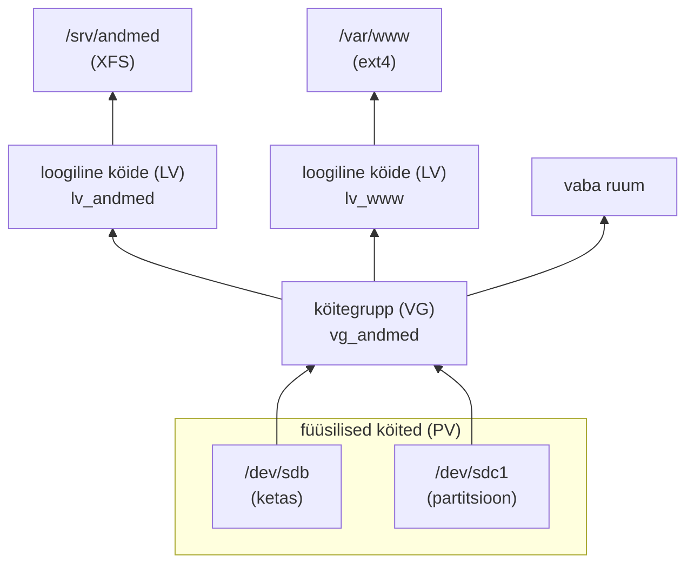
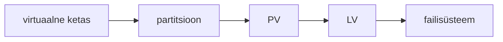
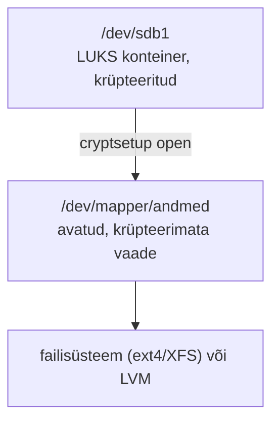

<!-- navigatsioon -->
[← Moodul 7. Enesekontroll](../moodul-07-vork-ssh/enesekontroll.md) · [Sisukord](../../README.md#sisukord) · [Laboritöö 8. Kettad, failisüsteemid ja LVM →](labor.md)
<!-- /navigatsioon -->

# Moodul 8. Kettad, failisüsteemid ja LVM

**Maht:** 8 tundi · **Laboritöö:** AlmaLinux · **Eeldused:** moodulid 1–7
## Õpiväljundid

Mooduli läbinud õppija:

- tuvastab süsteemi plokkseadmed, partitsioonid ja failisüsteemid;
- selgitab MBR- ja GPT-partitsioonitabeli erinevust;
- loob partitsioone ja failisüsteeme;
- haagib failisüsteeme ajutiselt ja püsivalt (`/etc/fstab`);
- loob ja haldab saaleala (swap);
- selgitab LVM-i ülesehitust ning loob, laiendab ja haldab loogilisi köiteid;
- jälgib kettakasutust ja leiab, mis ketast täidab;
- suurendab virtuaalmasina ketast ja failisüsteemi;
- krüpteerib ketta LUKS-iga ja seadistab selle püsiva avamise.

> [!NOTE]
> **Kuidas seda lehte lugeda:** iga teema algab kastiga **Lühidalt** - seal on kõige tähtsam paari lausega. Käsud ja näited on alati näha. Pikemad selgitused ja taust on peidetud plokkidesse **Loe lähemalt** - ava need, kui tahad teemast rohkem teada või kui laboritöös midagi ei õnnestu.

---
## 8.1 Plokkseadmed

> [!TIP]
> **Lühidalt:** Kettad on **plokkseadmed** kataloogis `/dev` (nt `/dev/sda`, `/dev/vda`, `/dev/nvme0n1`). `lsblk` näitab kettaid, partitsioone ja haakepunkte.

Kettaid nimetatakse Linuxis **plokkseadmeteks** (*block devices*), sest andmeid loetakse ja kirjutatakse plokkide kaupa. Iga seade on esitatud failina kataloogis `/dev`.

| Nimi | Seade |
|---|---|
| `/dev/sda`, `/dev/sdb`, … | SATA-, SAS- ja USB-kettad, samuti VirtIO SCSI virtuaalkettad (Proxmoxi vaikimisi) |
| `/dev/vda`, `/dev/vdb`, … | VirtIO Block virtuaalkettad |
| `/dev/nvme0n1`, `/dev/nvme1n1` | NVMe SSD-kettad |
| `/dev/sr0` | CD/DVD-seade |

Partitsioonid tähistatakse numbriga: `/dev/sda1`, `/dev/sda2`, `/dev/vdb1`. NVMe-ketastel lisatakse täht `p`: `/dev/nvme0n1p1`.

> [!WARNING]
> **Seadme nimi võib muutuda!** Kui lisad või eemaldad kettaid, võib `/dev/sdb` järgmisel alglaadimisel olla hoopis `/dev/sdc`. Seepärast kasutatakse püsivas seadistuses **UUID-d** (vt punkt 8.5).

### Seadmete uurimine

```bash
lsblk                        # kõik plokkseadmed puuna
lsblk -f                     # koos failisüsteemide ja UUID-dega
sudo blkid                   # failisüsteemide UUID-d ja tüübid
sudo fdisk -l                # kõik kettad ja partitsioonid
df -h                        # haagitud failisüsteemid ja vaba ruum
findmnt                      # haakimispunktid puuna
```

`lsblk` väljund AlmaLinuxi virtuaalmasinas:

```text
NAME               MAJ:MIN RM  SIZE RO TYPE MOUNTPOINTS
sda                  8:0    0   20G  0 disk
├─sda1               8:1    0    1M  0 part
├─sda2               8:2    0    1G  0 part /boot
└─sda3               8:3    0   19G  0 part
  ├─almalinux-root 253:0    0   17G  0 lvm  /
  └─almalinux-swap 253:1    0    2G  0 lvm  [SWAP]
sdb                  8:16   0    5G  0 disk
sr0                 11:0    1  1.0G  0 rom
```

Siin on näha, et süsteemiketas `sda` on jagatud kolmeks partitsiooniks ja kolmas partitsioon on LVM-i all jagatud juur- ja saalealaks. Ketas `sdb` on tühi.
## 8.2 Partitsioonitabelid

> [!TIP]
> **Lühidalt:** Ketas jagatakse partitsioonideks. Tänapäeval kasutatakse **GPT**-d (vanem MBR). Partitsioone loovad `fdisk`, `gdisk` ja `parted`.

Ketas jagatakse **partitsioonideks**, mille kirjeldus on ketta alguses **partitsioonitabelis**.

| | **MBR** (*Master Boot Record*) | **GPT** (*GUID Partition Table*) |
|---|---|---|
| Vanus | 1983 | 2000. aastad, osa UEFI standardist |
| Ketta maksimaalne suurus | 2 TiB | Praktiliselt piiramatu |
| Partitsioonide arv | 4 primaarset (või 3 + laiendatud) | 128 |
| Varukoopia | Ei ole | Tabeli koopia ketta lõpus |
| Alglaadimine | BIOS | UEFI (ja BIOS) |

**Uutel ketastel kasuta GPT-d.** MBR-i kohtad vanades süsteemides ja väikestel USB-mäludel.

### Partitsioonide loomine

Partitsioonide loomiseks on mitu tööriista:

| Tööriist | Iseloomustus |
|---|---|
| `fdisk` | Interaktiivne, menüüpõhine, toetab MBR-i ja GPT-d |
| `parted` | Toetab GPT-d, sobib ka skriptidesse (võti `-s`) |
| `gdisk` | Interaktiivne GPT-tööriist |

**fdisk** (interaktiivne):

```bash
sudo fdisk /dev/sdb
```

| Klahv | Tegevus |
|---|---|
| `p` | Näita partitsioone |
| `g` | Loo uus tühi GPT-tabel |
| `n` | Uus partitsioon |
| `t` | Muuda partitsiooni tüüpi (nt Linux LVM) |
| `d` | Kustuta partitsioon |
| `w` | Kirjuta muudatused kettale ja välju |
| `q` | Välju muudatusi salvestamata |

`fdisk` ei muuda midagi enne, kui vajutad `w`. Kuni selleni saab alati `q`-ga katkestada.

**parted** (sobib skriptidesse):

```bash
sudo parted -s /dev/sdb mklabel gpt
sudo parted -s /dev/sdb mkpart andmed ext4 1MiB 2GiB
sudo parted -s /dev/sdb mkpart arhiiv xfs 2GiB 100%
sudo parted /dev/sdb print
```

GPT puhul on `mkpart` esimene argument partitsiooni nimi, teine failisüsteemi tüübi vihje (failisüsteemi `parted` ise ei loo), seejärel algus ja lõpp. Partitsioonide algus 1 MiB juures tagab, et need on kettaplokkide suhtes õigesti joondatud.

Pärast partitsioonide muutmist kontrolli tulemust käsuga `lsblk`. Kui kernel uusi partitsioone kohe ei näe, käivita `sudo partprobe /dev/sdb`.

> [!WARNING]
> **Hoiatus:** partitsioonitööriist teeb täpselt seda, mida käsid. Vale ketta tähe korral kustutad töötava süsteemi andmed. **Kontrolli enne iga muudatust `lsblk`-iga, et töötad õige kettaga.**
## 8.3 Failisüsteemid

> [!TIP]
> **Lühidalt:** Failisüsteem korraldab andmed partitsioonil. Linuxis on levinud **ext4** ja **XFS**. Loomine: `mkfs.ext4 /dev/sdb1` - see kustutab kõik andmed.

**Failisüsteem** määrab, kuidas faile ja katalooge partitsioonil hoitakse. Enne kasutamist tuleb partitsioonile failisüsteem luua (**vormindada**).

| Failisüsteem | Iseloomustus | Kus vaikimisi |
|---|---|---|
| **ext4** | Väga levinud, töökindel, saab suurendada ja vähendada | Debian, Ubuntu |
| **XFS** | Suurte failide ja ketaste jaoks, väga hea jõudlus. **Saab ainult suurendada, mitte vähendada** | AlmaLinux, RHEL |
| **Btrfs** | Hetktõmmised, pakkimine, sisseehitatud RAID | Fedora, openSUSE |
| **vfat** (FAT32) | Ühildub kõigi operatsioonisüsteemidega, kasutatakse UEFI alglaadimispartitsioonil ja USB-mäludel | `/boot/efi` |
| **swap** | Saaleala, mitte tavaline failisüsteem | - |

Ext4, XFS ja Btrfs on **žurnaalivad** failisüsteemid: muudatused kirjutatakse kõigepealt žurnaali, mistõttu failisüsteem ei rikne voolukatkestuse korral.

```bash
sudo mkfs.ext4 /dev/sdb1                     # loo ext4
sudo mkfs.xfs /dev/sdb2                      # loo XFS
sudo mkfs.ext4 -L andmed /dev/sdb1           # koos sildiga (label)
sudo mkfs.xfs -f /dev/sdb2                   # -f: kirjuta olemasolev failisüsteem üle
```

> [!WARNING]
> **Vormindamine kustutab kõik partitsioonil olevad andmed.**

Failisüsteemi kontroll ja parandamine (failisüsteem peab olema **haakimata**):

```bash
sudo fsck.ext4 -f /dev/sdb1                  # ext4
sudo xfs_repair /dev/sdb2                    # XFS
```

FAT32-failisüsteemi (nt USB-mälu või UEFI partitsiooni jaoks) loob `mkfs.vfat` (pakett `dosfstools`):

```bash
sudo mkfs.vfat -F 32 -n USB /dev/sdc1        # FAT32, silt USB
```

Olemasoleva failisüsteemi andmeid ja seadeid näeb ning muudab ilma vormindamata:

```bash
sudo dumpe2fs -h /dev/sdb1                   # ext4 ülevaade: UUID, plokid, i-sõlmed, viimane kontroll
sudo tune2fs -L varu /dev/sdb1               # ext4: muuda silti
sudo tune2fs -m 1 /dev/sdb1                  # ext4: juurkasutajale reserveeritud ruum 5% asemel 1%
sudo tune2fs -c 30 /dev/sdb1                 # ext4: kontroll iga 30 haakimise järel
sudo xfs_admin -L logid /dev/sdb2            # XFS: muuda silti (haakimata)
sudo xfs_info /dev/sdb2                      # XFS ülevaade
```

ext4 jätab vaikimisi 5% ruumist juurkasutajale, et süsteem töötaks ka siis, kui tavakasutajad on ketta täis kirjutanud. Suurel andmekettal on see palju raisatud ruumi, seepärast vähendatakse seda sageli (`tune2fs -m`).
## 8.4 Haakimine

> [!TIP]
> **Lühidalt:** Failisüsteem haagitakse kataloogi: `mount /dev/sdb1 /mnt/andmed`, lahti `umount`. `findmnt` ja `df -h` näitavad haagitud failisüsteeme.

Failisüsteemi kasutamiseks tuleb see **haakida** (*mount*) mõnda kataloogi - **haakepunkti**. Pärast haakimist on failisüsteemi sisu selles kataloogis nähtav.

```bash
sudo mkdir -p /mnt/andmed
sudo mount /dev/sdb1 /mnt/andmed             # haagi
df -h /mnt/andmed                            # kontrolli
sudo umount /mnt/andmed                      # haagi lahti
```

Kui haakepunktis oli enne faile, ei ole need pärast haakimist nähtavad (kuid ei kao - need tulevad lahtihaakimisel tagasi).

Kui `umount` annab vea `target is busy`, kasutab mõni protsess seda failisüsteemi (näiteks sinu kest on selles kataloogis). Kes seda kasutab:

```bash
sudo fuser -vm /mnt/andmed
sudo lsof +f -- /mnt/andmed
```

Haakimisvalikud:

```bash
sudo mount -o ro /dev/sdb1 /mnt/andmed       # ainult lugemiseks
sudo mount -o remount,rw /mnt/andmed         # haagi uuesti kirjutamiseks
```
## 8.5 Püsiv haakimine: /etc/fstab

> [!TIP]
> **Lühidalt:** Püsivalt haagitakse failisüsteemid failis `/etc/fstab`, eelistatult **UUID** järgi. Kontrolli alati `sudo mount -a` ja `findmnt --verify` enne taaskäivitust.

Käsuga `mount` haagitud failisüsteem kaob taaskäivitusel. Püsiv haakimine kirjeldatakse failis **`/etc/fstab`**:

```text
# seade                                    haakepunkt    tüüp  valikud          dump  fsck
UUID=7746b4aa-dffc-47bd-9f2e-db9e95649cbe  /mnt/andmed   ext4  defaults,nofail  0     2
UUID=3f1c9a52-81d0-4e6b-b0a1-6d2f7a9c1e45  /srv/arhiiv   xfs   defaults,nofail  0     0
/dev/mapper/almalinux-swap                 none          swap  defaults         0     0
```

| Väli | Tähendus |
|---|---|
| Seade | `UUID=...` (soovitatav), `LABEL=...` või LVM-i köite tee |
| Haakepunkt | Kataloog, kuhu haagitakse (saalealal `none`) |
| Tüüp | `ext4`, `xfs`, `swap`, `nfs` jne |
| Valikud | `defaults` või komadega eraldatud loend (vt allpool) |
| dump | Vananenud varundusseade, alati `0` |
| fsck | Kontrollimise järjekord alglaadimisel: `1` juurfailisüsteem, `2` muud ext4, `0` ära kontrolli (XFS-il alati `0`) |

Olulisemad valikud:

| Valik | Tähendus |
|---|---|
| `defaults` | Tavalised vaikesätted |
| `nofail` | Kui seadet pole, jätka alglaadimist (oluline lisaketaste puhul!) |
| `ro` | Ainult lugemiseks |
| `noexec` | Keela programmide käivitamine sellelt failisüsteemilt |
| `noatime` | Ära uuenda faili lugemisaega (vähem kirjutamist) |

UUID leiad käsuga `lsblk -f` või `sudo blkid /dev/sdb1`.

**Pärast `fstab`-i muutmist kontrolli alati enne taaskäivitust:**

```bash
sudo findmnt --verify                # kontrolli fstab-i vigu
sudo systemctl daemon-reload         # systemd loeb fstab-i uuesti
sudo mount -a                        # haagi kõik fstab-is olevad, mis pole veel haagitud
df -h
```

> [!WARNING]
> **Vigane fstab võib takistada süsteemi käivitumist!** Kui alglaadimisel ei leita seadet, mis ei ole märgitud valikuga `nofail`, satub süsteem hädaolukorra režiimi (*emergency mode*), kust saab parandada ainult konsooli kaudu. Seepärast: kasuta lisaketastel `nofail`, kontrolli muudatusi `findmnt --verify` ja `mount -a` abil ning hoia konsool käepärast.
## 8.6 Saaleala (swap)

> [!TIP]
> **Lühidalt:** Saaleala (swap) on kettal asuv mälu varuks. Seda saab teha partitsioonina või failina (`mkswap`, `swapon`).

**Saaleala** on kettaruum, kuhu kernel tõstab vähe kasutatud mäluosad, kui füüsiline mälu (RAM) saab otsa. See on palju aeglasem kui RAM, kuid hoiab ära programmide kokkujooksmise mälupuuduse korral.

```bash
swapon --show                        # aktiivsed saalealad
free -h                              # mälu ja saaleala kasutus
```

Saaleala võib olla partitsioon, LVM-i köide või fail. **Saalefaili** loomine:

```bash
sudo dd if=/dev/zero of=/swapfile bs=1M count=1024   # 1 GiB fail
sudo chmod 600 /swapfile                             # ainult juurkasutaja!
sudo mkswap /swapfile
sudo swapon /swapfile
```

Püsivaks muutmiseks lisa faili `/etc/fstab` rida:

```text
/swapfile  none  swap  defaults  0  0
```

Kui palju saaleala on vaja, sõltub kasutusest. Serveritel on tavaliselt piisav 1–4 GiB. Kui server kasutab saaleala pidevalt ja palju, on vaja rohkem mälu, mitte rohkem saaleala.
## 8.7 LVM

> [!TIP]
> **Lühidalt:** LVM paneb kettad kokku **köiterühma**, millest luuakse paindlikke **loogilisi köiteid**. Köidet saab hiljem suurendada ilma partitsioone muutmata.

Tavalise partitsiooni suurust on raske muuta: partitsiooni taga ei pruugi olla vaba ruumi ja mitut ketast ühte partitsiooni ühendada ei saa. **LVM** (*Logical Volume Manager*) lisab ketaste ja failisüsteemide vahele paindliku kihi.



| Kiht | Selgitus | Käsud |
|---|---|---|
| **PV** (*Physical Volume*) | Ketas või partitsioon, mis on LVM-i jaoks ette valmistatud | `pvcreate`, `pvs`, `pvdisplay` |
| **VG** (*Volume Group*) | Ühe või mitme PV kogu ruum ühes „kotis“ | `vgcreate`, `vgextend`, `vgs`, `vgdisplay` |
| **LV** (*Logical Volume*) | VG-st eraldatud osa, mida kasutatakse nagu partitsiooni | `lvcreate`, `lvextend`, `lvs`, `lvdisplay` |

**LVM-i eelised:**

- köidet saab suurendada töö ajal, ilma masinat seiskamata;
- köitegruppi saab lisada uusi kettaid;
- köide võib ulatuda üle mitme füüsilise ketta;
- **hetktõmmised** (*snapshots*) - köite seisu saab jäädvustada näiteks enne uuendust.

AlmaLinux ja Ubuntu Server kasutavad vaikimisi paigaldusel LVM-i.

### LVM-i loomine

```bash
sudo pvcreate /dev/sdb                           # 1. valmista ketas ette
sudo vgcreate vg_andmed /dev/sdb                 # 2. loo köitegrupp
sudo lvcreate -n lv_andmed -L 2G vg_andmed       # 3. loo 2 GiB köide
sudo mkfs.xfs /dev/vg_andmed/lv_andmed           # 4. loo failisüsteem
sudo mkdir -p /srv/andmed
sudo mount /dev/vg_andmed/lv_andmed /srv/andmed  # 5. haagi
```

Köite tee on kujul `/dev/VG/LV` või `/dev/mapper/VG-LV` - mõlemad viitavad samale seadmele.

Ülevaade:

```bash
sudo pvs                     # füüsilised köited
sudo vgs                     # köitegrupid (veerg VFree näitab vaba ruumi)
sudo lvs                     # loogilised köited
```

Köite suuruse saab anda ka protsendina: `-l 100%FREE` (kogu vaba ruum) või `-l 50%VG`.

### Köite suurendamine

```bash
sudo lvextend -r -L +1G /dev/vg_andmed/lv_andmed       # suurenda 1 GiB võrra
sudo lvextend -r -l +100%FREE /dev/vg_andmed/lv_andmed # kasuta kogu vaba ruum
```

Võti **`-r`** (*resizefs*) suurendab koos köitega ka failisüsteemi. Ilma selleta tuleb failisüsteem eraldi suurendada: `xfs_growfs /srv/andmed` (XFS) või `resize2fs /dev/vg_andmed/lv_andmed` (ext4).

### Uue ketta lisamine

Kui köitegrupis ruum otsa saab:

```bash
sudo pvcreate /dev/sdc
sudo vgextend vg_andmed /dev/sdc
sudo lvextend -r -l +100%FREE /dev/vg_andmed/lv_andmed
```

Kõik see toimub töö ajal - failisüsteem võib olla haagitud ja kasutusel.

### Köite vähendamine

Ext4 köidet saab vähendada (`lvreduce -r`), kuid ainult haakimata olekus ja see on riskantne. **XFS-i ei saa üldse vähendada.** Seepärast on hea tava jätta köitegruppi vaba ruumi ja suurendada köiteid alles siis, kui vaja.

### Hetktõmmised

```bash
sudo lvcreate -s -n lv_andmed_snap -L 500M /dev/vg_andmed/lv_andmed
```

Hetktõmmis salvestab ainult muudatused, mistõttu see vajab vähe ruumi. See sobib lühiajaliseks kasutamiseks (nt enne riskantset uuendust või järjepideva varukoopia tegemiseks), mitte varukoopia asenduseks - kui algne ketas rikneb, kaob ka hetktõmmis.

### Kustutamine

```bash
sudo umount /srv/andmed
sudo lvremove /dev/vg_andmed/lv_andmed
sudo vgremove vg_andmed
sudo pvremove /dev/sdb
```
## 8.8 Kettakasutuse jälgimine

> [!TIP]
> **Lühidalt:** `df -h` näitab vaba ruumi failisüsteemides, `du -sh *` kataloogide suurust. Täis ketas peatab teenused - jälgi seda.

```bash
df -h                        # failisüsteemide täituvus
df -i                        # i-sõlmede kasutus (ketas võib olla „täis“ ka siis, kui baite on vaba)
du -sh /var/log              # kataloogi suurus
du -h --max-depth=1 /var | sort -h      # alamkataloogide suurused
sudo ncdu /                  # interaktiivne analüüs (EPEL-ist AlmaLinuxis)
find / -xdev -type f -size +100M 2>/dev/null   # suured failid
```

`-xdev` piirab `find`-i ühe failisüsteemiga, et see ei läheks teistele haagitud ketastele.

Levinud põhjused, miks ketas täis saab:

- logifailid (`/var/log`, journal - `journalctl --disk-usage`);
- pakihalduri vahemälu (`apt clean`, `dnf clean all`);
- vanad kernelid ja varukoopiad;
- kustutatud fail, mida mõni protsess veel avatuna hoiab - ruum vabaneb alles protsessi lõppedes (`sudo lsof +L1`).
## 8.9 Virtuaalmasina ketta suurendamine

> [!TIP]
> **Lühidalt:** Virtuaalmasina ketta suurendamine: suurenda ketast hüperviisoris, siis partitsiooni (`growpart`), LVM-i ja failisüsteemi.

Virtualiseerimisplatvormil (nt Proxmox) saab virtuaalset ketast suurendada. Seejärel tuleb järjest suurendada kõiki kihte:



Näide AlmaLinuxis, kus `sda3` on LVM-i PV:

```bash
lsblk                                         # kontrolli, et ketas on suurem
sudo growpart /dev/sda 3                      # suurenda partitsioon 3 (pakett cloud-utils-growpart)
sudo pvresize /dev/sda3                       # suurenda PV
sudo lvextend -r -l +100%FREE /dev/almalinux/root   # suurenda LV ja failisüsteemi
df -h /
```

Ilma LVM-ita: `growpart`, seejärel `resize2fs` (ext4) või `xfs_growfs` (XFS).
## 8.10 Ketta krüpteerimine: LUKS

> [!TIP]
> **Lühidalt:** **LUKS** krüpteerib terve ketta või partitsiooni. Ilma paroolita on andmed loetamatud, näiteks varastatud sülearvutis või kõrvaldatud kettal.

Kui sülearvuti varastatakse või serveri ketas visatakse ära ilma kustutamata, saab igaüks selle andmeid lugeda - failiõigused kehtivad ainult töötavas süsteemis. **LUKS** (*Linux Unified Key Setup*) krüpteerib terve partitsiooni või ketta. Avamiseks on vaja parooli või võtmefaili.



Krüpteeritud lisaketas:

```bash
sudo dnf install cryptsetup                      # Debian/Ubuntu: sudo apt install cryptsetup
sudo cryptsetup luksFormat /dev/sdb1             # KUSTUTAB partitsiooni sisu! Küsib parooli
sudo cryptsetup open /dev/sdb1 andmed            # avab seadmena /dev/mapper/andmed
sudo mkfs.ext4 /dev/mapper/andmed
sudo mkdir -p /srv/salajane
sudo mount /dev/mapper/andmed /srv/salajane
sudo cryptsetup luksDump /dev/sdb1               # päis: algoritm, võtmepesad
sudo umount /srv/salajane && sudo cryptsetup close andmed
```

Püsiv avamine alglaadimisel käib failide `/etc/crypttab` ja `/etc/fstab` kaudu:

```text
# /etc/crypttab:  nimi   seade                    võti    valikud
andmed            UUID=<luks-partitsiooni-UUID>   none    luks
```

```text
# /etc/fstab
/dev/mapper/andmed  /srv/salajane  ext4  defaults,nofail  0 2
```

Väärtus `none` tähendab, et parooli küsitakse alglaadimisel konsoolis. Serveris kasutatakse sageli **võtmefaili** (`/root/andmed.key`, õigused `400`, lisatakse käsuga `cryptsetup luksAddKey`) või võrgust avamist (Clevis + Tang, TPM).

Võtmepesad: LUKS-il on mitu pesa - igaüks oma parooli või võtmefailiga. Lisa varuparool (`cryptsetup luksAddKey`) ja hoia päise varukoopiat (`cryptsetup luksHeaderBackup`). **Kui kõik paroolid ja päis on kadunud, on andmed jäädavalt kadunud.**

Süsteemiketta krüpteerimine valitakse tavaliselt **paigaldamisel** (Debian ja Ubuntu: „Guided - use entire disk and set up encrypted LVM“; AlmaLinux: „Encrypt my data“). Sülearvutite puhul on see hea tava ja paljudes asutustes kohustuslik.

> [!NOTE]
> **Virtuaalmasinas** tähendab krüpteerimine, et hüperviisori administraator ei näe kettatõmmisest andmeid, kuid töötava masina mälus on võti olemas. Krüpteerimine kaitseb peamiselt **seisvaid andmeid** (*data at rest*).

---

## 8.11 Edasi: RAID, ZFS ja salvestuse süvendus

> [!TIP]
> **Lühidalt:** RAID, ZFS ja salvestuse süvendus on moodulis 10.

Mitme ketta ühendamine töökindluseks (RAID, `mdadm`), ZFS, ketaste jõudluse ja tervise mõõtmine ning andmete taastamine on **moodulis 10**.

---

## Distrode erinevused

| | **Debian** | **Ubuntu** | **AlmaLinux** |
|---|---|---|---|
| Vaikimisi failisüsteem | ext4 | ext4 | XFS |
| LVM vaikepaigaldusel | Ei (valikuline) | Jah (`ubuntu-vg/ubuntu-lv`) | Jah (`almalinux/root`, `almalinux/swap`) |
| Saaleala vaikimisi | Partitsioon | Saalefail `/swap.img` | LVM-i köide |
| `growpart` pakett | `cloud-guest-utils` | `cloud-guest-utils` | `cloud-utils-growpart` |
| Krüpteerimine paigaldusel | „encrypted LVM“ | „encrypted LVM“ | „Encrypt my data“ |

> [!WARNING]
> **Ubuntu Serveri lõks:** Ubuntu paigaldusprogramm jätab LVM-i kasutades suure ketta korral osa köitegrupist kasutamata. Kui `df -h /` näitab oodatust väiksemat juurfailisüsteemi, kontrolli `sudo vgs` veergu `VFree` ja suurenda köidet: `sudo lvextend -r -l +100%FREE /dev/ubuntu-vg/ubuntu-lv`.

<details>
<summary>Loe lähemalt: Kuidas on see FreeBSD-s?</summary>

FreeBSD-s on samad mõisted (ketas, partitsioon, failisüsteem, haakimine, `/etc/fstab`, saaleala), kuid tööriistad on teised. LVM-i FreeBSD-s pole: selle asemel on modulaarne kettakiht **GEOM** ja eelkõige **ZFS**, mida paigaldaja pakub vaikimisi (vt moodul 29, punkt 29.9).

| | Linux | FreeBSD |
|---|---|---|
| Ketaste nimed | `/dev/sda`, `/dev/vda`, `/dev/nvme0n1` | `/dev/ada0`, `/dev/da0`, `/dev/vtbd0`, `/dev/nda0` |
| Ketaste ülevaade | `lsblk` | `geom disk list`, `gpart show` |
| Partitsioonid | `fdisk`, `gdisk`, `parted` | `gpart create -s gpt`, `gpart add -t freebsd-ufs` |
| Klassikaline failisüsteem | ext4, XFS | UFS (`newfs -U`) |
| Köitehaldus | LVM | ZFS (või GEOM-i klassid, nt `gmirror`) |
| Ketta krüpteerimine | LUKS (`cryptsetup`) | GELI (`geli`) |
| Vaba ruum | `df -h`, `du -sh` | samad käsud; ZFS-il ka `zfs list` |

`fstab`-is kasutatakse UUID asemel sageli GPT silte (`/dev/gpt/andmed`), mille annab `gpart add -l andmed`.

</details>

---
## Kokkuvõte

| Käsk | Tegevus |
|---|---|
| `lsblk -f`, `blkid`, `fdisk -l` | Ketaste, partitsioonide ja failisüsteemide info |
| `fdisk`, `parted` | Partitsioonid |
| `mkfs.ext4`, `mkfs.xfs` | Failisüsteemi loomine |
| `mount`, `umount`, `findmnt` | Haakimine |
| `/etc/fstab`, `findmnt --verify`, `mount -a` | Püsiv haakimine |
| `mkswap`, `swapon`, `free -h` | Saaleala |
| `pvcreate`, `vgcreate`, `lvcreate` | LVM-i loomine |
| `pvs`, `vgs`, `lvs` | LVM-i ülevaade |
| `vgextend`, `lvextend -r` | LVM-i laiendamine |
| `df -h`, `du -sh`, `ncdu` | Kettakasutus |
| `growpart`, `pvresize`, `xfs_growfs`, `resize2fs` | Suurendamine |
| `cryptsetup luksFormat/open/close`, `/etc/crypttab` | Ketta krüpteerimine |

**Järgmised sammud:** tee [laboritöö](labor.md) ja kontrolli oma teadmisi [enesekontrolli](enesekontroll.md) abil.
## Lisamaterjal

- Red Hat Enterprise Linux dokumentatsioon - „Managing file systems“, „Configuring and managing logical volumes“ (docs.redhat.com)
- Arch Wiki - Partitioning, Fstab, LVM, Swap (wiki.archlinux.org)
- Brian Ward, „How Linux Works“ - ketaste ja failisüsteemide peatükk

<!-- navigatsioon -->
---

[← Moodul 7. Enesekontroll](../moodul-07-vork-ssh/enesekontroll.md) · [Sisukord](../../README.md#sisukord) · [Laboritöö 8. Kettad, failisüsteemid ja LVM →](labor.md)
<!-- /navigatsioon -->
