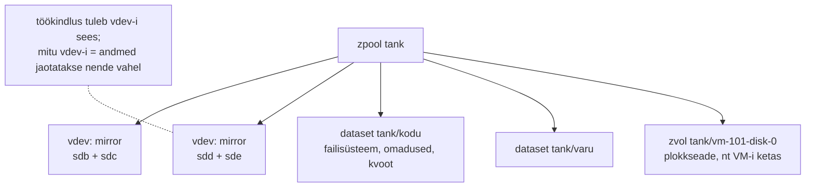

# Moodul 9. Salvestus: RAID, ZFS, jõudlus ja taastamine

**Maht:** 8 tundi · **Laboritöö:** AlmaLinux ja Ubuntu · **Eeldused:** moodul 8

## Õpiväljundid

Mooduli läbinud õppija:

- võrdleb RAID-i tasemeid ning riistvaralist ja tarkvaralist RAID-i;
- loob ja haldab tarkvaralist RAID-i tööriistaga `mdadm` ning vahetab rikkis ketta;
- selgitab ZFS-i põhimõtteid (pool, vdev, dataset, hetktõmmis) ja kasutab selle põhikäske;
- mõõdab ketta jõudlust tööriistadega `dd` ja `fio` ning tõlgendab tulemusi;
- jälgib ketaste tervist SMART-iga;
- taastab kadunud partitsioonitabeli TestDiskiga ja kirjeldab andmete taastamise reegleid.

---

## 9.1 RAID ja mdadm

**RAID** (*Redundant Array of Independent Disks*) ühendab mitu ketast, et saavutada töökindlus või kiirus.

| Tase | Põhimõte | Ketaste arv | Talub rikkeid | Kasulik maht |
|---|---|---|---|---|
| RAID 0 | Andmed jaotatakse ketaste vahel | ≥ 2 | 0 | 100% |
| RAID 1 | Peegeldus: sama info mõlemal kettal | ≥ 2 | n − 1 | 1 ketas |
| RAID 5 | Jaotus + paarsus | ≥ 3 | 1 | n − 1 ketast |
| RAID 6 | Jaotus + topeltpaarsus | ≥ 4 | 2 | n − 2 ketast |
| RAID 10 | Peegeldatud paaride jaotus | ≥ 4 | 1 igast paarist | 50% |

RAID-i saab teha kolmel tasemel:

| | Riistvaraline RAID | Tarkvaraline RAID (`mdadm`) | ZFS / Btrfs |
|---|---|---|---|
| Kus | RAID-kontroller serveris (oma protsessor, sageli akuga vahemälu) | Linuxi kernel | failisüsteem ise |
| Plussid | läbipaistev OS-ile, jõudlus | tasuta, kontrollerist sõltumatu - kettad saab tõsta teise masinasse | kontrollsummad, hetktõmmised, parandab vigu ise |
| Miinused | kontrolleri rike vajab sama kontrollerit, OS ei näe ketaste tervist | kasutab protsessorit, ei tea andmete õigsusest | vajab mälu, ZFS ei ole kernelis |

Tarkvaraline RAID 1 kahest kettast:

```bash
sudo dnf install mdadm                     # Debian/Ubuntu: sudo apt install mdadm
sudo mdadm --create /dev/md0 --level=1 --raid-devices=2 /dev/sdb /dev/sdc
cat /proc/mdstat                           # sünkroniseerimise edenemine
sudo mdadm --detail /dev/md0
sudo mkfs.xfs /dev/md0
sudo mdadm --detail --scan | sudo tee -a /etc/mdadm.conf    # Debian/Ubuntu: /etc/mdadm/mdadm.conf
```

Ketta rike ja vahetus:

```bash
sudo mdadm /dev/md0 --fail /dev/sdc        # märgi ketas rikkis (harjutamiseks)
sudo mdadm /dev/md0 --remove /dev/sdc
sudo mdadm /dev/md0 --add /dev/sdd         # uus ketas, algab taastamine (rebuild)
```

Massiivi saab kasutada otse failisüsteemina või LVM-i PV-na (moodul 8). Debianis ja Ubuntus uuenda pärast `mdadm.conf` muutmist initramfs: `sudo update-initramfs -u`.

> [!WARNING]
> **RAID ei ole varukoopia!** RAID kaitseb ketta rikke eest, kuid mitte kogemata kustutamise, viiruse, lunavara ega tulekahju eest.

## 9.2 ZFS

**ZFS** (algselt Sun Microsystems, 2005; tänapäeval avatud projekt **OpenZFS**) on failisüsteem ja köitehaldur ühes: see teeb ühe tööriistaga ära selle, milleks muidu on vaja `mdadm`-i (RAID), LVM-i ja failisüsteemi. ZFS-i kasutavad näiteks **Proxmox VE** (sh kõik HKHK Proxmoxi sõlmed), **TrueNAS** ja FreeBSD.

Põhiomadused:

- **Kontrollsummad kõigil andmetel** - ZFS märkab vaikset andmeriknemist (*bit rot*) ja parandab selle peegli või paarsuse abil automaatselt;
- **copy-on-write** - andmeid ei kirjutata kunagi üle, vaid uude kohta; failisüsteem ei satu elektrikatkestusel poolikusse olekusse (pole vaja `fsck`-i);
- **hetktõmmised** on hetkelised ja võtavad ruumi ainult muudatuste jagu;
- **`zfs send` / `zfs receive`** - hetktõmmiste kopeerimine teise masinasse (varundus, replikatsioon);
- **pakkimine** (vaikimisi `lz4` või `zstd`) on kiire ja sageli kiirendab kettatööd;
- **ARC** - nutikas lugemisvahemälu RAM-is.

### Mõisted



| Mõiste | Tähendus | LVM-i vaste |
|---|---|---|
| **pool** (*zpool*) | kõigi ketaste ühine ruum | VG |
| **vdev** | ketaste rühm: üksik ketas, `mirror`, `raidz1/2/3` | RAID-massiiv + PV |
| **dataset** | failisüsteem pooli sees, omadustega (pakkimine, kvoot, haakepunkt) | LV + failisüsteem |
| **zvol** | pooli sees olev plokkseade | LV |
| **snapshot** | dataset'i hetktõmmis, nt `tank/kodu@enne-uuendust` | LVM snapshot |

| vdev tüüp | Sarnane | Talub rikkeid | Märkus |
|---|---|---|---|
| `mirror` | RAID 1 | n − 1 ketast | kiireim, soovitatav VM-ide jaoks |
| `raidz1` | RAID 5 | 1 ketas | suurte ketastega riskantne (pikk taastamine) |
| `raidz2` | RAID 6 | 2 ketast | levinud NAS-ides (TrueNAS) |
| `raidz3` | - | 3 ketast | väga suured massiivid |

> [!WARNING]
> **Tähtis:** kui pool sisaldab mitut vdev-i ja **üks vdev** hävib, on kadunud **kogu pool**. Töökindlus tuleb tagada iga vdev-i sees (peegel või raidz). Varukoopiat ZFS ei asenda.

### Põhikäsud

```bash
sudo apt install zfsutils-linux          # Ubuntu; Debianis contrib-hoidlast: zfs-dkms zfsutils-linux

sudo zpool create tank mirror /dev/sdb /dev/sdc     # pärisketastel kasuta /dev/disk/by-id/… nimesid
zpool status                             # tervis, vead, scrub'i tulemused
zpool list                               # maht ja täituvus
sudo zpool scrub tank                    # loe kõik andmed ja kontrolli kontrollsummasid

sudo zfs create tank/kodu
sudo zfs set compression=zstd tank/kodu
sudo zfs set quota=10G tank/kodu
zfs list -o name,used,avail,compressratio,mountpoint
zfs get all tank/kodu | less

sudo zfs snapshot tank/kodu@enne-uuendust
zfs list -t snapshot
ls /tank/kodu/.zfs/snapshot/enne-uuendust/        # üksikute failide taastamine
sudo zfs rollback tank/kodu@enne-uuendust         # kogu dataset tagasi

sudo zfs send tank/kodu@enne-uuendust | ssh varuserver sudo zfs receive varu/kodu
```

Ketta vahetus peeglis: `sudo zpool replace tank /dev/sdc /dev/sdf` ja jälgi `zpool status` (*resilvering*).

### ZFS Proxmoxis ja TrueNASis

- **Proxmox VE:** paigaldaja pakub süsteemikettale ZFS-i (nt *ZFS RAID1*), pool nimega `rpool`. Virtuaalmasinate kettad on zvol-id (`rpool/data/vm-101-disk-0`), Proxmoxi hetktõmmised on ZFS-i hetktõmmised ja **Storage Replication** kasutab `zfs send`-i, et kopeerida VM-e teise sõlme. Mälu: ARC võtab vaikimisi kuni poole RAM-ist (uuemates versioonides väiksema piiriga) - seda saab piirata failis `/etc/modprobe.d/zfs.conf` (`options zfs zfs_arc_max=…`).
- **TrueNAS** (Community Edition põhineb Debianil, vanem CORE FreeBSD-l) on ZFS-ile ehitatud NAS: poolid, dataset'id, SMB- ja NFS-jagamised, automaatsed hetktõmmised ja replikatsioon on veebiliideses. TrueNASi kasutamist failiserverina käsitleb moodul 15 (punkt 15.2).

### ZFS eri distrodes

| | Debian | Ubuntu | AlmaLinux |
|---|---|---|---|
| ZFS-i tugi | `contrib` hoidlas, kernelimoodul kompileeritakse DKMS-iga | kernelis kaasas, `zfsutils-linux` | OpenZFS-i hoidlast (`zfs-release`), DKMS või kABI-moodul |
| Juurfailisüsteem ZFS-il | võimalik käsitsi | paigaldajas oli eksperimentaalne | ei ole tavapärane |

ZFS-i CDDL-litsents ei ühildu Linuxi kerneli GPL-iga, mistõttu ZFS ei ole kerneli osa. Seepärast eelistab Red Hat oma lahendusi (XFS, LVM, Stratis) ja Btrfs on Linuxi kernelis sisalduv sarnaste võimalustega alternatiiv (copy-on-write, hetktõmmised, kontrollsummad).

## 9.3 Ketta kiiruse mõõtmine

Ketta jõudlust on vaja hinnata, kui server on aeglane, kui võrreldakse salvestuslahendusi (kohalik SSD, Proxmoxi Ceph, iSCSI - moodul 19) või kui kahtlustatakse riistvara riket. Olulised näitajad:

| Näitaja | Tähendus | Kus oluline |
|---|---|---|
| **Läbilaskevõime** (MB/s) | järjestikune lugemine ja kirjutamine | suured failid, varukoopiad, video |
| **IOPS** | väikeste (4 KiB) juhuslike operatsioonide arv sekundis | andmebaasid, virtuaalmasinad |
| **Latentsus** (ms) | ühe operatsiooni ooteaeg | andmebaasid, interaktiivsed teenused |

### Kiire test: `dd`

```bash
# kirjutamine: 1 GiB, iga plokk sünkroonselt kettale (ei mõõda vahemälu)
dd if=/dev/zero of=/srv/testfail bs=1M count=1024 oflag=dsync status=progress

# kirjutamine: puhvri tühjendamine lõpus (realistlikum järjestikune kirjutus)
dd if=/dev/zero of=/srv/testfail bs=1M count=1024 conv=fdatasync

# lugemine: tühjenda enne lehevahemälu, muidu loetakse mälust
sync; echo 3 | sudo tee /proc/sys/vm/drop_caches
dd if=/srv/testfail of=/dev/null bs=1M status=progress

rm /srv/testfail
```

`dd` on igal pool olemas, kuid mõõdab ainult järjestikust kirjutamist ja lugemist ühe lõimega. `/dev/zero` andmed võivad pakkivas salvestuses (ZFS, mõned SSD-d) anda ebarealistlikult häid tulemusi.

> [!WARNING]
> **Hoiatus:** ära kunagi kasuta `dd` väljundiks seadet (`of=/dev/sdb`), kui sa ei taha selle sisu hävitada. Testi alati **faili** haagitud failisüsteemis.

### Põhjalik test: `fio`

`fio` (*Flexible I/O Tester*) on standardne tööriist, mis oskab simuleerida erinevaid koormusi.

```bash
sudo apt install fio        # AlmaLinux: sudo dnf install fio

# 4 KiB juhuslik lugemine ja kirjutamine (andmebaasilaadne koormus)
fio --name=juhuslik --filename=/srv/fio.test --size=1G \
    --rw=randrw --rwmixread=70 --bs=4k --iodepth=32 --numjobs=4 \
    --ioengine=libaio --direct=1 --runtime=60 --time_based --group_reporting

# järjestikune kirjutamine 1 MiB plokkidega
fio --name=jarjestikune --filename=/srv/fio.test --size=1G \
    --rw=write --bs=1M --iodepth=8 --ioengine=libaio --direct=1 --group_reporting

rm /srv/fio.test
```

| Valik | Tähendus |
|---|---|
| `--rw` | `read`, `write`, `randread`, `randwrite`, `randrw` |
| `--bs` | ploki suurus |
| `--iodepth` | samaaegsete päringute arv järjekorras |
| `--numjobs` | paralleelsete protsesside arv |
| `--direct=1` | möödub lehevahemälust (mõõdab ketast, mitte mälu) |
| `--ioengine=libaio` | Linuxi asünkroonne I/O |

Väljundis vaata ridu `read: IOPS=…, BW=…` ja `write: IOPS=…` ning latentsuse jaotust (`clat percentiles`).

### Jälgimine töö ajal

```bash
iostat -xz 2          # pakett sysstat: %util, r/s, w/s, await
sudo iotop            # millised protsessid kirjutavad
```

Tulemusi võrreldes kasuta **samu parameetreid**, korda testi mitu korda ja pane kirja keskkond (VM-i ketta seaded, vahemälu režiim Proxmoxis, failisüsteem).

## 9.4 Ketta tervis: SMART

Kettad annavad oma tervise kohta infot tehnoloogiaga **S.M.A.R.T.** Riknev ketas hakkab sageli enne lõplikku riket vigu näitama.

```bash
sudo apt install smartmontools            # AlmaLinux: sudo dnf install smartmontools
sudo smartctl -i /dev/sda                 # mudel, seerianumber, kas SMART on toetatud
sudo smartctl -H /dev/sda                 # kokkuvõte: PASSED / FAILED
sudo smartctl -a /dev/sda                 # kõik atribuudid ja vealogi
sudo smartctl -t short /dev/sda           # lühike enesetest (paar minutit)
sudo smartctl -a /dev/nvme0               # NVMe kettad
```

Olulised atribuudid (HDD/SATA SSD): `Reallocated_Sector_Ct`, `Current_Pending_Sector`, `Offline_Uncorrectable` - kui need kasvavad, tuleb ketas vahetada. NVMe puhul vaata `Percentage Used` ja `Media and Data Integrity Errors`.

Teenus `smartd` jälgib kettaid pidevalt ja saadab probleemist teate (`/etc/smartd.conf`, e-post - moodul 15). Proxmox ja TrueNAS näitavad SMART-i olekut veebiliideses.

> [!NOTE]
> **Virtuaalmasinas** ei ole SMART-i infot - virtuaalne ketas ei ole füüsiline seade. Ketaste tervist jälgitakse hüperviisori (Proxmoxi sõlme) tasemel.

## 9.5 Partitsioonide ja failide taastamine: TestDisk

Kui partitsioonitabel on kogemata kustutatud või üle kirjutatud (nt valele kettale tehtud `fdisk`), on andmed kettal tavaliselt veel alles - kadunud on ainult „sisukord“. **TestDisk** otsib kettalt failisüsteemide algusi ja taastab partitsioonitabeli. Sama projekti **PhotoRec** taastab üksikuid faile (pildid, dokumendid) ka siis, kui failisüsteem on rikutud.

```bash
sudo apt install testdisk      # AlmaLinux: EPEL-ist, sudo dnf install testdisk
sudo testdisk /dev/sdb
```

TestDiski töökäik (tekstimenüü):

1. **Create** - loo logifail `testdisk.log`;
2. vali ketas;
3. vali partitsioonitabeli tüüp (TestDisk pakub tavaliselt õige: *Intel* = MBR, *EFI GPT*);
4. **Analyse** → **Quick Search** - otsib partitsioone;
5. leitud partitsioonil vajuta **P**, et näha faile ja kontrollida, kas see on õige;
6. vajadusel **Deeper Search**;
7. **Write** - kirjuta taastatud partitsioonitabel kettale; taaskäivita või käivita `sudo partprobe`.

Andmete taastamise kuldreeglid:

- **ära kirjuta kahjustatud kettale midagi** - ei uut failisüsteemi, ei paigaldust, ei taastatud faile;
- võimalusel tee esmalt kettast koopia (`ddrescue` või VM-i puhul ketta kloon/hetktõmmis) ja tööta koopiaga;
- taastatud failid salvesta **teisele kettale**;
- TestDisk ei aita, kui andmed on üle kirjutatud või ketas on füüsiliselt rikkis - siis on abi ainult varukoopiast (moodul 15).

> [!NOTE]
> **Märkus:** TestDisk ja PhotoRec on olemas ka paljudel taastekettal (nt SystemRescue), sest süsteemiketta taastamisel ei tohi sellelt ketastelt süsteemi käivitada.

---

## Distrode erinevused

| | **Debian** | **Ubuntu** | **AlmaLinux** |
|---|---|---|---|
| `mdadm` seadistus | `/etc/mdadm/mdadm.conf` + `update-initramfs -u` | sama | `/etc/mdadm.conf` + `dracut -f` |
| ZFS | `contrib`, DKMS | kernelis kaasas (`zfsutils-linux`) | OpenZFS-i hoidla |
| Btrfs | jah | jah | ei ole RHEL-i kernelis toetatud |
| `fio`, `smartmontools`, `testdisk` | põhihoidlas | põhihoidlas | `fio`, `smartmontools` põhihoidlas, `testdisk` EPEL-is |

---

## Kokkuvõte

| Käsk | Tegevus |
|---|---|
| `mdadm --create`, `--detail`, `--fail`, `--add`, `cat /proc/mdstat` | Tarkvaraline RAID |
| `zpool create/status/scrub`, `zfs create/set/snapshot/rollback/send` | ZFS |
| `dd … oflag=dsync`, `fio`, `iostat -xz` | Jõudluse mõõtmine |
| `smartctl -H`, `smartctl -a`, `smartd` | Ketta tervis |
| `testdisk`, `photorec`, `ddrescue` | Partitsioonide ja failide taastamine |

**Järgmised sammud:** tee [laboritöö](labor.md) ja kontrolli oma teadmisi [enesekontrolli](enesekontroll.md) abil.

## Lisamaterjal

- OpenZFS dokumentatsioon (openzfs.github.io/openzfs-docs)
- Arch Wiki - RAID, ZFS, S.M.A.R.T., Benchmarking (wiki.archlinux.org)
- `man mdadm`, `man fio`, `man smartctl`
- TestDiski dokumentatsioon (cgsecurity.org)
