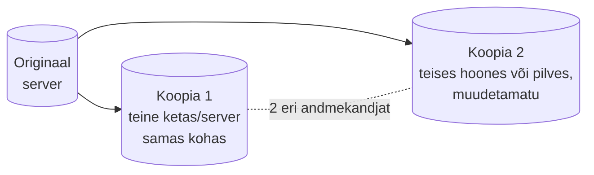

<!-- navigatsioon -->
[← Moodul 8. Enesekontroll](../moodul-08-kettad-lvm/enesekontroll.md) · [Sisukord](../../README.md#sisukord) · [Laboritöö 9. Varundus ja taastamine →](labor.md)
<!-- /navigatsioon -->

# Moodul 9. Varundus ja taastamine

**Maht:** 8 tundi · **Laboritöö:** Debian, Ubuntu · **Eeldused:** moodulid 1–8

> [!WARNING]
> **Varukoopia, mida ei ole proovitud taastada, ei ole varukoopia.**

Iga süsteemihaldur kaotab kunagi andmeid: ketas rikneb, keegi kustutab vale kataloogi, uuendus rikub seadistuse või lunavara krüpteerib serveri. Vahe on selles, kas see on ebameeldiv pärastlõuna või asutuse katastroof. Selles moodulis paneme kokku varem õpitu - `tar` (moodul 2), `rsync` ja SSH (moodul 7), skriptid (moodul 6), taimerid (moodul 5) ja kettad (moodul 8) - ning ehitame töökindla varunduse, mida oskame ka **taastada**.

Teenuste (veebisait, andmebaas, DNS, failiserver) eripärad on süvendusosa moodulites 15-18 - igaühes on oma alalõik varunduse kohta.

## Õpiväljundid

Mooduli läbinud õppija:

- selgitab, milliste ohtude eest varundus kaitseb ning miks RAID, hetktõmmis ja sünkroonimine ei ole varukoopia;
- planeerib varunduse 3-2-1 reegli ning taastamise eesmärkide (RPO, RTO) järgi;
- eristab täis-, juurdekasvu- ja diferentsiaalvarundust ning valib säilitamise reeglid;
- varundab ja taastab `tar`-iga ning `rsync`-iga teise masinasse;
- kirjutab varundusskripti, mis logib, kontrollib vigu ja kustutab vanad koopiad, ning ajastab selle systemd taimeriga;
- varundab ja taastab restic'uga kohalikku ja kaughoidlasse;
- teeb taastamistesti ja dokumenteerib taastamise sammud.

> [!NOTE]
> **Kuidas seda lehte lugeda:** iga teema algab kastiga **Lühidalt** - seal on kõige tähtsam paari lausega. Käsud ja näited on alati näha. Pikemad selgitused ja taust on peidetud plokkidesse **Loe lähemalt** - ava need, kui tahad teemast rohkem teada või kui laboritöös midagi ei õnnestu.

---

## 9.1 Miks varundada ja mis ei ole varukoopia?

> [!TIP]
> **Lühidalt:** Varundus kaitseb inimvea, rikke, lunavara ja õnnetuse eest. RAID, hetktõmmis ja sünkroonimine **ei ole** varukoopia.

| Oht | Näide | Kas RAID aitab? |
|---|---|---|
| Riistvara rike | ketas, kontroller, toiteplokk | Ketas: jah; muu: ei |
| **Inimviga** | `rm -rf` vales kataloogis, üle kirjutatud fail | Ei |
| Tarkvara viga | uuendus rikub andmebaasi, skript kustutab valed failid | Ei |
| **Lunavara** | ründaja krüpteerib serveri ja kõik, mida see näeb | Ei |
| Õnnetus | tulekahju, vesi, vargus, elektrikatkestus | Ei |
| Pahatahtlik siseringi tegevus | lahkuv töötaja kustutab andmed | Ei |

Varukoopia on **andmete eraldi koopia, mis on originaalist sõltumatu** ja millest saab taastada **varasema seisu**. Seetõttu ei ole varukoopia:

- **RAID** (moodul 10) - kaitseb ketta rikke eest, kuid kustutamine ja krüpteerimine jõuavad kohe kõigile ketastele;
- **hetktõmmis** (LVM, ZFS, VM-i *snapshot*) - väga kasulik kiireks tagasivõtuks, kuid asub **samas masinas** ja kaob koos sellega;
- **sünkroonimine** (`rsync --delete`, pilvekaust) - kustutatud või rikutud fail kopeeritakse ka teise kohta;
- **sama masina teine kataloog** - masina või ketta kaotusel kaovad mõlemad.

## 9.2 3-2-1 reegel

> [!TIP]
> **Lühidalt:** Hoia **3** koopiat, **2** eri andmekandjal, neist **1** teises kohas.

- **3** koopiat andmetest (originaal + 2 varukoopiat);
- **2** eri andmekandjal;
- **1** koopia mujal (teises hoones, pilves) - tulekahju, varguse ja lunavara vastu.



Lunavara vastu on oluline, et vähemalt üks koopia oleks **muudetamatu** või **võrgust eraldatud** - muidu krüpteerib ründaja ka varukoopiad.

Kaasaegne laiendus on **3-2-1-1-0**: lisaks üks **muudetamatu** või võrgust eraldatud koopia ja **0** viga taastamistestil.

## 9.3 Taastamise eesmärgid: RPO ja RTO

> [!TIP]
> **Lühidalt:** **RPO** - kui palju andmeid tohib kaotada, **RTO** - kui kiiresti peab teenus taas töötama. Nende järgi valitakse varunduse sagedus ja viis.

Varundusplaani koostamist alusta kahest küsimusest teenuse omanikule:

| Mõiste | Küsimus | Näide | Mõjutab |
|---|---|---|---|
| **RPO** (*Recovery Point Objective*) | Kui palju andmeid tohib kaotada? | „Kaotada võib kuni ühe päeva töö“ → RPO 24 h | kui tihti varundatakse (igaöine varundus → RPO kuni 24 h; replikatsioon → minutid) |
| **RTO** (*Recovery Time Objective*) | Kui kiiresti peab teenus taas töötama? | „Kooli koduleht peab töötama 4 tunni pärast“ → RTO 4 h | kuidas taastatakse (failidest käsitsi → tunnid; valmis VM-i varukoopia või varuserver → minutid) |

Väiksem RPO ja RTO maksavad rohkem (sagedasem varundus, rohkem salvestust, dubleeritud serverid). Taastamistestil **mõõda tegelik aeg** ja võrdle seda RTO-ga - alles siis tead, kas plaan töötab.

## 9.4 Mida varundada?

> [!TIP]
> **Lühidalt:** Varunda seadistus (`/etc`), kasutajate ja teenuste andmed (`/home`, `/srv`) ning andmebaasid dump-ina. Ajutisi faile ja `/proc` ei varundata.

| Mida | Kus | Märkus |
|---|---|---|
| Seadistus | `/etc` | Väike, kuid selle taastamine käsitsi võtab tunde |
| Kasutajate andmed | `/home` | |
| Teenuste andmed | `/srv`, `/var/www`, `/opt` | Veebisaidid, failijagamised |
| Andmebaasid | `mariadb-dump`, `pg_dump` | **Mitte** andmefailid otse töötava serveri alt (moodul 16) |
| Ajastatud tööd | `crontab -l`, `/etc/systemd/system`, `/var/spool/cron` | |
| Paigaldatud pakettide loend | `dpkg --get-selections`, `rpm -qa` | Süsteemi kiiremaks taastamiseks |
| Võtmed ja sertifikaadid | `/root/ca`, `/etc/ssl/private`, `/etc/ssh` | Hoia krüpteeritult |

**Mida mitte varundada:** `/proc`, `/sys`, `/dev`, `/run`, `/tmp`, vahemälud (`/var/cache`), pakettide failid (need saab uuesti alla laadida). Operatsioonisüsteemi ennast varundatakse tavaliselt kas **virtuaalmasinana tervikuna** (Proxmox Backup Server, moodul 27) või üldse mitte - see paigaldatakse uuesti ja seadistus taastatakse varukoopiast või automaatikaga (moodul 19).

## 9.5 Täis-, juurdekasvu- ja diferentsiaalvarundus

> [!TIP]
> **Lühidalt:** Täisvarundus kopeerib kõik, juurdekasvuvarundus ainult muutused. Säilitusreegel määrab, mitu vana koopiat alles hoida.

| Liik | Mis kopeeritakse | Taastamiseks on vaja | Plussid ja miinused |
|---|---|---|---|
| **Täisvarundus** (*full*) | Kõik | Ühte koopiat | Lihtne taastada; aeglane, võtab palju ruumi |
| **Juurdekasvu** (*incremental*) | Muutused **eelmisest varundusest** | Viimast täisvarundust + kõiki järgnevaid juurdekasve | Kiire ja väike; taastamine pikem, üks katkine lüli rikub ahela |
| **Diferentsiaal** (*differential*) | Muutused **viimasest täisvarundusest** | Viimast täisvarundust + viimast diferentsiaali | Vahepealne |

Tänapäevased tööriistad (restic, borg, Proxmox Backup Server) kasutavad **deduplitseerimist**: andmed jagatakse tükkideks ja iga tükk salvestatakse üks kord. Iga varundus on kiire nagu juurdekasv, kuid igast hetktõmmisest saab taastada nagu täisvarundusest.

**Säilitamine** (*retention*): kui palju vanu koopiaid alles hoida? Levinud on **GFS** (*grandfather-father-son*): näiteks 7 päevast, 4 nädalast ja 12 kuust koopiat. Nii saab taastada eilse faili ja ka eelmise kuu seisu, ilma et kõik koopiad alles oleksid.

## 9.6 tar: arhiiv varukoopiana

> [!TIP]
> **Lühidalt:** `tar --acls --xattrs -czpf arhiiv.tar.gz /etc` teeb arhiivi koos õigustega. Taasta alati kõigepealt ajutisse kataloogi (`-C /tmp/taaste`).

`tar` (moodul 2) on igas süsteemis olemas ja tema arhiivi saab taastada ka 20 aasta pärast. Varunduses on olulised järgmised valikud:

```bash
sudo tar --acls --xattrs -czpf /varu/etc-$(date +%F).tar.gz /etc
#        └ ACL-id ja SELinuxi märgised  └ p = säilita õigused
sudo tar -tzvf /varu/etc-2026-11-10.tar.gz | less                       # vaata sisu
sudo tar -xzpf /varu/etc-2026-11-10.tar.gz -C /tmp/taaste etc/ssh/sshd_config   # taasta üks fail
```

`tar` salvestab teed **ilma algusest `/`-ta** (`etc/ssh/...`) - lahtipakkimine `-C kataloog` abil ei kirjuta kogemata päris süsteemi üle. Taasta alati kõigepealt ajutisse kataloogi, kontrolli ja kopeeri siis õigesse kohta.

Mitme kataloogi ja välistustega:

```bash
sudo tar --acls --xattrs -czpf /varu/kodu-$(date +%F).tar.gz     --exclude='*/.cache' --exclude='*.iso' /home /srv
```

**Juurdekasvuga** `tar` jätab meelde, mis on juba varundatud:

```bash
sudo tar --listed-incremental=/varu/kodu.snar -czpf /varu/kodu-0-taiel.tar.gz /home   # esimene: täis
sudo tar --listed-incremental=/varu/kodu.snar -czpf /varu/kodu-1.tar.gz /home         # järgmised: ainult muutused
```

## 9.7 rsync: koopia teise masinasse

> [!TIP]
> **Lühidalt:** `rsync -aAX` kopeerib teise masinasse ainult muutunud failid. `--delete` teeb peegli, mis kopeerib ka vead - see ei ole varukoopia.

`rsync` (moodul 7) kopeerib SSH kaudu ainult muutunud failid - see on lihtsaim viis saada koopia **teise masinasse**.

```bash
rsync -aAXv --delete /srv/andmed/ varu@ubuntusrv:/varu/debian1/andmed/
#      │││   └ kustuta sihtkohast failid, mida allikas enam pole (peegel!)
#      ││└ laiendatud atribuudid
#      │└ ACL-id
#      └ arhiivirežiim: õigused, omanikud, ajad, viidad
```

> [!WARNING]
> **`--delete` teeb peegli, mitte varukoopia.** Kui fail allikas kustutatakse või lunavara selle krüpteerib, jõuab ka see muudatus järgmisel käivitusel koopiasse. Kasuta `rsync`-i varunduseks koos **ajaliste koopiatega** (allpool) või hetktõmmistega sihtmasinas.

**Ajalised koopiad `--link-dest`-iga:** iga päev luuakse uus kataloog, kuid muutmata failid on eelmise päeva failide **kõvaviited** (moodul 2) ega võta lisaruumi. Iga päeva kataloog näeb välja nagu täiskoopia.

```bash
TANA=$(date +%F); EILE=$(date -d yesterday +%F)
rsync -aAX --delete --link-dest=/varu/debian1/$EILE /srv/andmed/ /varu/debian1/$TANA/
du -sh /varu/debian1/*        # tegelik ruum: ainult muutused
```

Varundamiseks kasuta sihtmasinas eraldi kasutajat (`varu`) ja **SSH-võtit** ilma paroolita, kuid piira, mida see võti teha saab (vt lisaülesanne laboris).

## 9.8 Varundusskript ja ajastamine

> [!TIP]
> **Lühidalt:** Varundus peab olema automaatne: skript + systemd taimer, mis logib ja teatab veast (`OnFailure=`).

Käsitsi tehtud varundus jääb ühel päeval tegemata. Varundus peab olema **automaatne**, **logima** oma tulemuse ja **teatama** veast. Moodulis 6 kirjutasid skripti `varunda`; tootmisskript näeb välja umbes nii:

```bash
#!/bin/bash
# /usr/local/sbin/varunda-seadistus - /etc ja /home igaöine varundus
set -euo pipefail

SIHT=/varu
HOIA=14                                        # mitu päeva alles hoida
NIMI="$(hostname)-$(date +%F_%H%M)"

logger -t varundus "algus: $NIMI"
mkdir -p "$SIHT"
tar --acls --xattrs -czpf "$SIHT/$NIMI.tar.gz" /etc /home 2>/dev/null || {
    logger -t varundus -p user.err "VIGA: tar ebaõnnestus"; exit 1; }
tar -tzf "$SIHT/$NIMI.tar.gz" > /dev/null      # kontrolli, et arhiiv on loetav
find "$SIHT" -name "$(hostname)-*.tar.gz" -mtime +"$HOIA" -delete
logger -t varundus "valmis: $NIMI ($(du -h "$SIHT/$NIMI.tar.gz" | cut -f1))"
```

Ajasta systemd taimeriga (moodul 5):

```ini
# /etc/systemd/system/varundus.service
[Unit]
Description=Seadistuse ja kodukataloogide varundus
OnFailure=varundus-viga.service

[Service]
Type=oneshot
ExecStart=/usr/local/sbin/varunda-seadistus
Nice=10
IOSchedulingClass=idle
```

```ini
# /etc/systemd/system/varundus.timer
[Unit]
Description=Varundus iga öö 02:30

[Timer]
OnCalendar=*-*-* 02:30:00
RandomizedDelaySec=15min
Persistent=true

[Install]
WantedBy=timers.target
```

```bash
sudo systemctl daemon-reload
sudo systemctl enable --now varundus.timer
systemctl list-timers varundus.timer
sudo systemctl start varundus.service        # proovi kohe
journalctl -t varundus                       # skripti logi
```

- `Persistent=true` - kui masin oli kell 02:30 väljas, tehakse varundus kohe pärast käivitust;
- `Nice` ja `IOSchedulingClass=idle` - varundus ei aeglusta teenuseid;
- `OnFailure=` käivitab vea korral teise üksuse, mis teatab veast (näide laboritöös; e-posti teavitused ja seire on moodulis 20).

**Kontrolli varundust regulaarselt:** taimer, mis on pool aastat vaikselt vigadega töötanud, on halvem kui varunduse puudumine, sest see annab vale kindlustunde.

## 9.9 restic: krüpteeritud ja deduplitseeriv varundus

> [!TIP]
> **Lühidalt:** **restic** teeb krüpteeritud ja deduplitseeritud hetktõmmiseid kohalikku või kaughoidlasse. Hoia parooli kindlas kohas - ilma selleta andmeid ei taasta.

```bash
sudo apt install restic
sudo mkdir -p /srv/varundus
echo "Väga-pikk-varunduse-parool" | sudo tee /root/.restic-parool > /dev/null
sudo chmod 600 /root/.restic-parool

export RESTIC_REPOSITORY=/srv/varundus/restic
export RESTIC_PASSWORD_FILE=/root/.restic-parool

sudo -E restic init                                 # loo hoidla (üks kord)
sudo -E restic backup /etc /var/www                 # varunda
sudo -E restic snapshots                            # hetktõmmised
sudo -E restic restore latest --target /tmp/taaste  # taasta
sudo -E restic forget --keep-daily 7 --keep-weekly 4 --keep-monthly 6 --prune   # vanade kustutamine
sudo -E restic check                                # hoidla terviklikkuse kontroll
```

Teise serverisse saab varundada SFTP kaudu: `RESTIC_REPOSITORY=sftp:varu@varuserver:/srv/restic`.

> [!WARNING]
> **Kaota parool - kaota andmed.** restic'u hoidla on krüpteeritud. Hoia parooli turvaliselt ka väljaspool serverit.

**Kaughoidla SFTP kaudu** (sihtmasinas on kasutaja `varu` ja SSH-võti, moodul 7):

```bash
export RESTIC_REPOSITORY=sftp:varu@ubuntusrv:/varu/restic-debian1
sudo -E restic init
sudo -E restic backup /etc /home /srv --exclude-caches
sudo -E restic diff <vanem-ID> <uuem-ID>                # mis muutus kahe koopia vahel
sudo -E restic mount /mnt/restic                         # sirvi koopiaid nagu katalooge (vajab FUSE-i)
```

restic'u koopiad on **hetktõmmised** (*snapshots*): iga `restic backup` loob uue, kuid salvestab ainult uued andmetükid (deduplitseerimine). `forget` märgib vanad hetktõmmised kustutamiseks, `--prune` vabastab ruumi. `check --read-data-subset=10%` loeb osa andmetest läbi ja kontrollib, et need on terved.

## 9.10 Taastamine ja taastamistest

> [!TIP]
> **Lühidalt:** Ainult taastamine näitab, kas varukoopia töötab. Tee regulaarselt taastamistest ja mõõda aega.

Taastamise kohta tuleb ette teada:

1. **Mida** taastada: üks fail, kataloog, terve server?
2. **Kust**: milline koopia (kuupäev) ja kus see asub?
3. **Kuidas**: sammud, mida saab järgida ka keegi teine (moodul 18, käsiraamat);
4. **Kui kaua** see võtab - kas mahub RTO sisse?

Taastamise reeglid:

- taasta **ajutisse kataloogi** ja kontrolli enne, kui kirjutad üle päris andmed;
- säilita õigused ja omanikud (`tar -p`, `rsync -aAX`, restic teeb seda ise);
- kontrolli tulemust: kas teenus käivitub, kas failid avanevad, kas õigused on õiged;
- **kirjuta üles**, kui kaua läks ja mis ei olnud dokumenteeritud.

**Taastamistest** on harjutus, kus teed taastamise päriselt (testmasinasse või ajutisse kataloogi) ja mõõdad aega. Tee seda regulaarselt (nt kord kvartalis) ja alati pärast varunduse muutmist. Paljud asutused avastavad alles katastroofi ajal, et varukoopiad olid tühjad, krüpteeritud tundmatu parooliga või ei sisaldanud kõige olulisemat.

## 9.11 Teised tööriistad ja lahendused

> [!TIP]
> **Lühidalt:** Lisaks on borg, Proxmox Backup Server ja hetktõmmised. Lunavara vastu peab üks koopia olema muudetamatu või võrgust eraldatud.

| Tööriist | Iseloomustus |
|---|---|
| `tar`, `rsync` | Lihtsad, igal pool olemas |
| **restic** | Krüpteeritud, deduplitseeriv; sihtkohaks kataloog, SFTP, S3, Backblaze jt |
| **borg** (BorgBackup) | Sarnane restic'uga, väga tõhus; vajab sihtmasinas samuti borg'i |
| **Proxmox Backup Server** | Virtuaalmasinate ja konteinerite deduplitseeriv varundus (valikmoodul 27) |
| LVM ja ZFS hetktõmmised | Järjepidev seis varundamise ajaks (moodulid 8, 10); ZFS `send/receive` teise masinasse |
| Bacula, Bareos, Veeam | Suurte asutuste tsentraalsed varunduslahendused |

**Lunavara vastu:** varundusserver ei tohiks olla varundatavast masinast kirjutatav ega kustutatav. Võimalused: varundusserver tõmbab andmed ise (*pull*), `restic`-u *append-only* režiim (`rest-server --append-only`), muudetamatud hoidlad (S3 *Object Lock*), võrgust eraldatud kettad.

---

## Distrode erinevused

| | **Debian** | **Ubuntu** | **AlmaLinux** |
|---|---|---|---|
| restic | `apt install restic` | `apt install restic` | EPEL-ist `dnf install restic` |
| borg | `borgbackup` | `borgbackup` | EPEL-ist `borgbackup` |
| Pakettide loend | `dpkg --get-selections` | sama | `rpm -qa` või `dnf repoquery --userinstalled` |
| ACL-id ja SELinux tar-is | `--acls` | `--acls` | `--acls --xattrs` (SELinuxi märgised) |

Varundustööriistad töötavad kõigis distrodes ühtemoodi; erinevus on peamiselt paketi nimes ja hoidlas.

<details>
<summary>Loe lähemalt: Kuidas on see FreeBSD-s?</summary>

Varunduse põhimõtted (3-2-1, RPO/RTO, taastamise test) ei sõltu süsteemist. `tar` (FreeBSD-s bsdtar), `rsync` ja `restic` (`pkg install rsync restic`) töötavad samamoodi. FreeBSD-s on lisaks kaks ZFS-i võimalust (vt moodul 29, punkt 29.9):

```sh
zfs snapshot -r zroot/usr/home@2026-11-10        # hetktõmmis kõigist kodukataloogidest
zfs send -R zroot/usr/home@2026-11-10 | ssh varu zfs receive -u varu/fbsd-home   # koopia teise masinasse
bectl create enne-uuendust                       # alglaadimiskeskkond enne süsteemi uuendust
```

- **ZFS-i hetktõmmis** on kohe olemas ega võta alguses ruumi. Samas masinas on see ikkagi ainult tagasivõtu võimalus, mitte varukoopia (punkt 9.1).
- **`zfs send`** kopeerib hetktõmmise teise masinasse ja edaspidi ainult muutused (`zfs send -i`). Nii töötavad ka Proxmoxi replikatsioon ja TrueNASi varundus (moodulid 10 ja 18).
- **Alglaadimiskeskkond** (`bectl`) on süsteemiketta kloon, kuhu saab ebaõnnestunud uuenduse järel tagasi minna. See ei asenda andmete varundust.

</details>

---

## Kokkuvõte

| Käsk või mõiste | Tegevus |
|---|---|
| 3-2-1, RPO, RTO | Varundusplaani alus |
| `tar --acls --xattrs -czpf`, `tar -xzpf … -C` | Arhiiv koos õigustega, taastamine ajutisse kataloogi |
| `tar --listed-incremental` | Juurdekasvuga tar |
| `rsync -aAX`, `--link-dest` | Koopia teise masinasse, ajalised koopiad |
| `logger -t`, `journalctl -t` | Skripti logi |
| `.timer` + `.service`, `Persistent=`, `OnFailure=` | Ajastamine ja vigadest teatamine |
| `restic init/backup/snapshots/restore/forget/check` | Krüpteeritud deduplitseeriv varundus |
| Taastamistest | Varunduse ainus tõeline kontroll |

**Järgmised sammud:** tee [laboritöö](labor.md) ja kontrolli oma teadmisi [enesekontrolli](enesekontroll.md) abil.

## Lisamaterjal

- restic dokumentatsioon (restic.readthedocs.io)
- BorgBackup dokumentatsioon (borgbackup.readthedocs.io)
- Arch Wiki - *System backup*, *Rsync* (wiki.archlinux.org)
- `man tar`, `man rsync`, `man systemd.timer`

<!-- navigatsioon -->
---

[← Moodul 8. Enesekontroll](../moodul-08-kettad-lvm/enesekontroll.md) · [Sisukord](../../README.md#sisukord) · [Laboritöö 9. Varundus ja taastamine →](labor.md)
<!-- /navigatsioon -->
