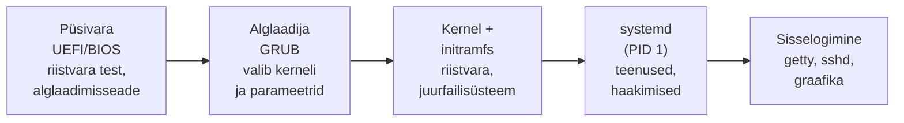
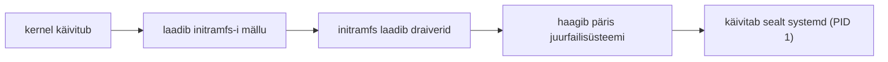

# Moodul 10. Kuidas Linux töötab: alglaadimine ja kernel

**Maht:** 10 tundi · **Laboritöö:** Debian · **Eeldused:** moodulid 1–8

## Õpiväljundid

Mooduli läbinud õppija:

- kirjeldab Linuxi alglaadimise etappe püsivarast kuni sisselogimiseni;
- muudab alglaadija GRUB seadistust ja kerneli parameetreid;
- selgitab initramfs-i rolli;
- kasutab systemd eesmärke (*targets*) ja analüüsib alglaadimise kiirust;
- uurib kerneli ja riistvara infot failisüsteemides `/proc` ja `/sys`;
- haldab kerneli mooduleid;
- muudab kerneli parameetreid käsuga `sysctl`;
- taastab süsteemi, mis ei käivitu, parandab GRUB-i taastemeedialt ja lähtestab juurkasutaja parooli;
- vahetab kasutatavat kernelit ja eemaldab vanu kerneleid;
- kompileerib ja paigaldab kerneli lähtekoodist.

---

## 10.1 Alglaadimise ülevaade

Kui vajutad arvuti toitenuppu, toimub enne sisselogimisviipa mitu etappi. Iga etapp laadib järgmise:



| Etapp | Mis toimub | Probleemi tunnus |
|---|---|---|
| **1. Püsivara** | Riistvara kontroll (POST), alglaadimisseadme valik | Masin ei leia alglaaditavat ketast |
| **2. Alglaadija** | GRUB näitab menüüd, laadib kerneli ja initramfs-i mällu | `grub rescue>` viip |
| **3. Kernel** | Riistvara tuvastamine, draiverite laadimine, juurfailisüsteemi haakimine initramfs-i abil | *Kernel panic*, „cannot mount root fs“ |
| **4. systemd** | Teenuste käivitamine, failisüsteemide haakimine fstab-i järgi | Hädaolukorra režiim, teenuste vead |
| **5. Sisselogimine** | Konsooli sisselogimisviip, SSH, graafiline töölaud | Ei saa sisse logida |

Kui tead, millises etapis probleem tekib, tead ka, kust lahendust otsida.

## 10.2 Püsivara: BIOS ja UEFI

**Püsivara** (*firmware*) on emaplaadi mälus olev programm, mis käivitub esimesena.

| | **BIOS** (ka *legacy*) | **UEFI** |
|---|---|---|
| Vanus | 1980. aastad | 2000. aastad, tänapäeva standard |
| Partitsioonitabel | Tavaliselt MBR | GPT |
| Alglaadija asukoht | Ketta esimesed sektorid | Fail EFI süsteempartitsioonil (ESP) |
| Turvaline alglaadimine | Ei | *Secure Boot* - käivitab ainult allkirjastatud alglaadijaid ja kerneleid |

UEFI-süsteemides on väike **EFI süsteempartitsioon** (FAT32), mis on haagitud kataloogi `/boot/efi`. Kas süsteem käivitus UEFI-ga, näed nii:

```bash
[ -d /sys/firmware/efi ] && echo "UEFI" || echo "BIOS"
```

Proxmoxi virtuaalmasinad kasutavad vaikimisi BIOS-i (SeaBIOS), UEFI (OVMF) tuleb masina loomisel eraldi valida.

Püsivara valib alglaadimise järjekorra järgi seadme, millelt käivitada: ketas, USB, CD/DVD või **võrk (PXE)**. Proxmoxis muudetakse järjekorda *Options* → *Boot Order*; käivitamisel avab ühekordse valikumenüü klahv **Esc**.

## 10.3 Alglaadija GRUB

**GRUB** (*GRand Unified Bootloader*) on enamiku Linuxi distrode alglaadija. See:

- näitab menüüd, kust saab valida kerneli (sh vanema versiooni) või muu operatsioonisüsteemi;
- laadib valitud kerneli ja initramfs-i mällu;
- annab kernelile käivitusparameetrid.

### Seadistus

GRUB-i seadistusfaili `/boot/grub/grub.cfg` **ei muudeta käsitsi** - see genereeritakse automaatselt. Muudetakse faili **`/etc/default/grub`**:

```text
GRUB_DEFAULT=0
GRUB_TIMEOUT=5
GRUB_TIMEOUT_STYLE=menu
GRUB_CMDLINE_LINUX_DEFAULT="quiet"
GRUB_CMDLINE_LINUX=""
```

| Seade | Tähendus |
|---|---|
| `GRUB_DEFAULT` | Vaikimisi valik menüüs (0 = esimene) |
| `GRUB_TIMEOUT` | Mitu sekundit menüüd näidatakse |
| `GRUB_TIMEOUT_STYLE` | `menu` - näita menüüd, `hidden` - peida (näitamiseks hoia Shift/Esc) |
| `GRUB_CMDLINE_LINUX_DEFAULT` | Kerneli parameetrid tavalisel käivitusel |
| `GRUB_CMDLINE_LINUX` | Kerneli parameetrid kõigil käivitustel (ka taastamisrežiimis) |

Pärast muutmist genereeri seadistus uuesti:

```bash
sudo update-grub                                  # Debian, Ubuntu
sudo grub2-mkconfig -o /boot/grub2/grub.cfg       # AlmaLinux
```

### Kerneli parameetrid

Kerneli käivitusparameetrid mõjutavad kerneli ja systemd käitumist. Praegused parameetrid:

```bash
cat /proc/cmdline
```

```text
BOOT_IMAGE=/boot/vmlinuz-6.12.0-1-amd64 root=UUID=7c1e... ro quiet
```

| Parameeter | Tähendus |
|---|---|
| `root=UUID=...` | Juurfailisüsteem |
| `ro` | Haagi juurfailisüsteem alguses ainult lugemiseks (systemd haagib selle hiljem kirjutatavaks) |
| `quiet` | Näita vähem teateid |
| `systemd.unit=rescue.target` | Käivita taastamisrežiimis |
| `systemd.unit=emergency.target` | Käivita hädaolukorra režiimis |
| `init=/bin/bash` | Käivita systemd asemel otse kest (vt punkt 10.9) |
| `nomodeset` | Ära kasuta graafikadraiveri režiimiseadistust (abiks graafikaprobleemide korral) |

### Ühekordne muudatus GRUB-i menüüs

GRUB-i menüüs saab parameetreid muuta **ainult selleks korraks**:

1. vali menüüs kirje ja vajuta **e**;
2. leia rida, mis algab sõnaga `linux`;
3. lisa rea lõppu parameeter (nt `systemd.unit=rescue.target`);
4. vajuta **Ctrl+X** või **F10**, et käivitada.

Muudatus ei salvestu - järgmisel käivitusel on kõik endine. Nii saab mittekäivituvat süsteemi taastada.

## 10.4 Kernel ja initramfs

**Kernel** asub failina kataloogis `/boot`:

```bash
ls -lh /boot
```

```text
config-6.12.0-1-amd64          # kerneli kompileerimise seadistus
initrd.img-6.12.0-1-amd64      # initramfs
System.map-6.12.0-1-amd64      # kerneli sümbolite tabel
vmlinuz-6.12.0-1-amd64         # kernel ise (pakitud)
```

Kerneli versiooni näeb käsuga `uname -r`. Kernelid paigaldatakse ja uuendatakse paketihalduriga nagu muu tarkvara. Pakihaldur **jätab alles ka eelmise kerneli** - kui uus kernel ei käivitu, saab GRUB-i menüüst valida vana (Debianis „Advanced options“).

### initramfs

Kernel peab haakima juurfailisüsteemi, kuid draiverid, mida selleks vaja on (nt kettakontrolleri, LVM-i, RAID-i või krüpteeringu jaoks), võivad asuda just sellel failisüsteemil. Seda „muna ja kana“ probleemi lahendab **initramfs** (*initial RAM file system*): väike ajutine failisüsteem, mis laaditakse koos kerneliga mällu ja sisaldab juurfailisüsteemi haakimiseks vajalikke draivereid ja tööriistu.



initramfs genereeritakse kerneli paigaldamisel automaatselt. Käsitsi on seda vaja uuendada näiteks pärast kettakontrolleri või krüpteeringu seadistuse muutmist:

```bash
sudo update-initramfs -u          # Debian, Ubuntu
lsinitramfs /boot/initrd.img-$(uname -r) | head    # sisu vaatamine

sudo dracut -f                    # AlmaLinux
lsinitrd | head
```

## 10.5 systemd ja eesmärgid

Kui kernel on juurfailisüsteemi haakinud, käivitab see protsessi **PID 1** - **systemd**. systemd loeb seadistuse ja käivitab teenused, mis kuuluvad vaike-**eesmärgile** (*target*).

| Eesmärk | Mis töötab | Vana runlevel |
|---|---|---|
| `poweroff.target` | Väljalülitamine | 0 |
| `rescue.target` | Ainult põhiteenused, juurkasutaja kest, failisüsteemid haagitud, võrk puudub | 1 |
| `multi-user.target` | Kõik teenused, tekstirežiim (tavaline server) | 3 |
| `graphical.target` | Nagu eelmine + graafiline töölaud | 5 |
| `reboot.target` | Taaskäivitus | 6 |
| `emergency.target` | Ainult juurfailisüsteem (ainult lugemiseks), juurkasutaja kest | - |

```bash
systemctl get-default                        # vaikimisi eesmärk
sudo systemctl set-default multi-user.target # muuda vaikimisi eesmärki
sudo systemctl isolate rescue.target         # mine kohe teise eesmärki (ettevaatust!)
systemctl list-dependencies multi-user.target    # mis eesmärgi juurde kuulub
```

**Taastamisrežiim** (*rescue*) ja **hädaolukorra režiim** (*emergency*) küsivad juurkasutaja parooli. Hädaolukorra režiimi satub süsteem ise, kui midagi olulist (nt fstab-is olev failisüsteem) ebaõnnestub.

### Alglaadimise analüüs

```bash
systemd-analyze                          # kui kaua alglaadimine kestis
systemd-analyze blame                    # teenused käivitusaja järgi
systemd-analyze critical-chain           # kõige aeglasem sõltuvuste ahel
systemd-analyze plot > alglaadimine.svg  # ajajoon pildina
```

```text
Startup finished in 1.982s (kernel) + 6.410s (userspace) = 8.393s
multi-user.target reached after 6.390s in userspace.
```

> [!TIP]
> **Pea meeles:** `blame` näitab iga teenuse käivitusaega, kuid paljud teenused käivituvad paralleelselt. Tegelikku pudelikaela näitab paremini `critical-chain`.

### Alglaadimise logid

```bash
journalctl -b                    # praeguse alglaadimise logid
journalctl -b -1                 # eelmise alglaadimise logid (vajab püsivat journal'it)
journalctl -b -p err             # vead
journalctl --list-boots          # kõik salvestatud alglaadimised
sudo dmesg                       # kerneli teated (rõngaspuhver)
sudo dmesg -T --level=err,warn   # vead ja hoiatused koos kellaajaga
journalctl -k                    # kerneli teated journal'ist
```

## 10.6 /proc ja /sys

Linuxis on kõik fail - ka kerneli andmed. Kaks **virtuaalset failisüsteemi** ei asu kettal, vaid kernel genereerib nende sisu lugemise hetkel.

### /proc

| Fail | Sisu |
|---|---|
| `/proc/cpuinfo` | Protsessori info |
| `/proc/meminfo` | Mälu kasutus |
| `/proc/uptime`, `/proc/loadavg` | Tööaeg, koormus |
| `/proc/cmdline` | Kerneli käivitusparameetrid |
| `/proc/version` | Kerneli versioon |
| `/proc/mounts` | Haagitud failisüsteemid |
| `/proc/partitions` | Partitsioonid |
| `/proc/<PID>/` | Iga protsessi info (käsk, keskkond, avatud failid) |
| `/proc/sys/` | Muudetavad kerneli parameetrid (vt punkt 10.8) |

```bash
grep "model name" /proc/cpuinfo | head -1
grep -E "MemTotal|MemAvailable" /proc/meminfo
cat /proc/$$/status | head      # praeguse kesta info
ls -l /proc/$$/fd               # praeguse kesta avatud failid
```

Paljud käsud (`ps`, `top`, `free`, `uptime`) loevad oma info just failidest `/proc`-is.

### /sys

`/sys` kirjeldab seadmeid ja draivereid struktureeritult:

```bash
ls /sys/class/net/                       # võrguliidesed
cat /sys/class/net/ens18/address         # liidese MAC-aadress
cat /sys/class/net/ens18/operstate       # kas üleval
ls /sys/block/                           # plokkseadmed
cat /sys/block/sda/size                  # ketta suurus 512-baidistes sektorites
```

Riistvara uurimiseks on ka mugavamad käsud: `lscpu`, `lspci`, `lsusb` (paketid `pciutils`, `usbutils`), `lsblk`, `sudo dmidecode` (emaplaadi ja BIOS-i info).

## 10.7 Kerneli moodulid

Linuxi kernel on **monoliitne**, kuid **modulaarne**: draivereid ja muid osi saab laadida ja eemaldada töö ajal **moodulitena**, ilma kernelit uuesti kompileerimata või taaskäivitamata. Moodulid asuvad kataloogis `/lib/modules/$(uname -r)/`.

```bash
lsmod                            # laaditud moodulid
modinfo e1000                    # mooduli info (kirjeldus, parameetrid, litsents)
sudo modprobe dummy              # laadi moodul (koos sõltuvustega)
sudo modprobe -r dummy           # eemalda moodul
```

Tavaliselt laadib kernel (täpsemalt `udev`) vajalikud moodulid riistvara tuvastamisel automaatselt.

### Püsivad seaded

| Fail | Kasutus |
|---|---|
| `/etc/modules-load.d/*.conf` | Moodulid, mis laaditakse alglaadimisel (üks nimi rea kohta) |
| `/etc/modprobe.d/*.conf` | Mooduli parameetrid ja keelamine |

```text
# /etc/modprobe.d/blacklist-pcspkr.conf
blacklist pcspkr
```

`blacklist` takistab mooduli automaatset laadimist. Kui moodul on initramfs-is, tuleb pärast muudatust uuendada ka initramfs.

## 10.8 Kerneli parameetrid: sysctl

Töötava kerneli käitumist saab muuta parameetritega, mis on failidena kataloogis `/proc/sys/`. Neid hallatakse käsuga `sysctl`:

```bash
sysctl -a | less                         # kõik parameetrid
sysctl net.ipv4.ip_forward               # ühe parameetri väärtus
cat /proc/sys/net/ipv4/ip_forward        # sama failina
sudo sysctl -w net.ipv4.ip_forward=1     # muuda (kuni taaskäivituseni)
```

Püsivaks muutmiseks loo fail kataloogi `/etc/sysctl.d/`:

```text
# /etc/sysctl.d/90-ruuter.conf
net.ipv4.ip_forward = 1
```

```bash
sudo sysctl --system                     # rakenda kõik seadistusfailid
```

Levinud parameetrid:

| Parameeter | Tähendus |
|---|---|
| `net.ipv4.ip_forward` | Kas masin edastab pakette liideste vahel (ruuter, NAT, konteinerid) |
| `vm.swappiness` | Kui meelsasti kasutab kernel saaleala (0–200, vaikimisi 60) |
| `kernel.hostname` | Masina nimi |
| `fs.file-max` | Avatud failide maksimaalne arv süsteemis |
| `net.ipv4.icmp_echo_ignore_all` | Kas ignoreerida `ping`-päringuid |
| `kernel.dmesg_restrict` | Kas tavakasutaja tohib `dmesg`-i lugeda |

## 10.9 Süsteemi taastamine

### Kui süsteem satub hädaolukorra režiimi

```text
You are in emergency mode. After logging in, type "journalctl -xb" to view
system logs, "systemctl reboot" to reboot, "systemctl default" or "exit"
to boot into default mode.
Give root password for maintenance
(or press Control-D to continue):
```

1. Sisesta juurkasutaja parool.
2. Uuri põhjust: `journalctl -xb -p err`.
3. Levinuim põhjus on vigane `/etc/fstab` (vt moodul 8). Juurfailisüsteem võib olla ainult lugemiseks - haagi see kirjutatavaks: `mount -o remount,rw /`.
4. Paranda viga ja käivita `systemctl default` või `reboot`.

> [!NOTE]
> **Debian ja Ubuntu:** kui juurkasutaja konto on lukus (Ubuntus alati, Debianis siis, kui paigaldusel parooli ei määratud), ei saa taastamis- ja hädaolukorra režiimi sisse logida. Siis aitab ainult `init=/bin/bash` (vt allpool) või paigaldusmeedia taastamisrežiim.

### Juurkasutaja parooli lähtestamine

Kui oled kaotanud juurkasutaja (ja kõigi `sudo`-kasutajate) parooli, kuid sul on ligipääs masina **konsoolile**, saad parooli lähtestada.

**Debian ja Ubuntu:**

1. GRUB-i menüüs vajuta **e**;
2. lisa rea `linux ...` lõppu `init=/bin/bash` ja vajuta **Ctrl+X**;
3. avaneb juurkasutaja kest ilma paroolita. Juurfailisüsteem on ainult lugemiseks:

```bash
mount -o remount,rw /
passwd                       # määra juurkasutaja uus parool
passwd mari                  # või tavakasutaja oma
sync
exec /sbin/init              # jätka tavalist alglaadimist (või: reboot -f)
```

**AlmaLinux** (SELinuxi tõttu tuleb lisaks märgistus taastada):

1. GRUB-is lisa rea `linux ...` lõppu `rd.break` ja vajuta **Ctrl+X**;
2. initramfs-i kestas:

```bash
mount -o remount,rw /sysroot
chroot /sysroot
passwd
touch /.autorelabel          # SELinux märgistab failid järgmisel alglaadimisel uuesti
exit
exit
```

> [!WARNING]
> **Turvalisus:** see näitab, et **füüsiline ligipääs masinale (või virtuaalmasina konsoolile) tähendab ligipääsu kõigele.** Seepärast on serveriruumid lukus, Proxmoxi veebiliides kaitstud ning tundlike süsteemide puhul kasutatakse ketta krüpteerimist ja GRUB-i parooli.

### Kui GRUB-i menüü ei ilmu

Kui `GRUB_TIMEOUT_STYLE=hidden`, ilmub menüü, kui hoiad alglaadimise ajal all **Shift** (BIOS) või vajutad korduvalt **Esc** (UEFI).

### GRUB-i parandamine taastemeedialt

Kui ekraanile ilmub `grub rescue>`, „No bootable device“ või masin jääb rippuma kohe pärast püsivara, on rikutud **alglaadija** - süsteem ise ja andmed on tavaliselt korras. Tüüpilised põhjused: teise operatsioonisüsteemi paigaldus, ketta kloonimine või vahetus, vigane `dd`, katkenud uuendus, kustutatud EFI-kirje.

Parandamiseks käivitatakse masin **teiselt andmekandjalt** ja paigaldatakse GRUB uuesti.

**Variant A: Debiani paigaldaja taastamisrežiim.** Käivita Debiani paigaldusmeedia (netinst ISO) → *Advanced options* → *Rescue mode*. Läbi keele- ja võrgusammud, vali juurfailisüsteemiga partitsioon ja menüüst *Reinstall GRUB boot loader* → seade (nt `/dev/sda`). Samas menüüs on ka *Execute a shell in /dev/sda1* (kest juba õiges süsteemis) ja *Execute a shell in the installer environment*.

**Variant B: live-süsteem ja `chroot`.** Sobib iga live-meedia (Debian Live, Ubuntu Desktop „Try Ubuntu“, SystemRescue):

```bash
lsblk -f                                   # leia juurfailisüsteem
sudo mount /dev/sda1 /mnt                  # juur
# kui /boot on eraldi partitsioonil:  sudo mount /dev/sda2 /mnt/boot
# UEFI-süsteemis ka ESP:              sudo mount /dev/sda15 /mnt/boot/efi
for d in dev proc sys run; do sudo mount --rbind /$d /mnt/$d; done
sudo chroot /mnt
```

Nüüd töötad paigaldatud süsteemis, aga kernel on live-meedia oma. `chroot`-i sees:

```bash
grub-install /dev/sda                      # BIOS: GRUB ketta algusesse (mitte partitsioonile!)
# UEFI: grub-install --target=x86_64-efi --efi-directory=/boot/efi --bootloader-id=debian
update-grub
exit
sudo umount -R /mnt
sudo reboot
```

`/dev`, `/proc`, `/sys` ja `/run` seotakse `chroot`-i, sest `grub-install` ja `update-grub` vajavad ligipääsu ketastele ja kerneli infole.

**LVM-iga süsteem** (Ubuntu, AlmaLinux): enne haakimist aktiveeri köitegrupid.

```bash
sudo vgscan
sudo vgchange -ay
lsblk
sudo mount /dev/mapper/ubuntu--vg-ubuntu--lv /mnt    # Ubuntu (sidekriipsud kahekordistuvad)
sudo mount /dev/mapper/almalinux-root /mnt           # AlmaLinux
sudo mount /dev/sda2 /mnt/boot                       # /boot on LVM-ist väljas
```

**AlmaLinux** kasutab käske `grub2-install` ja `grub2-mkconfig -o /boot/grub2/grub.cfg`. UEFI-süsteemis ei käivitata RHEL-i perekonnas `grub2-install`-i, vaid paigaldatakse alglaadija paketid uuesti: `dnf reinstall grub2-efi-x64 shim-x64`.

> [!NOTE]
> **Märkus:** püsivara saab süsteemi käivitada ka **võrgust** (PXE). Nii töötavad võrgupaigaldus, kettatõmmiste levitamine (FOG) ja ka võrgust käivitatavad taastetööriistad - vt valikmoodul 19.

## 10.10 Kernelite haldus ja kompileerimine

### Paigaldatud kernelid

Süsteemis võib olla korraga mitu kernelit. GRUB käivitab vaikimisi uusima, kuid teisi saab valida menüüst „Advanced options“.

```bash
uname -r                                   # töötav kernel
ls /boot/vmlinuz-*                         # paigaldatud kernelid
dpkg -l 'linux-image-*' | grep '^ii'       # Debian, Ubuntu
rpm -q kernel-core                         # AlmaLinux
```

### Vaikimisi kerneli vahetamine

**Debian ja Ubuntu.** GRUB-i menüükirjete nimed leiad failist `grub.cfg`:

```bash
grep -E "^\s*(menuentry|submenu) '" /boot/grub/grub.cfg | cut -d"'" -f2
```

```text
Debian GNU/Linux
Advanced options for Debian GNU/Linux
Debian GNU/Linux, with Linux 6.12.0-2-amd64
Debian GNU/Linux, with Linux 6.12.0-2-amd64 (recovery mode)
Debian GNU/Linux, with Linux 6.12.0-1-amd64
...
```

Et vaikimisi valikut saaks määrata nime järgi, sea failis `/etc/default/grub`:

```text
GRUB_DEFAULT=saved
```

ja käivita `sudo update-grub`. Seejärel:

```bash
# püsivalt (alammenüü ja kirje eraldatakse märgiga >)
sudo grub-set-default "Advanced options for Debian GNU/Linux>Debian GNU/Linux, with Linux 6.12.0-1-amd64"

# ainult järgmiseks alglaadimiseks
sudo grub-reboot "Advanced options for Debian GNU/Linux>Debian GNU/Linux, with Linux 6.12.0-1-amd64"
sudo systemctl reboot

# tagasi uusimale
sudo grub-set-default 0
```

`grub-reboot` on eriti kasulik uue kerneli testimiseks kaugelt: kui uus kernel ei käivitu, käivitub pärast järgmist taaskäivitust (nt hüperviisori kaudu) jälle vana.

**AlmaLinux.** Kerneleid hallatakse käsuga `grubby`:

```bash
sudo grubby --info=ALL | grep -E '^(index|kernel)'
sudo grubby --default-kernel                          # praegune vaikimisi kernel
sudo grubby --set-default /boot/vmlinuz-<versioon>     # püsivalt
sudo grub2-reboot <index>                             # ainult järgmiseks alglaadimiseks
```

### Uuemad kernelid

Stabiilsete distrode kernel on teadlikult vanem, kuid saab turvaparandusi. Uuemat kernelit võib vaja minna uue riistvara toe jaoks.

| Distro | Allikas | Paigaldamine |
|---|---|---|
| Debian | **backports** - uuem kernel stabiilsele Debianile | `sudo apt install -t <koodnimi>-backports linux-image-amd64` |
| Ubuntu | **HWE** (*Hardware Enablement*) - uuemate Ubuntu väljalasete kernelid LTS-ile | `sudo apt install linux-generic-hwe-<versioon>` |
| AlmaLinux | **ELRepo** - kolmanda osapoole hoidla (`kernel-ml` uusim, `kernel-lt` pikaajalise toega) | vt elrepo.org |

### Vanade kernelite eemaldamine

Kernelid võtavad kataloogis `/boot` ruumi, mis on mõnikord eraldi väike partitsioon.

```bash
sudo apt autoremove                              # Debian/Ubuntu: eemaldab mittevajalikud vanad kernelid
sudo apt remove linux-image-6.12.0-1-amd64       # kindla kerneli eemaldamine
sudo dnf remove kernel-core-<versioon>           # AlmaLinux
```

AlmaLinuxis määrab alles hoitavate kernelite arvu failis `/etc/dnf/dnf.conf` rida `installonly_limit=3`. **Töötavat kernelit ei saa eemaldada** ja alati tasub alles hoida vähemalt üks varukernel.

### Kernelivälised moodulid ja DKMS

Mõned draiverid (nt NVIDIA graafikadraiver, ZFS, VirtualBoxi moodulid) ei ole kerneli osa. Need tuleb iga uue kerneli jaoks uuesti kompileerida. Seda teeb automaatselt **DKMS** (*Dynamic Kernel Module Support*):

```bash
dkms status                      # millised moodulid on DKMS-i all ja millistele kernelitele kompileeritud
```

Kui pärast kerneli uuendust mõni draiver ei tööta, on põhjus sageli DKMS-i kompileerimisvea taga (`journalctl -b | grep -i dkms`).

### Oma kerneli kompileerimine

Enamasti pole oma kernelit vaja kompileerida - distro kernel on testitud ja saab turvauuendusi. Oma kernel võib siiski olla vajalik, kui:

- vajad funktsiooni või draiverit, mida distro kernelis pole;
- tahad testida uusimat kernelit või kerneliparandust;
- teed sardsüsteemi, kus kernel peab olema väga väike;
- tahad lihtsalt mõista, kuidas kernel on üles ehitatud.

Kerneli lähtekood on saadaval aadressil **kernel.org**. Seal on mitu haru:

| Haru | Kirjeldus |
|---|---|
| **mainline** | Linus Torvaldsi arendusharu, uus versioon ca iga 9–10 nädala järel |
| **stable** | Viimase väljalaske parandused |
| **longterm** (LTS) | Mitmeaastase toega versioonid, mida kasutavad ka distrod |

Kerneli versiooninumber `6.12.48` tähendab: põhiversioon 6, väljalase 12, parandusversioon 48.

#### Töövoog Debianis

```bash
# 1. Tööriistad
sudo apt install build-essential bc bison flex libssl-dev libelf-dev \
    libncurses-dev dwarves cpio kmod rsync debhelper xz-utils wget

# 2. Lähtekood (vali kernel.org-ist stable või longterm versioon)
wget https://cdn.kernel.org/pub/linux/kernel/v6.x/linux-<versioon>.tar.xz
tar -xf linux-<versioon>.tar.xz
cd linux-<versioon>

# 3. Seadistus: võta aluseks töötava kerneli seadistus
cp /boot/config-$(uname -r) .config
make olddefconfig                 # uued valikud saavad vaikeväärtuse
make localmodconfig               # (valikuline) ainult praegu laaditud moodulid - palju kiirem kompileerimine

# Debiani seadistus viitab Debiani allkirjavõtmetele, mida meil pole
scripts/config --set-str SYSTEM_TRUSTED_KEYS ""
scripts/config --set-str SYSTEM_REVOCATION_KEYS ""
scripts/config --set-str LOCALVERSION "-minu"      # nimeosa, mis eristab sinu kernelit
make olddefconfig

make menuconfig                   # (valikuline) menüüpõhine seadistus

# 4. Kompileeri .deb paketiks
make -j$(nproc) bindeb-pkg

# 5. Paigalda
sudo apt install ../linux-image-<versioon>-minu_*.deb
sudo systemctl reboot
uname -r
```

Selgitused:

- **`.config`** on kerneli seadistusfail, kus iga valik on kas sisse ehitatud (`=y`), moodulina (`=m`) või välja jäetud;
- **`make menuconfig`** avab tekstipõhise menüü, kus saab seadistust sirvida ja muuta (`/` otsib valikut nime järgi);
- **`make localmodconfig`** jätab alles ainult need moodulid, mis on parajasti laaditud (`lsmod`). See vähendab kompileerimisaega mitu korda, kuid kernelist võib puududa praegu ühendamata riistvara draiver (nt USB-mälu);
- **`make bindeb-pkg`** loob tavalised `.deb` paketid, mida saab paigaldada ja eemaldada pakihalduriga. Paigaldamisel genereeritakse automaatselt initramfs ja GRUB-i kirje.

Kompileerimine võtab sõltuvalt seadistusest ja protsessorist 15 minutist mitme tunnini ning vajab 5–25 GiB vaba kettaruumi. Mida rohkem protsessorituumi (`-j$(nproc)`), seda kiirem.

Lähtekoodist saab kerneli paigaldada ka ilma paketita (`sudo make modules_install && sudo make install`), kuid siis ei tea pakihaldur sellest ja eemaldamine on tülikas.

> [!NOTE]
> **Turvaline alglaadimine:** isekompileeritud kernel ei ole distro võtmega allkirjastatud. Kui masinas on *Secure Boot* sisse lülitatud, siis see kernel ei käivitu, kui sa ei allkirjasta seda ise. Proxmoxi BIOS-iga virtuaalmasinates see probleemiks ei ole.

> [!TIP]
> **Hea tava:** hoia alati alles distro töötav kernel. Kui sinu kernel ei käivitu, vali GRUB-i menüüst „Advanced options“ ja käivita distro kernel. Seejärel eemalda katkine kernel käsuga `sudo apt remove linux-image-<versioon>-minu`.

---

## Distrode erinevused

| | **Debian** | **Ubuntu** | **AlmaLinux** |
|---|---|---|---|
| GRUB-i seadistuse genereerimine | `update-grub` | `update-grub` | `grub2-mkconfig -o /boot/grub2/grub.cfg` (või `grubby`) |
| GRUB-i menüü vaikimisi | Nähtav (5 s) | Peidetud | Nähtav (5 s) |
| initramfs | `update-initramfs` | `update-initramfs` | `dracut` |
| Kerneli pakett | `linux-image-amd64` | `linux-image-generic` | `kernel` |
| Taastamine ilma paroolita | `init=/bin/bash` | `init=/bin/bash` | `rd.break` + `touch /.autorelabel` |
| Juurkasutaja konto | Sõltub paigaldusest | Lukus | Tavaliselt parooliga |

AlmaLinuxis saab kerneli parameetreid muuta ka käsuga `grubby`, mis muudab kõiki kernelikirjeid korraga:

```bash
sudo grubby --update-kernel=ALL --args="nomodeset"
sudo grubby --info=DEFAULT
```

---

## Kokkuvõte

| Käsk või fail | Tegevus |
|---|---|
| `/etc/default/grub`, `update-grub` | GRUB-i seadistus |
| GRUB-is **e**, `linux` rea lõppu parameeter, **Ctrl+X** | Ühekordne kerneli parameeter |
| `cat /proc/cmdline`, `uname -r` | Kerneli parameetrid ja versioon |
| `update-initramfs -u`, `dracut -f` | initramfs-i uuendamine |
| `systemctl get-default`, `set-default` | Vaike-eesmärk |
| `systemd-analyze blame`, `critical-chain` | Alglaadimise analüüs |
| `journalctl -b`, `dmesg` | Alglaadimise ja kerneli logid |
| `/proc`, `/sys`, `lscpu`, `lspci` | Kerneli ja riistvara info |
| `lsmod`, `modinfo`, `modprobe` | Kerneli moodulid |
| `sysctl`, `/etc/sysctl.d/` | Kerneli parameetrid |
| `systemd.unit=rescue.target`, `init=/bin/bash`, `rd.break` | Taastamine |
| *Rescue mode*, `mount --rbind`, `chroot`, `grub-install`, `update-grub` | GRUB-i parandamine taastemeedialt |
| `grub-set-default`, `grub-reboot`, `grubby --set-default` | Vaikimisi kerneli vahetamine |
| `make olddefconfig`, `make menuconfig`, `make bindeb-pkg` | Kerneli kompileerimine |

**Järgmised sammud:** tee [laboritöö](labor.md) ja kontrolli oma teadmisi [enesekontrolli](enesekontroll.md) abil.

## Lisamaterjal

- Brian Ward, „How Linux Works“ - alglaadimise, kerneli ja seadmete peatükid
- Arch Wiki - Arch boot process, GRUB, Kernel parameters, sysctl (wiki.archlinux.org)
- Linux From Scratch (linuxfromscratch.org) - ehita süsteem ise ja näed iga osa oma silmaga
- `man bootup`, `man systemd.special`, `man sysctl.d`
