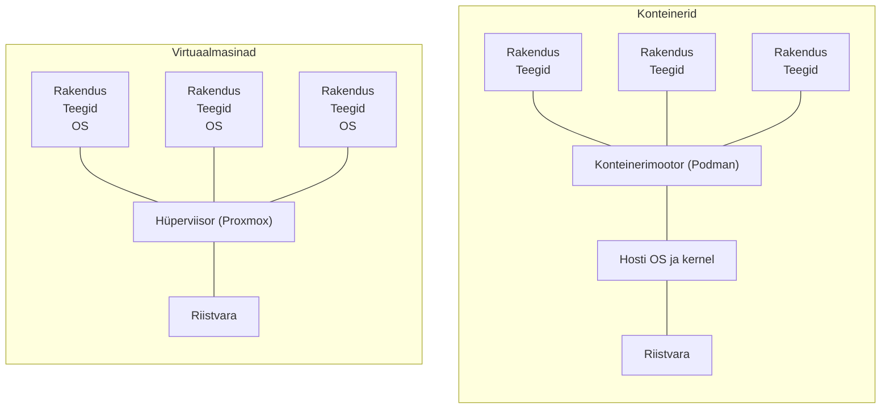
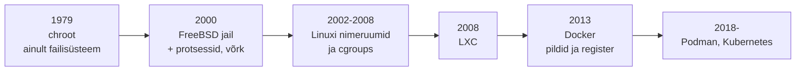
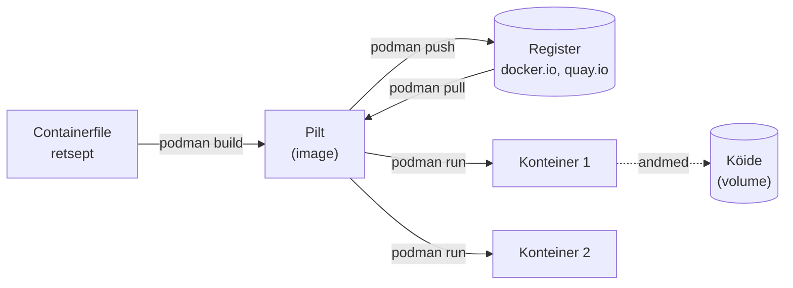

<!-- navigatsioon -->
[← Moodul 11. Enesekontroll](../moodul-11-turvalisus-logid/enesekontroll.md) · [Sisukord](../../README.md#sisukord) · [Laboritöö 12. Konteinerid →](labor.md)
<!-- /navigatsioon -->

# Moodul 12. Konteinerid

**Maht:** 8 tundi · **Laboritöö:** AlmaLinux · **Eeldused:** moodulid 1–11

## Õpiväljundid

Mooduli läbinud õppija:

- selgitab konteinerite toimimist ja erinevust virtuaalmasinatest;
- käivitab ja haldab konteinereid Podmaniga (ja tunneb Dockeri vasteid);
- koostab oma konteinerpildi;
- käivitab mitmest konteinerist koosneva rakenduse Compose-failiga;
- käivitab konteineri systemd teenusena (Quadlet) ja seadistab pildi automaatse uuendamise.

---

## 12.1 Konteinerid

Konteinerid on tänapäeva serverihalduse igapäevane tööriist. Õpime neid enne serveriteenuseid, sest järgmistes moodulites käivitatakse osa teenuseid (CoreDNS, Pi-hole, Mailpit, Adminer, Prometheus, Grafana, Uptime Kuma) just konteineritena.

### Mis on konteiner?

**Konteiner** on isoleeritud protsess (või protsesside rühm), millel on oma failisüsteem, võrk ja protsessipuu, kuid mis kasutab **hostmasina kernelit**. Konteineri **pilt** (*image*) sisaldab rakendust koos kõigi teekide ja sõltuvustega - seepärast töötab see igas Linuxis ühtemoodi.



| | **Virtuaalmasin** | **Konteiner** |
|---|---|---|
| Kernel | Igal masinal oma | Jagatud hostiga |
| Käivitusaeg | Kümned sekundid | Alla sekundi |
| Maht | Gigabaidid | Megabaidid |
| Isolatsioon | Väga tugev (riistvara tasemel) | Tugev, kuid ühine kernel |
| Kasutus | Erinevad OS-id, tugev eraldatus | Rakenduste pakendamine ja käivitamine |

### Eelkäija: chroot

Konteinerite idee on vana. Juba 1979. aastal lisati Unixisse **`chroot`** (*change root*): käsk, mis käivitab protsessi nii, et mingi kataloog paistab talle juurkataloogina `/`. Protsess ei näe faile väljaspool seda kataloogi. Sama käsuga parandad moodulis 10 alglaadijat taastemeedialt.

```bash
sudo mkdir -p /srv/proov
sudo debootstrap stable /srv/proov    # minimaalne Debian kataloogi (Debian/Ubuntu)
sudo chroot /srv/proov /bin/bash      # sees: cat /etc/os-release, ls /
ps aux | head                         # protsessid on ikka kõik nähtavad!
exit
```

`chroot` eraldab ainult **failisüsteemi**. Protsessid, võrk, kasutajad ja ressursid on hostiga ühised ning juurkasutaja saab `chroot`-ist lihtsalt välja murda. Seega ei ole `chroot` turvapiir. Konteiner lisab sellele ülejäänud isolatsiooni:



| | `chroot` | Konteiner |
|---|---|---|
| Failisüsteem | eraldi juur | eraldi juur (pildist) |
| Protsessid | näeb kõiki hosti protsesse | näeb ainult enda omi |
| Võrk | hosti võrk | oma võrguliides ja aadress |
| Ressursipiirangud | puuduvad | cgroups |
| Turvapiir | ei | jah (ühine kernel jääb siiski nõrgaks kohaks) |

Tänapäeval kasutatakse `chroot`-i peamiselt süsteemi parandamiseks, pakettide ehitamiseks ja failiedastuse kasutajate piiramiseks (SFTP, moodul 7).

### Millel konteinerid põhinevad

Konteinerid põhinevad Linuxi kerneli võimalustel:

- **nimeruumid** (*namespaces*) - konteiner näeb ainult oma protsesse, võrguliideseid, haakepunkte ja kasutajaid;
- **cgroups** - piiravad konteineri protsessori-, mälu- ja kettakasutust;
- **SELinux/AppArmor** ja **seccomp** - lisapiirangud.

Proxmoxis on kahte liiki virtualiseerimist: **KVM** virtuaalmasinad ja **LXC** konteinerid. LXC konteiner on terve „kerge Linuxi süsteem“, Dockeri/Podmani konteiner on tavaliselt üks rakendus.



### Pildid ja registrid

Konteinerpildid laaditakse **registritest**:

| Register | Aadress |
|---|---|
| Docker Hub | `docker.io` |
| Quay | `quay.io` |
| GitHub | `ghcr.io` |

Pildi nimi: `register/nimeruum/nimi:silt`, nt `docker.io/library/nginx:1.27-alpine`. **Silt** (*tag*) tähistab versiooni. Silt `latest` tähendab lihtsalt „uusim“ - tootmises kasuta konkreetset versiooni, et uus versioon ei tuleks ootamatult.

> [!WARNING]
> **Usalda ainult ametlikke ja tuntud pilte.** Registrites on ka pahatahtlikke pilte. Eelista ametlikke pilte (`docker.io/library/...`) või tarkvara tootja enda pilte.

### Podman ja Docker

| | **Podman** | **Docker** |
|---|---|---|
| Arendaja | Red Hat | Docker Inc. |
| Taustateenus | Puudub (*daemonless*) | `dockerd` töötab juurkasutajana |
| Juurkasutajata konteinerid | Vaikimisi (*rootless*) | Võimalik, kuid lisaseadistusega |
| systemd integratsioon | Quadlet | - |
| Käsud | `podman ...` | `docker ...` |
| Vaikimisi | AlmaLinux, RHEL, Fedora | Levinuim Ubuntus ja Debianis (paigaldatakse Dockeri hoidlast) |

Käsud on peaaegu identsed - `alias docker=podman` töötab enamasti. Selles moodulis kasutame Podmani.

## 12.2 Podmani kasutamine

```bash
sudo dnf install podman
podman --version
podman info | head -20
```

### Konteinerite käivitamine

```bash
podman run --rm docker.io/library/alpine:latest echo "Tere konteinerist"
podman run -it --rm docker.io/library/alpine:latest sh      # interaktiivne kest
podman run -d --name veeb -p 8080:80 docker.io/library/nginx:alpine
```

| Võti | Tähendus |
|---|---|
| `-d` | Käivita taustal (*detached*) |
| `-it` | Interaktiivne terminal |
| `--rm` | Kustuta konteiner pärast lõpetamist |
| `--name` | Konteineri nimi |
| `-p 8080:80` | Suuna hosti port 8080 konteineri porti 80 |
| `-v /host/kat:/konteineri/kat:Z` | Haagi hosti kataloog konteinerisse (`:Z` - SELinuxi märgis) |
| `-e MUUTUJA=väärtus` | Keskkonnamuutuja |

> [!NOTE]
> **Täielikud pildinimed:** AlmaLinuxis ja RHEL-is küsib Podman lühinime (`nginx`) korral, millisest registrist pilti otsida. Kirjuta alati täielik nimi koos registriga (`docker.io/library/nginx`).

### Haldus

```bash
podman ps                    # töötavad konteinerid
podman ps -a                 # kõik konteinerid
podman logs veeb             # konteineri väljund
podman logs -f veeb          # jälgi
podman exec -it veeb sh      # käivita käsk töötavas konteineris
podman stop veeb             # peata
podman start veeb            # käivita uuesti
podman rm veeb               # kustuta (peatatud) konteiner
podman images                # kohalikud pildid
podman rmi nginx:alpine      # kustuta pilt
podman stats                 # ressursikasutus
podman system prune          # koristamine
```

### Andmed ja köited

Konteiner on **ajutine**: kui see kustutatakse, kaob kõik, mis konteineri sisse kirjutati. Püsivad andmed hoitakse **köidetes** (*volumes*) või hosti kataloogides:

```bash
podman volume create dbandmed
podman run -d --name db -v dbandmed:/var/lib/mysql \
    -e MARIADB_ROOT_PASSWORD=Salajane-123 docker.io/library/mariadb:11
podman volume ls
podman volume inspect dbandmed
```

### Juurkasutajata (rootless) konteinerid

Podman käivitab tavakasutaja konteinerid **ilma juurkasutaja õigusteta**. Konteineri sees võib protsess olla `root`, kuid hostis töötab see sinu kasutajana. Kui ründaja konteinerist välja murrab, on tal ainult sinu kasutaja õigused.

Piirangud: tavakasutaja ei saa avada porte alla 1024 (kasuta nt 8080) ja tema konteinerid töötavad ainult siis, kui ta on sisse logitud (või kui on lubatud `loginctl enable-linger kasutaja`).

## 12.3 Oma konteinerpilt

Pilt kirjeldatakse failis **`Containerfile`** (Dockeri terminoloogias `Dockerfile` - mõlemad nimed töötavad):

```dockerfile
FROM docker.io/library/nginx:1.27-alpine
LABEL maintainer="mari@hkhk.edu.ee"
COPY sait/ /usr/share/nginx/html/
EXPOSE 80
```

| Käsk | Tähendus |
|---|---|
| `FROM` | Alus-pilt |
| `RUN` | Käivita käsk pildi ehitamisel (nt paketi paigaldus) |
| `COPY` | Kopeeri failid pildi sisse |
| `ENV` | Keskkonnamuutuja |
| `WORKDIR` | Töökataloog |
| `EXPOSE` | Dokumenteeri, millist porti rakendus kasutab |
| `USER` | Kasutaja, kellena rakendus töötab |
| `CMD` | Vaikimisi käivitatav käsk |

```bash
podman build -t minu-sait:1.0 .
podman images
podman run -d --name minusait -p 8081:80 minu-sait:1.0
curl http://localhost:8081
```

Pildi saab saata registrisse (`podman push`), et seda saaks kasutada ka teistes masinates.

## 12.4 Mitu konteinerit: Compose

Tegelik rakendus koosneb sageli mitmest konteinerist (veebirakendus, andmebaas, vahemälu). Need kirjeldatakse ühes failis **`compose.yaml`**:

```yaml
services:
  db:
    image: docker.io/library/mariadb:11
    environment:
      MARIADB_ROOT_PASSWORD: Juur-Parool-123
      MARIADB_DATABASE: kool
      MARIADB_USER: kool
      MARIADB_PASSWORD: Kool-Parool-123
    volumes:
      - dbandmed:/var/lib/mysql
    restart: unless-stopped

  adminer:
    image: docker.io/library/adminer:latest
    ports:
      - "8082:8080"
    depends_on:
      - db
    restart: unless-stopped

volumes:
  dbandmed:
```

```bash
sudo dnf install podman-compose              # AlmaLinuxis EPEL-ist
podman-compose up -d                         # käivita kõik
podman-compose ps
podman-compose logs -f
podman-compose down                          # peata ja kustuta konteinerid (köited jäävad)
```

Compose'i võrgus leiavad konteinerid üksteist **teenuse nime** järgi: Adminer ühendub andmebaasiga aadressil `db`. Dockeriga on sama käsk `docker compose up -d`.

## 12.5 Konteiner systemd teenusena: Quadlet

Serveris peavad konteinerid käivituma koos süsteemiga ja taaskäivituma vea korral - täpselt nagu tavalised teenused. Podmani **Quadlet** võimaldab kirjeldada konteineri systemd üksusena:

```ini
# /etc/containers/systemd/veeb.container
[Unit]
Description=Kooli veebisait konteineris

[Container]
Image=docker.io/library/nginx:1.27-alpine
PublishPort=8080:80
Volume=/srv/veeb:/usr/share/nginx/html:ro,Z

[Service]
Restart=always

[Install]
WantedBy=multi-user.target
```

```bash
sudo systemctl daemon-reload                 # Quadlet genereerib faili veeb.service
sudo systemctl start veeb
systemctl status veeb
journalctl -u veeb
```

Kasutaja konteinerite jaoks pannakse fail kataloogi `~/.config/containers/systemd/` ja kasutatakse käske `systemctl --user`.

Kõik moodulis 5 õpitu (`status`, `journalctl`, `Restart=`, sõltuvused) kehtib ka konteinerite kohta.

### Automaatsed pildiuuendused

Konteinerpilt ei uuene ise - kui pildi tootja parandab turvavea, tuleb uus pilt alla laadida ja konteiner uuesti luua. Podman oskab seda teha automaatselt Quadleti konteinerite jaoks. Lisa `[Container]` plokki:

```ini
AutoUpdate=registry
```

Pildi nimi peab olema täielik (`docker.io/library/nginx:1.27-alpine`, mitte lihtsalt `nginx`). Seejärel:

```bash
sudo podman auto-update --dry-run              # millised konteinerid saaks uuendada
sudo podman auto-update                        # uuenda kohe
sudo systemctl enable --now podman-auto-update.timer   # uuenda iga päev automaatselt
```

`podman auto-update` laadib registrist sama sildiga uuema pildi, taaskäivitab teenuse ja **võtab muudatuse tagasi** (*rollback*), kui teenus uue pildiga ei käivitu. Mida täpsem on silt, seda väiksem on üllatuste oht: `nginx:1.27-alpine` saab ainult paranduspaiku, `nginx:latest` võib tuua uue põhiversiooni.

> [!NOTE]
> Usaldusväärsemaks muudab tagasivõtmise tervisekontroll (`HealthCmd=` Quadleti failis): siis loetakse uuendus õnnestunuks alles siis, kui rakendus päriselt vastab.

---

## Distrode erinevused

| | **Debian** | **Ubuntu** | **AlmaLinux** |
|---|---|---|---|
| Konteinerid | `podman` või Docker (Dockeri hoidlast) | `podman` või Docker (Dockeri hoidlast) | `podman` (vaikimisi); Dockerit saab paigaldada Dockeri hoidlast, kuid distro seda ei toeta |
| Compose | `podman-compose`, `docker compose` | `podman-compose`, `docker compose` | `podman-compose` (EPEL) |
| Konteinerid ja MAC | AppArmor | AppArmor | SELinux - kasuta köidetel `:Z` või `:z` |

---

## Kokkuvõte

| Käsk | Tegevus |
|---|---|
| `podman run -d --name -p -v` | Käivita konteiner |
| `podman ps`, `logs`, `exec`, `stop`, `rm` | Konteinerite haldus |
| `podman build -t`, `Containerfile` | Oma pilt |
| `podman-compose up -d`, `compose.yaml` | Mitu konteinerit |
| `/etc/containers/systemd/*.container` | Konteiner teenusena (Quadlet) |
| `AutoUpdate=registry`, `podman auto-update`, `podman-auto-update.timer` | Automaatsed pildiuuendused |

**Järgmised sammud:** tee [laboritöö](labor.md) ja kontrolli oma teadmisi [enesekontrolli](enesekontroll.md) abil. Konteinerite käitamine mitme serveri klastris on valikmoodulis [24. Kubernetes: k3s](../moodul-24-kubernetes/index.md).

## Lisamaterjal

- Podmani dokumentatsioon (docs.podman.io), sh Quadlet (`man podman-systemd.unit`)
- Dockeri dokumentatsioon (docs.docker.com)
- „Podman in Action“ (D. Walsh) - tasuta e-raamat Red Hatilt

<!-- navigatsioon -->
---

[← Moodul 11. Enesekontroll](../moodul-11-turvalisus-logid/enesekontroll.md) · [Sisukord](../../README.md#sisukord) · [Laboritöö 12. Konteinerid →](labor.md)
<!-- /navigatsioon -->
