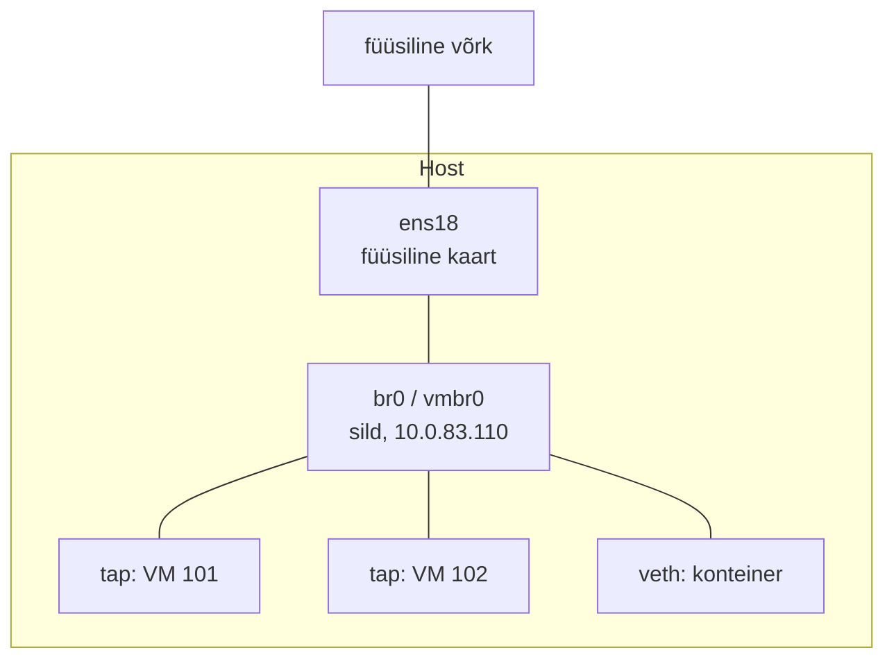
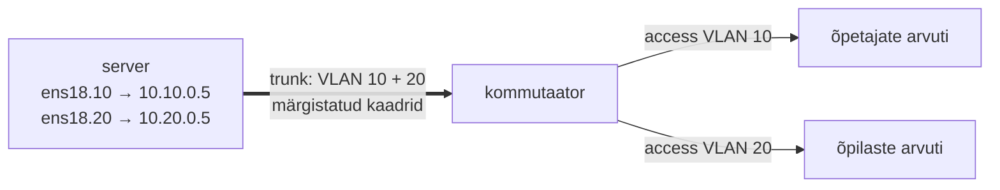
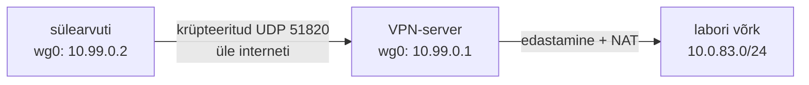

<!-- navigatsioon -->
[← Moodul 12. Enesekontroll](../moodul-12-turvalisus-logid/enesekontroll.md) · [Sisukord](../../README.md#sisukord) · [Laboritöö 13. Võrgu süvendus →](labor.md)
<!-- /navigatsioon -->

# Moodul 13. Võrgu süvendus: IPv6, sild, VLAN, bond ja VPN

**Maht:** 8 tundi · **Laboritöö:** Ubuntu, AlmaLinux, Debian · **Eeldused:** moodulid 1–12 (eriti 7 ja 12)

Moodulis 7 seadistasid ühe võrguliidese, aadressi, nimelahenduse ja tulemüüri. Päris serveriruumis on aga sageli mitu võrgukaarti, mitu loogilist võrku samas kaablis, IPv6 kõrvuti IPv4-ga ning kaugühendused üle interneti. Selles moodulis vaatame neid tehnikaid Linuxi administraatori vaatest: kuidas need töötavad ja kuidas neid kolmes distros seadistada.

## Õpiväljundid

Mooduli läbinud õppija:

- selgitab IPv6 aadresside ülesehitust ja liike ning seadistab staatilise IPv6-aadressi;
- seadistab silla (bridge) ja selgitab, kuidas virtuaalmasinad ja konteinerid seda kasutavad;
- seadistab VLAN-i ja selgitab märgistatud ja märgistamata pordi erinevust;
- koondab võrguliidesed bond-liideseks ja valib sobiva režiimi;
- teeb Linuxist ruuteri: lubab pakettide edastamise ning seadistab NAT-i ja pordi edasisuunamise;
- loob WireGuardiga VPN-tunneli;
- analüüsib võrguliiklust `tcpdump`-iga.

> [!NOTE]
> **Kuidas seda lehte lugeda:** iga teema algab kastiga **Lühidalt** - seal on kõige tähtsam paari lausega. Käsud ja näited on alati näha. Pikemad selgitused ja taust on peidetud plokkidesse **Loe lähemalt** - ava need, kui tahad teemast rohkem teada või kui laboritöös midagi ei õnnestu.

---

## 13.1 IPv6

> [!TIP]
> **Lühidalt:** IPv6 aadress on 128-bitine ja kirjutatakse kuueteistkümnendsüsteemis (`fd83::154/64`). Masin saab aadressi tavaliselt ise (SLAAC), serverile antakse staatiline. Käsud on samad mis IPv4-l, võtmega `-6`.

IPv4-aadresse on umbes 4 miljardit ja need on ammu otsas - internet on seni toiminud NAT-i abil. **IPv6** aadressid on **128-bitised** (IPv4 on 32-bitine), seega jätkub neid igale seadmele. Suur osa mobiilivõrkudest ja koduühendustest kasutab juba IPv6-t ning serveriadministraator kohtab seda kindlasti.

### Aadressi kirjutamine

IPv6-aadress kirjutatakse kaheksa 16-bitise rühmana kuueteistkümnendsüsteemis:

```text
2001:0db8:0083:0000:0000:0000:0000:0052
```

Kirjutamise lihtsustamiseks:

- iga rühma algusnullid võib ära jätta: `0db8` → `db8`, `0052` → `52`;
- **üks** järjestikuste nullrühmade jada asendatakse `::`-ga.

Seega sama aadress on `2001:db8:83::52`. Alamvõrk kirjutatakse nagu IPv4-s prefiksiga: `2001:db8:83::/64`. Aadressi esimesed 64 bitti on tavaliselt **võrguosa** (prefiks) ja viimased 64 bitti **liidese osa**.

### Aadresside liigid

| Aadress | Nimi | Tähendus | IPv4 vaste |
|---|---|---|---|
| `::1` | loopback | masin ise | `127.0.0.1` |
| `fe80::/10` | **link-local** | igal liidesel automaatselt, töötab ainult samas võrgulõigus, ei liigu ruuterist läbi | `169.254.0.0/16` |
| `fd00::/8` | **ULA** (*Unique Local Address*) | privaatvõrk, internetti ei marsruudita | `10.0.0.0/8` jt |
| `2000::/3` | **globaalne** (*GUA*) | avalik, internetis marsruuditav | avalik aadress |
| `ff00::/8` | multicast | ühelt paljudele; IPv6-s pole broadcasti | `224.0.0.0/4` |

Igal IPv6-liidesel on korraga **mitu aadressi**: vähemalt link-local ja sageli ka globaalne ja/või ULA. See on normaalne.

<details>
<summary>Loe lähemalt: Kuidas masin aadressi saab?</summary>

| Viis | Kuidas töötab |
|---|---|
| **SLAAC** (*Stateless Address Autoconfiguration*) | Ruuter saadab regulaarselt **ruuteri teateid** (*Router Advertisement*, RA) võrgu prefiksiga. Masin moodustab aadressi ise: prefiks + juhuslik või MAC-ist tuletatud liidese osa. Vaikelüüs on RA saatnud ruuter. |
| **DHCPv6** | Nagu IPv4 DHCP: server jagab aadressid (vajalik, kui tahad aadressid kesksel registreerida). |
| **Staatiline** | Serveritele, nagu IPv4-s. |

Serverile antakse üldjuhul staatiline aadress, et DNS-kirje (`AAAA`) ja tulemüüri reeglid püsiksid. Töölaudadel kasutatakse SLAAC-i koos **privaatsuslaienditega** (*privacy extensions*): liidese osa vahetub regulaarselt, et seadet ei saaks aadressi järgi jälgida.

</details>

### IPv6 käsud

Enamik käske töötab mõlemaga, IPv6 jaoks lisatakse sageli `-6`:

```bash
ip -6 address                          # IPv6-aadressid
ip -6 route                            # IPv6 marsruudid (vaikelüüs on sageli link-local aadress!)
ip -6 neigh                            # naabrid (IPv6-s asendab ARP-i NDP)
ping -6 -c2 ipv6.google.com
ping -c2 fe80::be24:11ff:fe2a:1b3c%ens18   # link-local aadressi juurde tuleb lisada liides
ss -6 -tlpn                            # IPv6 kuulavad pordid
dig AAAA debian.org +short
curl -6 https://ifconfig.co            # mis on minu avalik IPv6-aadress?
ssh kasutaja@fd83::152                  # ssh kasutaja@[fd83::152]:2222 pordiga; scp/rsync vajavad nurksulgusid
```

Link-local aadressi juures on vaja liidese nime (`%ens18`), sest sama `fe80::/64` võrk on olemas igal liidesel ja kernel ei tea muidu, kust pakett saata.

### Staatiline IPv6 kolmes distros

Kursuse laborivõrgus kasutame ULA-võrku `fd83::/64` (masina number nagu IPv4-s, nt `alma` → `fd83::155`).

```yaml
# Ubuntu: Netplani fail, nt /etc/netplan/50-cloud-init.yaml (liidese ens18 alla)
      addresses:
        - 10.0.83.154/24
        - fd83::154/64
```

```text
# Debian: /etc/network/interfaces (lisa IPv4 ploki järele)
iface ens18 inet6 static
    address fd83::152/64
```

```bash
# AlmaLinux: NetworkManager
sudo nmcli connection modify ens18 ipv6.method manual ipv6.addresses fd83::155/64
sudo nmcli connection up ens18
```

Kui võrgus on IPv6-ruuter, lisatakse ka `gateway6` (Netplan `routes: - to: default via: …`, nmcli `ipv6.gateway`). Laboris piisab samas võrgulõigus suhtlemisest.

### IPv6 ja tulemüür

IPv6-s ei kasutata tavaliselt NAT-i: iga masin on globaalse aadressiga otse adresseeritav. **NAT ei olnud kunagi turvamehhanism, kuid paljud võrgud on sellele kogemata lootnud** - IPv6-s kaitseb masinat ainult tulemüür.

- `ufw` ja `firewalld` haldavad IPv4 ja IPv6 reegleid korraga (ufw: `IPV6=yes` failis `/etc/default/ufw`).
- `nftables`-is kasuta tabelit **`inet`** (moodul 7), mis kehtib mõlemale; tabel `ip` kehtib ainult IPv4-le.
- **ICMPv6 ei tohi blokeerida**: IPv6 vajab seda naabrite leidmiseks (NDP), ruuteri teadeteks ja MTU tuvastuseks. Erinevalt IPv4-st lakkab võrk ilma selleta töötamast.
- Kontrolli alati ka IPv6 poolt: teenus, mis IPv4-s on kaitstud, võib `ss -6 -tlpn` järgi kuulata ka IPv6-l.

Veebiserver kuulab IPv6-l nginx-is reaga `listen [::]:80;` ja Apache'is `Listen 80` (mõlemad). DNS-is lisatakse `AAAA`-kirje (moodul 17).

## 13.2 Sild (bridge)

> [!TIP]
> **Lühidalt:** **Sild** on tarkvaraline kommutaator: sellega lisatud liidesed on samas võrgus. Sildu kasutavad virtuaalmasinad ja konteinerid (Proxmoxi `vmbr0`).

**Sild** on Linuxi kernelis töötav **tarkvaraline kommutaator** (*switch*). Silda lisatud liidesed on samas võrgulõigus (L2): sild õpib MAC-aadresse ja edastab kaadreid nagu päris kommutaator.

Sildu kasutavad kõik virtualiseerimis- ja konteinerilahendused:



- **Proxmox** loob vaikimisi silla `vmbr0`, mille küljes on füüsiline kaart ja kõigi VM-ide virtuaalsed võrgukaardid (moodul 28).
- **Podman ja Docker** loovad silla (`podman0`, `docker0`) ja ühendavad iga konteineri sellega **veth-paari** kaudu (moodul 14).
- **libvirt** loob silla `virbr0` NAT-iga.

Kui füüsiline liides lisatakse silda, liigub tema IP-aadress **sillale** - liides ise jääb ilma aadressita.

```bash
# AlmaLinux: NetworkManager
sudo nmcli connection add type bridge ifname br0 con-name br0 \
    ipv4.method manual ipv4.addresses 10.0.83.155/24 ipv4.gateway 10.0.83.1 ipv4.dns 10.0.83.1 \
    bridge.stp no
sudo nmcli connection add type bridge-slave ifname ens19 master br0
```

```yaml
# Ubuntu: Netplan
network:
  version: 2
  ethernets:
    ens19: {}
  bridges:
    br0:
      interfaces: [ens19]
      addresses: [10.50.0.1/24]
      parameters: {stp: false}
```

```text
# Debian: /etc/network/interfaces (pakett bridge-utils)
auto br0
iface br0 inet static
    address 10.50.0.1/24
    bridge-ports ens19
    bridge-stp off
```

```bash
bridge link                     # millised liidesed on sillas
bridge fdb show br br0          # silla MAC-aadresside tabel
ip -d link show br0             # silla seaded
```

**STP** (*Spanning Tree Protocol*) väldib silmuseid, kui mitu silda või kommutaatorit on ühendatud ringiks. Üksiku serveri sillal lülitatakse see tavaliselt välja (kiirem liidese käivitumine).

> [!WARNING]
> **Ära lisa silda liidest, mille kaudu oled SSH-ga ühendatud**, ilma konsoolita: aadress kolib sillale ja ühendus katkeb, kui midagi läheb valesti. Laboris kasutame selleks teist võrgukaarti (`ens19`).

## 13.3 VLAN

> [!TIP]
> **Lühidalt:** **VLAN** jagab ühe füüsilise võrgu mitmeks loogiliseks võrguks märgisega (802.1Q). Linuxis luuakse VLAN-liides (`ens19.20`) ja see seadistatakse nagu tavaline liides.

**VLAN** (*Virtual LAN*, standard **802.1Q**) jagab ühe füüsilise võrgu mitmeks loogiliseks võrguks. Iga Ethernet-kaadri sisse lisatakse **4-baidine märgis** (*tag*), milles on VLAN-i number (1-4094). Kommutaator hoiab eri VLAN-ide liikluse lahus nagu eraldi kommutaatorid.



| Pordi tüüp | Mida edastab | Kellele |
|---|---|---|
| **Access** (märgistamata, *untagged*) | Ühe VLAN-i kaadrid ilma märgiseta | Tavalised arvutid, mis VLAN-idest ei tea |
| **Trunk** (märgistatud, *tagged*) | Mitme VLAN-i kaadrid märgistega | Kommutaatorite vahel, serverid, hüperviisorid, tulemüür |

Linux loob iga VLAN-i jaoks eraldi alamliidese (tavaliselt nimega `ens18.20` või `vlan20`), millele antakse oma aadress:

```bash
# ajutiselt (testimiseks)
sudo ip link add link ens19 name ens19.20 type vlan id 20
sudo ip address add 10.20.0.5/24 dev ens19.20
sudo ip link set ens19.20 up
ip -d link show ens19.20                  # näitab: vlan protocol 802.1Q id 20
```

```bash
# AlmaLinux: püsivalt
sudo nmcli connection add type vlan con-name vlan20 dev ens19 id 20 \
    ipv4.method manual ipv4.addresses 10.20.0.155/24
```

```yaml
# Ubuntu: Netplan
  vlans:
    vlan20:
      id: 20
      link: ens19
      addresses: [10.20.0.154/24]
```

```text
# Debian: /etc/network/interfaces (pakett vlan)
auto ens19.20
iface ens19.20 inet static
    address 10.20.0.152/24
```

VLAN-e kasutatakse koolides ja ettevõtetes võrkude eraldamiseks (õpetajad, õpilased, serverid, külalised, IP-telefonid). VLAN-ide vahel liikumine käib alati läbi ruuteri või tulemüüri (nt OPNsense, moodul 22), kus saab liiklust piirata.

> [!NOTE]
> **Proxmoxis** saab VM-i võrgukaardile määrata VLAN-i (*VLAN Tag*), kui sild on *VLAN aware*. Siis märgistab Proxmox kaadrid ise ja VM näeb tavalist märgistamata võrku. Kui VM peab ise mitut VLAN-i nägema (nt tulemüür), jäetakse märgis tühjaks ja VLAN-id seadistatakse VM-is nagu eespool.

## 13.4 Bond (liideste koondamine)

> [!TIP]
> **Lühidalt:** **Bond** ühendab mitu võrgukaarti üheks liideseks töökindluse (`active-backup`) või suurema läbilaskevõime (`802.3ad`/LACP) jaoks. Olekut näeb failist `/proc/net/bonding/bond0`.

**Bond** (ka *link aggregation*, *teaming*, *NIC teaming*) ühendab mitu võrgukaarti üheks loogiliseks liideseks `bond0`. Eesmärk on **töökindlus** (kaabli, kaardi või kommutaatori pordi rikke korral ühendus jätkub) ja/või suurem **läbilaskevõime**.

| Režiim | Kuidas töötab | Kommutaatori tugi |
|---|---|---|
| `active-backup` (1) | Üks liides töötab, teine ootab; rikke korral võtab teine üle | Ei vaja - **kõige lihtsam ja töökindlam** |
| `802.3ad` (4), **LACP** | Liiklus jaotatakse liideste vahel, kommutaatoriga lepitakse kokku LACP-protokolliga | Vajab (LACP konfigureeritud kommutaatoris) |
| `balance-alb` (6) | Jaotab liiklust MAC-aadresside abil | Ei vaja |
| `balance-rr` (0) | Kordamööda kõikidele liidestele | Vajab; pakettide järjekord võib segi minna |

Üks TCP-ühendus kasutab tavaliselt ainult ühte liidest - bond suurendab koguläbilaskevõimet paljude ühenduste puhul, mitte ühe faili kopeerimise kiirust.

```bash
# AlmaLinux: NetworkManager
sudo nmcli connection add type bond con-name bond0 ifname bond0 \
    bond.options "mode=active-backup,miimon=100" \
    ipv4.method manual ipv4.addresses 10.30.0.155/24
sudo nmcli connection add type ethernet ifname ens19 master bond0
sudo nmcli connection add type ethernet ifname ens20 master bond0
```

```yaml
# Ubuntu: Netplan
network:
  version: 2
  ethernets:
    ens19: {}
    ens20: {}
  bonds:
    bond0:
      interfaces: [ens19, ens20]
      addresses: [10.30.0.154/24]
      parameters:
        mode: active-backup
        mii-monitor-interval: 100
```

```text
# Debian: /etc/network/interfaces (pakett ifenslave)
auto bond0
iface bond0 inet static
    address 10.30.0.152/24
    bond-slaves ens19 ens20
    bond-mode active-backup
    bond-miimon 100
```

```bash
cat /proc/net/bonding/bond0     # režiim, aktiivne liides, iga liidese olek ja rikete arv
ip -br link                     # bond0 ja selle liikmed (master bond0)
```

`miimon=100` kontrollib liidese olekut iga 100 ms järel. Bond, VLAN ja sild kombineeritakse sageli: `ens19` + `ens20` → `bond0` → `bond0.20` (VLAN) → `vmbr20` (sild VM-idele).

> [!NOTE]
> Virtuaalmasinas on bond'il vähe mõtet - hüperviisor tagab juba töökindluse. Füüsilistes serverites ja hüperviisorites (Proxmox) on see aga tavaline. Laboris harjutame VM-is kahe virtuaalse võrgukaardiga.

## 13.5 Linux ruuterina: edastamine ja NAT

> [!TIP]
> **Lühidalt:** Linux saab olla ruuter: luba edastamine (`net.ipv4.ip_forward=1`) ja lisa NAT (`masquerade`), et sisevõrgu masinad pääseksid välja. Pordi edasisuunamine (`dnat`) avab sisevõrgu teenuse väljapoole.

Linux saab olla **ruuter**: võtta pakette vastu ühest võrgust ja saata teise. Nii töötavad ka OPNsense, kodu-WiFi-ruuterid ja kõik konteineri- ja VPN-lahendused. Vaikimisi on edastamine välja lülitatud:

```bash
sysctl net.ipv4.ip_forward                     # 0 = väljas
echo "net.ipv4.ip_forward = 1" | sudo tee /etc/sysctl.d/90-ruuter.conf
echo "net.ipv6.conf.all.forwarding = 1" | sudo tee -a /etc/sysctl.d/90-ruuter.conf
sudo sysctl --system
```

Kui sisevõrgu aadressid (nt `10.50.0.0/24`) ei ole välisvõrgus teada, on vaja **NAT-i** (*Network Address Translation*): ruuter asendab väljuva paketi lähteaadressi enda aadressiga ja vastuse saabudes vahetab selle tagasi. Linuxis tehakse seda nftables'iga (moodul 7):

```text
# /etc/nftables.conf (lisa olemasolevale)
table ip nat {
    chain postrouting {
        type nat hook postrouting priority srcnat;
        ip saddr 10.50.0.0/24 oifname "ens18" masquerade      # sisevõrk välja läbi ens18
    }
    chain prerouting {
        type nat hook prerouting priority dstnat;
        iifname "ens18" tcp dport 8080 dnat to 10.50.0.2:80    # pordi edasisuunamine sisse
    }
}
```

| Mõiste | Mida teeb | Näide |
|---|---|---|
| **masquerade** (SNAT) | Muudab väljuva paketi **lähteaadressi** ruuteri omaks | Kodu-WiFi, konteinerid, VPN-i kliendid internetti |
| **DNAT** (*port forwarding*) | Muudab sissetuleva paketi **sihtaadressi** sisevõrgu masina omaks | Sisevõrgu veebiserver väljast ligipääsetavaks |

firewalld-is (AlmaLinux): `sudo firewall-cmd --permanent --zone=public --add-masquerade` ja `--add-forward-port=port=8080:proto=tcp:toport=80:toaddr=10.50.0.2`.

```bash
sudo nft list ruleset           # kontrolli reegleid
sudo conntrack -L               # aktiivsed NAT-ühendused (pakett conntrack)
```

> [!NOTE]
> Ruuteril peab lisaks NAT-ile tulemüür lubama edastatavat liiklust (ahel `forward`). firewalld ja ufw keelavad edastamise vaikimisi; ufw-s muuda `DEFAULT_FORWARD_POLICY` failis `/etc/default/ufw` või lisa `ufw route allow` reeglid.

## 13.6 VPN: WireGuard

> [!TIP]
> **Lühidalt:** WireGuard loob kiire krüpteeritud VPN-tunneli. Igal osapoolel on võtmepaar, seadistus on failis `/etc/wireguard/wg0.conf`, käivitus `systemctl enable --now wg-quick@wg0`, olek `wg show`.

**VPN** (*Virtual Private Network*) loob kahe võrgu või seadme vahele krüpteeritud tunneli üle interneti. Nii pääseb nt kodust turvaliselt kooli labori sisevõrku, kuigi labori masinatel pole avalikke aadresse.

**WireGuard** on Linuxi kernelis sisalduv kaasaegne VPN: väike, kiire ja lihtsa seadistusega. Iga osapool (*peer*) on tuvastatud **võtmepaariga** (nagu SSH-võtmed). WireGuard kasutab ainult **UDP-d** ja ei vasta valele võtmele üldse - väljast vaadates paistab port suletuna.



Võtmed (mõlemas masinas):

```bash
sudo apt install wireguard-tools         # AlmaLinux: sudo dnf install wireguard-tools
umask 077
wg genkey | tee privaat.key | wg pubkey > avalik.key
```

Server, `/etc/wireguard/wg0.conf`:

```ini
[Interface]
Address = 10.99.0.1/24
ListenPort = 51820
PrivateKey = <serveri privaatvõti>
# luba VPN-i klientidel labori võrku pääseda (punkt 13.5):
PostUp = sysctl -w net.ipv4.ip_forward=1; nft add table ip wgnat; nft add chain ip wgnat post '{ type nat hook postrouting priority srcnat; }'; nft add rule ip wgnat post ip saddr 10.99.0.0/24 oifname ens18 masquerade
PostDown = nft delete table ip wgnat

[Peer]
# Mari sülearvuti
PublicKey = <kliendi avalik võti>
AllowedIPs = 10.99.0.2/32
```

Klient, `/etc/wireguard/wg0.conf` (Windowsis ja telefonis sama sisuga fail WireGuardi rakendusse):

```ini
[Interface]
Address = 10.99.0.2/24
PrivateKey = <kliendi privaatvõti>

[Peer]
PublicKey = <serveri avalik võti>
Endpoint = vpn.example.ee:51820
AllowedIPs = 10.99.0.0/24, 10.0.83.0/24     # mis liiklus läheb tunnelisse
PersistentKeepalive = 25
```

```bash
sudo systemctl enable --now wg-quick@wg0
sudo wg show                          # partnerid, viimane ühenduse kinnitus (handshake), liiklus
ping 10.99.0.1
```

Serveri tulemüüris ava **51820/udp** (`sudo ufw allow 51820/udp`, `sudo firewall-cmd --permanent --add-port=51820/udp`).

**`AllowedIPs` on korraga marsruutimistabel ja juurdepääsukontroll:** kliendis määrab see, millised sihtaadressid saadetakse tunnelisse; serveris, millise lähteaadressiga pakette sellelt partnerilt vastu võetakse. `AllowedIPs = 0.0.0.0/0` kliendis suunab **kogu** liikluse tunnelisse (nt avalikus WiFi-võrgus).

| Kasutus | Seadistus |
|---|---|
| **Kaugtöö** (*road warrior*): sülearvuti → asutuse võrk | Nagu eespool: server NAT-iga, kliendis `AllowedIPs` asutuse võrgud |
| **Kahe asukoha ühendamine** (*site-to-site*) | Kaks Linuxi (või OPNsense) ruuterit, mõlemas `AllowedIPs` teise asukoha võrk; NAT-i pole vaja, kui mõlemas võrgus lisatakse marsruut |

> [!NOTE]
> OPNsense'is (moodul 22) on WireGuard veebiliideses (*VPN* → *WireGuard*). Kooli võrgust välja ühendudes järgi alati asutuse IT-reegleid - ära ava omavoliliselt tunneleid sisevõrku.

Teisi VPN-e: **OpenVPN** (vanem, TLS-põhine, töötab ka TCP-pordil 443 piiravates võrkudes) ja **IPsec** (standardne, ühildub ruuterite ja tulemüüridega, keerulisem seadistada).

## 13.7 Liikluse analüüs: tcpdump

> [!TIP]
> **Lühidalt:** `tcpdump` näitab liidesel liikuvaid pakette: `sudo tcpdump -i ens18 -n port 53`. Salvesta püüdmine faili (`-w`) ja ava see Wiresharkis.

Kui ühendus ei tööta ja tavalised käsud (moodul 7, punkt 7.5) põhjust ei näita, vaata pakette endid. **tcpdump** püüab võrguliidesel liikuvaid pakette ja näitab neid terminalis.

```bash
sudo apt install tcpdump              # AlmaLinux: sudo dnf install tcpdump
sudo tcpdump -i ens18 -n icmp         # ainult ping-paketid, ilma nimelahenduseta (-n)
sudo tcpdump -i ens18 -n port 53      # DNS-päringud
sudo tcpdump -i any -n host 10.0.83.152 and tcp port 22
sudo tcpdump -i ens19 -n -e vlan      # VLAN-märgised (-e näitab Etherneti päist)
sudo tcpdump -i ens18 -n icmp6        # IPv6 naabrite leidmine ja ping
sudo tcpdump -i ens18 -w puuk.pcap    # salvesta faili, ava hiljem Wiresharkis
```

| Mida näed | Mida see tähendab |
|---|---|
| Päringud lähevad välja, vastust ei tule | Tulemüür, marsruut või teine pool |
| Päringut ei jõua üldse liidesele | Vale marsruut, vale liides, kohalik tulemüür väljuval suunal |
| `TCP SYN` → `RST` | Pordil keegi ei kuula |
| `TCP SYN`, vastust pole | Tulemüür viskab paketi ära (`drop`) |
| ARP/NDP päringud ilma vastuseta | Teine masin pole samas võrgulõigus (VLAN, sild) |

**Wireshark** on sama asi graafilise liidesega; serveris püütakse tavaliselt `tcpdump -w` failiks ja analüüsitakse oma arvutis.

> [!WARNING]
> Pakettide püüdmine näeb kogu krüpteerimata sisu (ka paroole). Tee seda ainult oma võrgus ja oma masinates või loa alusel.

---

## Distrode erinevused

| | **Debian** | **Ubuntu** | **AlmaLinux** |
|---|---|---|---|
| Sild, VLAN, bond | `/etc/network/interfaces` + paketid `bridge-utils`, `vlan`, `ifenslave` | Netplan: `bridges:`, `vlans:`, `bonds:` | `nmcli con add type bridge/vlan/bond` |
| Staatiline IPv6 | `iface ens18 inet6 static` | Netplan `addresses:` | `nmcli … ipv6.addresses` |
| NAT ja edastamine | nftables | ufw (`/etc/ufw/before.rules`) või nftables | firewalld `--add-masquerade`, `--add-forward-port` |
| WireGuard | `wireguard-tools` | `wireguard-tools` | `wireguard-tools` |

<details>
<summary>Loe lähemalt: Kuidas on see FreeBSD-s?</summary>

Selle mooduli teemad on FreeBSD-s olemas ja seadistatakse failis `/etc/rc.conf`:

| | Linux | FreeBSD |
|---|---|---|
| Sild | `ip link add br0 type bridge` | `ifconfig bridge0 create addm vtnet0` |
| VLAN | `ip link add link eth0 name eth0.20 type vlan id 20` | `vlans_vtnet0="20"`, liides `vtnet0.20` |
| Liideste koondamine | bond | `lagg` (`laggproto lacp`) |
| Edastamine (ruuter) | `net.ipv4.ip_forward=1` | `sysrc gateway_enable=YES` |
| NAT ja tulemüür | nftables | pf: `nat on $ext_if from 10.50.0.0/24 to any -> ($ext_if)` |
| Virtuaalne IP kahe ruuteri vahel | keepalived (VRRP) | **CARP** (OpenBSD-st) |
| WireGuard | kernelis | kernelis (`if_wg`), `pkg install wireguard-tools` |
| Liikluse analüüs | `tcpdump` | `tcpdump` baassüsteemis |

FreeBSD võrgupinu on tuntud jõudluse poolest. Selle peal töötavad OPNsense ja pfSense (moodul 22), Juniperi ruuterite Junos ja Netflixi videoedastuse serverid.

</details>

---

## Kokkuvõte

| Käsk | Tegevus |
|---|---|
| `ip -6 a`, `ip -6 r`, `ip -6 neigh`, `ping -6`, `dig AAAA` | IPv6 |
| `bridge link`, `bridge fdb` | Sild |
| `ip link add … type vlan id 20`, `ip -d link` | VLAN |
| `cat /proc/net/bonding/bond0` | Bond'i olek |
| `sysctl net.ipv4.ip_forward`, `nft … masquerade`, `dnat to` | Ruuter ja NAT |
| `wg genkey`, `wg-quick@wg0`, `wg show` | WireGuard VPN |
| `tcpdump -i liides -n filter` | Pakettide püüdmine |

**Järgmised sammud:** tee [laboritöö](labor.md) ja kontrolli oma teadmisi [enesekontrolli](enesekontroll.md) abil.

## Lisamaterjal

- Netplan dokumentatsioon - bridges, bonds, vlans (netplan.readthedocs.io)
- Red Hat: *Configuring and managing networking* (docs.redhat.com)
- WireGuardi koduleht ja *Quick Start* (www.wireguard.com)
- RIPE NCC IPv6 õppematerjalid (www.ripe.net/support/training)
- `man tcpdump`, `man 7 pcap-filter`

<!-- navigatsioon -->
---

[← Moodul 12. Enesekontroll](../moodul-12-turvalisus-logid/enesekontroll.md) · [Sisukord](../../README.md#sisukord) · [Laboritöö 13. Võrgu süvendus →](labor.md)
<!-- /navigatsioon -->
