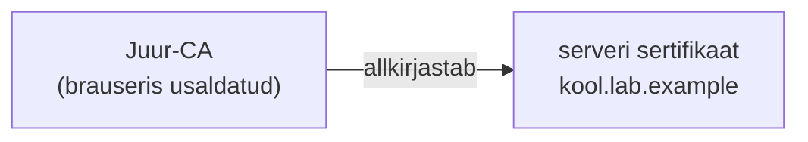
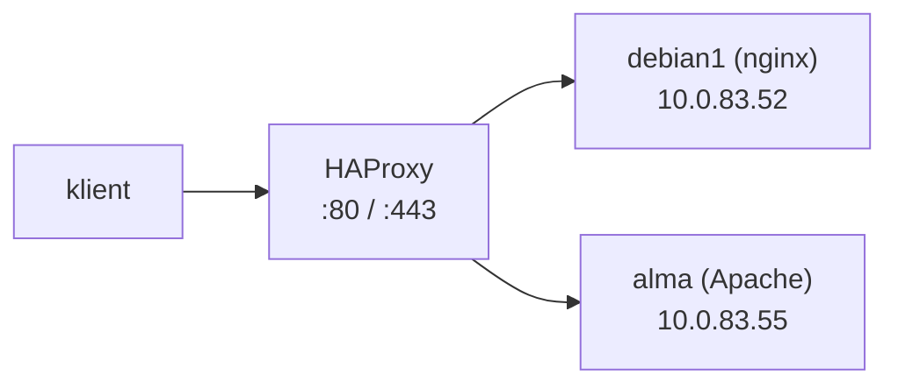
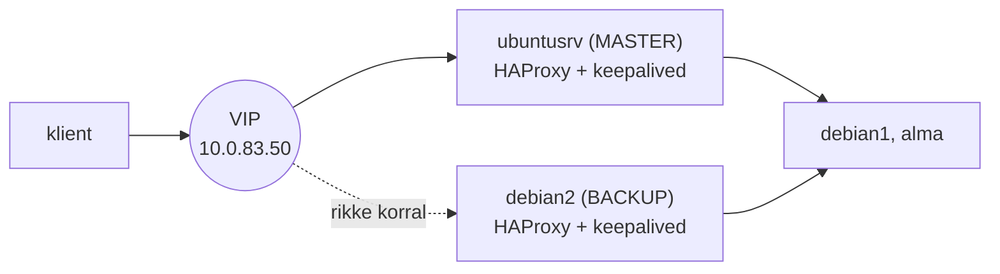

<!-- navigatsioon -->
[← Moodul 14. Enesekontroll](../moodul-14-konteinerid/enesekontroll.md) · [Sisukord](../../README.md#sisukord) · [Laboritöö 15. Veebiserverid (kooli väikeserver, I osa) →](labor.md)
<!-- /navigatsioon -->

# Moodul 15. Veebiserverid

**Maht:** 10 tundi · **Laboritöö:** Debian, AlmaLinux, Ubuntu · **Eeldused:** moodulid 1–8, 12–14

> [!NOTE]
> **Süsteemihalduri vaade veebiserveritele.** See moodul õpetab veebiserverit paigaldama, seadistama ja hoidma nii, nagu Linuxi serveri haldur seda vajab: nginx ja Apache saidid, HTTPS ja sertifikaadid, koormuse jaotus ja varundus. Eesmärk on töötav ja turvaline veebiserver laboris - mitte veebirakenduste arendus ega suurte veebiplatvormide täielik valdamine.
>
> **HKHK õppijale:** veebiservereid ja rakendusservereid käsitletakse põhjalikumalt eraldi moodulites (nt veebiserveri paigaldus, rakendusserverid). See moodul annab neile Linuxi serveri poolt vaadates aluse.

## Õpiväljundid

Mooduli läbinud õppija:

- kirjeldab serveriteenuse paigaldamise üldist töövoogu;
- paigaldab ja seadistab veebiserveri nginx koos virtuaalhostidega;
- seadistab veebiserverile TLS-i (HTTPS) oma CA-ga ning kirjeldab avaliku sertifikaadi hankimise ja uuendamise protsessi (domeen, valideerimine, ACME, certbot, kehtivus, Certificate Transparency);
- seadistab Apache'i virtuaalhostid nii Debianis kui ka AlmaLinuxis;
- kasutab Caddyt automaatse HTTPS-i ja lihtsa pöördpuhvri jaoks ning tunneb kergemaid veebiservereid (lighttpd);
- seadistab pöördpuhvri ja koormuse jaotuse (nginx `upstream`, HAProxy) ning kirjeldab Traefiki rolli;
- teeb koormusejaoturi rikkekindlaks virtuaalse IP-aadressiga (keepalived, VRRP) ja mõõdab veebiserveri jõudlust koormustestiga;
- valib olukorrale sobiva veebiserveri.

> [!NOTE]
> **Kuidas seda lehte lugeda:** iga teema algab kastiga **Lühidalt** - seal on kõige tähtsam paari lausega. Käsud ja näited on alati näha. Pikemad selgitused ja taust on peidetud plokkidesse **Loe lähemalt** - ava need, kui tahad teemast rohkem teada või kui laboritöös midagi ei õnnestu.

---

## 15.1 Serveriteenuste ülevaade

> [!TIP]
> **Lühidalt:** Iga serveriteenus käib sama töövooga: paigalda → seadista → kontrolli süntaksit → käivita ja luba → ava tulemüür → testi → vaata logisid → varunda.

Moodulites 15–18 paneme kokku kõik varem õpitu: pakihaldus, teenused, võrk, tulemüür, õigused, skriptid ja varundus. Selles moodulis tegeleme veebiserveritega, moodulis 16 andmebaasidega, moodulis 17 DNS-iga ja moodulis 18 failiserveri, varunduse ja dokumentatsiooniga. Tüüpiline väikese asutuse server pakub järgmisi teenuseid:

| Teenus | Tarkvara (näited) | Port |
|---|---|---|
| Veebiserver | **nginx**, Apache, Caddy, lighttpd | 80, 443 |
| Koormusejaotur | HAProxy, Traefik, nginx | 80, 443 |
| Andmebaas | **MariaDB**/MySQL, PostgreSQL, SQLite, Valkey | 3306, 5432, 6379 |
| DNS | **BIND9**, Unbound, dnsmasq, CoreDNS | 53 |
| Failide jagamine Linuxile | **NFS** | 2049 |
| Failide jagamine Windowsile | **Samba** | 445 |
| E-post (saatmine) | **Postfix** | 25, 587 |
| Varundus | **restic**, borg, rsync, Proxmox Backup Server | - |

Iga teenuse puhul kehtib sama töövoog:

1. paigalda pakihalduriga;
2. seadista (seadistusfail `/etc` all, tee enne varukoopia);
3. kontrolli seadistuse süntaksit (igal teenusel on selleks oma käsk);
4. käivita ja luba teenus (`systemctl enable --now`);
5. ava tulemüüris vajalik port;
6. testi (kohalikult ja teisest masinast);
7. vaata logisid;
8. seadista varundus;
9. dokumenteeri.

## 15.2 Veebiserver nginx

> [!TIP]
> **Lühidalt:** nginx teenindab mitut saiti **serveriplokkidega**: seadistus `/etc/nginx/sites-available/`, lubamiseks viit `sites-enabled/`-isse. Enne `reload`-i kontrolli alati `nginx -t`.

**nginx** on tänapäeval üks levinumaid veebiservereid. See on kiire, kasutab vähe mälu ja sobib nii staatiliste failide serveerimiseks kui ka pöördpuhverserveriks. Teine levinud veebiserver on **Apache** (`apache2`, AlmaLinuxis `httpd`).

```bash
sudo apt install nginx
systemctl status nginx
curl -I http://localhost
```

### Seadistusfailide ülesehitus (Debian, Ubuntu)

| Fail või kataloog | Sisu |
|---|---|
| `/etc/nginx/nginx.conf` | Põhiseadistus (tavaliselt ei muudeta) |
| `/etc/nginx/sites-available/` | Virtuaalhostide seadistused |
| `/etc/nginx/sites-enabled/` | Sümbolviidad lubatud saitidele |
| `/etc/nginx/snippets/` | Korduvkasutatavad seadistuse osad |
| `/var/www/` | Veebisaitide failid |
| `/var/log/nginx/access.log`, `error.log` | Logid |

AlmaLinuxis kasutatakse selle asemel kataloogi `/etc/nginx/conf.d/*.conf`.

### Virtuaalhostid

Üks veebiserver võib teenindada mitut saiti. Brauser saadab päringus nime (päis `Host:`) ja nginx valib selle järgi õige **serveriploki** (*server block*, Apache'is *virtual host*).

```nginx
# /etc/nginx/sites-available/kool.lab.example
server {
    listen 80;
    listen [::]:80;
    server_name kool.lab.example www.lab.example;

    root /var/www/kool;
    index index.html;

    access_log /var/log/nginx/kool.access.log;
    error_log  /var/log/nginx/kool.error.log;

    location / {
        try_files $uri $uri/ =404;
    }
}
```

| Direktiiv | Tähendus |
|---|---|
| `listen` | Port (ja aadress), kus serveriplokk kuulab |
| `server_name` | Nimed, mille päringuid see plokk teenindab |
| `root` | Kataloog, kust faile serveeritakse |
| `index` | Fail, mida näidatakse kataloogi päringu korral |
| `location` | Reeglid kindlate URL-ide jaoks |
| `try_files` | Proovi järjest: fail, kataloog, muidu viga 404 |

Saidi lubamine:

```bash
sudo mkdir -p /var/www/kool
echo "<h1>Kooli sait</h1>" | sudo tee /var/www/kool/index.html
sudo ln -s /etc/nginx/sites-available/kool.lab.example /etc/nginx/sites-enabled/
sudo nginx -t                        # kontrolli süntaksit
sudo systemctl reload nginx
curl -H "Host: kool.lab.example" http://localhost
```

> [!WARNING]
> **Alati `nginx -t` enne `reload`-i!** Vigase seadistusega `restart` jätab saidi maha, `reload` vigase seadistusega jätab vana seadistuse tööle - kuid parem on viga enne leida.

Faili `default` saidi saab keelata: `sudo rm /etc/nginx/sites-enabled/default`.

### Pöördpuhverserver

nginx võib päringud edasi saata teisele serverile või rakendusele (nt Node.js, Python, Docker konteiner), mis kuulab ainult kohalikul pordil:

```nginx
server {
    listen 80;
    server_name rakendus.lab.example;

    location / {
        proxy_pass http://127.0.0.1:3000;
        proxy_set_header Host $host;
        proxy_set_header X-Real-IP $remote_addr;
        proxy_set_header X-Forwarded-For $proxy_add_x_forwarded_for;
        proxy_set_header X-Forwarded-Proto $scheme;
    }
}
```

Nii saab mitu rakendust töötada ühe IP-aadressi ja pordi 443 taga, TLS-i haldab ainult nginx ja rakendus ise ei ole otse internetist kättesaadav.

## 15.3 TLS ja HTTPS

> [!TIP]
> **Lühidalt:** HTTPS vajab sertifikaati. Avalikule saidile annab selle tasuta Let's Encrypt (`certbot`), laboris kasutame oma CA-d. Sertifikaat ja võti lisatakse serveriplokki (`listen 443 ssl`).

**TLS** (*Transport Layer Security*) krüpteerib ühenduse brauseri ja serveri vahel ning tõendab, et server on see, kelleks ta end nimetab. HTTP koos TLS-iga on **HTTPS** (port 443).

### Sertifikaadid

TLS põhineb **sertifikaatidel**:

- serveril on **privaatvõti** (salajane) ja **sertifikaat**, mis sisaldab avalikku võtit ja serveri nime;
- sertifikaati allkirjastab **sertifitseerimiskeskus** (CA, *Certificate Authority*);
- brauser usaldab sertifikaati, kui selle allkirjastanud CA on brauseri või operatsioonisüsteemi usaldatud CA-de loendis.



Sertifikaadis peab serveri nimi olema väljal **SAN** (*Subject Alternative Name*) - brauserid kontrollivad just seda.

| Sertifikaadi liik | Kasutus | Brauser usaldab |
|---|---|---|
| **Let's Encrypt** (ACME) | Avalikud saidid, tasuta, automaatne uuendamine | Jah |
| **Kommertsiaalne CA** | Avalikud saidid, organisatsiooni valideerimine | Jah |
| **Oma CA** | Sisevõrk, labor | Ainult siis, kui CA on käsitsi usaldatud |
| **Iseallkirjastatud** | Testimine | Ei (hoiatus) |

### Labor ja päris maailm

**Selles kursuses kasutame laborites oma CA-d** (allpool) või Caddy `tls internal`-it, sest laborivõrgu nimed (`*.lab.example`) ei ole avalikud ja laborimasinad ei ole internetist kättesaadavad. Oma CA on õige valik ka päris sisevõrgus. **Avalikul veebisaidil** aga peab sertifikaat tulema avalikult usaldatud CA-lt - muidu näeb iga külastaja turvahoiatust. Allpool on kirjeldatud, kuidas see päriselt käib.

| Olukord | Lahendus |
|---|---|
| Labor, testkeskkond | oma CA, Caddy `tls internal`, iseallkirjastatud (ainult testiks) |
| Asutuse sisevõrk (nimed pole avalikud) | oma CA (OpenSSL, `step-ca`), Active Directory sertifikaaditeenused, Proxmoxi enda CA |
| Sisevõrgu server, kuid asutusel on päris domeen (nt `lab.kool.ee`) | Let's Encrypt **DNS-01** valideerimisega (server ei pea olema internetist kättesaadav) |
| Avalik veebisait | Let's Encrypt (ACME) või kommertsiaalne CA |

<!-- PILT: ../pildid/m15-brauseri-hoiatus.png | Brauseri hoiatus isesigneeritud sertifikaadi korral -->

<details>
<summary>Loe lähemalt: Avaliku sertifikaadi hankimine</summary>

**1. Domeen ja DNS.** Saidil peab olema avalik domeeninimi (nt `minukool.ee`, `.ee` domeenid registreeritakse akrediteeritud registripidaja kaudu) ja avalikus DNS-is kirje, mis osutab serveri avalikule IP-aadressile (`A`/`AAAA`, moodul 17).

**2. Valideerimine.** CA peab veenduma, et taotleja kontrollib domeeni. Valideerimise tasemed:

| Tase | Mida kontrollitakse | Kus |
|---|---|---|
| **DV** (*Domain Validation*) | ainult domeeni kontrolli (automaatselt, minutitega) | Let's Encrypt, enamik saite |
| **OV** (*Organization Validation*) | lisaks organisatsiooni olemasolu | asutuste saidid |
| **EV** (*Extended Validation*) | põhjalik organisatsiooni kontroll | pangad (brauserid ei näita seda enam eraldi) |

**3. ACME ja väljakutsed.** **ACME** on protokoll, millega sertifikaadi taotlemine, valideerimine ja uuendamine käivad automaatselt (Let's Encrypt, ZeroSSL, ka mõned kommertsiaalsed CA-d). CA esitab **väljakutse** (*challenge*), mille server peab täitma:

| Väljakutse | Kuidas tõendatakse | Nõue | Märkus |
|---|---|---|---|
| **HTTP-01** | server näitab faili aadressil `http://<domeen>/.well-known/acme-challenge/…` | port **80** internetist kättesaadav | kõige levinum |
| **DNS-01** | luuakse DNS-kirje `_acme-challenge.<domeen>` (TXT) | ligipääs DNS-i haldusele (API) | ainus viis **wildcard**-sertifikaadiks (`*.minukool.ee`); server võib olla sisevõrgus |
| **TLS-ALPN-01** | eriline TLS-vastus pordil 443 | port **443** kättesaadav | kasutavad nt Caddy ja Traefik |

**4. Sertifikaadi hankimine certbotiga** (Debian, Ubuntu; AlmaLinuxis EPEL-ist):

```bash
sudo apt install certbot python3-certbot-nginx
sudo certbot --nginx -d minukool.ee -d www.minukool.ee --staging   # esmalt testkeskkonnas
sudo certbot --nginx -d minukool.ee -d www.minukool.ee             # päris sertifikaat
sudo certbot certificates                                            # millised sertifikaadid, kehtivus
```

certbot täidab väljakutse, salvestab failid kataloogi `/etc/letsencrypt/live/<nimi>/` ja muudab nginx-i seadistust:

| Fail | Sisu | nginx |
|---|---|---|
| `privkey.pem` | privaatvõti | `ssl_certificate_key` |
| `fullchain.pem` | serveri sertifikaat **koos vahesertifikaatidega** | `ssl_certificate` |
| `cert.pem`, `chain.pem` | eraldi serveri ja vahesertifikaadid | (Apache'i vanemad seadistused) |

Staging-keskkonda (`--staging`) tasub kasutada katsetamiseks, sest päris keskkonnal on **päringute piirangud** (*rate limits*) ja liiga paljude ebaõnnestunud katsete järel peab ootama.

**5. Automaatne uuendamine.** Paigaldus loob systemd taimeri, mis uuendab sertifikaadid enne aegumist ja laadib veebiserveri uuesti:

```bash
systemctl list-timers | grep certbot
sudo certbot renew --dry-run                                         # testi uuendamist
# veebiserveri uuesti laadimine pärast uuendust:
# /etc/letsencrypt/renewal-hooks/deploy/reload-nginx.sh  →  systemctl reload nginx
```

Teised ACME-kliendid: **acme.sh** (shelliskript, palju DNS-pakkujate pistikprogramme), **Caddy** ja **Traefik** (sisseehitatud), Proxmox VE ja OPNsense (veebiliideses). DNS-01 jaoks on certbotil pistikprogrammid DNS-pakkujate API-dele (nt `python3-certbot-dns-cloudflare`).

**6. Kommertsiaalne CA ja CSR.** Kui sertifikaat ostetakse (nt OV-sertifikaat), käib protsess käsitsi:

```bash
# privaatvõti ja sertifikaadi taotlus (CSR) koos SAN-iga - võti ei lahku kunagi serverist
openssl req -new -newkey rsa:3072 -nodes -keyout minukool.key -out minukool.csr \
    -subj "/C=EE/O=Haapsalu Kutsehariduskeskus/CN=minukool.ee" \
    -addext "subjectAltName=DNS:minukool.ee,DNS:www.minukool.ee"
openssl req -in minukool.csr -noout -text | grep -A1 "Subject Alternative"
```

CSR (mitte võti!) saadetakse CA-le, CA valideerib domeeni ja organisatsiooni ning väljastab sertifikaadi koos **vahesertifikaatidega**. Serverisse pannakse nende ühendfail (serveri sertifikaat esimesena, siis vahesertifikaadid) - puuduv vahesertifikaat on levinuim viga, mille puhul brauser töötab, kuid `curl` või telefon kaebab.

**7. Kehtivus lüheneb.** Avalike sertifikaatide maksimaalne kehtivus on CA/Browser Forumi otsusega lühenemas: alates 15.03.2026 kuni **200 päeva**, alates 15.03.2027 kuni **100 päeva** ja alates 15.03.2029 kuni **47 päeva**. Let's Encrypt plaanib minna 90 päevalt 64 päevale (veebruar 2027) ja 45 päevale (veebruar 2028). Seega **käsitsi uuendamine ei ole enam realistlik** - sertifikaadid peavad uuenema automaatselt ja nende aegumist tuleb jälgida (Uptime Kuma, Prometheus, moodul 20).

**8. Avalikkus ja turvalisus.**

- **Certificate Transparency:** kõik avalikult usaldatud sertifikaadid kantakse avalikesse logidesse - igaüks näeb aadressil crt.sh, milliseid nimesid sinu domeenil on. **Sisevõrgu nimed lekivad**, kui küsid neile avaliku sertifikaadi (wildcard-sertifikaat aitab nimesid varjata).
- **CAA-kirje** DNS-is määrab, millised CA-d tohivad domeenile sertifikaate väljastada: `minukool.ee. IN CAA 0 issue "letsencrypt.org"`.
- **Privaatvõti** jääb serverisse (`chmod 600`), seda ei saadeta kunagi kellelegi. Kui võti lekib, **tühista** sertifikaat (`sudo certbot revoke --cert-name minukool.ee`) ja hangi uus uue võtmega.
- Kontrolli seadistust tööriistaga **SSL Labs Server Test** (ssllabs.com/ssltest) - see hindab protokolle, šifreid ja sertifikaadiahelat.

</details>

### Oma CA (sisevõrk ja labor)

Sisevõrgu teenustele ja laborile saab luua oma sertifitseerimiskeskuse. Põhimõte on sama mis päris CA-l (CSR → allkiri → ahel), ainult CA ise on sinu oma ja kliendid peavad selle juursertifikaati usaldama:

```bash
# 1. CA (tehakse üks kord, CA võtit hoitakse väga hoolikalt)
openssl req -x509 -newkey rsa:4096 -sha256 -days 3650 -nodes \
    -keyout labori-ca.key -out labori-ca.crt -subj "/CN=HKHK labori CA"

# 2. Serveri võti ja sertifikaadi taotlus (CSR)
openssl req -newkey rsa:2048 -nodes \
    -keyout kool.key -out kool.csr -subj "/CN=kool.lab.example"

# 3. CA allkirjastab sertifikaadi (koos SAN-iga)
printf "subjectAltName=DNS:kool.lab.example,DNS:www.lab.example\nextendedKeyUsage=serverAuth\n" > kool.ext
openssl x509 -req -in kool.csr -CA labori-ca.crt -CAkey labori-ca.key -CAcreateserial \
    -out kool.crt -days 825 -sha256 -extfile kool.ext

# 4. Kontrolli
openssl verify -CAfile labori-ca.crt kool.crt
openssl x509 -in kool.crt -noout -subject -issuer -dates -ext subjectAltName
```

CA sertifikaadi usaldamine Debianis ja Ubuntus:

```bash
sudo cp labori-ca.crt /usr/local/share/ca-certificates/
sudo update-ca-certificates
```

Windowsis imporditakse CA sertifikaat (`certmgr.msc` → *Trusted Root Certification Authorities*), brauseris Firefox kasutab oma sertifikaadihoidlat.

> [!NOTE]
> Proxmox VE, Active Directory sertifikaaditeenused ja tööriistad nagu `step-ca` kasutavad sama põhimõtet automatiseeritult.

<!-- PILT: ../pildid/m15-sertifikaadi-ahel.png | Brauseri sertifikaadivaade: labori CA → serveri sertifikaat (pärast CA usaldamist) -->

### nginx ja HTTPS

```nginx
server {
    listen 80;
    listen [::]:80;
    server_name kool.lab.example;
    return 301 https://$host$request_uri;      # suuna HTTP → HTTPS
}

server {
    listen 443 ssl;
    listen [::]:443 ssl;
    server_name kool.lab.example;

    ssl_certificate     /etc/ssl/kool/kool.crt;
    ssl_certificate_key /etc/ssl/kool/kool.key;
    ssl_protocols       TLSv1.2 TLSv1.3;

    add_header Strict-Transport-Security "max-age=31536000" always;

    root /var/www/kool;
    index index.html;
}
```

Privaatvõtme õigused: `chmod 600` ja omanik `root` - nginx loeb võtme käivitumisel juurkasutaja õigustes.

Kontroll:

```bash
curl -v https://kool.lab.example 2>&1 | grep -E "subject|issuer|SSL"
openssl s_client -connect kool.lab.example:443 -servername kool.lab.example </dev/null | head -20
```

## 15.4 Apache HTTP Server

> [!TIP]
> **Lühidalt:** Apache saidid on Debianis ja Ubuntus `/etc/apache2/sites-available/` (`a2ensite`, `apachectl configtest`), AlmaLinuxis `/etc/httpd/conf.d/*.conf`. Teenus on vastavalt `apache2` või `httpd`.

**Apache** (`httpd`) on vanim endiselt laialt kasutatav veebiserver. nginx on uutes paigaldustes levinum, kuid Apache on paljude rakenduste (Moodle, vanemad PHP-rakendused, paljud hostingupakkujad) juhendites vaikimisi valik ja oskab mõnda asja, mida nginx ei oska, nt kataloogipõhist seadistust failiga `.htaccess`.

| | nginx | Apache |
|---|---|---|
| Ülesehitus | sündmuspõhine, väike mälukasutus | moodulid ja protsessimudelid (MPM: `event`, `prefork`) |
| Kataloogipõhine seadistus | ei | `.htaccess` (`AllowOverride`) |
| PHP | ainult PHP-FPM kaudu | PHP-FPM (`proxy_fcgi`) või `mod_php` |
| Tugevus | staatilised failid, pöördpuhver | paindlikkus, laialt dokumenteeritud rakendused |

### Debian ja Ubuntu

```bash
sudo apt install apache2
ls /etc/apache2/            # apache2.conf, sites-available/, mods-available/, conf-available/
```

Virtuaalhost `/etc/apache2/sites-available/kool.lab.example.conf`:

```apache
<VirtualHost *:80>
    ServerName kool.lab.example
    ServerAlias www.lab.example
    DocumentRoot /var/www/kool
    <Directory /var/www/kool>
        Options -Indexes
        AllowOverride All              # luba .htaccess
        Require all granted
    </Directory>
    ErrorLog ${APACHE_LOG_DIR}/kool.error.log
    CustomLog ${APACHE_LOG_DIR}/kool.access.log combined
</VirtualHost>
```

```bash
sudo a2ensite kool.lab.example       # sites-enabled/ viide
sudo a2dissite 000-default
sudo a2enmod rewrite ssl headers     # moodulid
sudo apache2ctl configtest           # "Syntax OK"
sudo systemctl reload apache2
```

HTTPS: `a2enmod ssl`, virtuaalhost `<VirtualHost *:443>` koos `SSLEngine on`, `SSLCertificateFile` ja `SSLCertificateKeyFile`. PHP-FPM-iga: `sudo a2enmod proxy_fcgi setenvif` ja `sudo a2enconf php8.4-fpm` (versioon vastavalt).

### AlmaLinux

```bash
sudo dnf install httpd mod_ssl
sudo systemctl enable --now httpd
sudo firewall-cmd --permanent --add-service={http,https} && sudo firewall-cmd --reload
```

Seadistus: `/etc/httpd/conf/httpd.conf`, virtuaalhostid failidena `/etc/httpd/conf.d/*.conf` (sama süntaks, kuid `a2ensite`-i pole), logid `/var/log/httpd/`, kontroll `sudo apachectl configtest`. Veebifailid mittestandardses kohas vajavad SELinuxi konteksti (moodul 12).

## 15.5 Caddy

> [!TIP]
> **Lühidalt:** Caddy hangib avaliku nimega saidile HTTPS-sertifikaadi ise. Seadistus failis `Caddyfile` on väga lühike; laboris annab sertifikaadi `tls internal`.

**Caddy** on Go-s kirjutatud moodne veebiserver, mille eripära on **automaatne HTTPS**: avaliku DNS-nimega saidile hangib ja uuendab Caddy sertifikaadi Let's Encryptilt ise. Seadistus (`Caddyfile`) on väga lühike.

```bash
sudo apt install caddy           # Debian 13 / Ubuntu 24.04 (uusim versioon Caddy enda hoidlast)
```

`/etc/caddy/Caddyfile`:

```text
# avalik sait: sertifikaat Let's Encryptilt automaatselt
# www.example.ee {
#     root * /var/www/kool
#     file_server
# }

# sisevõrgu sait: Caddy enda CA
kool.lab.example {
    tls internal
    root * /var/www/kool
    file_server
    encode zstd gzip
    log {
        output file /var/log/caddy/kool.log
    }
}

rakendus.lab.example {
    tls internal
    reverse_proxy localhost:3000         # pöördpuhver ühe reaga
}
```

```bash
sudo caddy fmt --overwrite /etc/caddy/Caddyfile
sudo caddy validate --config /etc/caddy/Caddyfile
sudo systemctl reload caddy
```

`tls internal` kasutab Caddy enda sertifitseerimiskeskust (sobib laborile ja sisevõrgule). **Laboris kasuta alati `tls internal`-it või oma CA sertifikaati** (`tls /etc/caddy/certs/sait.crt /etc/caddy/certs/sait.key`) - muidu proovib Caddy Let's Encryptilt sertifikaati hankida ja see ebaõnnestub. Globaalne valik `{ local_certs }` Caddyfile'i alguses lülitab sisemise CA sisse kõigile saitidele korraga. Kliendid peavad selle juursertifikaati usaldama: see asub serveris failis `/var/lib/caddy/.local/share/caddy/pki/authorities/local/root.crt` (kopeeri kliendile nagu oma CA sertifikaat punktis 15.3). PHP-rakenduse jaoks: `php_fastcgi unix//run/php/php8.4-fpm.sock`.

> [!NOTE]
> Caddy on hea valik, kui on vaja kiiresti panna HTTPS mõne rakenduse ette (nt konteineris töötav haldusliides). Suurtes ja keerukates seadistustes on nginx ja Apache endiselt levinumad.

## 15.6 lighttpd ja teised

> [!TIP]
> **Lühidalt:** lighttpd on väga väikese mälukasutusega veebiserver manussüsteemidele ja väikestele seadmetele. Teisi veebiservereid tunned ära, kui neid kohtad.

**lighttpd** („lighty“) on väga väikese mälukasutusega veebiserver. Seda kasutatakse manussüsteemides, ruuterites ja väikestes seadmetes; Pi-hole kasutas seda versioonini 5.

```bash
sudo apt install lighttpd
sudo lighty-enable-mod fastcgi fastcgi-php    # PHP tugi
sudo lighttpd -tt -f /etc/lighttpd/lighttpd.conf
sudo systemctl reload lighttpd
```

Seadistus `/etc/lighttpd/lighttpd.conf`, vaikimisi juurkataloog `/var/www/html`.

Teised, mida tasub teada:

| Server | Kus kohtad |
|---|---|
| **Microsoft IIS** | Windows Server (võrdluseks) |
| **Apache Tomcat** | Java veebirakendused |
| **Gunicorn**, **uWSGI**, **Node.js** | Pythoni ja JavaScripti rakendusserverid - tavaliselt nginx-i või Caddy taga |
| **OpenLiteSpeed** | kiire PHP (WordPressi hostingud) |
| **Python `http.server`** | kiire test: `python3 -m http.server 8000` (mitte tootmises!) |

## 15.7 Pöördpuhvrid ja koormuse jaotus

> [!TIP]
> **Lühidalt:** Koormusejaotur (nginx `upstream`, HAProxy) jagab päringud mitme taustserveri vahel. keepalived annab jaoturile virtuaalse IP, mis liigub rikke korral teise masinasse.

Kui üks server ei jaksa või peab teenus töötama ka ühe serveri rikke korral, pannakse mitu **taustserverit** (*backend*) ühe **koormusejaoturi** (*load balancer*) taha.



### nginx upstream

```nginx
upstream kool_taust {
    server 10.0.83.52:80;
    server 10.0.83.55:80;
    # least_conn;             # vaikimisi round robin
}
server {
    listen 80;
    server_name kool.lab.example;
    location / {
        proxy_pass http://kool_taust;
        proxy_set_header Host $host;
        proxy_set_header X-Forwarded-For $proxy_add_x_forwarded_for;
    }
}
```

### HAProxy

**HAProxy** on spetsiaalne ja väga kiire koormusejaotur (TCP ja HTTP), mis kontrollib taustserverite tervist ja jätab rikkis serveri välja.

```bash
sudo apt install haproxy
```

`/etc/haproxy/haproxy.cfg` lõppu:

```text
frontend veeb
    bind *:80
    default_backend koolisait

backend koolisait
    balance roundrobin
    option httpchk
    http-check send meth GET uri / ver HTTP/1.1 hdr Host kool.lab.example
    server debian1 10.0.83.52:80 check
    server alma    10.0.83.55:80 check

listen statistika
    bind *:8404
    stats enable
    stats uri /
    stats refresh 5s
```

```bash
sudo haproxy -c -f /etc/haproxy/haproxy.cfg
sudo systemctl reload haproxy
for i in 1 2 3 4; do curl -s http://localhost/ | grep -o "Server [a-z0-9]*"; done
```

Tervisekontroll saadab päise `Host`, et taustserverid vastaksid õige saidiga (muidu võib nt AlmaLinuxi Apache'i vaikeleht vastata koodiga 403 ja server märgitakse rikkis olevaks). Statistikaleht (`http://<server>:8404`) näitab iga taustserveri olekut (UP/DOWN) ja liiklust.

### Jaoturi enda rikkekindlus: keepalived ja VRRP

HAProxy jätab rikkis taustserveri välja, aga mis saab siis, kui rikki läheb **jaotur ise**? Siis on jaotur **üksik rikkepunkt** (*single point of failure*). Lahendus: kaks jaoturit ja nende vahel **virtuaalne IP-aadress** (VIP), mis on alati selle masina küljes, mis parajasti töötab. Kliendid ja DNS kasutavad ainult VIP-i.



**VRRP** (*Virtual Router Redundancy Protocol*) on standardne protokoll (IP-protokoll 112), millega masinad lepivad kokku, kes VIP-i hoiab: põhimasin (**MASTER**) saadab iga sekundi järel teate, ja kui teated lakkavad, võtab varumasin (**BACKUP**) aadressi üle. Linuxis teeb seda **keepalived**.

```bash
sudo apt install keepalived        # Debian, Ubuntu
sudo dnf install keepalived        # AlmaLinux
```

`/etc/keepalived/keepalived.conf` põhimasinas:

```text
global_defs {
    enable_script_security
    script_user root
}

vrrp_script kontrolli_haproxy {
    script "/usr/bin/systemctl is-active --quiet haproxy"
    interval 2          # kontrolli iga 2 sekundi järel
    fall 2              # 2 ebaõnnestumist → rikkis
    rise 2
}

vrrp_instance VEEB {
    state MASTER            # varumasinas: BACKUP
    interface ens18         # võrguliides (vt ip -br a)
    virtual_router_id 51    # sama mõlemas masinas, võrgus unikaalne (1-255)
    priority 150            # varumasinas väiksem, nt 100
    advert_int 1
    authentication {
        auth_type PASS
        auth_pass Kool2026    # sama mõlemas masinas (max 8 märki)
    }
    virtual_ipaddress {
        10.0.83.50/24
    }
    track_script {
        kontrolli_haproxy
    }
}
```

Varumasinas on sama fail, ainult `state BACKUP` ja `priority 100`. Kui HAProxy põhimasinas seiskub, märgib `vrrp_script` selle rikkis olevaks, põhimasin loobub VIP-ist ja varumasin võtab selle üle mõne sekundiga.

```bash
sudo systemctl enable --now keepalived
ip -br address show ens18            # VIP on näha ainult MASTER-i küljes
journalctl -u keepalived -f          # oleku muutused: Entering MASTER/BACKUP STATE
```

| Teema | Selgitus |
|---|---|
| **Tulemüür** | VRRP ei ole TCP ega UDP, vaid IP-protokoll 112. firewalld: `firewall-cmd --permanent --add-rich-rule='rule protocol value="vrrp" accept'`; ufw: lisa faili `/etc/ufw/before.rules` rida `-A ufw-before-input -p 112 -j ACCEPT` |
| **Teenus peab kuulama VIP-il** | `bind *:80` kuulab kõigil aadressidel ja sobib. Kui seod teenuse otse VIP-iga, vajab varumasin `sysctl net.ipv4.ip_nonlocal_bind=1`, sest aadressi tal veel ei ole |
| **Multicast** | VRRP kasutab vaikimisi multicast-aadressi `224.0.0.18`. Kui võrk seda ei luba (osa pilvi ja SDN-võrke), kasuta `unicast_src_ip` ja `unicast_peer { teise-masina-IP }` |
| **Seadistuse sünkroon** | keepalived ei kopeeri HAProxy seadistust - mõlemas masinas peab see olema sama (sobib hästi Ansible'iga, moodul 19) |
| **Lõhestunud aju** (*split brain*) | kui masinad üksteist ei näe (nt tulemüür blokeerib VRRP), arvavad mõlemad, et on MASTER, ja VIP on kahes kohas. Kontrolli alati `ip -br a` mõlemas masinas |

Sama põhimõtet (VIP + VRRP) kasutavad ka ruuterid ja tulemüürid (OPNsense'is ja FreeBSD-s sarnane protokoll CARP) ning andmebaaside ülevõtt (moodul 16).

### Koormustest

Enne kui väidad, et lahendus „talub koormust“, mõõda seda. Koormustest saadab serverile palju samaaegseid päringuid ja mõõdab vastamise kiirust ning vigu.

```bash
sudo apt install apache2-utils      # ab (AlmaLinuxis: dnf install httpd-tools)
ab -n 2000 -c 50 http://10.0.83.50:8080/      # 2000 päringut, 50 korraga
```

Olulised read väljundis:

| Rida | Tähendus |
|---|---|
| `Requests per second` | läbilaskevõime - mitu päringut sekundis server teenindas |
| `Time per request` | keskmine vastamise aeg |
| `Failed requests` | ebaõnnestunud päringud (peab olema 0) |
| `Percentage of the requests served within a certain time` | jaotus: nt 95% päringutest vastati alla X ms (protsentiilid on olulisemad kui keskmine) |

Teised tööriistad: **`wrk`** (`apt install wrk`; kiirem, kestusepõhine: `wrk -t2 -c50 -d30s URL`) ja **k6** (testid kirjutatakse JavaScriptis, sobib keerukamate kasutajastsenaariumide jaoks).

> [!WARNING]
> **Testi ainult enda servereid.** Koormustest võõra saidi vastu on sisuliselt teenusetõkestusrünnak (DoS). Laboris jälgi testi ajal taustserverites `top`-i ja HAProxy statistikalehte (moodul 20): kas pudelikael on protsessor, võrk või rakendus?

<details>
<summary>Loe lähemalt: Traefik</summary>

**Traefik** on konteinerimaailma pöördpuhver: see loeb Dockeri või Podmani konteinerite **siltidelt** (*labels*), milline nimi millisele konteinerile suunata, ja hangib sertifikaadid automaatselt. Näide `compose.yaml`-ist (moodul 14):

```yaml
services:
  traefik:
    image: docker.io/library/traefik:v3.5
    command: ["--providers.docker=true", "--entrypoints.web.address=:80"]
    ports: ["80:80"]
    volumes: ["/var/run/docker.sock:/var/run/docker.sock:ro"]
  vile:
    image: docker.io/traefik/whoami
    labels:
      - "traefik.http.routers.vile.rule=Host(`vile.lab.example`)"
```

</details>

<details>
<summary>Loe lähemalt: Koormusejaoturi mõisted</summary>

| Mõiste | Tähendus |
|---|---|
| **Round robin** | päringud jagatakse kordamööda |
| **Least connections** | päring läheb serverile, millel on kõige vähem ühendusi |
| **Tervisekontroll** (*health check*) | jaotur kontrollib regulaarselt, kas taustserver vastab |
| **Seansi püsivus** (*sticky sessions*) | sama klient suunatakse samale serverile (vajalik, kui seanss on serveri mälus) |
| **TLS-i lõpetamine** | HTTPS lõpeb jaoturis, taustal HTTP sisevõrgus |
| **`X-Forwarded-For`** | päis, milles jaotur edastab kliendi tegeliku IP-aadressi |

</details>

## 15.8 Millist veebiserverit valida?

> [!TIP]
> **Lühidalt:** nginx on hea vaikevalik, Apache rakenduste juhendite pärast, Caddy automaatse HTTPS-i pärast. Töövoog on kõigil sama: seadista → kontrolli → `reload` → testi → logid.

| Olukord | Soovitus |
|---|---|
| Üldine veebiserver, staatilised failid, pöördpuhver | **nginx** |
| Rakenduse juhend nõuab Apache'it või `.htaccess`-i | **Apache** |
| Kiiresti HTTPS mõne teenuse ette, väike sait | **Caddy** |
| Väga piiratud ressurssidega seade | **lighttpd** |
| Mitu taustserverit, kõrge kättesaadavus | **HAProxy** (või nginx `upstream`) |
| Konteinerid, palju dünaamiliselt muutuvaid teenuseid | **Traefik** või Caddy |

Kõigi veebiserverite puhul kehtib sama töövoog (punkt 15.1): seadista → kontrolli süntaksit → `reload` → testi → vaata logisid.

## 15.9 Veebiserveri varundus

> [!TIP]
> **Lühidalt:** Varunda saidi failid, seadistus (`/etc/nginx`, `/etc/apache2`), sertifikaadid ja eriti **oma CA võti** - Let's Encrypti sertifikaadi saab uuesti, oma CA-d mitte.

Veebiserveri taastamiseks on vaja rohkem kui veebisaidi faile. Varunda (moodul 9):

| Mida | Kus | Märkus |
|---|---|---|
| Saidi failid ja üleslaaditud failid | `/var/www`, `/srv/www` | Rakenduse kood võib olla ka Gitis; kasutajate üleslaadimised (pildid, dokumendid) mitte |
| Veebiserveri seadistus | `/etc/nginx`, `/etc/apache2` või `/etc/httpd`, `/etc/caddy` | |
| PHP seadistus | `/etc/php/` | |
| TLS-võtmed ja sertifikaadid | `/etc/letsencrypt`, `/etc/ssl/private`, oma CA (`/root/ca`) | Privaatvõtmed - varukoopia peab olema krüpteeritud (restic) |
| Andmebaas | dump (moodul 16) | Mitte andmebaasi failid otse |

Let's Encrypti sertifikaadi saab uuesti taotleda, kuid **oma CA võti** (sisevõrgu sertifikaadid) on asendamatu: selle kaotamisel tuleb kõigile klientidele uus CA usaldusväärseks lisada.

Pärast taastamist kontrolli seadistust (`nginx -t`, `apachectl configtest`), õigusi (`www-data` / `apache` omanik, AlmaLinuxis SELinuxi kontekstid `restorecon -Rv /var/www`) ja sertifikaatide kehtivust.

---

## Distrode erinevused

| | **Debian** | **Ubuntu** | **AlmaLinux** |
|---|---|---|---|
| nginx saidid | `sites-available/`, `sites-enabled/` | `sites-available/`, `sites-enabled/` | `/etc/nginx/conf.d/*.conf` |
| Apache | `apache2`, `a2ensite`, `a2enmod`, `apache2ctl` | sama | `httpd`, `/etc/httpd/conf.d/`, `apachectl` |
| Apache'i logid | `/var/log/apache2/` | sama | `/var/log/httpd/` |
| Caddy | `caddy` (distro hoidla) | `caddy` (universe) | Caddy hoidlast (COPR) |
| HAProxy | `haproxy` | `haproxy` | `haproxy` |
| Veebi failid | `/var/www/html` | `/var/www/html` | `/var/www/html` (SELinux!) |
| Teenus käivitub paigaldamisel | Jah | Jah | Ei (`enable --now`), avada ka `firewall-cmd` |
| CA usaldamine | `/usr/local/share/ca-certificates/` + `update-ca-certificates` | sama | `/etc/pki/ca-trust/source/anchors/` + `update-ca-trust` |

AlmaLinuxis tuleb arvestada SELinuxiga (moodul 12): veebifailid mittestandardses kohas, mittestandardsed pordid ja pöördpuhvri ühendused (`httpd_can_network_connect`) vajavad õigeid kontekste või tõeväärtusi.

---

## Kokkuvõte

| Teenus | Paigaldus | Seadistus | Kontroll |
|---|---|---|---|
| nginx | `apt install nginx` | `/etc/nginx/sites-available/` | `nginx -t` |
| TLS (oma CA) | `openssl` | `ssl_certificate`, `ssl_certificate_key` | `openssl s_client`, `curl -v` |
| TLS (avalik) | `certbot --nginx`, ACME | `/etc/letsencrypt/live/<nimi>/fullchain.pem` | `certbot certificates`, `certbot renew --dry-run`, SSL Labs |
| Apache | `apt install apache2` / `dnf install httpd` | `sites-available/`, `a2ensite` / `conf.d/` | `apache2ctl configtest` |
| Caddy | `apt install caddy` | `/etc/caddy/Caddyfile` | `caddy validate` |
| lighttpd | `apt install lighttpd` | `/etc/lighttpd/lighttpd.conf` | `lighttpd -tt -f …` |
| HAProxy | `apt install haproxy` | `/etc/haproxy/haproxy.cfg` | `haproxy -c -f …`, statistikaleht |
| keepalived | `apt install keepalived` | `/etc/keepalived/keepalived.conf` | `ip -br a`, `journalctl -u keepalived` |
| Koormustest | `apt install apache2-utils` | - | `ab -n … -c … URL`, `wrk` |

**Järgmised sammud:** tee [laboritöö](labor.md) ja kontrolli oma teadmisi [enesekontrolli](enesekontroll.md) abil. Seejärel jätka moodulis 16 sama serveriga.

## Lisamaterjal

- nginx dokumentatsioon (nginx.org/en/docs)
- Apache HTTP Serveri dokumentatsioon (httpd.apache.org/docs)
- Caddy dokumentatsioon (caddyserver.com/docs)
- HAProxy dokumentatsioon (docs.haproxy.org)
- Mozilla SSL Configuration Generator (ssl-config.mozilla.org) - soovitatavad TLS-i seadistused
- Let's Encrypt ja certbot (letsencrypt.org, certbot.eff.org)

<!-- navigatsioon -->
---

[← Moodul 14. Enesekontroll](../moodul-14-konteinerid/enesekontroll.md) · [Sisukord](../../README.md#sisukord) · [Laboritöö 15. Veebiserverid (kooli väikeserver, I osa) →](labor.md)
<!-- /navigatsioon -->
