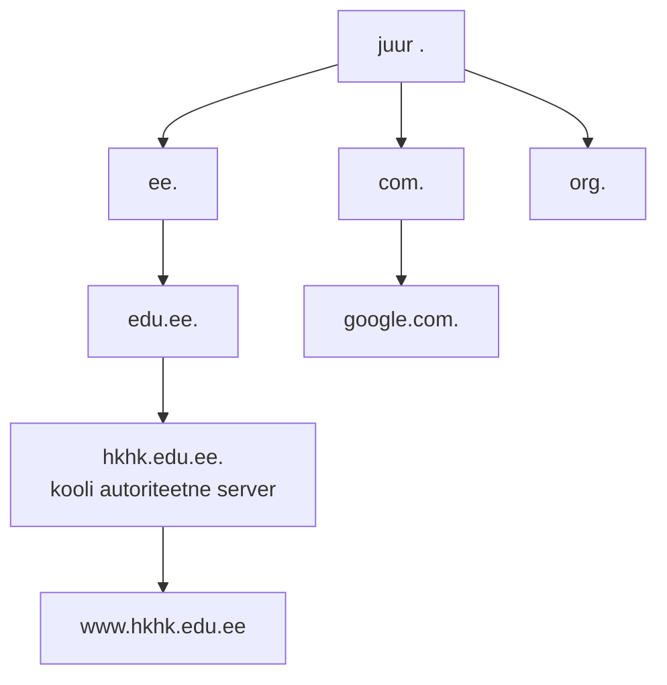
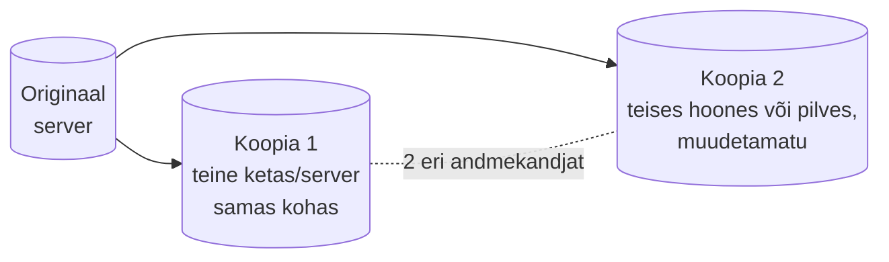

<!-- navigatsioon -->
[← Moodul 14. Enesekontroll](../moodul-14-andmebaasid/enesekontroll.md) · [Sisukord](../../README.md#sisukord) · [Laboritöö 15. Kooli väikeserver, III osa: DNS, failid, e-post ja varundus →](labor.md)
<!-- /navigatsioon -->

# Moodul 15. Võrguteenused: DNS, failijagamine, e-post ja varundus

**Maht:** 10 tundi · **Laboritöö:** Debian (15), Ubuntu (15B) · **Eeldused:** moodulid 13–14

## Õpiväljundid

Mooduli läbinud õppija:

- seadistab DNS-serveri ja tsoonifaili;
- võrdleb DNS-servereid (BIND9, Unbound, dnsmasq, CoreDNS, Pi-hole) ning seadistab CoreDNS-i ja filtreeriva DNS-i Pi-hole;
- jagab faile NFS-i ja Samba abil ning võrdleb isehallatavat failiserverit NAS-lahendustega (TrueNAS);
- seadistab serverile e-posti saatmise (Postfix relee) teavituste jaoks;
- planeerib varunduse taastamise eesmärkide (RPO, RTO) järgi, seadistab selle ning testib taastamist;
- dokumenteerib serveri seadistuse ning koostab käsiraamatu (runbook) ja otsuste logi;
- haagib NFS-jagamised vajadusel automaatselt (autofs).

---

## 15.1 DNS-server

Moodulis 7 kasutasid DNS-i kliendina. Oma DNS-server on vajalik, et sisevõrgu masinatel oleksid nimed (nt `kool.lab.example`) ilma, et iga masina `/etc/hosts` faili peaks muutma.

DNS on hierarhiline: iga tase teab ainult järgmise taseme servereid.



DNS-serverid jagunevad kahte liiki:

| Liik | Ülesanne | Tarkvara |
|---|---|---|
| **Autoriteetne** | Vastab oma tsooni (domeeni) nimede kohta | BIND9, NSD, PowerDNS, CoreDNS |
| **Rekursiivne** (*resolver*) | Küsib klientide eest vastuse teistelt serveritelt ja hoiab vahemälu | Unbound, BIND9, dnsmasq, systemd-resolved |

**BIND9** oskab mõlemat ja on DNS-i õppimiseks klassikaline valik.

### Kirjete tüübid

| Kirje | Tähendus | Näide |
|---|---|---|
| `SOA` | Tsooni põhiandmed | seerianumber, aegumisajad |
| `NS` | Tsooni nimeserver | `ns1.lab.example.` |
| `A` | Nimi → IPv4-aadress | `kool → 10.0.83.52` |
| `AAAA` | Nimi → IPv6-aadress | |
| `CNAME` | Nimi → teine nimi (alias) | `www → kool` |
| `MX` | E-posti server | `10 mail.lab.example.` |
| `TXT` | Vaba tekst (nt SPF, domeeni omandi tõendamine) | |
| `PTR` | IP-aadress → nimi (pöördtsoon) | |

### BIND9 seadistus (Debian)

```bash
sudo apt install bind9 bind9-dnsutils
```

Tsoon kirjeldatakse failis `/etc/bind/named.conf.local`:

```text
zone "lab.example" {
    type primary;
    file "/etc/bind/db.lab.example";
};
```

Tsoonifail `/etc/bind/db.lab.example`:

```text
$TTL 3600
@       IN  SOA ns1.lab.example. admin.lab.example. (
                2026110801  ; seerianumber (AAAAKKPPNN)
                3600        ; refresh
                900         ; retry
                604800      ; expire
                300 )       ; negatiivse vastuse TTL
        IN  NS  ns1.lab.example.

ns1     IN  A      10.0.83.52
kool    IN  A      10.0.83.52
www     IN  CNAME  kool
db      IN  A      10.0.83.53
```

Olulised reeglid:

- täielikud nimed lõpevad **punktiga** (`ns1.lab.example.`), ilma punktita nimedele lisatakse tsooni nimi;
- `@` tähistab tsooni ennast (`lab.example`);
- SOA-s olev e-posti aadress kirjutatakse punktiga (`admin.lab.example.` = `admin@lab.example`);
- **iga muudatuse järel suurenda seerianumbrit** - muidu ei saa teised serverid muudatusest teada.

Kontroll ja rakendamine:

```bash
sudo named-checkconf
sudo named-checkzone lab.example /etc/bind/db.lab.example
sudo systemctl reload named
dig @localhost kool.lab.example +short
dig @localhost www.lab.example
```

BIND9 on Debianis vaikimisi ka rekursiivne resolver kohalikule võrgule (`allow-recursion` vaikimisi `localnets; localhost;`), nii et kliendid saavad sama serveri kaudu lahendada ka internetinimesid. Kliendid tuleb seadistada kasutama seda serverit (Netplan, `nmcli`, `/etc/resolv.conf` - vt moodul 7) ja tulemüüris peab olema avatud port 53 (UDP ja TCP).

> [!NOTE]
> **Domeeninimed:** `.example` on reserveeritud näidete jaoks ja ei kuulu kunagi kellelegi. Sisevõrgus kasutatakse sageli oma domeeni alamdomeeni (nt `lab.hkhk.ee`) või tippdomeeni `.internal`. Lõpuga `.local` tasub vältida, sest seda kasutab mDNS.

### Teised DNS-serverid

BIND9 on klassika, kuid praktikas kasutatakse sageli kergemaid või kitsama otstarbega servereid:

| Tarkvara | Liik | Tüüpiline kasutus |
|---|---|---|
| **BIND9** | autoriteetne + rekursiivne | klassikaline täisfunktsionaalne DNS, suured tsoonid, DNSSEC |
| **Unbound** | rekursiivne | turvaline vahemäluga resolver (OPNsense'i vaikimisi DNS, moodul 18) |
| **dnsmasq** | edastav vahemälu + DHCP + TFTP | väikesed võrgud, kodu- ja laboriruuterid, libvirt, Pi-hole'i alus |
| **CoreDNS** | autoriteetne + edastav, pistikprogrammidega | konteinerid, Kubernetes (vaikimisi klastri DNS), seadistus ühes failis |
| **PowerDNS** | autoriteetne (andmebaasiga) + eraldi Recursor | teenusepakkujad, API-ga hallatavad tsoonid |
| **Pi-hole**, AdGuard Home | filtreeriv DNS | reklaami- ja jälitusdomeenide blokeerimine kogu võrgule |
| **systemd-resolved** | kohalik kliendipoolne vahemälu | Ubuntu jt töölaud ja server (`127.0.0.53`, moodul 7) |
| **Windows Server DNS** | autoriteetne + rekursiivne | Active Directory (valikmoodul 21) |

#### dnsmasq

dnsmasq loeb nimesid failist `/etc/hosts` ja edastab muud päringud ülemisele serverile. Väikese laborivõrgu DNS on sellega mõne reaga valmis:

```bash
sudo apt install dnsmasq
```

```text
# /etc/dnsmasq.d/labor.conf
domain-needed                 # ära edasta punktita nimesid
bogus-priv                    # ära edasta privaataadresside pöördpäringuid
no-resolv                     # ära kasuta /etc/resolv.conf ülemisi servereid
server=1.1.1.1
server=9.9.9.9
local=/lab.example/           # see domeen vastatakse ainult kohalikult
domain=lab.example
expand-hosts                  # lisa /etc/hosts nimedele domeen
address=/www.lab.example/10.0.83.52
```

```bash
sudo systemctl restart dnsmasq
dig @localhost www.lab.example +short
```

> [!NOTE]
> Ubuntu masinas kuulab `systemd-resolved` juba aadressil `127.0.0.53:53`. Kui dnsmasq või Pi-hole ei käivitu (`address already in use`), lülita resolvedi kohalik kuulaja välja: fail `/etc/systemd/resolved.conf.d/dns.conf` sisuga `[Resolve]` ja `DNSStubListener=no`, seejärel `sudo systemctl restart systemd-resolved`.

#### CoreDNS

**CoreDNS** on Go-s kirjutatud DNS-server, mille kogu seadistus on ühes failis `Corefile`. Iga plokk kirjeldab tsooni ja selle **pistikprogrammid** (*plugins*). Tsoonifailid on samas vormingus nagu BIND9-l, seega saab punktis 15.1 loodud tsooni otse kasutada.

```text
# Corefile
lab.example {
    file /etc/coredns/zones/db.lab.example   # autoriteetne tsoon failist
    log
    errors
}

83.0.10.in-addr.arpa {
    file /etc/coredns/zones/db.10.0.83    # pöördtsoon
}

. {
    forward . 1.1.1.1 9.9.9.9                # kõik muu edasi
    cache 300
    errors
}
```

`file` pistikprogramm loeb tsoonifaili automaatselt uuesti, kui selle seerianumber suureneb. Pistikprogramm `reload` loeb uuesti ka `Corefile`'i, kui see muutub.

CoreDNS-i käivitatakse enamasti **konteinerina** (moodul 12). Näide Compose-failist:

```yaml
# compose.yaml
services:
  coredns:
    image: docker.io/coredns/coredns:1.12.1     # kontrolli uusimat versiooni
    command: -conf /etc/coredns/Corefile
    ports:
      - "53:53/udp"
      - "53:53/tcp"
    volumes:
      - ./Corefile:/etc/coredns/Corefile:ro
      - ./zones:/etc/coredns/zones:ro
    restart: unless-stopped
```

**Näide päriselust: HKHK Proxmoxi labori DNS.** Kooli laboris teenindavad sisevõrgu tsooni kaks CoreDNS-serverit (`ns1` ja `ns2`), mis töötavad Dockeris Compose'iga. Mõlemal on identne tsoonifail ja kogu seadistus (`Corefile` ja tsoonid, ka pöördtsoonid) on **Giti hoidlas**. Kumbki server tõmbab ajastatud tööga iga paari minuti järel hoidlast muudatused (`git pull`). Kirje lisamiseks muudetakse tsoonifaili ja suurendatakse seerianumbrit Gitis. Mõne minuti pärast on muudatus mõlemas serveris ja ajalugu näitab, kes ja millal kirjet muutis. See on lihtne **infrastruktuur koodina** (moodul 16) - ilma eraldi primaar-sekundaar-replikatsioonita.

#### Pi-hole

**Pi-hole** on DNS-server (põhineb dnsmasq-il, töötab teenusena `pihole-FTL`), mis vastab reklaami-, jälitus- ja pahavaradomeenide päringutele tühja vastusega. Kui võrgu masinad kasutavad DNS-serverina Pi-hole'i, blokeeritakse need domeenid kõigis seadmetes - ka nutitelerites ja telefonides, kuhu reklaamiblokeerijat paigaldada ei saa. Lisaks on veebiliides, kus näeb päringute logi ja statistikat.

```bash
# Ära käivita võõrast skripti pimesi (curl ... | bash) - laadi alla, loe läbi, siis käivita
curl -sSL https://install.pi-hole.net -o basic-install.sh
less basic-install.sh
sudo bash basic-install.sh
```

```bash
pihole status
sudo pihole setpassword          # veebiliidese parool
pihole -q doubleclick.net        # kas domeen on mõnes blokeerimisloendis
sudo pihole -g                   # uuenda blokeerimisloendeid (gravity)
pihole tail                      # päringud reaalajas
```

Veebiliides on aadressil `http://<IP>/admin`. Seal saab lisada blokeerimisloendeid, lubatud domeene (*allowlist*), kohalikke DNS-kirjeid ja suunata kindla domeeni päringud teisele serverile (nt `lab.example` → BIND9).

Pi-hole'i võib käivitada ka konteinerina (pilt `pihole/pihole`). Teadmiseks: Pi-hole ei blokeeri reklaame, mida serveeritakse samalt domeenilt kui sisu (nt YouTube), ja seadmed, mis kasutavad DNS-i üle HTTPS-i (DoH), võivad sellest mööda minna.

## 15.2 Failide jagamine

### NFS - Linuxilt Linuxile

**NFS** (*Network File System*) võimaldab haakida teise Linuxi masina kataloogi üle võrgu nagu kohaliku ketta.

**Server:**

```bash
sudo apt install nfs-kernel-server
sudo mkdir -p /srv/nfs/jagatud
```

`/etc/exports`:

```text
/srv/nfs/jagatud  10.0.83.0/24(rw,sync,no_subtree_check)
```

```bash
sudo exportfs -ra              # rakenda
sudo exportfs -v               # vaata jagamisi
```

**Klient:**

```bash
sudo apt install nfs-common
showmount -e 10.0.83.52
sudo mkdir -p /mnt/nfs
sudo mount -t nfs 10.0.83.52:/srv/nfs/jagatud /mnt/nfs
```

Püsivalt (`/etc/fstab`):

```text
10.0.83.52:/srv/nfs/jagatud  /mnt/nfs  nfs  defaults,_netdev,nofail  0  0
```

`_netdev` ütleb, et failisüsteem vajab võrku.

> [!NOTE]
> **NFS ja kasutajad:** lihtsas NFS-is tuvastatakse kasutajad **UID-numbri järgi**. Kui kasutaja `mari` on serveris UID 1001 ja kliendis 1002, ei klapi failide omanikud. Suuremates keskkondades kasutatakse kesksest kataloogist (LDAP, Active Directory - valikmoodulid 20 ja 21) pärit kasutajaid ja Kerberost. Lisaks muudetakse kliendi juurkasutaja serveris vaikimisi õigusteta kasutajaks `nobody` (**root_squash**), et kliendi juurkasutaja ei saaks serveris kõike teha.

### autofs - haakimine vajadusel

`/etc/fstab`-is olev NFS-jagamine haagitakse alglaadimisel. Kui server ei ole sel hetkel kättesaadav, aeglustab see alglaadimist ja haakimine jääb tegemata. **autofs** haagib jagamise alles siis, kui keegi kataloogi poole pöördub, ja haagib selle tegevusetuse järel lahti.

```bash
sudo apt install autofs                     # AlmaLinux: sudo dnf install autofs
```

`/etc/auto.master` (või fail `/etc/auto.master.d/kool.autofs`):

```text
/mnt/kool   /etc/auto.kool   --timeout=300
```

`/etc/auto.kool`:

```text
jagatud   -rw,sync   debian1.lab.example:/srv/nfs/jagatud
```

```bash
sudo systemctl enable --now autofs
ls /mnt/kool              # tühi
ls /mnt/kool/jagatud      # nüüd haagitakse
findmnt /mnt/kool/jagatud
```

Kodukataloogide jaoks kasutatakse metamärki: `* -rw,sync server:/srv/kodu/&` (`&` asendatakse kataloogi nimega) - nii saab iga LDAP/AD kasutaja (moodulid 20–21) oma kodukataloogi failiserverist.

Lihtsam systemd alternatiiv: fstab-is valik `x-systemd.automount` (nt `debian1:/srv/nfs/jagatud /mnt/nfs nfs defaults,_netdev,x-systemd.automount 0 0`).

### Samba - Windowsiga jagamine

**Samba** rakendab Windowsi failijagamise protokolli **SMB**. Sellega saab Linuxi server jagada kaustu Windowsi arvutitele (ja vastupidi). Samba võib olla ka Active Directory domeenikontroller (valikmoodul 21).

```bash
sudo apt install samba
sudo mkdir -p /srv/samba/jagatud
sudo groupadd smbkasutajad
sudo chown root:smbkasutajad /srv/samba/jagatud
sudo chmod 2770 /srv/samba/jagatud
```

Jagamine faili `/etc/samba/smb.conf` lõppu:

```ini
[jagatud]
   comment = Ühine kaust
   path = /srv/samba/jagatud
   valid users = @smbkasutajad
   read only = no
   create mask = 0660
   directory mask = 2770
```

Samba kasutab **oma paroolide andmebaasi** - Linuxi kasutaja peab olema olemas, kuid Samba parool määratakse eraldi:

```bash
sudo usermod -aG smbkasutajad mari
sudo smbpasswd -a mari
testparm                              # kontrolli seadistust
sudo systemctl restart smbd
```

Ühendamine:

- **Windows:** Exploreris `\\10.0.83.52\jagatud`;
- **Linux:** `smbclient //10.0.83.52/jagatud -U mari` või haakimine `mount -t cifs` (pakett `cifs-utils`).

### Valmis NAS-lahendused: TrueNAS

Eespool seadistasid failiserveri käsitsi: Debian, `/etc/exports`, `smb.conf`, kasutajad ja õigused. Paljudes asutustes ja kodudes kasutatakse selle asemel **NAS-i** (*Network Attached Storage*) - seadet või distrot, mis on loodud ainult failide hoidmiseks ja jagamiseks ning mida hallatakse veebiliidesest.

| | Oma server (Debian + Samba/NFS) | **TrueNAS** Community Edition | OpenMediaVault | Synology, QNAP |
|---|---|---|---|---|
| Alus | mis tahes distro | Debian + **ZFS** (vanem TrueNAS CORE: FreeBSD) | Debian | tootja Linux (Btrfs/ext4) |
| Haldus | käsurida, seadistusfailid | veebiliides, API | veebiliides, pistikprogrammid | veebiliides, rakendused |
| Failisüsteem | ext4, XFS, LVM, ZFS - vali ise | ainult ZFS | ext4/XFS + mdadm, ZFS pistikprogrammiga | Btrfs, ext4 |
| Paindlikkus | täielik | piiratud (süsteem on „seade“) | keskmine | piiratud |
| Hind | tasuta | tasuta (Enterprise tasuline) | tasuta | riistvara koos tarkvaraga |
| Kellele | õppimine, eri teenused ühes masinas | tõsine salvestus, palju kettaid, hetktõmmised ja replikatsioon | väike kodu-NAS, vana riistvara | kes ei taha ise hallata |

**TrueNAS** ühendab mooduli 9 ZFS-i ja selle punkti failijagamise. Veebiliideses vastavad mõisted käsurea tööriistadele:

| TrueNASi veebiliides | Mida see tegelikult teeb |
|---|---|
| *Storage* → *Create Pool* | `zpool create` (vdev-ide tüüp: mirror, RAIDZ1/2/3) |
| *Datasets* | `zfs create`, pakkimine, kvoodid, õigused (ACL) |
| *Shares* → *SMB* | Samba jagamine (`smb.conf`) |
| *Shares* → *NFS* | NFS-i eksport (`/etc/exports`) |
| *Credentials* → *Local Users* / *Directory Services* | kasutajad ja grupid; liitumine AD-ga (valikmoodul 21) või LDAP-iga (valikmoodul 20) |
| *Data Protection* → *Periodic Snapshot Tasks* | ajastatud `zfs snapshot` |
| *Data Protection* → *Replication Tasks* | `zfs send \| ssh … zfs receive` teise masinasse |
| *Data Protection* → *Scrub Tasks*, *S.M.A.R.T. Tests* | `zpool scrub`, `smartctl` |
| *Apps* | konteinerid (Docker) |

SMB-jagamisel saab lubada **hetktõmmiste näitamise Windowsis**: ZFS-i hetktõmmised ilmuvad Windowsi failiomaduste vahekaardile *Previous Versions* ja kasutaja saab kustutatud või üle kirjutatud faili ise taastada.

Mida TrueNASi puhul arvestada:

- **TrueNAS on seade, mitte üldotstarbeline distro.** Süsteemi paketihaldus on keelatud ja käsitsi muudatused võivad uuendusel kaduda. Kõik seadistused tehakse veebiliidese või API kaudu.
- **ZFS tahab näha päris kettaid.** Proxmoxis tootmiskasutuseks suunatakse TrueNASi VM-ile terve kettakontroller (HBA, PCIe läbisuunamine) või vähemalt kettad otse (`qm set <vmid> -scsi1 /dev/disk/by-id/…`). Virtuaalkettad Proxmoxi enda ZFS-i peal tähendavad „ZFS-i ZFS-i peal“: topelt vahemälu ja ZFS ei näe ketaste tervist. Laboris harjutamiseks sobivad virtuaalkettad.
- **Süsteemiketas** on eraldi väike SSD; andmekettad lähevad poolidesse.
- **Mälu:** soovitatav vähemalt 8 GiB, sest ARC kasutab vaba mälu vahemäluna.
- **RAID ja hetktõmmised ei ole varukoopia** - andmed peavad olema ka teises masinas või asukohas (replikatsioon, 3-2-1 reegel, punkt 15.4).

## 15.3 E-post: Postfix serveri teavitusteks

Täisväärtuslik e-posti server (vastuvõtmine, postkastid, rämpsposti filtreerimine, SPF/DKIM/DMARC) on omaette eriala ja asutused kasutavad selleks sageli pilveteenust. Iga Linuxi server peab aga oskama **e-kirju saata**: cron'i ja systemd taimerite tõrked, `smartd` hoiatused (moodul 9), `unattended-upgrades` aruanded, varunduse tulemused ja omaenda skriptide teated.

Selleks paigaldatakse **MTA** (*Mail Transfer Agent*) - levinuim on **Postfix** - tavaliselt **relee** režiimis: server ei saada kirju otse adressaadi serverisse, vaid edastab need asutuse (või pakkuja) SMTP-serverile.

```bash
sudo apt install postfix mailutils libsasl2-modules
```

Paigaldusel vali **Satellite system** (või *Internet with smarthost*): süsteemi nimi `debian1.lab.example`, releeserver `[smtp.example.ee]:587`.

Põhiseaded failis `/etc/postfix/main.cf`:

```text
myhostname = debian1.lab.example
relayhost = [smtp.example.ee]:587
inet_interfaces = loopback-only          # ära võta kirju võrgust vastu
mydestination =
smtp_tls_security_level = encrypt
smtp_sasl_auth_enable = yes
smtp_sasl_password_maps = hash:/etc/postfix/sasl_passwd
smtp_sasl_security_options = noanonymous
```

Releeserveri kasutajanimi ja parool (fail ainult juurkasutajale):

```text
# /etc/postfix/sasl_passwd
[smtp.example.ee]:587  teavitus@example.ee:SALASONA
```

```bash
sudo chmod 600 /etc/postfix/sasl_passwd
sudo postmap /etc/postfix/sasl_passwd
sudo systemctl restart postfix
echo "Test serverist $(hostname)" | mail -s "Test" admin@example.ee
sudo journalctl -u postfix -n 20            # või /var/log/mail.log
mailq                                       # saatmata kirjade järjekord
```

Kõik juurkasutajale saadetud kirjad (cron, `smartd`) suuna päris aadressile failis `/etc/aliases`:

```text
root: admin@example.ee
```

```bash
sudo newaliases
```

> [!NOTE]
> **Laboris** ei ole sageli välist SMTP-releed. Siis saab Postfixi testida kohaliku kohaletoimetamisega (*Local only*): kirjad jõuavad faili `/var/mail/<kasutaja>` ja neid saab lugeda käsuga `mail`. Testimiseks sobib ka konteineris töötav kirjapüüdja **Mailpit** (moodul 12), mis näitab saadetud kirju veebiliideses.

AlmaLinuxis: `sudo dnf install postfix s-nail`, seadistus samas failis, logid `journalctl -u postfix`.

## 15.4 Varundus

> [!WARNING]
> **Varukoopia, mida ei ole proovitud taastada, ei ole varukoopia.**

### 3-2-1 reegel

- **3** koopiat andmetest (originaal + 2 varukoopiat);
- **2** eri andmekandjal;
- **1** koopia mujal (teises hoones, pilves) - tulekahju, varguse ja lunavara vastu.



Lunavara vastu on oluline, et vähemalt üks koopia oleks **muudetamatu** või **võrgust eraldatud** - muidu krüpteerib ründaja ka varukoopiad.

### Taastamise eesmärgid: RPO ja RTO

Varundusplaani koostamist alusta kahest küsimusest teenuse omanikule:

| Mõiste | Küsimus | Näide | Mõjutab |
|---|---|---|---|
| **RPO** (*Recovery Point Objective*) | Kui palju andmeid tohib kaotada? | „Kaotada võib kuni ühe päeva töö“ → RPO 24 h | kui tihti varundatakse (igaöine varundus → RPO kuni 24 h; replikatsioon → minutid) |
| **RTO** (*Recovery Time Objective*) | Kui kiiresti peab teenus taas töötama? | „Kooli koduleht peab töötama 4 tunni pärast“ → RTO 4 h | kuidas taastatakse (failidest käsitsi → tunnid; valmis VM-i varukoopia või varuserver → minutid) |

Väiksem RPO ja RTO maksavad rohkem (sagedasem varundus, rohkem salvestust, dubleeritud serverid). Taastamistestil **mõõda tegelik aeg** ja võrdle seda RTO-ga - alles siis tead, kas plaan töötab.

### Mida varundada?

| Mida | Kuidas |
|---|---|
| Seadistus | `/etc` |
| Veebisaidid ja rakendused | `/var/www`, `/srv`, `/opt` |
| Andmebaasid | `mariadb-dump`, `pg_dump` (mitte failid otse!) |
| Kasutajate andmed | `/home` |
| Ajastatud tööd | `crontab -l`, `/etc/systemd/system` |
| Paigaldatud pakettide loend | `dpkg --get-selections`, `rpm -qa` |

Virtuaalmasinate puhul saab varundada terve masina (nt **Proxmox Backup Server**), kuid ka siis on andmebaaside jaoks soovitatav eraldi dump.

### Tööriistad

| Tööriist | Iseloomustus |
|---|---|
| `tar`, `rsync` | Lihtsad, igal pool olemas (vt moodulid 2, 6, 7) |
| **restic** | Krüpteeritud, deduplitseeriv, hetktõmmistega varundus; sihtkohaks kohalik kataloog, SFTP või pilv |
| **borg** | Sarnane restic'uga, väga tõhus |
| Proxmox Backup Server | Virtuaalmasinate ja konteinerite varundus |

### restic

```bash
sudo apt install restic
sudo mkdir -p /srv/varundus
echo "Väga-pikk-varunduse-parool" | sudo tee /root/.restic-parool > /dev/null
sudo chmod 600 /root/.restic-parool

export RESTIC_REPOSITORY=/srv/varundus/restic
export RESTIC_PASSWORD_FILE=/root/.restic-parool

sudo -E restic init                                 # loo hoidla (üks kord)
sudo -E restic backup /etc /var/www                 # varunda
sudo -E restic snapshots                            # hetktõmmised
sudo -E restic restore latest --target /tmp/taaste  # taasta
sudo -E restic forget --keep-daily 7 --keep-weekly 4 --keep-monthly 6 --prune   # vanade kustutamine
sudo -E restic check                                # hoidla terviklikkuse kontroll
```

Teise serverisse saab varundada SFTP kaudu: `RESTIC_REPOSITORY=sftp:varu@varuserver:/srv/restic`.

> [!WARNING]
> **Kaota parool - kaota andmed.** restic'u hoidla on krüpteeritud. Hoia parooli turvaliselt ka väljaspool serverit.

## 15.5 Dokumenteerimine

Hästi seadistatud, kuid dokumenteerimata server on ohtlik: keegi (ka sina ise poole aasta pärast) ei tea, miks miski on seadistatud nii, nagu on. Serveri dokumentatsioon peaks sisaldama:

- serveri eesmärk, asukoht (nt Proxmoxi sõlm), IP-aadressid ja DNS-nimed;
- operatsioonisüsteem ja versioon;
- paigaldatud teenused, nende pordid ja olulised seadistusfailid;
- kasutajad ja kes vastutab;
- tulemüüri reeglid;
- varundus: mida, kuhu, kui tihti ja **kuidas taastada**;
- muudatuste logi: kuupäev, mida muudeti ja miks.

Dokumentatsioon kirjutatakse sageli Markdownis ja hoitakse Git-repos koos seadistusfailidega (vt moodul 6, punkt 6.14).

Suuremate süsteemide juurde kuuluvad veel kaks dokumenti:

**Käsiraamat** (*runbook*) - sammhaaval juhised tüüpilisteks toiminguteks ja riketeks, mida saab järgida ka see, kes süsteemi ei ehitanud (näiteks öösel valves olev kolleeg). Iga juhis on lühike ja konkreetne:

```markdown
## Veebisait ei vasta
1. Kontrolli: `curl -I https://kool.lab.example` - mis koodi saad?
2. `systemctl status nginx php8.4-fpm` - kas teenused töötavad?
3. `journalctl -u nginx --since "30 min ago"` - vead?
4. `df -h /var` - kas ketas on täis?
5. Kui andmebaas ei vasta: vt „MariaDB ei käivitu“.
6. Kui 15 minutiga ei lahene: teavita (kontakt) ja kirjuta intsident üles.
```

**Otsuste logi** (*decision log*, ka ADR - *Architecture Decision Record*) - lühike kirje iga olulise valiku kohta: mis oli probleem, millised olid variandid, mida valiti ja **miks**. Näiteks „Valisime PostgreSQL-i asemel MariaDB, sest rakendus toetab ametlikult ainult MariaDB-d ja meeskond tunneb seda“. Aasta pärast ei pea keegi arvama, miks asjad nii on.

---

## Distrode erinevused

| | **Debian** | **Ubuntu** | **AlmaLinux** |
|---|---|---|---|
| BIND9 | `bind9`, `/etc/bind/`, teenus `named` | sama | `bind`, `/etc/named.conf`, `/var/named/` |
| NFS server | `nfs-kernel-server` | `nfs-kernel-server` | `nfs-utils`, teenus `nfs-server` |
| Samba | `samba`, teenus `smbd` | sama | `samba`, teenus `smb`, SELinux `samba_share_t` |
| Postfix | `postfix`, `mailutils`, logi `/var/log/mail.log` | sama | `postfix`, `s-nail`, logi `journalctl -u postfix` |
| restic | `restic` | `restic` | EPEL-ist `restic` |
| Teenus käivitub paigaldamisel | Jah | Jah | Ei (`enable --now`), avada ka `firewall-cmd` |

AlmaLinuxis tuleb lisaks arvestada SELinuxiga (moodul 11): Samba jagamised (`samba_share_t`) ja NFS-i kodukataloogid vajavad õigeid kontekste või tõeväärtusi.

---

## Kokkuvõte

| Teenus | Paigaldus | Seadistus | Kontroll |
|---|---|---|---|
| BIND9 | `apt install bind9` | `named.conf.local`, tsoonifail | `named-checkconf`, `named-checkzone`, `dig` |
| dnsmasq | `apt install dnsmasq` | `/etc/dnsmasq.d/*.conf` | `dig @localhost` |
| CoreDNS | konteiner `coredns/coredns` | `Corefile` + tsoonifailid | `dig @localhost`, konteineri logid |
| Pi-hole | `basic-install.sh` või konteiner | veebiliides `/admin` | `pihole status`, `pihole -q` |
| NFS | `apt install nfs-kernel-server` | `/etc/exports` | `exportfs -v`, `showmount -e` |
| Samba | `apt install samba` | `/etc/samba/smb.conf` | `testparm`, `smbclient` |
| TrueNAS | ISO, eraldi masin/VM | veebiliides: *Storage*, *Datasets*, *Shares*, *Data Protection* | `zpool status`, Windowsi *Previous Versions* |
| Postfix | `apt install postfix mailutils` | `/etc/postfix/main.cf`, `/etc/aliases` | `mail`, `mailq`, `journalctl -u postfix` |
| restic | `apt install restic` | `RESTIC_REPOSITORY` | `restic snapshots`, `restic check` |
| autofs | `apt install autofs` | `/etc/auto.master`, `/etc/auto.*` | `ls` haakepunktis, `findmnt` |

**Järgmised sammud:** tee [laboritöö](labor.md) ja kontrolli oma teadmisi [enesekontrolli](enesekontroll.md) abil.

## Lisamaterjal

- BIND 9 administraatori juhend (bind9.readthedocs.io)
- CoreDNS dokumentatsioon (coredns.io) ja Pi-hole'i dokumentatsioon (docs.pi-hole.net)
- Samba Wiki (wiki.samba.org)
- Postfix dokumentatsioon (www.postfix.org/documentation.html)
- restic dokumentatsioon (restic.readthedocs.io)

<!-- navigatsioon -->
---

[← Moodul 14. Enesekontroll](../moodul-14-andmebaasid/enesekontroll.md) · [Sisukord](../../README.md#sisukord) · [Laboritöö 15. Kooli väikeserver, III osa: DNS, failid, e-post ja varundus →](labor.md)
<!-- /navigatsioon -->
