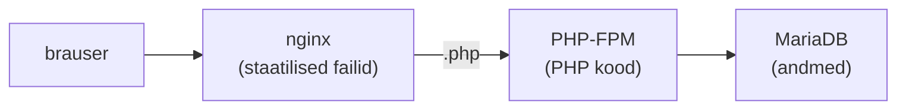

<!-- navigatsioon -->
[← Moodul 15. Enesekontroll](../moodul-15-veebiserverid/enesekontroll.md) · [Sisukord](../../README.md#sisukord) · [Laboritöö 16. Andmebaasid (kooli väikeserver, II osa) →](labor.md)
<!-- /navigatsioon -->

# Moodul 16. Andmebaasid

**Maht:** 8 tundi · **Laboritöö:** Debian (ja AlmaLinux kliendina) · **Eeldused:** moodul 15

> [!NOTE]
> **Süsteemihalduri vaade andmebaasidele.** See moodul õpetab andmebaasiserverit paigaldama ja hoidma: kasutajad ja õigused, turvaline ligipääs, varundus ja taastamine ning replikatsiooni põhimõte. Eesmärk on, et oskaksid rakendusele andmebaasi valmis seada ja seda hallata - mitte SQL-i ega andmebaaside disaini põhjalik õppimine.
>
> **HKHK õppijale:** andmebaase ja SQL-i käsitletakse põhjalikumalt eraldi ainetes. See moodul annab andmebaasiserveri haldamiseks vajaliku aluse.

## Õpiväljundid

Mooduli läbinud õppija:

- võrdleb andmebaaside liike (relatsiooniline server, manustatud, võti-väärtus, NoSQL) ja valib sobiva;
- paigaldab MariaDB ja PostgreSQL-i, loob andmebaasid, kasutajad ja õigused ning lubab ühendused ainult vajalikest masinatest;
- kasutab SQLite'i ja tunneb ära, millised rakendused seda kasutavad;
- kasutab Valkey/Redise võti-väärtus hoidlat vahemäluna;
- paigaldab dünaamilise veebirakenduse (nginx + PHP + MariaDB);
- varundab ja taastab andmebaase ning taastab unustatud administraatori parooli;
- kirjeldab replikatsiooni põhimõtet ning viib rikke korral koopia põhiserveriks (ülevõtt).

> [!NOTE]
> **Kuidas seda lehte lugeda:** iga teema algab kastiga **Lühidalt** - seal on kõige tähtsam paari lausega. Käsud ja näited on alati näha. Pikemad selgitused ja taust on peidetud plokkidesse **Loe lähemalt** - ava need, kui tahad teemast rohkem teada või kui laboritöös midagi ei õnnestu.

---

## 16.1 Andmebaaside ülevaade

> [!TIP]
> **Lühidalt:** Relatsiooniline andmebaas (MariaDB, PostgreSQL) on server tabelitega ja SQL-iga, SQLite on üks fail, Valkey/Redis on mälus olev võti-väärtus hoidla. Haldur paigaldab, annab õigused, varundab ja taastab.

Peaaegu iga rakendus hoiab oma andmeid andmebaasis. Administraator ei pea olema andmebaasiekspert, kuid peab oskama andmebaasi paigaldada, kasutajaid ja õigusi hallata, varundada ja taastada ning probleeme leida.

| Liik | Põhimõte | Näited | Kus kasutatakse |
|---|---|---|---|
| **Relatsiooniline server** | tabelid, SQL, eraldi teenus võrgus | **MariaDB**/MySQL, **PostgreSQL** | veebirakendused (WordPress, Moodle, Nextcloud) |
| **Manustatud** (*embedded*) | andmebaas on üks fail, teek rakenduse sees | **SQLite** | töölauarakendused, telefonid, väikesed teenused (Uptime Kuma, Grafana) |
| **Võti-väärtus** | kiire mälupõhine hoidla | **Valkey**/Redis | vahemälu, seansid, järjekorrad |
| **Dokumendipõhine** | JSON-dokumendid | MongoDB, CouchDB | paindliku struktuuriga andmed |
| **Aegread** | mõõdikud ajas | Prometheuse TSDB, InfluxDB | seire (moodul 20) |
| **Otsingumootor** | täistekstiotsing | OpenSearch, Elasticsearch | logid, SIEM (Wazuh, moodul 12) |

**SQL** (*Structured Query Language*) on relatsiooniliste andmebaaside ühine keel. Põhikäsud (`CREATE`, `INSERT`, `SELECT`, `UPDATE`, `DELETE`, `GRANT`) on MariaDB-s, PostgreSQL-is ja SQLite'is peaaegu samad, erinevused on peamiselt halduskäskudes.

| | **MariaDB** / MySQL | **PostgreSQL** | **SQLite** |
|---|---|---|---|
| Tüüp | server | server | fail |
| Klient | `mariadb` (`mysql`) | `psql` | `sqlite3` |
| Port | 3306 | 5432 | - |
| Varundus | `mariadb-dump` | `pg_dump` | `.backup`, faili koopia peatatud rakendusega |
| Tugevus | levinud veebirakendustes, lihtne | standarditele vastav, võimas (JSON, laiendused) | null seadistust, üks fail |

> [!NOTE]
> **NoSQL** ei tähenda „parem“ ega „uuem“. Enamiku rakenduste jaoks on relatsiooniline andmebaas õige valik. NoSQL-andmebaasid lahendavad kitsamaid ülesandeid (vahemälu, väga suured andmemahud, paindlik struktuur).

## 16.2 MariaDB ja MySQL

> [!TIP]
> **Lühidalt:** MariaDB: `sudo mariadb` avab kliendi, `CREATE DATABASE`, `CREATE USER`, `GRANT` annavad rakendusele oma andmebaasi ja kasutaja. Vaikimisi kuulab server ainult `127.0.0.1`-l.

```bash
sudo apt install mariadb-server
sudo mariadb                         # Debianis logib juurkasutaja sisse ilma paroolita (unix_socket)
```

Debianis ja Ubuntus autenditakse andmebaasi juurkasutaja **operatsioonisüsteemi kasutaja järgi** (`unix_socket`): `sudo mariadb` toimib, parooli pole vaja ega soovitatav.

Andmebaasi ja kasutaja loomine:

```sql
CREATE DATABASE kool CHARACTER SET utf8mb4 COLLATE utf8mb4_unicode_ci;
CREATE USER 'kool'@'localhost' IDENTIFIED BY 'Tugev-Parool-123';
GRANT ALL PRIVILEGES ON kool.* TO 'kool'@'localhost';
FLUSH PRIVILEGES;
```

Rakendusel on **oma kasutaja**, kellel on õigused ainult oma andmebaasile - mitte kunagi juurkasutaja õigused (vähima õiguse põhimõte).

SQL-i põhikäsud:

```sql
USE kool;
CREATE TABLE opilased (
    id     INT AUTO_INCREMENT PRIMARY KEY,
    nimi   VARCHAR(100) NOT NULL,
    eriala VARCHAR(100)
);
INSERT INTO opilased (nimi, eriala) VALUES ('Mari Maasikas', 'IT-süsteemid');
SELECT * FROM opilased;
UPDATE opilased SET eriala = 'Tarkvaraarendus' WHERE id = 1;
DELETE FROM opilased WHERE id = 1;
SHOW DATABASES;
SHOW TABLES;
```

Vaikimisi kuulab MariaDB ainult aadressil `127.0.0.1` (`bind-address` failis `/etc/mysql/mariadb.conf.d/50-server.cnf`). **Andmebaas ei tohiks olla internetist kättesaadav.** Kui teine server peab andmebaasiga ühenduma, muuda `bind-address`, loo kasutaja kindla IP-ga (`'kool'@'10.0.83.53'`) ja luba tulemüüris ainult see aadress.

Varundus ja taastamine:

```bash
sudo mariadb-dump --single-transaction kool > kool-$(date +%F).sql
sudo mariadb-dump --all-databases --single-transaction > koik.sql
sudo mariadb kool < kool-2026-11-08.sql
```

> [!NOTE]
> **Andmebaasi failide (`/var/lib/mysql`) kopeerimine töötava serveri pealt ei ole usaldusväärne varukoopia** - failid võivad olla poolelioleva muudatuse keskel. Kasuta `mariadb-dump`-i või peata enne kopeerimist teenus.

#### Unustatud andmebaasi parooli taastamine

Debianis ja Ubuntus pole juurkasutaja parooli tavaliselt vaja - `sudo mariadb` toimib `unix_socket` autentimisega. Kui aga juurkasutajale on seatud parool (või see on MySQL või AlmaLinuxi MariaDB, kus administraator on parooli määranud) ja see on kadunud, saab andmebaasi käivitada **ilma õiguste kontrollita**:

```bash
sudo systemctl stop mariadb
sudo systemctl set-environment MYSQLD_OPTS="--skip-grant-tables --skip-networking"
sudo systemctl start mariadb
sudo mariadb -u root
```

```sql
FLUSH PRIVILEGES;     -- laadib õigustetabelid, et ALTER USER töötaks
ALTER USER 'root'@'localhost' IDENTIFIED BY 'Uus-Tugev-Parool';
-- Debianis/Ubuntus võib taastada ka unix_socket autentimise:
-- ALTER USER 'root'@'localhost' IDENTIFIED VIA unix_socket;
EXIT;
```

```bash
sudo systemctl stop mariadb
sudo systemctl unset-environment MYSQLD_OPTS
sudo systemctl start mariadb
sudo mariadb -u root -p                # kontrolli uut parooli
```

`--skip-networking` on **kohustuslik**: sel ajal saab andmebaasi kasutada igaüks ilma paroolita ja see ei tohi olla võrgust kättesaadav. Klassikaline viis on käivitada server käsitsi: `sudo mariadbd-safe --skip-grant-tables --skip-networking &` (MySQL-is ja vanemas MariaDB-s `mysqld_safe`); siis võib olla vaja enne luua kataloog `/run/mysqld` omanikuga `mysql`.

> [!WARNING]
> **Turvalisus:** see töötab ainult juurkasutaja õigustega serveris. Andmebaasi kaitseb seega lõpuks operatsioonisüsteemi turvalisus - kes saab serveris `root`-iks, saab ka andmebaasi.

### Replikatsioon lühidalt

**Replikatsioon** hoiab teises serveris (*replica*) andmebaasist pidevalt uuendatavat koopiat: lugemispäringuid saab jagada ja põhiserveri rikke korral on andmed alles. Põhimõte MariaDB-s:

```text
# põhiserver (primary), /etc/mysql/mariadb.conf.d/60-repl.cnf
[mariadb]
server_id = 1
log_bin   = mariadb-bin

# koopia (replica)
[mariadb]
server_id = 2
read_only = ON
```

```sql
-- põhiserveris: replikatsioonikasutaja
CREATE USER 'repl'@'10.0.83.53' IDENTIFIED BY 'Repl-Parool-1';
GRANT REPLICATION SLAVE ON *.* TO 'repl'@'10.0.83.53';
-- koopias (pärast andmete esmast kopeerimist mariadb-dump --master-data=1 abil):
CHANGE MASTER TO MASTER_HOST='10.0.83.52', MASTER_USER='repl',
    MASTER_PASSWORD='Repl-Parool-1', MASTER_USE_GTID=slave_pos;
START REPLICA;
SHOW REPLICA STATUS\G
```

> [!WARNING]
> **Replikatsioon ei ole varukoopia:** kogemata `DROP TABLE` jõuab sekunditega ka koopiasse.

### Ülevõtt: koopia põhiserveriks

Kui põhiserver rikneb, tuleb koopia teha uueks põhiserveriks (**ülevõtt**, *failover*) ja suunata rakendus sellele. Käsitsi tehakse seda MariaDB-s nii:

```sql
-- koopias (debian2): kontrolli, et koopia oli järje peal (Seconds_Behind_Master, GTID)
SHOW REPLICA STATUS\G
STOP REPLICA;
RESET REPLICA ALL;              -- unusta vana põhiserver
SET GLOBAL read_only = OFF;     -- luba kirjutamine
```

Seejärel muuda koopia seadistusfailis `read_only = OFF` (püsivalt) ja suuna rakendus uuele serverile. Rakenduse seadistust ei pea muutma, kui see kasutab **nime või virtuaalset IP-d** (keepalived, moodul 15), mis tõstetakse uuele serverile.

Kui vana põhiserver taas töötab, **ei tohi seda lihtsalt käivitada** - siis oleks kaks põhiserverit ja andmed läheksid lahku (*split brain*). Vanast serverist tehakse uue põhiserveri koopia (`CHANGE MASTER TO … MASTER_USE_GTID=current_pos`) või ehitatakse see dumpist uuesti.

| Tööriist | Mida teeb |
|---|---|
| **MariaDB MaxScale** | andmebaasipuhver, mis jagab päringud ja teeb automaatse ülevõtu (BSL-litsents) |
| **Galera Cluster** | MariaDB mitme põhiserveriga klaster (kõik sõlmed kirjutavad, sünkroonne replikatsioon, vähemalt 3 sõlme) |
| **Patroni** | PostgreSQL-i automaatne ülevõtt (kasutab etcd-d või Consulit, et sõlmed lepiksid kokku, kes on juht) |

PostgreSQL-is tehakse koopiast põhiserver käsuga `SELECT pg_promote();` (või `pg_ctl promote`).

> [!NOTE]
> **Automaatne ülevõtt on keerukam, kui tundub.** Kõige raskem on otsustada, kas põhiserver on päriselt rikkis või on ainult võrk katkenud. Seepärast kasutavad automaatsed lahendused vähemalt kolme sõlme ja häälteenamust (*quorum*). Väikeses asutuses on sageli piisav **dokumenteeritud ja harjutatud käsitsi ülevõtt**.

## 16.3 PostgreSQL

> [!TIP]
> **Lühidalt:** PostgreSQL-i haldab kasutaja `postgres`: `sudo -u postgres psql`, `createuser`, `createdb`. Kaugühendused lubatakse failides `postgresql.conf` ja `pg_hba.conf`.

**PostgreSQL** on võimas avatud lähtekoodiga andmebaas, mida eelistatakse uutes rakendustes (nt GitLab, Mastodon, paljud ettevõtte süsteemid) ja keerukamate andmete jaoks.

```bash
sudo apt install postgresql              # Debian 13: PostgreSQL 17, Ubuntu 24.04: 16
# AlmaLinux:
# sudo dnf install postgresql-server && sudo postgresql-setup --initdb && sudo systemctl enable --now postgresql
sudo -u postgres psql                    # haldur on süsteemikasutaja 'postgres'
```

PostgreSQL-is on **rollid** (kasutajad ja grupid on sama asi). Kohalik ühendus kasutab vaikimisi **peer**-autentimist: süsteemikasutaja `postgres` on andmebaasi kasutaja `postgres`.

```sql
CREATE ROLE kool LOGIN PASSWORD 'Tugev-Parool-123';
CREATE DATABASE kool OWNER kool;
\c kool
CREATE TABLE opilased (
    id     SERIAL PRIMARY KEY,
    nimi   VARCHAR(100) NOT NULL,
    eriala VARCHAR(100)
);
```

`psql` käsud algavad kaldkriipsuga:

| Käsk | Tegevus |
|---|---|
| `\l` | andmebaasid |
| `\du` | rollid |
| `\c andmebaas` | ühendu teise andmebaasiga |
| `\dt`, `\d tabel` | tabelid, tabeli struktuur |
| `\x` | laiendatud väljund |
| `\q` | välju |

Seadistus (Debian, Ubuntu): `/etc/postgresql/<versioon>/main/`; AlmaLinux: `/var/lib/pgsql/data/`.

- `postgresql.conf` - `listen_addresses = 'localhost'` (vaikimisi ainult kohalik), mälu, logimine;
- `pg_hba.conf` - **kes, kust ja kuidas** tohib ühenduda:

```text
# TYPE  DATABASE  USER  ADDRESS          METHOD
local   all       all                    peer
host    kool      kool  10.0.83.55/32    scram-sha-256
```

```bash
sudo systemctl reload postgresql
psql -h 10.0.83.52 -U kool -d kool           # teisest masinast
```

Varundus ja taastamine:

```bash
sudo -u postgres pg_dump -Fc kool > kool.dump        # kohandatud vorming, pakitud
sudo -u postgres pg_restore -d kool --clean kool.dump
sudo -u postgres pg_dumpall > koik.sql               # kõik andmebaasid ja rollid
```

## 16.4 SQLite

> [!TIP]
> **Lühidalt:** SQLite ei ole server, vaid **üks fail**, mida rakendus otse kasutab. Varunda see käsuga `sqlite3 fail.db ".backup koopia.db"`, mitte töötava faili kopeerimisega.

**SQLite** ei ole server, vaid teek: kogu andmebaas on **üks fail**, mida rakendus otse loeb ja kirjutab. Ei ole kasutajaid, porti ega teenust. SQLite on maailma enim kasutatud andmebaas - see on igas telefonis, brauseris (Firefoxi järjehoidjad) ja paljudes serveriprogrammides (Grafana, Uptime Kuma, Home Assistant, Pi-hole'i päringulogi).

```bash
sudo apt install sqlite3
sqlite3 kool.db
```

```sql
CREATE TABLE opilased (id INTEGER PRIMARY KEY, nimi TEXT NOT NULL, eriala TEXT);
INSERT INTO opilased (nimi, eriala) VALUES ('Mari Maasikas', 'IT-süsteemid');
.headers on
.mode box
SELECT * FROM opilased;
.tables
.schema opilased
.quit
```

Kasulikud käsud:

```bash
sqlite3 kool.db "SELECT COUNT(*) FROM opilased;"      # päring käsurealt (skriptides)
sqlite3 -csv kool.db "SELECT * FROM opilased;" > opilased.csv
sqlite3 kool.db ".backup varu.db"                      # järjepidev koopia ka kasutuse ajal
sqlite3 kool.db ".dump" > kool.sql                     # SQL-tekstina
file kool.db
```

Millal SQLite sobib ja millal mitte:

| Sobib | Ei sobi |
|---|---|
| üks rakendus, väike või keskmine andmemaht | palju samaaegseid kirjutajaid |
| seadistus ja olek (nt Uptime Kuma, Grafana) | mitu serverit peab samu andmeid kasutama |
| testid ja prototüübid | fail NFS-i peal (lukustus ei pruugi töötada) |

> [!NOTE]
> Haldaja jaoks on SQLite **lihtsalt fail**: varunda see (`.backup` või peatatud rakendusega koopia), ära kustuta kõrvalfaile `*-wal` ja `*-shm` töötava rakenduse ajal ning kontrolli õigusi - kes faili loeb, näeb kõiki andmeid.

## 16.5 Võti-väärtus hoidla: Valkey ja Redis

> [!TIP]
> **Lühidalt:** Valkey (Redise vaba haru) hoiab andmeid mälus ja vastab mikrosekunditega. Seda kasutatakse vahemälu ja seansside jaoks. `valkey-cli ping` kontrollib, kas teenus töötab.

**Redis** on mälupõhine võti-väärtus andmebaas, mis vastab mikrosekunditega. 2024. aastal muutis Redis oma litsentsi ja kogukond jätkas vaba haruna **Valkey** (Linux Foundation); käsud ja protokoll on samad. AlmaLinux 10 ja uuemad distrod pakuvad Valkeyt.

Tüüpiline kasutus:

- **vahemälu** - andmebaasipäringute või lehtede tulemused (Nextcloud, WordPressi pistikprogrammid);
- **seansid** - veebirakenduse kasutajaseansid mitme serveri vahel (koormusejaoturi taga, moodul 15);
- **järjekorrad ja loendurid**.

```bash
sudo apt install valkey-server          # Debian 13 (kui paketti pole: redis-server); Ubuntu 24.04: redis-server
# AlmaLinux 10: sudo dnf install valkey && sudo systemctl enable --now valkey
valkey-cli ping                         # PONG  (Redisega: redis-cli)
```

```text
127.0.0.1:6379> SET tervitus "Tere!"
127.0.0.1:6379> GET tervitus
127.0.0.1:6379> SET seanss:mari "sisse logitud" EX 60     # aegub 60 s pärast
127.0.0.1:6379> TTL seanss:mari
127.0.0.1:6379> INCR kylastused
127.0.0.1:6379> INFO memory
```

Turvalisus: vaikimisi kuulab ainult `127.0.0.1` ja `protected-mode yes`. **Ära ava Redise/Valkey porti 6379 võrku ilma paroolita** (`requirepass` või ACL-id) - internetis on tuhandeid sel viisil häkitud servereid. Andmed on mälus; püsivuse tagavad RDB-hetktõmmised ja AOF-logi (`/var/lib/valkey/`).

## 16.6 Dünaamiline veebirakendus: nginx + PHP + MariaDB

> [!TIP]
> **Lühidalt:** Dünaamiline sait: nginx saadab `.php` päringud **PHP-FPM**-ile ja PHP loeb andmed MariaDB-st. Nii töötavad WordPress ja Moodle.

Klassikaline veebirakenduse virn on **LEMP** (*Linux, nginx, MariaDB/MySQL, PHP*) või Apache'iga **LAMP**. Nii töötavad näiteks WordPress ja Moodle.



**PHP-FPM** on eraldi teenus, mis käivitab PHP-koodi. nginx saadab `.php` päringud sellele Unixi pesa (*socket*) kaudu:

```bash
sudo apt install php-fpm php-mysql
ls /run/php/                          # PHP-FPM pesa nimi (sõltub PHP versioonist)
```

```nginx
location ~ \.php$ {
    include snippets/fastcgi-php.conf;
    fastcgi_pass unix:/run/php/php8.4-fpm.sock;     # pane siia tegelik pesa nimi
}
```

Lisa serveriplokis ka `index index.php index.html;`.

## 16.7 Andmebaaside turvalisus ja varundus

> [!TIP]
> **Lühidalt:** Andmebaasi varundatakse **dump**-iga (`mariadb-dump`, `pg_dump`), mitte failide kopeerimisega. Rakendus saab oma kasutaja ainult oma andmebaasile, mitte `root`-i. Tee taastamistest.

| Reegel | Miks |
|---|---|
| Igal rakendusel **oma kasutaja**, õigused ainult oma andmebaasile | häkitud rakendus ei pääse teistele andmetele ligi |
| Andmebaas kuulab ainult `127.0.0.1` või sisevõrgus kindlatele masinatele (tulemüür, `pg_hba.conf`, kasutaja `'kool'@'10.0.83.55'`) | andmebaas ei tohi kunagi olla internetist kättesaadav |
| Paroolid ei ole koodis ega Gitis | seadistusfail piiratud õigustega, keskkonnamuutujad, saladuste haldus |
| Varundus **dump-tööriistaga** ja regulaarselt testitud taastamine | töötava andmebaasi failide koopia võib olla katki |
| Uuendused (`unattended-upgrades`, `dnf-automatic`) | andmebaasiserverite turvaaugud on tõsised |
| Logid ja seire (moodul 20): ühenduste arv, aeglased päringud, kettaruum | andmebaas täidab ketta sageli märkamatult |

### Andmebaasi varundus ja taastamistest

Töötava andmebaasi failide (`/var/lib/mysql`, `/var/lib/postgresql`) kopeerimine annab sageli **katkise** koopia, sest osa andmeid on mälus ja failid muutuvad kopeerimise ajal. Seepärast tehakse andmebaasist **dump** (SQL-laused või andmebaasi enda vorming) ja varundatakse see moodulis 9 õpitud tööriistadega:

```bash
#!/bin/bash
# /usr/local/sbin/varunda-andmebaasid - käivitatakse taimeriga enne restic'ut
set -euo pipefail
SIHT=/var/backups/db
mkdir -p "$SIHT"
mariadb-dump --all-databases --single-transaction --routines --events | gzip > "$SIHT/mariadb-$(date +%F).sql.gz"
sudo -u postgres pg_dumpall | gzip > "$SIHT/postgres-$(date +%F).sql.gz"
find "$SIHT" -name '*.sql.gz' -mtime +7 -delete
logger -t varundus "andmebaasid varundatud"
```

`--single-transaction` teeb InnoDB tabelitest järjepideva hetkeseisu ilma tabeleid lukustamata. Dump-failid varundatakse seejärel koos `/etc`-iga restic'uga teise masinasse (moodul 9, laboritöö 18).

**Taastamistest** on andmebaasi puhul eriti oluline - dump võib olla tühi, katki või aegunud. Taasta regulaarselt testandmebaasi ja kontrolli sisu:

```bash
sudo mariadb -e "CREATE DATABASE kool_test"
zcat /var/backups/db/mariadb-2026-11-10.sql.gz | sudo mariadb kool_test     # ühe andmebaasi dumpi korral
sudo mariadb kool_test -e "SELECT COUNT(*) FROM opilased"
sudo mariadb -e "DROP DATABASE kool_test"
```

Igaöine dump tähendab RPO-d kuni 24 tundi. Väiksema andmekao jaoks kasutatakse **tehingulogi** (MariaDB *binary log*, PostgreSQL *WAL*): taastatakse viimane dump ja rakendatakse logist kõik hilisemad muudatused kuni soovitud hetkeni (*point-in-time recovery*). Seda ja replikatsiooni käsitletakse andmebaaside halduse süvakursustel.

---

## Distrode erinevused

| | **Debian** | **Ubuntu** | **AlmaLinux** |
|---|---|---|---|
| MariaDB seadistus | `/etc/mysql/mariadb.conf.d/` | sama | `/etc/my.cnf.d/` |
| MariaDB root | `unix_socket` (`sudo mariadb`) | sama | `mariadb-secure-installation` |
| PostgreSQL | `postgresql` (17), käivitub kohe, `/etc/postgresql/17/main/` | `postgresql` (16) | `postgresql-server`, `postgresql-setup --initdb`, `/var/lib/pgsql/data/` |
| SQLite | `sqlite3` | `sqlite3` | `sqlite` |
| Võti-väärtus | `valkey-server` / `redis-server` | `redis-server` | `valkey` |
| PHP andmebaasimoodulid | `php-mysql`, `php-pgsql`, `php-sqlite3`, `php-redis` | sama | `php-mysqlnd`, `php-pgsql`, `php-pdo` |

---

## Kokkuvõte

| Andmebaas | Paigaldus | Klient | Varundus |
|---|---|---|---|
| MariaDB | `apt install mariadb-server` | `sudo mariadb` | `mariadb-dump --single-transaction` |
| PostgreSQL | `apt install postgresql` | `sudo -u postgres psql` | `pg_dump -Fc`, `pg_restore`, `pg_dumpall` |
| SQLite | `apt install sqlite3` | `sqlite3 fail.db` | `.backup`, `.dump` |
| Valkey/Redis | `apt install valkey-server` | `valkey-cli` | RDB/AOF failid |
| PHP | `apt install php-fpm php-mysql` | `fastcgi_pass` | - |

**Järgmised sammud:** tee [laboritöö](labor.md) ja kontrolli oma teadmisi [enesekontrolli](enesekontroll.md) abil.

## Lisamaterjal

- MariaDB Knowledge Base (mariadb.com/kb)
- PostgreSQL dokumentatsioon (postgresql.org/docs) - eriti „Client Authentication“ (`pg_hba.conf`)
- SQLite dokumentatsioon (sqlite.org/docs.html) ja „Appropriate Uses For SQLite“
- Valkey dokumentatsioon (valkey.io)
- SQLBolt (sqlbolt.com) - interaktiivne SQL-i õpetus

<!-- navigatsioon -->
---

[← Moodul 15. Enesekontroll](../moodul-15-veebiserverid/enesekontroll.md) · [Sisukord](../../README.md#sisukord) · [Laboritöö 16. Andmebaasid (kooli väikeserver, II osa) →](labor.md)
<!-- /navigatsioon -->
