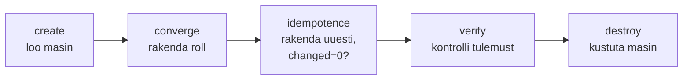

# Moodul 16. Automatiseerimine: Ansible, Vagrant ja infrastruktuur koodina

**Maht:** 10 tundi · **Laboritöö:** AlmaLinux (juhtmasin), Debian ja Ubuntu (hallatavad) · **Eeldused:** moodulid 1–15

> [!NOTE]
> **Sissejuhatav moodul.** See moodul annab automatiseerimisest **ülevaate ja alused**: miks ja kuidas infrastruktuuri koodina hallata ning kuidas Ansible, Vagrant, cloud-init ja OpenTofu omavahel sobituvad. Eesmärk on, et oskaksid kursuse servereid korratavalt seadistada ja tunneksid vahendeid ära - mitte veel nende täielik valdamine.
>
> **HKHK õppijale:** automatiseerimist käsitletakse põhjalikult eraldi aines „IT-süsteemide automatiseerimine“, mis läbitakse pärast Linuxi ja BSD halduse moodulit. See moodul valmistab sind selleks ette.

## Õpiväljundid

Mooduli läbinud õppija:

- selgitab infrastruktuuri koodina (IaC) põhimõtet ja idempotentsust;
- seadistab mitu serverit korraga Ansible'iga (inventuur, ad-hoc käsud, mänguraamatud, mallid, käsitlejad);
- kirjutab mänguraamatu, mis töötab nii Debiani kui ka Red Hati perekonna distrol;
- hoiab infrastruktuuri koodi Gitis koos saladuste kaitsega;
- loob Vagrantiga oma arvutisse korratava laborikeskkonna;
- jagab Ansible'i projekti rollideks ja muutujafailideks ning testib seda (`--check`, idempotentsuse test, `ansible-lint`, Molecule);
- loob virtuaalmasinaid koodina (cloud-init, OpenTofu) ja seadistab need Ansible'iga.

---

## 16.1 Miks automatiseerida?

Moodulites 13–15 seadistasid serveri käsitsi. See võttis mitu tundi ja kui server peaks homme uuesti üles ehitama, kuluks sama palju aega - ja tõenäoliselt jääks midagi kahe silma vahele. Kujuta ette sama tööd kümne või saja serveriga.

Oled juba õppinud kahte tööriista, mis selle probleemi lahendavad, ja selles moodulis lisandub kolmas:

| Tööriist | Lahendab |
|---|---|
| **Git** (moodul 6) | Kus on seadistus, kes ja miks seda muutis, kuidas eelmise versiooni juurde tagasi minna |
| **Konteinerid** (moodul 12) | Rakendus koos kõigi sõltuvustega ühes pakis, mis töötab igal pool ühtemoodi |
| **Ansible** | Serverite seadistamine koodina: üks käsk seadistab kõik serverid ühesuguseks |

Ühine põhimõte on **infrastruktuur koodina** (*Infrastructure as Code*, IaC): serverite seadistus kirjeldatakse tekstifailides, mida hoitakse Gitis, vaadatakse üle nagu programmikoodi ja rakendatakse automaatselt.

## 16.2 Ansible

**Ansible** seadistab servereid üle SSH. Erinevalt mõnest teisest automatiseerimisvahendist ei vaja hallatavad serverid eraldi agenti - piisab SSH-st ja Pythonist.

| Mõiste | Tähendus |
|---|---|
| **Juhtsõlm** (*control node*) | Masin, kus Ansible töötab |
| **Hallatavad sõlmed** (*managed nodes*) | Serverid, mida seadistatakse |
| **Inventuur** (*inventory*) | Hallatavate serverite loend ja grupid |
| **Moodul** (*module*) | Üks tegevus (paigalda pakett, kopeeri fail, käivita teenus) |
| **Ülesanne** (*task*) | Mooduli kasutamine kindlate parameetritega |
| **Mänguraamat** (*playbook*) | YAML-fail, mis kirjeldab ülesandeid serverigruppidele |
| **Käsitleja** (*handler*) | Ülesanne, mis käivitub ainult siis, kui midagi muutus (nt teenuse taaskäivitus) |
| **Roll** (*role*) | Korduvkasutatav ülesannete, failide ja mallide kogum |

### Idempotentsus

Ansible'i kõige olulisem omadus on **idempotentsus**: mänguraamat kirjeldab **soovitud olekut** („pakett nginx on paigaldatud“), mitte käske („paigalda nginx“). Kui olek juba vastab soovitule, ei tee Ansible midagi. Mänguraamatut võib käivitada ükskõik mitu korda - tulemus on alati sama.

### Paigaldus ja inventuur

```bash
sudo dnf install ansible-core                # AlmaLinux (täielik 'ansible' pakett on EPEL-is)
ansible --version
```

Projekti kataloogis `~/ansible`:

```ini
# inventuur.ini
[veebiserverid]
debian1 ansible_host=10.0.83.52
ubuntusrv ansible_host=10.0.83.54

[all:vars]
ansible_user=mari
```

```ini
# ansible.cfg
[defaults]
inventory = inventuur.ini
```

Hallatavatesse masinatesse peab saama SSH-võtmega sisse logida (vt moodul 7).

### Ad-hoc käsud

```bash
ansible all -m ansible.builtin.ping                      # kas kõik vastavad
ansible all -a "uptime"                                  # käivita käsk
ansible veebiserverid -m ansible.builtin.setup -a "filter=ansible_distribution*"   # faktid
ansible all -b -K -m ansible.builtin.package -a "name=htop state=present"         # paigalda
```

`-b` (*become*) tähendab `sudo`-t ja `-K` küsib `sudo` parooli.

### Mänguraamat

```yaml
# veebiserver.yml
- name: Seadista veebiserverid
  hosts: veebiserverid
  become: true

  vars:
    kooli_nimi: Haapsalu õppekool

  tasks:
    - name: Paigalda nginx
      ansible.builtin.package:
        name: nginx
        state: present

    - name: Loo avaleht mallist
      ansible.builtin.template:
        src: templates/index.html.j2
        dest: /var/www/html/index.html
        mode: "0644"

    - name: Paigalda nginx-i seadistus
      ansible.builtin.copy:
        src: files/nginx-default.conf
        dest: /etc/nginx/sites-available/default
        mode: "0644"
      notify: Laadi nginx uuesti

    - name: nginx töötab ja käivitub alglaadimisel
      ansible.builtin.service:
        name: nginx
        state: started
        enabled: true

  handlers:
    - name: Laadi nginx uuesti
      ansible.builtin.service:
        name: nginx
        state: reloaded
```

Mall `templates/index.html.j2` kasutab **Jinja2** süntaksit ja Ansible'i **fakte** (iga serveri kohta automaatselt kogutud info):

```jinja
<h1>{{ kooli_nimi }}</h1>
<p>Server: {{ ansible_hostname }} ({{ ansible_distribution }} {{ ansible_distribution_version }})</p>
<p>IP: {{ ansible_default_ipv4.address }}</p>
```

Käivitamine:

```bash
ansible-playbook veebiserver.yml --syntax-check
ansible-playbook veebiserver.yml -K --check --diff     # proovirežiim: näita, mida muudetaks
ansible-playbook veebiserver.yml -K
```

Väljundi lõpus on kokkuvõte iga serveri kohta: `ok` (juba õiges olekus), `changed` (muudeti), `failed` (viga). Teisel käivitusel peaks `changed=0` olema.

### Sagedasemad moodulid

| Moodul | Tegevus |
|---|---|
| `ansible.builtin.package` | Paigalda pakett (valib ise `apt` või `dnf`) |
| `ansible.builtin.apt`, `ansible.builtin.dnf` | Distrospetsiifiline pakihaldus |
| `ansible.builtin.copy` | Kopeeri fail |
| `ansible.builtin.template` | Loo fail Jinja2 mallist |
| `ansible.builtin.file` | Loo kataloog, muuda õigusi, loo viit |
| `ansible.builtin.lineinfile` | Muuda ühte rida failis |
| `ansible.builtin.service` | Halda teenust |
| `ansible.builtin.user`, `ansible.builtin.group` | Kasutajad ja grupid |
| `ansible.posix.authorized_key` | SSH avalik võti (kollektsioon `ansible.posix`) |
| `ansible.builtin.command`, `ansible.builtin.shell` | Käivita käsk (viimane abinõu, ei ole idempotentne) |

Kõigi moodulite dokumentatsioon: `ansible-doc ansible.builtin.user` või docs.ansible.com.

### Erinevad distrod

Ansible teab iga serveri distrot (`ansible_os_family`: `Debian` või `RedHat`), nii et ülesandeid saab tingimuslikult käivitada:

```yaml
- name: Paigalda Apache (Debian)
  ansible.builtin.apt:
    name: apache2
  when: ansible_os_family == "Debian"

- name: Paigalda Apache (RedHat)
  ansible.builtin.dnf:
    name: httpd
  when: ansible_os_family == "RedHat"
```

### Saladused

Paroole ei kirjutata mänguraamatusse avatekstina. **Ansible Vault** krüpteerib failid:

```bash
ansible-vault create saladused.yml
ansible-playbook mänguraamat.yml --ask-vault-pass
```

### Ansible ja teised tööriistad

| Tööriist | Kasutus |
|---|---|
| **Ansible** | Serverite seadistamine (mis on serveri sees) |
| **Terraform**/**OpenTofu** | Infrastruktuuri loomine (virtuaalmasinad, võrgud, pilveressursid - ka Proxmoxis) |
| **cloud-init** | Virtuaalmasina esmane seadistus esimesel käivitusel |
| **Vagrant** | Arenduse ja labori virtuaalmasinad oma arvutis (punkt 16.3) |
| **Kubernetes** | Konteinerite käitamine paljudes serverites korraga (valikmoodul 24) |

## 16.3 Laborikeskkond koodina: Vagrant

**Vagrant** (HashiCorp) loob ja seadistab virtuaalmasinaid tekstifaili `Vagrantfile` järgi. Ühe käsuga saad oma arvutisse terve labori - näiteks kolm masinat Ansible'i harjutamiseks - ja sama käsuga selle kustutada ning uuesti luua. Vagrant kasutab virtualiseerimiseks pakkujat (*provider*), tavaliselt **VirtualBoxi** (ka libvirt, Hyper-V, VMware).

| Mõiste | Tähendus |
|---|---|
| **Box** | valmis põhitõmmis (nt Debian 13), laaditakse alla Vagranti kataloogist |
| **Vagrantfile** | Ruby-süntaksiga fail: millised masinad, mälu, võrk, seadistus |
| **Provisioner** | mis tehakse masinas pärast loomist: shelli skript, Ansible jt |

> [!NOTE]
> **Litsents:** Vagrant on alates 2023. aastast BSL-litsentsiga (*Business Source License*) - õppimiseks ja oma töös kasutamiseks on see tasuta, kuid tegemist pole enam vaba tarkvaraga. Proxmoxis kasutatakse virtuaalmasinate koodina loomiseks pigem Terraformi/OpenTofut koos cloud-initiga; Vagrant sobib eelkõige **oma arvutisse** labori loomiseks.

### Näide: kolm masinat Ansible'i jaoks

```ruby
# Vagrantfile
MASINAD = {
  "debian" => { box: "debian/trixie64",  ip: "192.168.60.11" },
  "ubuntu" => { box: "bento/ubuntu-24.04", ip: "192.168.60.12" },
  "alma"   => { box: "almalinux/10",     ip: "192.168.60.13" },
}

Vagrant.configure("2") do |config|
  config.vm.provider "virtualbox" do |vb|
    vb.memory = 1024
    vb.cpus   = 1
  end

  MASINAD.each do |nimi, seaded|
    config.vm.define nimi do |m|
      m.vm.box      = seaded[:box]
      m.vm.hostname = nimi
      # sisevõrk: masinad näevad üksteist, aga mitte kooli võrku
      m.vm.network "private_network", ip: seaded[:ip], virtualbox__intnet: "ansible_lab"
      m.vm.provision "shell", inline: <<-SHELL
        echo "Masin #{nimi} on valmis" > /etc/motd
      SHELL
    end
  end
end
```

> [!NOTE]
> **Märkus:** boxide nimed ja saadavus muutuvad. Kontrolli enne kasutamist Vagranti kataloogist (portal.cloud.hashicorp.com/vagrant/discover), et box on olemas ja uuendatud - eelista distrode ametlikke (`debian/…`, `almalinux/…`) või Bento (`bento/…`) boxe. AlmaLinux 10 vajab ka VirtualBoxis x86-64-v3 toega protsessorit.

### Põhikäsud

```bash
vagrant up                 # loo ja käivita kõik masinad (esimesel korral laadib boxid alla)
vagrant status
vagrant ssh debian         # logi masinasse (kasutaja vagrant, sudo ilma paroolita)
vagrant provision alma     # käivita provisioner uuesti
vagrant snapshot save debian puhas
vagrant snapshot restore debian puhas
vagrant halt               # lülita välja
vagrant destroy -f         # kustuta kõik masinad
vagrant box list
```

Vagrant loob igale masinale NAT-võrguliidese (internet ja `vagrant ssh`) ning Vagrantfile'i järgi lisaliidesed. Projekti kataloog on masinas jagatud kataloogina `/vagrant`.

### Vagrant ja Ansible

Provisioneriks võib panna otse laboritöö 16 mänguraamatu:

```ruby
config.vm.provision "ansible" do |a|
  a.playbook = "site.yml"
end
```

Nii on kogu labor - masinad ja nende seadistus - kirjas Giti hoidlas ning iga õppija saab sama keskkonna käskudega `git clone` ja `vagrant up`.


## 16.4 Suurem projekt: rollid, muutujad ja testimine

Üks pikk mänguraamat muutub kiiresti loetamatuks. Päris projektis jagatakse kood **rollideks** - iga roll on üks iseseisev ülesanne (nt `baas`, `veebiserver`, `andmebaas`), mida saab kasutada mitmes mänguraamatus.

### Projekti ülesehitus

```text
ansible/
├── ansible.cfg
├── inventuur.ini
├── group_vars/
│   ├── all.yml              # muutujad kõigile serveritele
│   └── veebiserverid.yml    # muutujad grupile
├── host_vars/
│   └── debian1.yml          # muutujad ühele serverile
├── roles/
│   ├── baas/                # kasutajad, SSH, tulemüür, NTP
│   └── veebiserver/
│       ├── defaults/main.yml   # vaikemuutujad (madalaim prioriteet)
│       ├── tasks/main.yml      # ülesanded
│       ├── handlers/main.yml   # käsitlejad
│       ├── templates/          # Jinja2 mallid
│       ├── files/              # failid kopeerimiseks
│       └── meta/main.yml       # info ja sõltuvused
├── requirements.yml         # vajalikud kollektsioonid ja rollid
└── site.yml                 # peamine mänguraamat
```

Uue rolli põhja loob `ansible-galaxy role init --init-path roles veebiserver`. Mänguraamat jääb lühikeseks:

```yaml
# site.yml
- name: Kõik serverid
  hosts: all
  become: true
  roles:
    - baas

- name: Veebiserverid
  hosts: veebiserverid
  become: true
  roles:
    - veebiserver
```

**Muutujate prioriteet** (lihtsustatult, väiksemast suuremani): rolli `defaults/` → `group_vars/all.yml` → `group_vars/<grupp>.yml` → `host_vars/<masin>.yml` → mänguraamatu `vars:` → käsurea `-e`. Seepärast pannakse rolli `defaults/main.yml` mõistlikud vaikeväärtused ja keskkonnapõhised väärtused `group_vars`/`host_vars` failidesse.

Teiste tehtud kollektsioonid kirjeldatakse failis `requirements.yml` ja paigaldatakse käsuga `ansible-galaxy collection install -r requirements.yml`:

```yaml
collections:
  - name: ansible.posix
  - name: community.general
```

### Testimine

Infrastruktuuri koodi testitakse nagu tarkvara - enne, kui see jõuab päris serverisse.

| Tase | Vahend | Mida kontrollib |
|---|---|---|
| 1. Süntaks | `ansible-playbook site.yml --syntax-check` | kas YAML ja mänguraamatu ülesehitus on korrektne |
| 2. Stiil ja head tavad | **`ansible-lint`** | täielikud moodulinimed (`ansible.builtin.…`), ülesannete nimed, `command` asemel moodulid, õigused failidele jpm |
| 3. Proovirežiim | `--check --diff` | mida muudetaks (ilma muutmata) |
| 4. Idempotentsus | käivita kaks korda; teisel korral `changed=0` | kas mänguraamatut võib korduvalt käivitada |
| 5. Terviktest | **Molecule** | rolli test puhtas ajutises masinas või konteineris |

`ansible-lint` paigaldatakse Pythoni paketina (`python3 -m pip install --user ansible-lint`) ja käivitatakse projekti kataloogis: `ansible-lint`. See annab iga leiu kohta reegli nime (nt `fqcn[action-core]`, `name[missing]`) ja selgituse.

Idempotentsust saab kontrollida skriptiga:

```bash
ansible-playbook site.yml -K | tee /tmp/teine.txt
grep -E 'changed=[1-9]' /tmp/teine.txt && echo "EI OLE IDEMPOTENTNE" || echo "OK"
```

**Molecule** automatiseerib rolli testimise. Igal rollil on üks või mitu **stsenaariumi** (`molecule/default/`), mille test käib järgmiste sammudena:



- `molecule.yml` kirjeldab, kus testitakse (nt Podmani konteiner pildist `almalinux:10` või `debian:13`);
- `converge.yml` on lühike mänguraamat, mis rakendab rolli;
- `verify.yml` kontrollib tulemust (nt `ansible.builtin.uri` - kas veebileht vastab).

```bash
python3 -m pip install --user molecule "molecule-plugins[podman]"
cd roles/veebiserver
molecule test          # kogu tsükkel
molecule converge      # ainult rakenda (arenduse ajal)
molecule login         # logi testmasinasse sisse
molecule destroy
```

Molecule'i stsenaariumi loomise käsk ja failide täpne kuju sõltuvad versioonist - vaata Molecule'i dokumentatsiooni „Getting started“ ja kasuta laboritöö lisaülesandes selle näidet.

> [!NOTE]
> **Konteiner ei ole päris server:** konteineris pole tavaliselt systemd-d ega kernelit. Teenuste käivitamise test vajab systemd-ga pilti või virtuaalmasinat (Vagrant). Seepärast testitakse Molecule'iga sageli just paigaldust ja seadistusfaile, teenuseid aga päris testmasinas.

## 16.5 Virtuaalmasinad koodina: cloud-init ja OpenTofu

Ansible seadistab olemasolevaid masinaid. Masinad ise saab samuti luua koodi järgi - siis on kogu keskkond nullist uuesti ehitatav.

### cloud-init

**cloud-init** on tööriist, mis käivitub virtuaalmasina **esimesel alglaadimisel** ja seadistab selle vastavalt hüperviisori või pilve antud andmetele: hostinimi, IP-aadress, kasutaja, SSH-võti, paketid. Distrod pakuvad selleks spetsiaalseid **pilvetõmmiseid** (*cloud images*, nt `debian-13-genericcloud-amd64.qcow2`), millest tehakse **mall**.

Proxmoxis antakse cloud-initi andmed VM-i seadetes (vt moodul 23, cloud-init mall): `--ciuser`, `--sshkeys`, `--ipconfig0`. Keerukamad seaded kirjutatakse `user-data` faili:

```yaml
#cloud-config
hostname: k3s1
timezone: Europe/Tallinn
users:
  - name: kasutaja
    groups: [sudo]
    shell: /bin/bash
    sudo: "ALL=(ALL) NOPASSWD:ALL"
    ssh_authorized_keys:
      - ssh-ed25519 AAAA… kasutaja@alma
package_update: true
packages: [qemu-guest-agent, curl]
runcmd:
  - systemctl enable --now qemu-guest-agent
```

Masinas saab kontrollida: `cloud-init status --long`, logi `/var/log/cloud-init-output.log`.

### OpenTofu

**Terraform** (HashiCorp, alates 2023 BSL-litsents) ja selle vaba haru **OpenTofu** (Linux Foundation) kirjeldavad infrastruktuuri **deklaratiivselt**: kirjutad, mis peab olemas olema, ja tööriist arvutab, mida luua, muuta või kustutada. Ühendus platvormiga käib **pakkuja** (*provider*) kaudu - Proxmoxi jaoks on levinud `bpg/proxmox`.

```hcl
# main.tf - kolm VM-i cloud-init mallist 9000
terraform {
  required_providers {
    proxmox = { source = "bpg/proxmox" }
  }
}

variable "proxmox_token" {
  type      = string
  sensitive = true          # "kasutaja@pve!tofu=<saladus>"
}

provider "proxmox" {
  endpoint  = "https://pve.lab.example:8006/"
  api_token = var.proxmox_token
  insecure  = true          # labor: isesigneeritud sertifikaat
}

resource "proxmox_virtual_environment_vm" "k3s" {
  count     = 3
  name      = "k3s${count.index + 1}"
  node_name = "pve1"

  clone {
    vm_id = 9000
  }
  cpu {
    cores = 2
  }
  memory {
    dedicated = 2048
  }
  initialization {
    ip_config {
      ipv4 {
        address = "10.0.83.${61 + count.index}/24"
        gateway = "10.0.83.1"
      }
    }
    user_account {
      username = "kasutaja"
      keys     = [trimspace(file("~/.ssh/id_ed25519.pub"))]
    }
  }
}
```

```bash
export TF_VAR_proxmox_token='kasutaja@pve!tofu=…'
tofu init        # laadi pakkuja alla
tofu plan        # näita, mida tehakse (nagu Ansible'i --check)
tofu apply       # loo masinad
tofu destroy     # kustuta kõik, mis selle koodiga loodi
```

OpenTofu peab **olekufaili** `terraform.tfstate`, kus on kirjas, mida ta on loonud. Olekufailis võib olla saladusi - see **ei lähe Giti** (lisa `.gitignore`-i `*.tfstate*` ja `.terraform/`). Meeskonnas hoitakse olekut jagatud kohas (nt S3-ühilduvas salvestuses).

**Töövoog:** OpenTofu loob masinad → cloud-init annab neile nime, IP ja SSH-võtme → Ansible seadistab teenused. Kõik kolm on Gitis ja keskkonna saab mõne minutiga uuesti üles ehitada.

> [!NOTE]
> **Laboris:** API-tokeni loomiseks on vaja Proxmoxis vastavaid õigusi (*Datacenter* → *Permissions* → *API Tokens*). Kooli Proxmoxis küsi tokenit õpetajalt või harjuta oma Proxmoxis (moodul 23). Alternatiiv on Ansible'i moodul `community.general.proxmox_kvm`, mis kloonib malli samuti koodi järgi.

---

## Distrode erinevused

| | **Debian** | **Ubuntu** | **AlmaLinux** |
|---|---|---|---|
| Ansible | `apt install ansible` | `apt install ansible` | `dnf install ansible-core` (täielik EPEL-ist) |
| Pakimoodul | `ansible.builtin.apt` | `ansible.builtin.apt` | `ansible.builtin.dnf` |
| Distro tuvastus | `ansible_os_family == "Debian"` | `ansible_os_family == "Debian"` | `ansible_os_family == "RedHat"` |
| Vagrant | HashiCorpi hoidlast | HashiCorpi hoidlast | HashiCorpi hoidlast |

---

## Kokkuvõte

| Käsk | Tegevus |
|---|---|
| `ansible all -m ping` | Ad-hoc käsk |
| `ansible-playbook -K --check --diff` | Mänguraamat proovirežiimis |
| `ansible-vault create`, `--ask-vault-pass` | Saladused |
| `vagrant up`, `vagrant ssh`, `vagrant destroy` | Labori virtuaalmasinad Vagrantfile'i järgi |
| `ansible-galaxy role init`, `roles:`, `group_vars/` | Rollid ja muutujad |
| `ansible-lint`, `molecule test` | Ansible'i koodi testimine |
| `cloud-init status`, `#cloud-config` | VM-i esmane seadistus |
| `tofu init`, `plan`, `apply`, `destroy` | Virtuaalmasinad koodina (OpenTofu) |

**Järgmised sammud:** tee [laboritöö](labor.md) ja kontrolli oma teadmisi [enesekontrolli](enesekontroll.md) abil.

## Lisamaterjal

- Ansible'i dokumentatsioon (docs.ansible.com) - „Getting started“
- Jeff Geerling, „Ansible for DevOps“ - praktiline Ansible'i raamat
- Vagranti dokumentatsioon (developer.hashicorp.com/vagrant)
- OpenTofu dokumentatsioon (opentofu.org)
