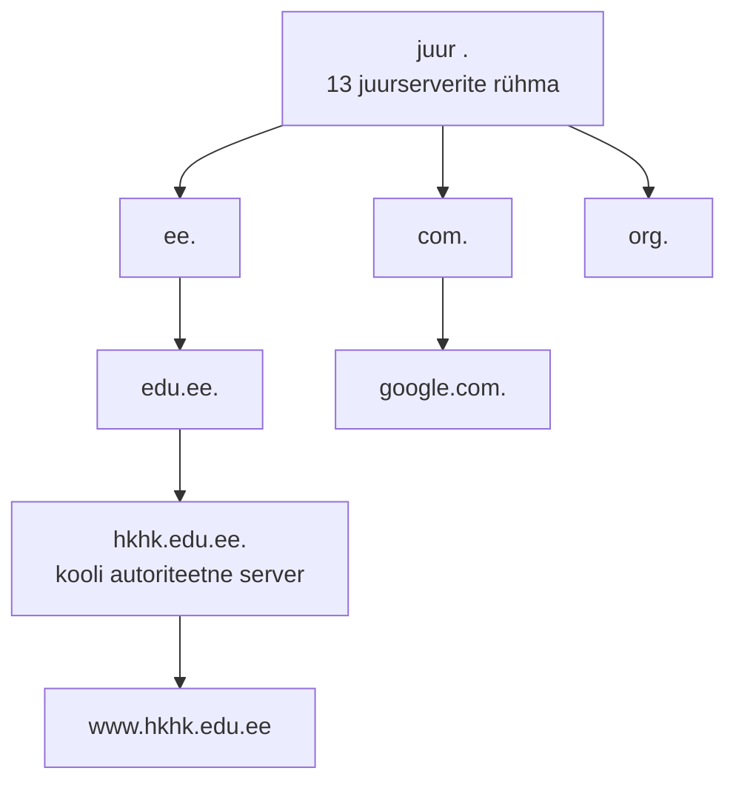
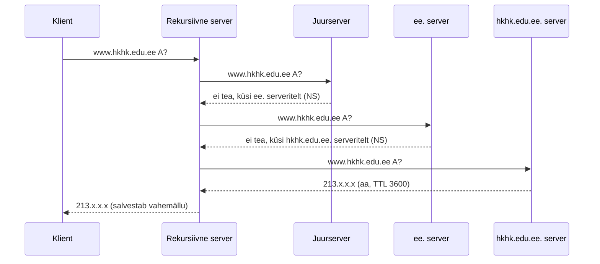
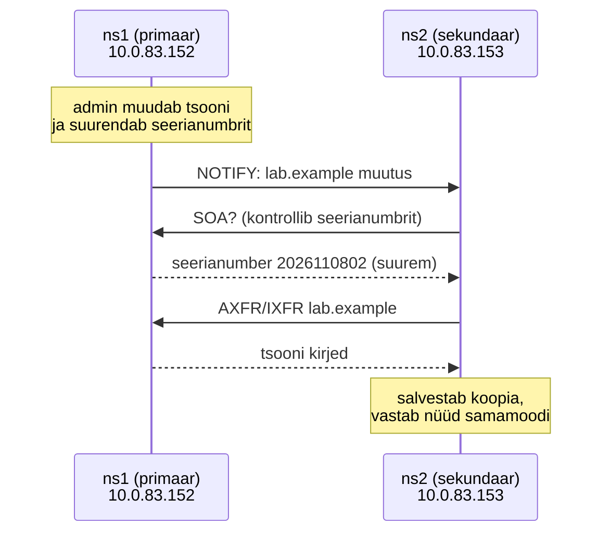

<!-- navigatsioon -->
[← Moodul 16. Enesekontroll](../moodul-16-andmebaasid/enesekontroll.md) · [Sisukord](../../README.md#sisukord) · [Laboritöö 17. Kooli väikeserver, III osa: DNS →](labor.md)
<!-- /navigatsioon -->

# Moodul 17. DNS ja nimelahendus

**Maht:** 8 tundi · **Laboritöö:** Debian (17), Ubuntu (17B) · **Eeldused:** moodulid 1–16 (eriti 7 ja 14)

Iga võrguteenus algab nimest: veebisait, e-post, failiserver, Active Directory ja Kubernetes vajavad töötavat DNS-i. Kui DNS ei tööta, „ei tööta internet“, kuigi võrk on korras. Moodulis 7 kasutasid DNS-i kliendina. Selles moodulis vaatame, kuidas nimelahendus Linuxis ja DNS tervikuna töötab, ning seadistame oma DNS-serverid: primaar- ja sekundaarserveri, pöördtsooni ning kergemad alternatiivid.

## Õpiväljundid

Mooduli läbinud õppija:

- selgitab, kuidas Linux nime lahendab (`nsswitch.conf`, `/etc/hosts`, `systemd-resolved`, vahemälu);
- selgitab DNS-i hierarhiat, rekursiivset päringut, TTL-i ja vahemälu ning jälgib päringu teekonda (`dig +trace`);
- seadistab BIND9 autoriteetse tsooni ja pöördtsooni ning rekursiooni piirangud;
- seadistab sekundaarserveri ja tsooniülekande;
- võrdleb DNS-servereid (BIND9, Unbound, dnsmasq, CoreDNS, Pi-hole) ning seadistab CoreDNS-i ja filtreeriva DNS-i Pi-hole;
- selgitab DNS-i turvariske ja kaitsevõtteid (avatud resolver, DNSSEC, DoT/DoH, *split-horizon*);
- leiab ja parandab tüüpilisi DNS-i vigu ning varundab DNS-i seadistuse.

> [!NOTE]
> **Kuidas seda lehte lugeda:** iga teema algab kastiga **Lühidalt** - seal on kõige tähtsam paari lausega. Käsud ja näited on alati näha. Pikemad selgitused ja taust on peidetud plokkidesse **Loe lähemalt** - ava need, kui tahad teemast rohkem teada või kui laboritöös midagi ei õnnestu.

---

## 17.1 Nimelahendus Linuxis

> [!TIP]
> **Lühidalt:** Linux otsib nime failide `/etc/nsswitch.conf` järjekorras: `/etc/hosts`, siis DNS. Ubuntus vahendab päringuid `systemd-resolved` (`127.0.0.53`, `resolvectl`). `getent hosts` lahendab nagu programmid.

Moodulis 7 nägid, et nime lahendamise järjekorra määrab `/etc/nsswitch.conf`. Täpsemalt:

```text
# /etc/nsswitch.conf (Ubuntu)
hosts: files mdns4_minimal [NOTFOUND=return] dns
```

| Allikas | Mida teeb |
|---|---|
| `files` | `/etc/hosts` |
| `mdns4_minimal` | Kohaliku võrgu `.local` nimed (Avahi, printerid) - seepärast ei sobi `.local` sisevõrgu domeeniks |
| `dns` | DNS-server(id) failist `/etc/resolv.conf` |
| `resolve` | otse systemd-resolved (mõnes distros) |
| `sss`, `ldap` | Kataloogiteenused (valikmoodulid 25-26) |

Programmid kasutavad nime lahendamiseks C-teegi funktsiooni `getaddrinfo()`, mis järgib `nsswitch.conf`-i. Seepärast:

- **`getent hosts nimi`** lahendab nime **täpselt nagu programmid** (arvestab `/etc/hosts`-i, mDNS-i jm);
- **`dig nimi`** küsib **ainult DNS-serverilt** ja ignoreerib `/etc/hosts`-i.

Kui `ping` töötab, kuid `dig` mitte (või vastupidi), on vastus peaaegu alati `/etc/hosts`-is.

### Otsingudomeenid

`/etc/resolv.conf` real `search lab.example` lisatakse lühinimele domeen: `ping debian1` → `debian1.lab.example`. Valik `ndots:1` (vaikimisi) tähendab, et kui nimes on vähemalt üks punkt, proovitakse seda kõigepealt täisnimena. Liiga pikk `search`-loend aeglustab päringuid, sest iga nime proovitakse iga domeeniga.

### Vahemälu ja systemd-resolved

Igal tasemel hoitakse vastuseid **vahemälus** (*cache*) kirje **TTL**-i (*Time To Live*) ajani. Ubuntu `systemd-resolved` on kohalik vahemäluga vahendaja; Debian ja AlmaLinux saadavad päringud vaikimisi otse `/etc/resolv.conf` serveritele (vahemälu on DNS-serveris).

```bash
resolvectl status               # serverid ja domeenid liideste kaupa
resolvectl query www.debian.org # päring koos allikaga
resolvectl statistics           # vahemälu tabamused
sudo resolvectl flush-caches    # tühjenda vahemälu (pärast DNS-i muudatust)
```

systemd-resolved oskab ka **liidesepõhist DNS-i** (*split DNS*): domeen `lab.example` küsitakse labori serverilt, kõik muu teiselt. Seda kasutavad näiteks VPN-id (moodul 13):

```bash
sudo resolvectl dns wg0 10.0.83.152
sudo resolvectl domain wg0 '~lab.example'      # tilde: ainult marsruutimiseks, mitte search'iks
```

## 17.2 Kuidas DNS töötab

> [!TIP]
> **Lühidalt:** DNS on hierarhiline: juur → tippdomeen (`.ee`) → domeen. Rekursiivne resolver küsib läbi kogu ahela ja jätab vastuse **TTL**-i ajaks vahemällu. `dig +trace` näitab teekonda.

DNS on **hierarhiline** ja **hajutatud** andmebaas: ükski server ei tea kõike, iga tase teab ainult järgmise taseme servereid.



DNS-serverid jagunevad kahte liiki:

| Liik | Ülesanne | Tarkvara |
|---|---|---|
| **Autoriteetne** | Vastab oma tsooni (domeeni) nimede kohta; vastusel on lipp `aa` (*authoritative answer*) | BIND9, NSD, PowerDNS, CoreDNS |
| **Rekursiivne** (*resolver*) | Küsib klientide eest vastuse teistelt serveritelt ja hoiab vahemälu | Unbound, BIND9, dnsmasq, systemd-resolved |

### Rekursiivne päring samm-sammult

Kui sinu arvuti küsib `www.hkhk.edu.ee`, ja vahemälus pole midagi:



Sama teekonna saab ise läbi käia:

```bash
dig +trace www.hkhk.edu.ee
```

### TTL ja vahemälu

**TTL** määrab sekundites, kui kaua võib vastust vahemälus hoida. Pikk TTL (nt 86400 = ööpäev) vähendab päringuid, lühike (300) võimaldab kiiresti muuta. Enne serveri kolimist **vähendatakse TTL-i ette**, et uus aadress jõuaks kiiresti kõigini.

Vahemällu jäävad ka **negatiivsed vastused** (`NXDOMAIN` - nime pole olemas): kui küsisid nime enne selle loomist, võib „pole olemas“ vastus püsida SOA-kirjes määratud aja.

```bash
dig www.debian.org | grep -A2 "ANSWER SECTION"     # TTL on teine väli; korda - TTL väheneb
```

## 17.3 Kirjete tüübid

> [!TIP]
> **Lühidalt:** Põhikirjed: `A`/`AAAA` - nimi → IP, `CNAME` - teine nimi, `MX` - e-posti server, `NS` - nimeserverid, `PTR` - IP → nimi, `TXT` - tekst (SPF, DKIM).

| Kirje | Tähendus | Näide |
|---|---|---|
| `SOA` | Tsooni põhiandmed | seerianumber, aegumisajad |
| `NS` | Tsooni nimeserver | `ns1.lab.example.` |
| `A` | Nimi → IPv4-aadress | `kool → 10.0.83.152` |
| `AAAA` | Nimi → IPv6-aadress | `kool → fd83::152` |
| `CNAME` | Nimi → teine nimi (alias) | `www → kool` |
| `MX` | E-posti server (koos eelistusega) | `10 mail.lab.example.` |
| `TXT` | Vaba tekst: SPF, DKIM, DMARC, domeeni omandi tõendamine | `"v=spf1 mx -all"` |
| `PTR` | IP-aadress → nimi (pöördtsoon) | `52 → debian1.lab.example.` |
| `SRV` | Teenuse asukoht: port ja server | `_ldap._tcp → 0 100 389 dc1.lab.example.` (Active Directory) |
| `CAA` | Millised sertifikaadikeskused võivad domeenile sertifikaate anda | `0 issue "letsencrypt.org"` |

Reeglid: `CNAME` ei tohi olla samal nimel ühegi teise kirjega (seega mitte tsooni juurel `@`) ning `MX` ja `NS` peavad osutama nimele, millel on `A`-kirje, mitte `CNAME`-le.

## 17.4 BIND9: autoriteetne server

> [!TIP]
> **Lühidalt:** BIND9 tsoon kirjeldatakse failis `named.conf.local`, kirjed tsoonifailis. Iga muudatuse järel **suurenda seerianumbrit**, kontrolli `named-checkzone` ja tee `systemctl reload named`.

**BIND9** oskab nii autoriteetset kui ka rekursiivset rolli ja on DNS-i õppimiseks klassikaline valik.

### Edasitsoon

```bash
sudo apt install bind9 bind9-dnsutils
```

Tsoon kirjeldatakse failis `/etc/bind/named.conf.local`:

```text
zone "lab.example" {
    type primary;
    file "/etc/bind/db.lab.example";
};
```

Tsoonifail `/etc/bind/db.lab.example`:

```text
$TTL 3600
@       IN  SOA ns1.lab.example. admin.lab.example. (
                2026110801  ; seerianumber (AAAAKKPPNN)
                3600        ; refresh
                900         ; retry
                604800      ; expire
                300 )       ; negatiivse vastuse TTL
        IN  NS  ns1.lab.example.

ns1     IN  A      10.0.83.152
kool    IN  A      10.0.83.152
www     IN  CNAME  kool
db      IN  A      10.0.83.153
```

Olulised reeglid:

- täielikud nimed lõpevad **punktiga** (`ns1.lab.example.`), ilma punktita nimedele lisatakse tsooni nimi;
- `@` tähistab tsooni ennast (`lab.example`);
- SOA-s olev e-posti aadress kirjutatakse punktiga (`admin.lab.example.` = `admin@lab.example`);
- **iga muudatuse järel suurenda seerianumbrit** - muidu ei saa teised serverid muudatusest teada.

Kontroll ja rakendamine:

```bash
sudo named-checkconf
sudo named-checkzone lab.example /etc/bind/db.lab.example
sudo systemctl reload named
dig @localhost kool.lab.example +short
dig @localhost www.lab.example
```

BIND9 on Debianis vaikimisi ka rekursiivne resolver kohalikule võrgule (`allow-recursion` vaikimisi `localnets; localhost;`), nii et kliendid saavad sama serveri kaudu lahendada ka internetinimesid. Kliendid tuleb seadistada kasutama seda serverit (Netplan, `nmcli`, `/etc/resolv.conf` - vt moodul 7) ja tulemüüris peab olema avatud port 53 (UDP ja TCP).

**Uue kirje lisamine samm-sammult** (nt uus server `seire` aadressiga `10.0.83.154`) - see on DNS-i haldaja kõige sagedasem töö:

1. Ava tsoonifail: `sudo nano /etc/bind/db.lab.example`.
2. Lisa kirje: `seire   IN  A   10.0.83.154`.
3. **Suurenda seerianumbrit** SOA-s (nt `2026110801` → `2026110802`). Kui unustad, ei saa sekundaarserver muudatusest teada.
4. Kontrolli ja rakenda:

    ```bash
    sudo named-checkzone lab.example /etc/bind/db.lab.example   # peab lõppema: OK
    sudo systemctl reload named
    ```

5. Kontrolli vastust - ka sekundaarserverist, kui see on olemas:

    ```bash
    dig @localhost seire.lab.example +short          # 10.0.83.154
    dig @10.0.83.153 seire.lab.example +short         # sekundaar (punkt 17.5)
    ```

6. Kui on pöördtsoon, lisa sinna ka `PTR`-kirje (allpool) ja suurenda ka selle seerianumbrit.

> [!NOTE]
> **Domeeninimed:** `.example` on reserveeritud näidete jaoks ja ei kuulu kunagi kellelegi. Sisevõrgus kasutatakse sageli oma domeeni alamdomeeni (nt `lab.hkhk.ee`) või tippdomeeni `.internal`. Lõpuga `.local` tasub vältida, sest seda kasutab mDNS.

### Pöördtsoon

Pöördtsoon vastab küsimusele „kelle aadress see on?“ (`dig -x 10.0.83.152`). Seda vajavad logid, e-posti serverid (saaja kontrollib saatja PTR-kirjet) ja paljud diagnostikatööriistad. Võrgu `10.0.83.0/24` pöördtsooni nimi on aadressi osad tagurpidi + `in-addr.arpa`:

```text
# /etc/bind/named.conf.local
zone "83.0.10.in-addr.arpa" {
    type primary;
    file "/etc/bind/db.10.0.83";
};
```

```text
; /etc/bind/db.10.0.83
$TTL 3600
@   IN  SOA ns1.lab.example. admin.lab.example. ( 2026110801 3600 900 604800 300 )
    IN  NS  ns1.lab.example.
152  IN  PTR debian1.lab.example.
153  IN  PTR debian2.lab.example.
154  IN  PTR ubuntusrv.lab.example.
155  IN  PTR alma.lab.example.
```

```bash
sudo named-checkzone 83.0.10.in-addr.arpa /etc/bind/db.10.0.83
sudo systemctl reload named
dig @localhost -x 10.0.83.155 +short
```

IPv6 pöördtsoon on `ip6.arpa` all, iga kuueteistkümnendnumber eraldi (pikk, kuid põhimõte sama).

### Rekursioon ja ligipääs

Avalikust internetist kättesaadav **avatud rekursiivne server** (*open resolver*) on ohtlik: seda kasutatakse **DNS-võimendusrünnakuteks**, kus väike päring võltsitud lähteaadressiga tekitab ohvrile suure vastuse. Seepärast piiratakse rekursioon oma võrguga:

```text
# /etc/bind/named.conf.options
acl "sisevork" { 127.0.0.1; ::1; 10.0.83.0/24; fd83::/64; };

options {
    directory "/var/cache/bind";
    recursion yes;
    allow-recursion { sisevork; };
    allow-query { any; };            # oma tsoonide kohta võib küsida igaüks
    allow-transfer { none; };        # tsooniülekanne ainult sekundaarile (punkt 17.5)
    forwarders { 1.1.1.1; 9.9.9.9; };  # valikuline: küsi välisnimesid nendelt, mitte juurest
    dnssec-validation auto;
    listen-on { any; };
    listen-on-v6 { any; };
};
```

```bash
sudo named-checkconf
sudo systemctl reload named
sudo journalctl -u named -n 20
sudo rndc status                 # serveri olek
sudo rndc reload lab.example     # laadi üks tsoon uuesti
sudo rndc flush                  # tühjenda vahemälu
```

## 17.5 Sekundaarserver ja tsooniülekanne

> [!TIP]
> **Lühidalt:** Igal tsoonil peab olema vähemalt kaks nimeserverit. Sekundaar saab tsooni primaarilt tsooniülekandega (`allow-transfer`, `also-notify`) ja uueneb seerianumbri järgi.

Üks DNS-server on **üksik rikkekoht**: kui see on maas, ei tööta midagi. Iga tsoonil peab olema vähemalt **kaks** nimeserverit (domeeni registripidajad nõuavad seda). Sekundaarserver saab tsooni koopia primaarilt **tsooniülekandega** (AXFR, muudatuste korral IXFR).



Primaaris (`debian1`) luba ülekanne ja teavitus sekundaarile:

```text
zone "lab.example" {
    type primary;
    file "/etc/bind/db.lab.example";
    allow-transfer { 10.0.83.153; };
    also-notify { 10.0.83.153; };
};
```

Lisa tsoonifaili teine NS-kirje (`IN NS ns2.lab.example.` ja `ns2 IN A 10.0.83.153`) ning suurenda seerianumbrit.

Sekundaaris (`debian2`):

```text
zone "lab.example" {
    type secondary;
    file "/var/cache/bind/db.lab.example";     # BIND kirjutab selle ise
    primaries { 10.0.83.152; };
};
```

```bash
sudo named-checkconf && sudo systemctl reload named
sudo journalctl -u named | grep -i transfer     # "Transfer completed"
dig @10.0.83.153 kool.lab.example +short
dig @10.0.83.152 lab.example SOA +short           # võrdle seerianumbreid
dig @10.0.83.153 lab.example SOA +short
```

SOA-kirje ajad juhivad sekundaari käitumist: `refresh` - kui tihti kontrollib muudatusi ise (kui NOTIFY ei jõudnud kohale), `retry` - kui tihti proovib ebaõnnestumisel uuesti, `expire` - kui kaua vastab vana koopiaga, kui primaar ei vasta.

> [!NOTE]
> Tsooniülekanne on vana ja usaldusväärne lahendus. Alternatiiv on hoida tsoonifailid **Gitis** ja lasta mõlemal serveril neid sealt tõmmata (näide punktis 17.6, CoreDNS) või kasutada andmebaasipõhist serverit (PowerDNS).

## 17.6 Teised DNS-serverid

> [!TIP]
> **Lühidalt:** Lihtsamad DNS-serverid: **dnsmasq** (väike võrk, `/etc/hosts`), **CoreDNS** (konteinerid, Kubernetes), **Pi-hole** (reklaamide ja jälgimise blokeerimine).

BIND9 on klassika, kuid praktikas kasutatakse sageli kergemaid või kitsama otstarbega servereid:

| Tarkvara | Liik | Tüüpiline kasutus |
|---|---|---|
| **BIND9** | autoriteetne + rekursiivne | klassikaline täisfunktsionaalne DNS, suured tsoonid, DNSSEC |
| **Unbound** | rekursiivne | turvaline vahemäluga resolver (OPNsense'i vaikimisi DNS, moodul 22) |
| **dnsmasq** | edastav vahemälu + DHCP + TFTP | väikesed võrgud, kodu- ja laboriruuterid, libvirt, Pi-hole'i alus |
| **CoreDNS** | autoriteetne + edastav, pistikprogrammidega | konteinerid, Kubernetes (vaikimisi klastri DNS), seadistus ühes failis |
| **PowerDNS** | autoriteetne (andmebaasiga) + eraldi Recursor | teenusepakkujad, API-ga hallatavad tsoonid |
| **Pi-hole**, AdGuard Home | filtreeriv DNS | reklaami- ja jälitusdomeenide blokeerimine kogu võrgule |
| **systemd-resolved** | kohalik kliendipoolne vahemälu | Ubuntu jt töölaud ja server (`127.0.0.53`, moodul 7) |
| **Windows Server DNS** | autoriteetne + rekursiivne | Active Directory (valikmoodul 26) |

### dnsmasq

dnsmasq loeb nimesid failist `/etc/hosts` ja edastab muud päringud ülemisele serverile. Väikese laborivõrgu DNS on sellega mõne reaga valmis:

```bash
sudo apt install dnsmasq
```

```text
# /etc/dnsmasq.d/labor.conf
domain-needed                 # ära edasta punktita nimesid
bogus-priv                    # ära edasta privaataadresside pöördpäringuid
no-resolv                     # ära kasuta /etc/resolv.conf ülemisi servereid
server=1.1.1.1
server=9.9.9.9
local=/lab.example/           # see domeen vastatakse ainult kohalikult
domain=lab.example
expand-hosts                  # lisa /etc/hosts nimedele domeen
address=/www.lab.example/10.0.83.152
```

```bash
sudo systemctl restart dnsmasq
dig @localhost www.lab.example +short
```

> [!NOTE]
> Ubuntu masinas kuulab `systemd-resolved` juba aadressil `127.0.0.53:53`. Kui dnsmasq või Pi-hole ei käivitu (`address already in use`), lülita resolvedi kohalik kuulaja välja: fail `/etc/systemd/resolved.conf.d/dns.conf` sisuga `[Resolve]` ja `DNSStubListener=no`, seejärel `sudo systemctl restart systemd-resolved`.

### CoreDNS

**CoreDNS** on Go-s kirjutatud DNS-server, mille kogu seadistus on ühes failis `Corefile`. Iga plokk kirjeldab tsooni ja selle **pistikprogrammid** (*plugins*). Tsoonifailid on samas vormingus nagu BIND9-l, seega saab punktis 17.4 loodud tsooni otse kasutada.

```text
# Corefile
lab.example {
    file /etc/coredns/zones/db.lab.example   # autoriteetne tsoon failist
    log
    errors
}

83.0.10.in-addr.arpa {
    file /etc/coredns/zones/db.10.0.83    # pöördtsoon
}

. {
    forward . 1.1.1.1 9.9.9.9                # kõik muu edasi
    cache 300
    errors
}
```

`file` pistikprogramm loeb tsoonifaili automaatselt uuesti, kui selle seerianumber suureneb. Pistikprogramm `reload` loeb uuesti ka `Corefile`'i, kui see muutub.

CoreDNS-i käivitatakse enamasti **konteinerina** (moodul 14). Näide Compose-failist:

```yaml
# compose.yaml
services:
  coredns:
    image: docker.io/coredns/coredns:1.12.1     # kontrolli uusimat versiooni
    command: -conf /etc/coredns/Corefile
    ports:
      - "53:53/udp"
      - "53:53/tcp"
    volumes:
      - ./Corefile:/etc/coredns/Corefile:ro
      - ./zones:/etc/coredns/zones:ro
    restart: unless-stopped
```

**Näide päriselust: HKHK Proxmoxi labori DNS.** Kooli laboris teenindavad sisevõrgu tsooni kaks CoreDNS-serverit (`ns1` ja `ns2`), mis töötavad Dockeris Compose'iga. Mõlemal on identne tsoonifail ja kogu seadistus (`Corefile` ja tsoonid, ka pöördtsoonid) on **Giti hoidlas**. Kumbki server tõmbab ajastatud tööga iga paari minuti järel hoidlast muudatused (`git pull`). Kirje lisamiseks muudetakse tsoonifaili ja suurendatakse seerianumbrit Gitis. Mõne minuti pärast on muudatus mõlemas serveris ja ajalugu näitab, kes ja millal kirjet muutis. See on lihtne **infrastruktuur koodina** (moodul 20) - ilma eraldi primaar-sekundaar-replikatsioonita.

### Pi-hole

**Pi-hole** on DNS-server (põhineb dnsmasq-il, töötab teenusena `pihole-FTL`), mis vastab reklaami-, jälitus- ja pahavaradomeenide päringutele tühja vastusega. Kui võrgu masinad kasutavad DNS-serverina Pi-hole'i, blokeeritakse need domeenid kõigis seadmetes - ka nutitelerites ja telefonides, kuhu reklaamiblokeerijat paigaldada ei saa. Lisaks on veebiliides, kus näeb päringute logi ja statistikat.

```bash
# Ära käivita võõrast skripti pimesi (curl ... | bash) - laadi alla, loe läbi, siis käivita
curl -sSL https://install.pi-hole.net -o basic-install.sh
less basic-install.sh
sudo bash basic-install.sh
```

```bash
pihole status
sudo pihole setpassword          # veebiliidese parool
pihole -q doubleclick.net        # kas domeen on mõnes blokeerimisloendis
sudo pihole -g                   # uuenda blokeerimisloendeid (gravity)
pihole tail                      # päringud reaalajas
```

Veebiliides on aadressil `http://<IP>/admin`. Seal saab lisada blokeerimisloendeid, lubatud domeene (*allowlist*), kohalikke DNS-kirjeid ja suunata kindla domeeni päringud teisele serverile (nt `lab.example` → BIND9).

Pi-hole'i võib käivitada ka konteinerina (pilt `pihole/pihole`). Teadmiseks: Pi-hole ei blokeeri reklaame, mida serveeritakse samalt domeenilt kui sisu (nt YouTube), ja seadmed, mis kasutavad DNS-i üle HTTPS-i (DoH), võivad sellest mööda minna.

## 17.7 DNS-i turvalisus

> [!TIP]
> **Lühidalt:** Ära jäta avatud resolverit internetti (`allow-recursion` ainult oma võrgule). DNSSEC kaitseb võltsitud vastuste eest, DoT/DoH krüpteerib päringud.

| Oht | Mis juhtub | Kaitse |
|---|---|---|
| **Avatud resolver** | Server võimendab rünnakuid teiste vastu | `allow-recursion` ainult sisevõrgule |
| **Vahemälu mürgitamine** (*cache poisoning*) | Ründaja paneb resolveri vahemällu võltsvastuse → kasutajad suunatakse võltslehele | Juhuslikud lähtepordid ja päringu ID-d (vaikimisi), **DNSSEC** |
| **Pealtkuulamine** | DNS-päringud liiguvad krüpteerimata - teenusepakkuja ja WiFi-võrgu omanik näevad, milliseid saite külastad | **DoT** (DNS over TLS, port 853), **DoH** (DNS over HTTPS) |
| **Tsooniülekanne kõigile** | Ründaja saab kogu sisevõrgu nimekirja | `allow-transfer` ainult sekundaarile |
| **Sisevõrgu nimed väljas** | Avalikus DNS-is paistavad sisemised serverid | *Split-horizon*: sisevõrgule üks vaade, internetile teine (BIND `view`), või eraldi serverid |

**DNSSEC** allkirjastab tsooni kirjed krüptograafiliselt: resolver kontrollib allkirja ahelat juurest alates ja lükkab võltsitud vastuse tagasi. Valideerimine on BIND-is ja Unboundis vaikimisi sees (`dnssec-validation auto`); oma tsooni allkirjastamine on keerulisem ja jääb sellest kursusest välja.

```bash
dig +dnssec www.ria.ee            # allkirjad (RRSIG); vastuse lipp "ad" = valideeritud
dig +short @1.1.1.1 dnssec-failed.org   # SERVFAIL: valesti allkirjastatud domeen lükati tagasi
resolvectl query --legend=no www.ria.ee   # "authenticated: yes"
```

systemd-resolved oskab DoT-i (`DNSOverTLS=opportunistic` failis `/etc/systemd/resolved.conf`).

## 17.8 DNS-i tõrkeotsing

> [!TIP]
> **Lühidalt:** Otsi viga järjest: kas server vastab (`dig @server nimi`), kas vastus on autoriteetne (`aa`), kas tsoon laadis (`journalctl -u named`), kas seerianumber suurenes, kas tulemüür lubab porti 53.

Üldine töökäik on lisas [tõrkeotsingu töövoog](../lisad/torkeotsing.md); siin on selle DNS-i osa.

| Sümptom | Mida kontrollida |
|---|---|
| `ping nimi` töötab, `dig nimi` mitte | Nimi on `/etc/hosts`-is, DNS-is mitte |
| Muudatus ei jõua klientideni | Seerianumber suurendamata? TTL ja vahemälu (`resolvectl flush-caches`, `rndc flush`)? |
| `NXDOMAIN` | Nime pole tsoonis; kirjaviga; puuduv lõpupunkt (`www.lab.example` → `www.lab.example.lab.example`) |
| `SERVFAIL` | Server ei saanud vastust: tsoon ei laadinud (vaata logi), ülemine server ei vasta, DNSSEC viga |
| `REFUSED` | Rekursioon või päring pole sellele kliendile lubatud (`allow-recursion`, `allow-query`) |
| Vastus puudub (*timeout*) | Teenus ei tööta, tulemüür (port 53 **UDP ja TCP**), vale aadress |
| Sekundaar annab vana vastuse | Ülekanne ebaõnnestus: `allow-transfer`, tulemüür (TCP 53), seerianumber; logi `journalctl -u named` |

```bash
dig @server nimi                     # kas KONKREETNE server vastab?
dig @server nimi +norecurse          # kas vastus on serveri enda tsoonist (aa) või vahemälust?
dig nimi +trace                      # kogu teekond juurest
sudo named-checkconf -z              # kontrolli seadistust ja kõiki tsoone
sudo journalctl -u named -f          # logi reaalajas (BIND9 nimi on "named")
sudo ss -tulpn | grep ':53 '         # kas server kuulab?
```

## 17.9 DNS-i seadistuse varundus

> [!TIP]
> **Lühidalt:** Varunda `/etc/bind` (seadistus ja tsoonifailid) või hoia tsoonifailid Gitis. Sekundaarserver ei ole varukoopia - vead kopeeritakse sinna samuti.

DNS-i andmed on väikesed, kuid kriitilised. Varunda:

- seadistus ja tsoonifailid (`/etc/bind/`, AlmaLinuxis `/etc/named.conf` ja `/var/named/`);
- sekundaarservereid ei pea varundama - nad saavad koopia primaarilt, kuid **sekundaar ei ole varukoopia**: vigane muudatus primaaris jõuab ka sinna;
- parim tava on hoida tsoonifailid **Gitis** (moodul 6): iga muudatus on ajaloos, kes ja millal muutis, ning eelmise versiooni taastamine on üks käsk.

Varunduse üldised põhimõtted ja tööriistad on moodulis 9.

---

## Distrode erinevused

| | **Debian** | **Ubuntu** | **AlmaLinux** |
|---|---|---|---|
| BIND9 pakett | `bind9`, `bind9-dnsutils` | sama | `bind`, `bind-utils` |
| Seadistus | `/etc/bind/named.conf.local`, `named.conf.options` | sama | `/etc/named.conf` |
| Tsoonifailid | `/etc/bind/` (primaar), `/var/cache/bind/` (sekundaar) | sama | `/var/named/`, sekundaar `/var/named/slaves/` |
| Teenus | `named` (alias `bind9`) | `named` | `named` (`enable --now`), tulemüür `firewall-cmd --add-service=dns` |
| Kohalik resolver | otse `/etc/resolv.conf` | `systemd-resolved` (`127.0.0.53`) | NetworkManager → `/etc/resolv.conf` |

AlmaLinuxis kontrollib SELinux, et `named` kirjutaks ainult lubatud kataloogidesse (`/var/named/data`, `/var/named/slaves`).

---

## Kokkuvõte

| Käsk või fail | Tegevus |
|---|---|
| `/etc/nsswitch.conf`, `getent hosts` | Lahendamise järjekord, lahenda nagu programmid |
| `resolvectl status/query/flush-caches` | systemd-resolved |
| `dig`, `dig +trace`, `dig -x`, `dig +norecurse` | DNS-päringud ja diagnostika |
| `named.conf.local`, `named.conf.options` | BIND9 tsoonid ja valikud |
| `named-checkconf -z`, `named-checkzone` | Seadistuse ja tsooni kontroll |
| `rndc reload/flush/status` | BIND9 haldus |
| `allow-recursion`, `allow-transfer`, `also-notify` | Ligipääs ja tsooniülekanne |
| `Corefile`, `/etc/dnsmasq.d/` | CoreDNS, dnsmasq |
| `pihole status`, `pihole -q` | Pi-hole |

**Järgmised sammud:** tee [laboritöö](labor.md) ja kontrolli oma teadmisi [enesekontrolli](enesekontroll.md) abil.

## Lisamaterjal

- BIND 9 administraatori juhend (bind9.readthedocs.io)
- Julia Evans, „How DNS works“ ja „Mess With DNS“ (messwithdns.net) - DNS-i katsetamine brauseris
- CoreDNS dokumentatsioon (coredns.io) ja Pi-hole'i dokumentatsioon (docs.pi-hole.net)
- RFC 1034 ja 1035 - DNS-i alusdokumendid

<!-- navigatsioon -->
---

[← Moodul 16. Enesekontroll](../moodul-16-andmebaasid/enesekontroll.md) · [Sisukord](../../README.md#sisukord) · [Laboritöö 17. Kooli väikeserver, III osa: DNS →](labor.md)
<!-- /navigatsioon -->
