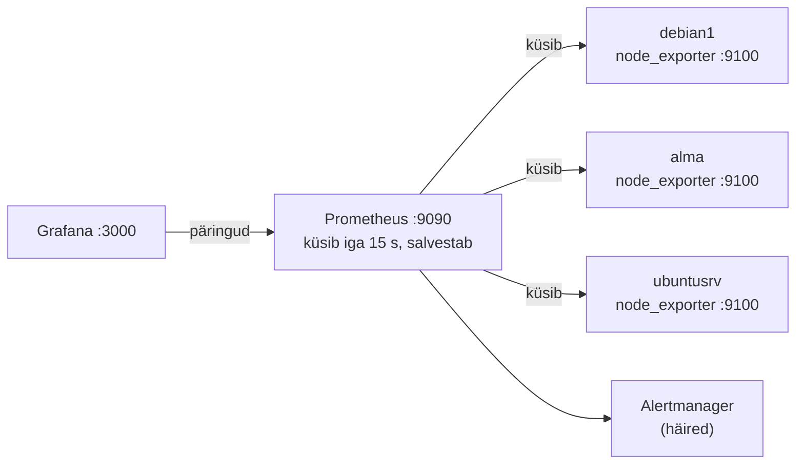

# Moodul 17. Seire ja jõudlus

**Maht:** 8 tundi · **Laboritöö:** Debian ja Ubuntu (Docker) · **Eeldused:** moodulid 1–16

> [!NOTE]
> **Sissejuhatav moodul.** See moodul annab seirest ja jõudluse analüüsist **ülevaate ja alused**: kuidas leida ühe serveri jõudlusprobleemi põhjus käsurea tööriistadega ning kuidas on üles ehitatud seiresüsteemid (Prometheus, Grafana, Uptime Kuma, Zabbix). Eesmärk on mõista põhimõtteid ja ehitada laborile lihtne seire - mitte veel suurte seirelahenduste täielik valdamine.
>
> **HKHK õppijale:** seiret käsitletakse põhjalikult eraldi aines „IT-süsteemide monitooring“, mis läbitakse pärast Linuxi ja BSD halduse moodulit. See moodul valmistab sind selleks ette.

## Õpiväljundid

Mooduli läbinud õppija:

- selgitab seire eesmärke ning mõõdikute, logide ja häirete rolli;
- analüüsib süsteemi koormust tööriistadega `uptime`, `top`, `vmstat`, `iostat`, `pidstat`, `free` ja `sar`;
- leiab jõudlusprobleemi põhjuse süstemaatiliselt (USE meetod) ning kasutab `strace`-i ja `lsof`-i;
- võrdleb seiresüsteeme (Prometheus ja Grafana, Zabbix, Netdata, Uptime Kuma);
- paigaldab Prometheuse, node_exporteri ja Grafana ning koostab lihtsaid PromQL-päringuid;
- seadistab kättesaadavuse jälgimise ja häired;
- valib ja rakendab jõudlusprofiili (`tuned`).

---

## 17.1 Miks seirata?

Server, mille kohta keegi ei tea, kas see töötab, on ohtlik. Seire vastab küsimustele:

- **Kas teenus töötab?** (kättesaadavus - kas veebileht vastab?)
- **Kas see töötab hästi?** (jõudlus - kui kiiresti vastab, kas ressursse jätkub?)
- **Mis juhtus?** (ajalugu - mis toimus öösel kell 3, kui server aeglaseks läks?)
- **Mis juhtub varsti?** (trendid - millal saab ketas täis?)

Seire kolm alustala:

| | Mis | Näide | Tööriistad |
|---|---|---|---|
| **Mõõdikud** (*metrics*) | arvud ajas | protsessori kasutus 85%, vaba ruum 12 GiB | Prometheus, Zabbix, `sar` |
| **Logid** | sündmused tekstina | `Failed password for root from …` | journald, rsyslog, Loki, Graylog (moodul 11) |
| **Häired** (*alerts*) | teade inimesele, kui midagi on valesti | „ketas `/var` on 95% täis“ | Alertmanager, Zabbix, Uptime Kuma, e-post (moodul 15) |

### USE meetod

Kui server on aeglane, ära arva - kontrolli süstemaatiliselt iga ressurssi (protsessor, mälu, ketas, võrk) kolme küsimusega (Brendan Gregg):

| | Küsimus | Protsessor | Mälu | Ketas | Võrk |
|---|---|---|---|---|---|
| **U**tilization | kui palju on kasutusel? | `%us + %sy` | `used` | `%util` | Mbit/s |
| **S**aturation | kas tekib järjekord? | koormus > tuumade arv, `r` | saalealasse kirjutamine (`si/so`) | `aqu-sz`, `await` | kaotatud paketid |
| **E**rrors | kas on vigu? | - | OOM killer | I/O vead `dmesg` | `ip -s link` vead |

---

## 17.2 Jõudluse tööriistad

### Koormus

```bash
uptime
```

```text
 20:15:01 up 12 days,  3:04,  2 users,  load average: 0.52, 1.10, 0.95
```

**Koormus** (*load average*) on viimase 1, 5 ja 15 minuti keskmine protsesside arv, mis töötavad või ootavad protsessorit (Linuxis ka need, kes ootavad ketast). Võrdle seda **tuumade arvuga** (`nproc`): 4 tuumaga masinas on koormus 4 täis koormus, 8 tähendab järjekorda.

### top ja htop

```bash
top            # P - sordi CPU järgi, M - mälu järgi, 1 - iga tuum eraldi, q - välju
htop           # värviline ja mugavam (paigalda eraldi)
```

`top` päise rida `%Cpu(s)`:

| Väli | Tähendus |
|---|---|
| `us` | kasutajaprogrammid |
| `sy` | kernel |
| `wa` | ootab ketast (I/O wait) - kõrge väärtus viitab kettaprobleemile |
| `st` | *steal* - hüperviisor andis protsessoriaja teistele VM-idele (ülekoormatud Proxmoxi sõlm!) |
| `id` | jõude |

### Mälu

```bash
free -h
```

```text
               total        used        free      shared  buff/cache   available
Mem:           3.8Gi       1.1Gi       210Mi        12Mi       2.6Gi       2.5Gi
Swap:          1.0Gi          0B       1.0Gi
```

Linux kasutab vaba mälu **failide vahemäluna** (`buff/cache`), mistõttu `free` on alati väike. Oluline on veerg **`available`** - kui palju saab programmidele anda. Kui mälu tõesti otsa saab, tapab kernel mõne protsessi (**OOM killer**): `journalctl -k | grep -i "out of memory"`.

### vmstat, iostat, pidstat ja mpstat

```bash
sudo apt install sysstat           # AlmaLinux: sudo dnf install sysstat
vmstat 2                           # iga 2 sekundi järel
iostat -xz 2                       # ketaste koormus
pidstat 2                          # protsesside CPU-kasutus
pidstat -d 2                       # protsesside kettakasutus
mpstat -P ALL 2                    # iga tuum eraldi
```

`vmstat` olulisemad veerud: `r` (protsessorit ootavad protsessid), `b` (ketast ootavad), `si`/`so` (saalealasse ja sealt), `us sy id wa st`.

`iostat -x` olulisemad veerud: `r/s`, `w/s` (operatsioonid sekundis), `r_await`, `w_await` (ooteaeg ms), `aqu-sz` (järjekorra pikkus), `%util`.

### Ajalugu: sar

`sysstat` kogub mõõdikuid iga 10 minuti järel (Debianis/Ubuntus lülita sisse: `sudo systemctl enable --now sysstat`):

```bash
sar -u            # protsessor täna
sar -r            # mälu
sar -d            # kettad
sar -n DEV        # võrk
sar -q -f /var/log/sysstat/sa08     # koormus kuu 8. päeval (AlmaLinuxis /var/log/sa/sa08)
```

Nii saad vastata küsimusele „mis juhtus öösel?“ ka ilma eraldi seiresüsteemita.

### Võrk

```bash
ss -s                          # ühenduste kokkuvõte
ss -tnp state established      # avatud TCP-ühendused protsessidega
ip -s link                     # liidese liiklus ja vead
sudo iftop -i ens18            # reaalajas liiklus ühenduste kaupa (pakett iftop)
```

### Kiire ülevaade 60 sekundiga

Kui logid aeglasesse serverisse, käivita järjest:

```bash
uptime
dmesg -T | tail
vmstat 1 5
mpstat -P ALL 1 3
pidstat 1 3
iostat -xz 1 3
free -h
sar -n DEV 1 3
top -b -n 1 | head -20
```

---

### Jõudlusprofiilid: tuned

**tuned** rakendab terve komplekti kerneli ja riistvara seadeid (protsessori sageduse juhtimine, ketta järjekorrad, `sysctl` väärtused) valmis **profiilidena**. AlmaLinuxis on see vaikimisi sees.

```bash
sudo dnf install tuned && sudo systemctl enable --now tuned     # Debian/Ubuntu: sudo apt install tuned
tuned-adm list                        # profiilid
tuned-adm active                      # praegune
tuned-adm recommend                   # soovitus (VM-is tavaliselt virtual-guest)
sudo tuned-adm profile throughput-performance
```

| Profiil | Kasutus |
|---|---|
| `virtual-guest` | virtuaalmasin |
| `virtual-host` | hüperviisor (nt Proxmoxi sõlm) |
| `throughput-performance` | serverid, suur läbilaskevõime |
| `latency-performance` | väike latentsus (andmebaasid, kauplemine) |
| `powersave` | energiasääst (sülearvutid) |

Mõõda enne ja pärast (`fio`, `sar`, moodul 9) - profiil ei ole imerohi.

## 17.3 Tõrkeotsing: strace ja lsof

### lsof - avatud failid

Linuxis on „kõik fail“: ka võrguühendused ja seadmed. `lsof` näitab, kes mida avatuna hoiab.

```bash
sudo lsof -p 1234               # protsessi 1234 avatud failid
sudo lsof /var/log/syslog       # kes hoiab seda faili avatuna
sudo lsof -i :80                # kes kuulab pordil 80
sudo lsof +L1                   # kustutatud, kuid avatud failid (moodul 8)
```

### strace - süsteemikutsed

`strace` näitab, milliseid **süsteemikutseid** programm kernelile teeb: failide avamine, lugemine, võrguühendused. See on asendamatu, kui programm „lihtsalt ei tööta“ ja veateade on ebaselge.

```bash
strace -e trace=openat,stat cat /etc/hostname
strace -f -e trace=file -o /tmp/jalg.txt ./skript.sh     # -f - ka alamprotsessid
sudo strace -p 1234                                      # ühendu töötava protsessiga
strace -c ls /usr/bin > /dev/null                        # kokkuvõte: millised kutsed, kui palju aega
```

Tüüpiline leid: `openat(AT_FDCWD, "/etc/rakendus.conf", O_RDONLY) = -1 ENOENT (No such file or directory)` - programm otsib seadistust teisest kohast, kui arvasid.

> [!WARNING]
> **Hoiatus:** `strace` aeglustab programmi märgatavalt. Tootmisserveris kasuta seda lühiajaliselt. Süvitsi jõudlusanalüüsiks on `perf` ja eBPF-tööriistad (`bpftrace`, `bcc`).

---

## 17.4 Seiresüsteemid

Kui servereid on rohkem kui paar, ei logi keegi igasse sisse `top`-i vaatama. **Seiresüsteem** kogub mõõdikud kõigist masinatest kokku, salvestab ajaloo, joonistab graafikud ja saadab häireid.

| Süsteem | Põhimõte | Tugevused | Tüüpiline kasutus |
|---|---|---|---|
| **Prometheus** + **Grafana** | Prometheus küsib (*pull*) mõõdikuid eksportijatelt HTTP kaudu, Grafana joonistab | pilve- ja konteinerimaailma standard, võimas päringukeel PromQL | konteinerid, Kubernetes, moodne taristu |
| **Zabbix** | agent saadab andmed serverisse, mallid | valmis mallid sadadele seadmetele (serverid, võrguseadmed, Proxmox), veebiliides | ettevõtete ja asutuste klassikaline seire |
| **Netdata** | iga masin kogub sekundi täpsusega | paigaldus minutiga, ilusad reaalajagraafikud | ühe masina sügavam vaatlus |
| **Uptime Kuma** | kontrollib väljast, kas teenus vastab | väga lihtne, palju teavitusviise | veebisaitide ja teenuste kättesaadavus |
| **Checkmk**, **Icinga** | kontrollid (*checks*) | Nagiose järglased | klassikaline seire |

Logide kogumiseks kasutatakse **Grafana Lokit**, **Graylogi** või **OpenSearchi**, turvasündmuste jaoks SIEM-i (Wazuh, moodul 11).

---

## 17.5 Prometheus, node_exporter ja Grafana



### node_exporter jälgitavatesse masinatesse

```bash
sudo apt install prometheus-node-exporter        # Debian, Ubuntu
curl -s http://localhost:9100/metrics | grep ^node_load
```

AlmaLinuxis käivita see konteinerina (või laadi alla eksportija binaarfail projekti GitHubi lehelt):

```bash
sudo podman run -d --name node-exporter --net=host --pid=host \
    -v /:/host:ro,rslave quay.io/prometheus/node-exporter:latest --path.rootfs=/host
```

Luba tulemüüris port **9100/tcp** ainult seireserverile.

### Prometheus ja Grafana konteinerites

Seireserveris (nt `ubuntusrv`, Docker või Podman, moodul 12):

```yaml
# ~/seire/compose.yaml
services:
  prometheus:
    image: docker.io/prom/prometheus:v3.5.0          # kontrolli uusimat versiooni
    volumes:
      - ./prometheus.yml:/etc/prometheus/prometheus.yml:ro
      - prom-andmed:/prometheus
    ports:
      - "9090:9090"
    restart: unless-stopped
  grafana:
    image: docker.io/grafana/grafana:12.1.0          # kontrolli uusimat versiooni
    volumes:
      - grafana-andmed:/var/lib/grafana
    ports:
      - "3000:3000"
    restart: unless-stopped
volumes:
  prom-andmed:
  grafana-andmed:
```

```yaml
# ~/seire/prometheus.yml
global:
  scrape_interval: 15s
scrape_configs:
  - job_name: node
    static_configs:
      - targets:
          - 10.0.83.52:9100      # debian1
          - 10.0.83.54:9100      # ubuntusrv
          - 10.0.83.55:9100      # alma
```

```bash
cd ~/seire && docker compose up -d
```

Ava `http://<seireserver>:9090/targets` - kõik sihtmärgid peavad olema **UP**.

### PromQL näited

| Päring | Tähendus |
|---|---|
| `up` | kas sihtmärk vastab (1/0) |
| `node_load1` | 1 minuti koormus |
| `100 - avg by (instance) (rate(node_cpu_seconds_total{mode="idle"}[5m])) * 100` | protsessori kasutus % |
| `node_memory_MemAvailable_bytes / node_memory_MemTotal_bytes * 100` | vaba mälu % |
| `node_filesystem_avail_bytes{mountpoint="/"} / 1024^3` | vaba ruum juurfailisüsteemis GiB |
| `predict_linear(node_filesystem_avail_bytes{mountpoint="/"}[6h], 24*3600) < 0` | kas ketas saab 24 tunni jooksul täis |

### Grafana

Ava `http://<seireserver>:3000` (esmakordne kasutaja `admin` / `admin` - muuda kohe). Lisa andmeallikas *Connections* → *Data sources* → *Prometheus*, URL `http://prometheus:9090`. Valmis armatuurlaua saad importida: *Dashboards* → *New* → *Import*, ID **1860** (*Node Exporter Full*).

<!-- PILT: ../pildid/m17-grafana-node-exporter.png | Grafana töölaud *Node Exporter Full* (CPU, mälu, ketas) -->

### Häired

Prometheuse reeglid kirjeldavad, millal tekib häire; **Alertmanager** saadab need e-posti, Slacki, Teamsi või Matrixi. Lihtsamal juhul saab häireid seadistada ka otse Grafanas (*Alerting* → *Alert rules*). Näide reeglist:

```yaml
groups:
  - name: serverid
    rules:
      - alert: KetasTaitub
        expr: node_filesystem_avail_bytes{mountpoint="/"} / node_filesystem_size_bytes{mountpoint="/"} < 0.10
        for: 10m
        annotations:
          summary: "{{ $labels.instance }}: juurfailisüsteemis alla 10% vaba ruumi"
```

> [!TIP]
> **Häirete väsimus:** kui häireid tuleb palju ja enamik neist ei vaja tegutsemist, lõpetavad inimesed nende lugemise. Häire peab tähendama, et **inimene peab midagi tegema**. Muu info kuulub armatuurlauale.

---

## 17.6 Kättesaadavus: Uptime Kuma

**Uptime Kuma** kontrollib väljastpoolt, kas teenus vastab (HTTP(S), TCP-port, ping, DNS) ja kui kaua sertifikaat veel kehtib.

```bash
docker run -d --name uptime-kuma --restart unless-stopped \
    -p 3001:3001 -v uptime-kuma:/app/data docker.io/louislam/uptime-kuma:1
```

Ava `http://<server>:3001`, loo administraator ja lisa jälgimised (*Add New Monitor*), nt `https://kool.lab.example` (moodul 13) ja DNS-päring `debian1` serverile (moodul 15). Teavitusi saab saata e-posti (SMTP), Telegrami, Discordi, Teamsi jt kaudu. Avalik olekuleht (*Status Page*) näitab kasutajatele, kas teenused töötavad.

<!-- PILT: ../pildid/m17-uptime-kuma.png | Uptime Kuma jälgitavate teenuste nimekiri -->

---

## 17.7 Zabbix lühidalt

**Zabbix** on paljudes Eesti asutustes ja ettevõtetes kasutatav seiresüsteem. Server (PHP veebiliides + andmebaas) ja agendid paigaldatakse Zabbixi enda hoidlast (repo.zabbix.com, vali LTS-versioon). Agent:

```bash
sudo apt install zabbix-agent2          # pärast Zabbixi hoidla lisamist
# /etc/zabbix/zabbix_agent2.conf: Server=<zabbixi server>, ServerActive=<zabbixi server>, Hostname=debian1
sudo systemctl enable --now zabbix-agent2
```

Veebiliideses lisatakse host ja seotakse **malliga** (nt *Linux by Zabbix agent*), mis toob kaasa sadu valmis mõõdikuid, graafikuid ja häirereegleid. Zabbixil on mallid ka Proxmoxi, võrguseadmete (SNMP) ja andmebaaside jaoks.

---

## Distrode erinevused

| | **Debian** | **Ubuntu** | **AlmaLinux** |
|---|---|---|---|
| sysstat ajalugu | `systemctl enable --now sysstat`, `/var/log/sysstat/` | sama | sees, `/var/log/sa/` |
| node_exporter | `prometheus-node-exporter` | `prometheus-node-exporter` | konteiner või binaarfail |
| Zabbixi agent | Zabbixi hoidlast | Zabbixi hoidlast | Zabbixi hoidlast (vajadusel välista EPEL-i Zabbixi paketid) |
| Tulemüür seire jaoks | `ufw allow from <server> to any port 9100` | sama | `firewall-cmd --add-rich-rule=…` |

---

## Kokkuvõte

| Käsk või tööriist | Kasutus |
|---|---|
| `uptime`, `nproc` | Koormus ja tuumade arv |
| `top`, `htop` | Protsessid, CPU (`wa`, `st`) |
| `free -h` | Mälu (`available`) |
| `vmstat`, `mpstat`, `pidstat`, `iostat -xz` | Jooksev jõudlus |
| `sar` | Jõudluse ajalugu |
| `lsof`, `strace` | Avatud failid, süsteemikutsed |
| node_exporter, Prometheus, PromQL | Mõõdikute kogumine ja päringud |
| Grafana | Armatuurlauad ja häired |
| Uptime Kuma | Kättesaadavus ja sertifikaatide kehtivus |
| Zabbix | Agendiga seire mallidega |
| `tuned-adm list/active/recommend/profile` | Jõudlusprofiilid |

**Järgmised sammud:** tee [laboritöö](labor.md) ja kontrolli oma teadmisi [enesekontrolli](enesekontroll.md) abil. Seejärel proovi [proovieksamit](../proovieksam.md) ja alusta [lõpuprojektiga](../lopuprojekt.md).

## Lisamaterjal

- Brendan Gregg, „Systems Performance“ ja brendangregg.com (USE meetod, Linux Performance)
- Prometheuse dokumentatsioon (prometheus.io/docs) ja Grafana dokumentatsioon (grafana.com/docs)
- Uptime Kuma (github.com/louislam/uptime-kuma)
- Zabbixi dokumentatsioon (zabbix.com/documentation)
