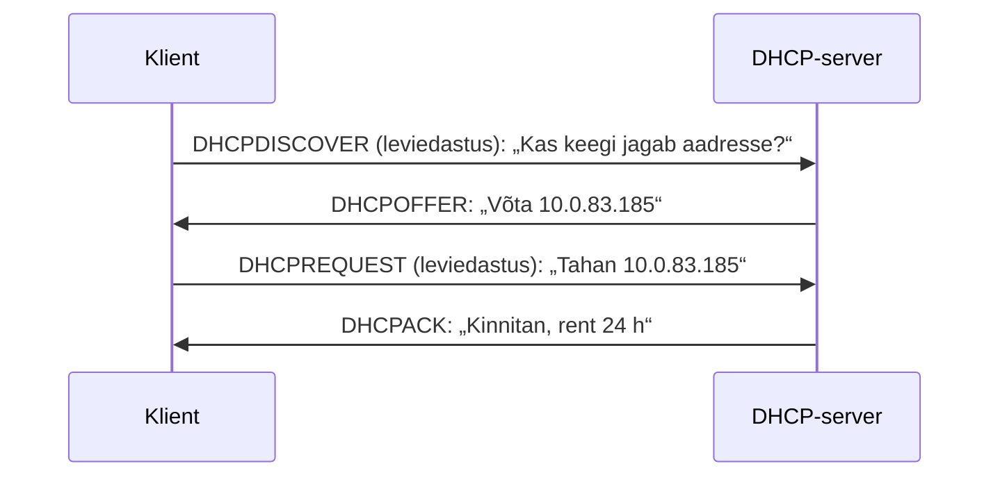

<!-- navigatsioon -->
[← Moodul 17. Enesekontroll](../moodul-17-dns/enesekontroll.md) · [Sisukord](../../README.md#sisukord) · [Laboritöö 18. DHCP-server →](labor.md)
<!-- /navigatsioon -->

# Moodul 18. DHCP

**Maht:** 6 tundi · **Laboritöö:** Debian (server), Ubuntu ja AlmaLinux (kliendid) · **Eeldused:** moodulid 1–9, 13 ja 17

## Õpiväljundid

Mooduli läbinud õppija:

- selgitab DHCP toimimist, sõnumite vahetust (DORA) ja rendi mõistet;
- nimetab olulisemad DHCP-valikud ja Linuxi DHCP-serverid;
- seadistab Linuxis DHCP-serveri Kea: alamvõrk, aadressivahemik, valikud ja reserveeringud;
- seadistab kliendi DHCP-d kasutama, uuendab renti ja leiab rendid serverist;
- leiab DHCP vea põhjuse logide ja `tcpdump`-i abil;
- selgitab, miks võrgus tohib olla ainult üks DHCP-server, ja mis on DHCP relee;
- varundab DHCP-serveri seadistuse ja hoiab võrguplaani ajakohasena.

> [!NOTE]
> **Kuidas seda lehte lugeda:** iga teema algab kastiga **Lühidalt** - seal on kõige tähtsam paari lausega. Käsud ja näited on alati näha. Pikemad selgitused ja taust on peidetud plokkidesse **Loe lähemalt** - ava need, kui tahad teemast rohkem teada või kui laboritöös midagi ei õnnestu.

> [!WARNING]
> **Ainult oma laborivõrgus!** DHCP-server mõjutab kõiki samas võrgus olevaid masinaid. Vale DHCP-server kooli või ettevõtte võrgus võib jätta kõik arvutid ilma internetita. Käivita DHCP-server ainult oma laborivõrgus (HKHK Proxmoxi laboris sinu enda sild või VNet, vt [paigalduslisa](../lisad/paigaldus.md)) ja kontrolli enne, et seal ei tööta juba teist DHCP-serverit.

---

## 18.1 Kuidas DHCP töötab

> [!TIP]
> **Lühidalt:** DHCP annab masinale automaatselt IP-aadressi, maski, vaikelüüsi ja DNS-serveri. Klient ja server vahetavad neli sõnumit (**DORA**: Discover, Offer, Request, Ack). Aadress antakse **rendile** kindlaks ajaks. Serveritel on staatiline aadress, klientidel DHCP.

**DHCP** (*Dynamic Host Configuration Protocol*) jagab võrgu masinatele automaatselt IP-aadressi ja muud võrguseadistust: maski, vaikelüüsi, DNS-servereid, domeeni. Ilma DHCP-ta tuleks iga klientarvuti, telefoni ja printeri võrk käsitsi seadistada (moodul 7) ja aadresside üle arvet pidada.

### DORA

Klient ja server vahetavad nelja sõnumit (pordid UDP 67 server, 68 klient):



Esimene sõnum on **leviedastus** (*broadcast*), sest kliendil pole veel aadressi ega teadmist serveri kohta. Seepärast töötab DHCP vaikimisi ainult ühe võrgusegmendi piires. Teistesse võrkudesse edastab päringud **DHCP relee** (*relay*, nt ruuteris).

**Rendi** (*lease*) kestuse järel peab klient aadressi uuendama. Klient proovib uuendada juba poole rendiaja möödudes.

### Olulisemad DHCP-valikud

| Valik | Nimi | Sisu |
|---|---|---|
| 1 | Subnet mask | Võrgumask |
| 3 | Router | Vaikelüüs |
| 6 | Domain Name Server | DNS-serverid |
| 15 | Domain Name | Domeen |
| 42 | NTP Servers | Ajaserverid |
| 66 | TFTP Server Name | PXE: alglaadimisserver (ka väli `next-server`) |
| 67 | Bootfile Name | PXE: alglaadimisfail |

## 18.2 DHCP-serverid Linuxis

> [!TIP]
> **Lühidalt:** Uutel süsteemidel kasuta **Kea**-d. Vana **ISC DHCP** (`dhcpd`) arendus on lõppenud. Väikeses võrgus sobib ka **dnsmasq**, mis teeb DNS-i ja DHCP ühes.

| Tarkvara | Olukord |
|---|---|
| **Kea** (ISC) | Tänapäevane DHCP-server, JSON-seadistus, REST API. RHEL 10/AlmaLinux 10 ja OPNsense soovitavad seda |
| **ISC DHCP** (`isc-dhcp-server`, `dhcpd`) | Klassikaline, väga levinud vanemates juhendites. **Arendus on lõpetatud** ja turvaparandusi ei tule; RHEL 10-s seda enam pole |
| **dnsmasq** | Kerge DNS + DHCP + TFTP ühes, sobib väikevõrkudele (OPNsense'i vaikimisi DHCP) |
| systemd-networkd | Lihtne sisseehitatud DHCP-server (nt konteinerite võrkude jaoks) |

Selles moodulis kasutame **Kea**-d. Kuna paljud olemasolevad juhendid kasutavad ISC DHCP-d, on punktis 18.5 ka selle seadistuse võrdlus.

dnsmasq-i (moodul 17, punkt 17.6) DHCP käib paari reaga failis `/etc/dnsmasq.conf` ja antud nimed lahenduvad kohe ka DNS-is:

```text
dhcp-range=10.0.83.180,10.0.83.199,24h
dhcp-option=option:router,10.0.83.1
dhcp-host=bc:24:11:12:34:56,ubuntuklient,10.0.83.198
```

## 18.3 Kea DHCP-server

> [!TIP]
> **Lühidalt:** Kea seadistus on JSON-fail `/etc/kea/kea-dhcp4.conf`: liides, alamvõrk (`subnet4`), aadressivahemik (`pools`), valikud (`option-data`) ja reserveeringud. Kontrolli alati `kea-dhcp4 -t` ja alles siis taaskäivita teenus.

```bash
sudo apt install kea-dhcp4-server            # Debian, Ubuntu
sudo dnf install kea                         # AlmaLinux
```

Seadistus on JSON-failis `/etc/kea/kea-dhcp4.conf`:

```json
{
  "Dhcp4": {
    "interfaces-config": {
      "interfaces": [ "ens18" ]
    },
    "lease-database": {
      "type": "memfile",
      "persist": true,
      "lfc-interval": 3600
    },
    "valid-lifetime": 86400,
    "renew-timer": 43200,
    "rebind-timer": 75600,
    "authoritative": true,
    "option-data": [
      { "name": "domain-name-servers", "data": "10.0.83.1" },
      { "name": "domain-name", "data": "lab.example" }
    ],
    "subnet4": [
      {
        "id": 1,
        "subnet": "10.0.83.0/24",
        "pools": [ { "pool": "10.0.83.180 - 10.0.83.199" } ],
        "option-data": [
          { "name": "routers", "data": "10.0.83.1" }
        ],
        "reservations": [
          {
            "hw-address": "bc:24:11:12:34:56",
            "ip-address": "10.0.83.198",
            "hostname": "ubuntuklient"
          }
        ]
      }
    ],
    "loggers": [
      {
        "name": "kea-dhcp4",
        "output-options": [ { "output": "stdout" } ],
        "severity": "INFO"
      }
    ]
  }
}
```

| Osa | Tähendus |
|---|---|
| `interfaces-config` | Liidesed, millel server päringuid kuulab |
| `lease-database` | Kuhu rendid salvestatakse (`memfile` = CSV-fail `/var/lib/kea/kea-leases4.csv`) |
| `valid-lifetime` | Rendi kestus sekundites |
| `option-data` | DHCP-valikud (üldised või alamvõrgu kaupa) |
| `subnet4` | Alamvõrgud: `id` (unikaalne number), võrk, aadressivahemik (`pools`), valikud |
| `reservations` | Kindel aadress kindlale MAC-aadressile |
| `loggers` | Logimine; `stdout` → journal |

JSON-is peavad jutumärgid, komad ja sulud olema täpselt õiged - **komaviga muudab kogu faili kehtetuks**. Kontrolli alati enne käivitamist:

```bash
sudo kea-dhcp4 -t /etc/kea/kea-dhcp4.conf
sudo systemctl restart kea-dhcp4-server         # AlmaLinuxis: kea-dhcp4
journalctl -u kea-dhcp4-server -f
```

Antud rendid:

```bash
sudo cat /var/lib/kea/kea-leases4.csv
```

Tulemüüris peab olema avatud UDP port 67 (`sudo ufw allow 67/udp` või `sudo firewall-cmd --add-service=dhcp --permanent`).

### Reserveeringu lisamine samm-sammult

**Reserveering** annab kindlale masinale (MAC-aadressi järgi) alati sama aadressi. See sobib printeritele ja klientidele, mille aadress peab olema teada, kuid mida ei taheta käsitsi seadistada.

1. Leia kliendi MAC-aadress: kliendis `ip -br link`, serveris rentide failist või Proxmoxis masina *Hardware* → *Network Device*.
2. Lisa alamvõrgu `reservations` loendisse uus kirje (jälgi komasid kirjete vahel):

    ```json
    { "hw-address": "bc:24:11:aa:bb:cc", "ip-address": "10.0.83.199", "hostname": "winklient" }
    ```

3. Kontrolli ja taaskäivita:

    ```bash
    sudo kea-dhcp4 -t /etc/kea/kea-dhcp4.conf
    sudo systemctl restart kea-dhcp4-server
    ```

4. Uuenda kliendis renti (punkt 18.4) ja kontrolli aadressi. Kui klient hoiab vana aadressi, vabasta rent kliendis ja küsi uus.
5. Kanna aadress võrguplaani.

Reserveeritud aadress võib olla vahemikus (`pools`) või sellest väljas, kuid peab olema samas alamvõrgus. Selgem on hoida reserveeringud ja vabalt jagatav vahemik eraldi.

## 18.4 Klient ja rendid

> [!TIP]
> **Lühidalt:** Klient kasutab DHCP-d, kui tema võrguseadistus on „automaatne“ (moodul 7, punkt 7.2). Renti uuendab `networkctl renew` (Ubuntu), `nmcli connection up` (AlmaLinux) või `dhclient` (Debian). Antud rendid on serveris failis `/var/lib/kea/kea-leases4.csv`.

Kuidas klient DHCP peale seadistada, on igas distros erinev - vt [moodul 7, punkt 7.2](../moodul-07-vork-ssh/index.md#72-püsiv-võrguseadistus). Rendi uuendamine ja vabastamine:

```bash
# Debian (ifupdown) - rendi uuendamine
sudo dhclient -r ens18 && sudo dhclient ens18
# Ubuntu (Netplan/networkd)
sudo networkctl renew ens18
# AlmaLinux (NetworkManager)
sudo nmcli connection up ens18
# Windows
ipconfig /release
ipconfig /renew
```

Kontrolli kliendis tulemust samade käskudega nagu staatilise aadressi puhul: `ip -br a` (aadress), `ip r` (vaikelüüs), `resolvectl status` või `cat /etc/resolv.conf` (DNS-server ja domeen).

**Rendi kestus** on kompromiss: pikk rent (nt 24 h) tähendab vähem liiklust ja kliendid töötavad edasi ka siis, kui server on mõnda aega maas; lühike rent (nt 1 h) vabastab aadressid kiiresti võrgus, kus seadmed vahetuvad sageli (külaliste WiFi).

## 18.5 ISC DHCP võrdluseks

> [!TIP]
> **Lühidalt:** Vanemates süsteemides on DHCP-server ISC DHCP ja seadistus failis `/etc/dhcp/dhcpd.conf`. Mõisted on samad mis Kea-s, erineb süntaks. Uutele süsteemidele seda enam ära paigalda.

Vanemates süsteemides ja juhendites on seadistus failis `/etc/dhcp/dhcpd.conf`:

```text
authoritative;
subnet 10.0.83.0 netmask 255.255.255.0 {
    range 10.0.83.180 10.0.83.199;
    option routers 10.0.83.1;
    option domain-name-servers 10.0.83.1;
    option domain-name "lab.example";
    default-lease-time 86400;
    max-lease-time 86400;
}
host ubuntuklient {
    hardware ethernet bc:24:11:12:34:56;
    fixed-address 10.0.83.198;
}
```

Liides määratakse Debianis failis `/etc/default/isc-dhcp-server` (`INTERFACESv4="ens18"`), rendid on failis `/var/lib/dhcp/dhcpd.leases`. Mõisted (alamvõrk, vahemik, valikud, reserveering) on Keaga samad - erineb ainult süntaks. Uutel süsteemidel kasuta Kea-d.

## 18.6 Tõrkeotsing ja turvalisus

> [!TIP]
> **Lühidalt:** Kui klient aadressi ei saa, kontrolli järjest: kas teenus töötab, kas see kuulab õigel liidesel, kas tulemüür lubab UDP porti 67, kas vahemikus on vabu aadresse, kas võrgus on teine DHCP-server. `tcpdump port 67 or port 68` näitab, kas päringud jõuavad kohale.

Üldine töökäik on lisas [tõrkeotsingu töövoog](../lisad/torkeotsing.md); siin on selle DHCP osa.

| Sümptom | Tõenäoline põhjus | Kontroll |
|---|---|---|
| Teenus ei käivitu | JSON-i viga | `sudo kea-dhcp4 -t /etc/kea/kea-dhcp4.conf`, `journalctl -u kea-dhcp4-server` |
| Klient ei saa aadressi, logis pole midagi | vale liides `interfaces-config`-is, tulemüür, klient on teises võrgus | `sudo tcpdump -ni ens18 port 67 or port 68` |
| Klient saab aadressi `169.254.x.x` | DHCP-server ei vastanud (Windows ja töölauad annavad endale ise kohtvõrgu aadressi) | sama |
| Klient saab vale võrgu aadressi | võrgus on **teine DHCP-server** | `tcpdump` näitab, milliselt aadressilt OFFER tuleb |
| Logis teade, et vabu aadresse pole | vahemik on täis | `kea-leases4.csv`, suurenda vahemikku või lühenda renti |
| Reserveering ei rakendu | kliendil on vana rent või vale MAC | vabasta rent kliendis, kontrolli MAC-i |

**Kaks DHCP-serverit samas võrgus.** Klient võtab vastu esimese pakkumise. Kui võrgus on kaks serverit eri seadistusega, saavad kliendid juhuslikult ühe või teise vastuse - osa töötab, osa mitte, ja viga on raske leida. Volitamata DHCP-server (*rogue DHCP*) on ka rünne: ründaja annab klientidele enda masina vaikelüüsiks ja DNS-serveriks ning näeb kogu nende liiklust. Kommutaatorites kaitseb selle eest **DHCP snooping**, mis lubab DHCP-serveri vastuseid ainult usaldatud pordist.

**Teised võrgud: DHCP relee.** DISCOVER on leviedastus ega liigu läbi ruuteri. Kui DHCP-server peab teenindama mitut võrku (nt VLAN-id, moodul 13), seadistatakse ruuteris **DHCP relee** (*relay*), mis edastab päringud serverile. Serveris on siis iga võrgu kohta eraldi `subnet4` kirje ja server valib õige alamvõrgu relee aadressi järgi.

<details>
<summary>Loe lähemalt: DHCP ja DNS koos, kõrge kättesaadavus, IPv6</summary>

- **Dünaamiline DNS (DDNS):** DHCP-server saab antud aadressi kohta lisada DNS-tsooni kirje, nii et klient on kohe ka nime järgi leitav. Kea-s teeb seda eraldi teenus `kea-dhcp-ddns`, BIND-is lubatakse uuendused võtmega (`allow-update`). Windowsi domeenis (ja Samba AD-s, valikmoodul 26) registreerivad kliendid end DNS-is ise.
- **Kõrge kättesaadavus:** DHCP-serveri rike ei katkesta tööd kohe (kliendid kasutavad renti lõpuni), kuid uued seadmed aadressi ei saa. Kea-l on selleks kõrge kättesaadavuse laiendus: kaks serverit sünkroonivad rente ja teine võtab töö üle.
- **IPv6:** IPv6 võrgus saab masin aadressi enamasti ise (SLAAC, moodul 13); DHCPv6 (`kea-dhcp6-server`) on vajalik siis, kui aadresse tahetakse keskselt hallata.

</details>

## 18.7 Varundus ja dokumenteerimine

> [!TIP]
> **Lühidalt:** Varunda `/etc/kea/` (seadistus ja reserveeringud). Rentide faili kaotus ei ole katastroof, kuid reserveeringute ja võrguplaani kaotus on. Hoia seadistus Gitis ja võrguplaan ajakohane.

| Mida | Kus | Kui oluline |
|---|---|---|
| Seadistus ja reserveeringud | `/etc/kea/kea-dhcp4.conf` | **väga** - reserveeringuid ei saa mujalt taastada |
| Rendid | `/var/lib/kea/kea-leases4.csv` | vähem - kliendid küsivad aadressi uuesti |
| Võrguplaan | dokumentatsioon, Git | **väga** - staatilised aadressid, vahemik ja reserveeringud ühes kohas |

```bash
sudo tar -czf /root/kea-$(date +%F).tar.gz /etc/kea /var/lib/kea
```

Seadistusfail sobib hästi Gitisse (moodul 6): iga uus reserveering on üks commit ja ajaloost näed, kes mida millal muutis. Taastamiseks piisab Kea paigaldamisest, seadistusfaili tagasi kopeerimisest ja teenuse käivitamisest.

---

## Distrode erinevused

| | **Debian** | **Ubuntu** | **AlmaLinux** |
|---|---|---|---|
| Kea pakett / teenus | `kea-dhcp4-server` / `kea-dhcp4-server` | sama | `kea` / `kea-dhcp4` |
| ISC DHCP | `isc-dhcp-server` (aegunud) | sama | Puudub (RHEL 10-st) |
| Tulemüür | `ufw allow 67/udp` (kui ufw on paigaldatud) | `ufw allow 67/udp` | `firewall-cmd --permanent --add-service=dhcp` |
| Kliendi rendi uuendamine | `dhclient -r ens18 && dhclient ens18` | `networkctl renew ens18` | `nmcli connection up ens18` |
| Kliendi rendi info | `/var/lib/dhcp/` | `networkctl status ens18` | `nmcli -f DHCP4 device show ens18` |

---

## Kokkuvõte

| Käsk või fail | Otstarve |
|---|---|
| `/etc/kea/kea-dhcp4.conf` | Kea seadistus: liides, alamvõrk, vahemik, valikud, reserveeringud |
| `kea-dhcp4 -t <fail>` | Seadistuse kontroll enne taaskäivitust |
| `systemctl restart kea-dhcp4-server` | Seadistuse rakendamine (AlmaLinuxis `kea-dhcp4`) |
| `journalctl -u kea-dhcp4-server -f` | DHCP-sõnumite jälgimine logist |
| `/var/lib/kea/kea-leases4.csv` | Antud rendid |
| `networkctl renew`, `nmcli connection up`, `dhclient` | Kliendi rendi uuendamine |
| `tcpdump -ni ens18 port 67 or port 68` | DHCP-liikluse püüdmine |

**Järgmised sammud:** tee [laboritöö](labor.md) ja kontrolli oma teadmisi [enesekontrolli](enesekontroll.md) abil. Võrgu kaudu alglaadimist (PXE), mis kasutab DHCP-d, käsitleb valikmoodul 23.

## Lisamaterjal

- Kea administraatori juhend (kea.readthedocs.io)
- `man kea-dhcp4`, `man dhclient`, `man networkctl`
- RFC 2131 - Dynamic Host Configuration Protocol

<!-- navigatsioon -->
---

[← Moodul 17. Enesekontroll](../moodul-17-dns/enesekontroll.md) · [Sisukord](../../README.md#sisukord) · [Laboritöö 18. DHCP-server →](labor.md)
<!-- /navigatsioon -->
