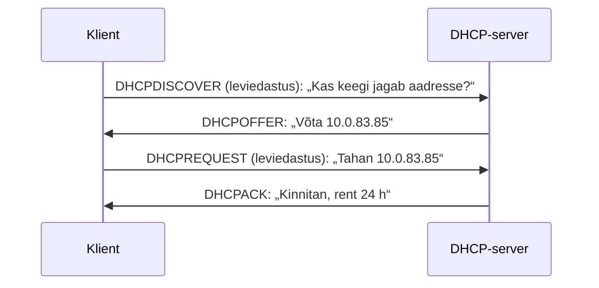
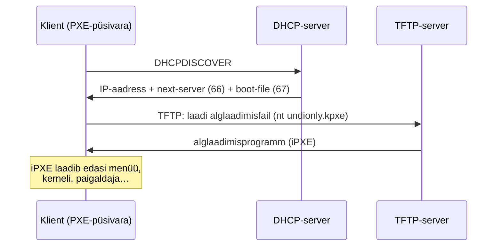

# Moodul 19. Võrgu infrastruktuur: DHCP, PXE ja iSCSI

**Maht:** 10 tundi · **Laboritöö:** Debian (serverid), AlmaLinux ja Ubuntu (kliendid) · **Eeldused:** moodulid 1–8, 15, 18 · **Valikmoodul**

## Õpiväljundid

Mooduli läbinud õppija:

- selgitab DHCP toimimist ja DHCP-sõnumite vahetust;
- seadistab Linuxis DHCP-serveri Kea koos reserveeringutega;
- selgitab võrgu kaudu alglaadimise (PXE) põhimõtet ning TFTP ja iPXE rolli;
- seadistab PXE alglaadimise DHCP- ja TFTP-serveriga;
- kirjeldab kettatõmmiste masspaigalduse lahendust FOG;
- paigaldab Linuxi üle võrgu automaatselt vastustefailiga (kickstart, preseed, autoinstall);
- selgitab iSCSI põhimõtteid (sihtmärk, initsiaator, LUN, IQN);
- seadistab Linuxis iSCSI sihtmärgi ja ühendab selle Linuxi ning Windowsi initsiaatoriga.

> [!WARNING]
> **Ainult isoleeritud laborivõrgus!** Selle mooduli teenused (eriti DHCP ja PXE) mõjutavad kõiki samas võrgus olevaid masinaid. Vale DHCP-server kooli võrgus võib jätta kõik arvutid ilma internetita. Tee laboritöid ainult moodulis 18 ehitatud OPNsense'i taga oleval isoleeritud võrgul või muus isoleeritud võrgus.

---

## 19.1 DHCP

**DHCP** (*Dynamic Host Configuration Protocol*) jagab võrgu masinatele automaatselt IP-aadressi ja muud võrguseadistust: maski, vaikelüüsi, DNS-servereid, domeeni.

### DORA

Klient ja server vahetavad nelja sõnumit (pordid UDP 67 server, 68 klient):



Esimene sõnum on **leviedastus** (*broadcast*), sest kliendil pole veel aadressi ega teadmist serveri kohta. Seepärast töötab DHCP vaikimisi ainult ühe võrgusegmendi piires. Teistesse võrkudesse edastab päringud **DHCP relee** (*relay*, nt ruuteris).

**Rendi** (*lease*) kestuse järel peab klient aadressi uuendama. Klient proovib uuendada juba poole rendiaja möödudes.

### Olulisemad DHCP-valikud

| Valik | Nimi | Sisu |
|---|---|---|
| 1 | Subnet mask | Võrgumask |
| 3 | Router | Vaikelüüs |
| 6 | Domain Name Server | DNS-serverid |
| 15 | Domain Name | Domeen |
| 42 | NTP Servers | Ajaserverid |
| 66 | TFTP Server Name | PXE: alglaadimisserver (ka väli `next-server`) |
| 67 | Bootfile Name | PXE: alglaadimisfail |

### DHCP-serverid Linuxis

| Tarkvara | Olukord |
|---|---|
| **Kea** (ISC) | Tänapäevane DHCP-server, JSON-seadistus, REST API. RHEL 10/AlmaLinux 10 ja OPNsense soovitavad seda |
| **ISC DHCP** (`isc-dhcp-server`, `dhcpd`) | Klassikaline, väga levinud vanemates juhendites. **Arendus on lõpetatud** ja turvaparandusi ei tule; RHEL 10-s seda enam pole |
| **dnsmasq** | Kerge DNS + DHCP + TFTP ühes, sobib väikevõrkudele (OPNsense'i vaikimisi DHCP) |
| systemd-networkd | Lihtne sisseehitatud DHCP-server (nt konteinerite võrkude jaoks) |

Selles moodulis kasutame **Kea**-d. Kuna paljud olemasolevad juhendid kasutavad ISC DHCP-d, on punktis 19.3 ka selle seadistuse võrdlus.

## 19.2 Kea DHCP-server

```bash
sudo apt install kea-dhcp4-server            # Debian, Ubuntu
sudo dnf install kea                         # AlmaLinux
```

Seadistus on JSON-failis `/etc/kea/kea-dhcp4.conf`:

```json
{
  "Dhcp4": {
    "interfaces-config": {
      "interfaces": [ "ens18" ]
    },
    "lease-database": {
      "type": "memfile",
      "persist": true,
      "lfc-interval": 3600
    },
    "valid-lifetime": 86400,
    "renew-timer": 43200,
    "rebind-timer": 75600,
    "authoritative": true,
    "option-data": [
      { "name": "domain-name-servers", "data": "10.0.83.1" },
      { "name": "domain-name", "data": "lab.example" }
    ],
    "subnet4": [
      {
        "id": 1,
        "subnet": "10.0.83.0/24",
        "pools": [ { "pool": "10.0.83.80 - 10.0.83.99" } ],
        "option-data": [
          { "name": "routers", "data": "10.0.83.1" }
        ],
        "reservations": [
          {
            "hw-address": "bc:24:11:12:34:56",
            "ip-address": "10.0.83.98",
            "hostname": "ubuntuklient"
          }
        ]
      }
    ],
    "loggers": [
      {
        "name": "kea-dhcp4",
        "output-options": [ { "output": "stdout" } ],
        "severity": "INFO"
      }
    ]
  }
}
```

| Osa | Tähendus |
|---|---|
| `interfaces-config` | Liidesed, millel server päringuid kuulab |
| `lease-database` | Kuhu rendid salvestatakse (`memfile` = CSV-fail `/var/lib/kea/kea-leases4.csv`) |
| `valid-lifetime` | Rendi kestus sekundites |
| `option-data` | DHCP-valikud (üldised või alamvõrgu kaupa) |
| `subnet4` | Alamvõrgud: `id` (unikaalne number), võrk, aadressivahemik (`pools`), valikud |
| `reservations` | Kindel aadress kindlale MAC-aadressile |
| `loggers` | Logimine; `stdout` → journal |

JSON-is peavad jutumärgid, komad ja sulud olema täpselt õiged - **komaviga muudab kogu faili kehtetuks**. Kontrolli alati enne käivitamist:

```bash
sudo kea-dhcp4 -t /etc/kea/kea-dhcp4.conf
sudo systemctl restart kea-dhcp4-server         # AlmaLinuxis: kea-dhcp4
journalctl -u kea-dhcp4-server -f
```

Antud rendid:

```bash
sudo cat /var/lib/kea/kea-leases4.csv
```

Tulemüüris peab olema avatud UDP port 67 (`sudo ufw allow 67/udp` või `sudo firewall-cmd --add-service=dhcp --permanent`).

### Kliendi pool

```bash
# Debian (ifupdown) - rendi uuendamine
sudo dhclient -r ens18 && sudo dhclient ens18
# Ubuntu (Netplan/networkd)
sudo networkctl renew ens18
# AlmaLinux (NetworkManager)
sudo nmcli connection up ens18
# Windows
ipconfig /release
ipconfig /renew
```

## 19.3 ISC DHCP võrdluseks

Vanemates süsteemides ja juhendites on seadistus failis `/etc/dhcp/dhcpd.conf`:

```text
authoritative;
subnet 10.0.83.0 netmask 255.255.255.0 {
    range 10.0.83.80 10.0.83.99;
    option routers 10.0.83.1;
    option domain-name-servers 10.0.83.1;
    option domain-name "lab.example";
    default-lease-time 86400;
    max-lease-time 86400;
}
host ubuntuklient {
    hardware ethernet bc:24:11:12:34:56;
    fixed-address 10.0.83.98;
}
```

Liides määratakse Debianis failis `/etc/default/isc-dhcp-server` (`INTERFACESv4="ens18"`), rendid on failis `/var/lib/dhcp/dhcpd.leases`. Mõisted (alamvõrk, vahemik, valikud, reserveering) on Keaga samad - erineb ainult süntaks. Uutel süsteemidel kasuta Kea-d.

## 19.4 PXE - alglaadimine üle võrgu

**PXE** (*Preboot eXecution Environment*) võimaldab arvutil käivituda ilma kõvaketta või USB-mäluta - alglaadimisprogramm laaditakse võrgust. Seda kasutatakse:

- operatsioonisüsteemide **masspaigalduseks** (klassiruum, ettevõte);
- kettatõmmiste salvestamiseks ja taastamiseks (FOG, Clonezilla);
- kettata tööjaamadeks ja diagnostikatööriistadeks.

### Kuidas PXE töötab



| Komponent | Ülesanne |
|---|---|
| **DHCP** | Annab aadressi ja ütleb, kust ja milline alglaadimisfail laadida |
| **TFTP** | Väga lihtne failiedastusprotokoll (UDP 69), mida PXE-püsivara oskab |
| **iPXE** | Täiustatud alglaadimisprogramm: oskab HTTP-d, skripte, menüüsid. Laaditakse TFTP-ga, edasi laeb juba kiiremini HTTP-ga |

**BIOS ja UEFI vajavad eri faile:**

| Püsivara | Tüüpiline alglaadimisfail |
|---|---|
| BIOS (*legacy*) | `undionly.kpxe`, `ipxe.kpxe` |
| UEFI | `ipxe.efi`, `snponly.efi` |

DHCP-server saab kliendi püsivara tuvastada valiku 93 (*client system architecture*) järgi ja jagada õige faili. Kea-s tehakse seda **kliendiklassidega** (`client-classes`).

### PXE Kea-s

Lihtsaim seadistus (ainult BIOS-kliendid) - lisa alamvõrgu juurde:

```json
"next-server": "10.0.83.53",
"boot-file-name": "netboot.xyz.kpxe"
```

### TFTP-server

```bash
sudo apt install tftpd-hpa                # Debian, Ubuntu (failid kataloogis /srv/tftp)
sudo dnf install tftp-server              # AlmaLinux (failid /var/lib/tftpboot, teenus tftp.socket)
```

**netboot.xyz** on valmis iPXE menüü, millest saab võrgu kaudu käivitada kümnete distrode paigaldajaid ja tööriistu - hea viis PXE testimiseks ilma oma paigaldusmeediata. Alglaadimisfail laaditakse alla aadressilt `boot.netboot.xyz/ipxe/` ja pannakse TFTP-kataloogi.

### FOG Project

**FOG** (*Free Open-source Ghost*) on veebiliidesega lahendus arvutite kettatõmmiste haldamiseks:

1. **etalonarvuti** paigaldatakse ja seadistatakse (OS, tarkvara, seaded);
2. etalonarvuti käivitatakse PXE-ga ja FOG **salvestab** (*capture*) selle ketta tõmmise serverisse;
3. teised arvutid käivitatakse PXE-ga ja FOG **paigaldab** (*deploy*) neile tõmmise - kas ükshaaval või kogu grupile korraga (*multicast*).

FOG paigaldatakse Debiani või Ubuntu serverisse skriptiga (`installfog.sh` FOG-i Git-hoidlast). Paigaldaja seadistab TFTP, veebiliidese, andmebaasi ja NFS-i; DHCP võib olla FOG-is endas või olemasolevas DHCP-serveris (siis tuleb seal seada valikud 66 ja 67 FOG-i serverile). Veebiliides: `http://<fog-server>/fog/management`.

Klassiruumi kasutuses on FOG-i eelis, et kõik arvutid saavad identse seadistuse ja vigase arvuti saab minutitega algolekusse taastada.

> [!NOTE]
> FOG vajab tõmmiste jaoks palju kettaruumi (laboris vähemalt 100 GiB) ja seda tasub katsetada eraldi isoleeritud võrgus, et teised arvutid ei käivituks kogemata FOG-i menüüsse.

### Automaatne paigaldus: kickstart, preseed ja autoinstall

PXE toob paigaldaja võrgust, aga paigaldaja küsib ikka keelt, ketast ja kasutajat. **Vastustefail** annab vastused ette ja paigaldus käib ilma inimeseta. Iga distroperekond kasutab oma vormingut:

| Distro | Vorming | Kuidas anda paigaldajale |
|---|---|---|
| AlmaLinux, RHEL, Fedora | **kickstart** (`ks.cfg`) | kerneli parameeter `inst.ks=http://…/ks.cfg` |
| Debian | **preseed** (`preseed.cfg`) | `auto=true priority=critical url=http://…/preseed.cfg` |
| Ubuntu Server | **autoinstall** (YAML, cloud-init stiilis `user-data`) | `autoinstall ds=nocloud;s=http://…/` |

**Kickstart (AlmaLinux).** Iga käsitsi paigaldatud AlmaLinux jätab oma vastused faili `/root/anaconda-ks.cfg` - see on hea alguspunkt. Lihtne `ks.cfg`:

```text
text
url --url="https://repo.almalinux.org/almalinux/10/BaseOS/x86_64/os/"
lang et_EE.UTF-8
keyboard --vckeymap=ee --xlayouts='ee'
timezone Europe/Tallinn
network --bootproto=dhcp --hostname=alma-uus.lab.example --activate
rootpw --lock
user --name=kasutaja --groups=wheel --iscrypted --password='$6$…'   # openssl passwd -6
sshkey --username=kasutaja "ssh-ed25519 AAAA… kasutaja@alma"
zerombr
clearpart --all --initlabel
autopart --type=lvm
reboot

%packages
@^minimal-environment
sssd
realmd
%end

%post
echo "Paigaldatud kickstartiga $(date +%F)" > /etc/motd
%end
```

Kontrolli faili enne kasutamist: `sudo dnf install pykickstart && ksvalidator ks.cfg`. Faili jagamiseks sobib mis tahes veebiserver (moodul 13), nt `debian2`-s `/var/www/html/ks.cfg`.

**iPXE skript** käivitab paigaldaja otse võrgust (kerneli ja initrd failid on hoidla kataloogis `images/pxeboot/`):

```text
#!ipxe
set repo https://repo.almalinux.org/almalinux/10/BaseOS/x86_64/os
kernel ${repo}/images/pxeboot/vmlinuz inst.repo=${repo} inst.ks=http://10.0.83.53/ks.cfg ip=dhcp
initrd ${repo}/images/pxeboot/initrd.img
boot
```

Et klient saaks selle skripti, annab Kea esmalt TFTP-ga iPXE (`undionly.kpxe`, allikas boot.ipxe.org) ja seejärel, kui päringu teeb juba iPXE ise (valik 77 on `iPXE`), skripti HTTP-aadressi:

```json
"boot-file-name": "undionly.kpxe",
"client-classes": [
  { "name": "ipxe", "test": "option[77].hex == 'iPXE'",
    "boot-file-name": "http://10.0.83.53/boot.ipxe" }
]
```

**Preseed (Debian)** on ridadest koosnev fail kujul `d-i küsimus tüüp väärtus`, näiteks:

```text
d-i debian-installer/locale string et_EE.UTF-8
d-i keyboard-configuration/xkb-keymap select ee
d-i netcfg/get_hostname string debian-uus
d-i passwd/root-login boolean false
d-i passwd/username string kasutaja
d-i passwd/user-password-crypted password $6$…
d-i time/zone string Europe/Tallinn
d-i partman-auto/method string lvm
tasksel tasksel/first multiselect standard, ssh-server
```

Täielik näide koos kõigi partitsioneerimise kinnitustega on Debiani paigaldusjuhendi lisas „Example preseed file“ (`example-preseed.txt`) - alusta sellest ja muuda vajalikke ridu.

**Autoinstall (Ubuntu)** kasutab YAML-faili, mille algus on `#cloud-config` ja võti `autoinstall:` (identiteet, SSH, paketid, salvestus). Ubuntu paigaldaja kirjutab käsitsi paigalduse järel valmis näite faili `/var/log/installer/autoinstall-user-data`.

> [!NOTE]
> **Domeeniga liitmine** (moodulid 20-21) vajab domeeni parooli, mida vastustefaili avatekstina panna ei tohi. Tavaline lahendus: vastustefail paigaldab paketid (`sssd`, `realmd`) ja SSH-võtme, liitmise teeb pärast esimest käivitust Ansible (moodul 16) koos Vaultis hoitud parooliga.

<!-- PILT: ../pildid/m19-netbootxyz-menuu.png | netboot.xyz menüü võrgust alglaadimisel -->

## 19.5 iSCSI

**iSCSI** (*Internet Small Computer System Interface*) jagab **plokkseadmeid** (kettaid) üle IP-võrgu. Erinevalt NFS-ist ja Sambast (failitasemel jagamine) näeb klient iSCSI ketast nagu oma kohalikku ketast - selle saab partitsioneerida, vormindada ja haakida.

| Mõiste | Tähendus |
|---|---|
| **Sihtmärk** (*target*) | Server, mis jagab kettaid |
| **Initsiaator** (*initiator*) | Klient, mis kettaga ühendub |
| **LUN** (*Logical Unit Number*) | Üks jagatav ketas sihtmärgi sees |
| **IQN** (*iSCSI Qualified Name*) | Unikaalne nimi kujul `iqn.AAAA-KK.pööratud.domeen:nimi`, nt `iqn.2026-11.example.lab:debian2.disk01` |
| **Portaal** | IP-aadress ja port (vaikimisi TCP 3260) |
| **ACL** | Millised initsiaatorid (IQN-i järgi) tohivad LUN-i kasutada |
| **CHAP** | Kasutajanime ja parooliga autentimine |

**Kasutus:** salvestusvõrgud (SAN), virtualiseerimisplatvormide jagatud salvestus (Proxmox, VMware), andmebaasiserverite kettad, kettata tööjaamad.

> [!WARNING]
> **Ühte iSCSI LUN-i tohib korraga kasutada ainult üks initsiaator!** Tavalised failisüsteemid (ext4, XFS, NTFS) ei tea, et keegi teine samal ajal samale kettale kirjutab - tulemuseks on andmete hävimine. Mitme masina jagatud kasutuseks on vaja klastrifailisüsteemi (nt OCFS2, GFS2) või sellist kasutust, kus failisüsteemi haldab üks osapool (nt Proxmoxi LVM iSCSI peal).

### Sihtmärk: targetcli (LIO)

Linuxi kernelis on sisseehitatud iSCSI sihtmärk **LIO**, mida hallatakse tööriistaga **targetcli**:

```bash
sudo apt install targetcli-fb             # Debian, Ubuntu
sudo dnf install targetcli                # AlmaLinux
sudo systemctl enable --now target        # AlmaLinux: taastab seadistuse alglaadimisel
```

Taustaks (*backstore*) võib olla terve ketas, LVM-i köide või fail:

```bash
sudo mkdir -p /srv/iscsi
sudo targetcli
```

```text
/> backstores/fileio create disk01 /srv/iscsi/disk01.img 10G
/> iscsi/ create iqn.2026-11.example.lab:debian2.disk01
/> iscsi/iqn.2026-11.example.lab:debian2.disk01/tpg1/luns create /backstores/fileio/disk01
/> iscsi/iqn.2026-11.example.lab:debian2.disk01/tpg1/acls create iqn.2026-11.example.lab:alma
/> ls
/> saveconfig
/> exit
```

| Käsk | Tegevus |
|---|---|
| `backstores/fileio create` | Loo failipõhine taust (`backstores/block create` - terve ketas või LVM-köide) |
| `iscsi/ create` | Loo sihtmärk (portaal `0.0.0.0:3260` luuakse automaatselt) |
| `luns create` | Seo taust sihtmärgiga LUN-ina |
| `acls create` | Luba initsiaator selle IQN-iga |
| `saveconfig` | Salvesta seadistus (Debianis taastab selle alglaadimisel teenus `rtslib-fb-targetctl`) |

Ava tulemüüris TCP port 3260.

Vanemates juhendites kasutatakse sihtmärgina kasutajaruumis töötavat **tgt**-d (`tgtadm`, seadistus `/etc/tgt/conf.d/*.conf`). Põhimõtted on samad.

### Initsiaator: Linux

```bash
sudo apt install open-iscsi                 # Debian, Ubuntu
sudo dnf install iscsi-initiator-utils      # AlmaLinux
```

Initsiaatori nimi on failis `/etc/iscsi/initiatorname.iscsi` - see peab vastama sihtmärgi ACL-ile:

```text
InitiatorName=iqn.2026-11.example.lab:alma
```

```bash
sudo systemctl restart iscsid
sudo iscsiadm -m discovery -t sendtargets -p 10.0.83.53     # avasta sihtmärgid
sudo iscsiadm -m node --login                               # logi sisse
lsblk                                                       # uus ketas, nt /dev/sdb
sudo iscsiadm -m session                                    # aktiivsed seansid
```

Automaatne sisselogimine alglaadimisel:

```bash
sudo iscsiadm -m node -T iqn.2026-11.example.lab:debian2.disk01 -p 10.0.83.53 \
    --op update -n node.startup -v automatic
```

Edasi on see tavaline ketas (moodul 8): partitsioon, failisüsteem, haakimine. Failis `/etc/fstab` kasuta **UUID-d** ja valikut **`_netdev`**, et haakimist proovitaks alles pärast võrgu ja iSCSI seansi tekkimist:

```text
UUID=…  /mnt/iscsi  xfs  _netdev,nofail  0  0
```

Väljalogimine: `sudo iscsiadm -m node --logout`.

### Initsiaator: Windows

Windowsis (v.a Home-versioonid) on iSCSI initsiaator sisseehitatud: käivita `iscsicpl`, sisesta *Target* väljale sihtmärgi aadress ja vajuta *Quick Connect*. Initsiaatori IQN on vahekaardil *Configuration* - lisa see sihtmärgi ACL-i. Seejärel vorminda ketas kettahalduses (`diskmgmt.msc`).

### CHAP

Tootmises lisatakse ACL-ile ka CHAP-autentimine (`targetcli`-s ACL-i juures `set auth userid=… password=…`, initsiaatoris failis `/etc/iscsi/iscsid.conf` või `iscsiadm … -n node.session.auth.*`). iSCSI liiklus ei ole krüpteeritud, seepärast hoitakse see eraldi salvestusvõrgus (VLAN).

---

## Distrode erinevused

| | **Debian** | **Ubuntu** | **AlmaLinux** |
|---|---|---|---|
| Kea pakett / teenus | `kea-dhcp4-server` / `kea-dhcp4-server` | sama | `kea` / `kea-dhcp4` |
| ISC DHCP | `isc-dhcp-server` (aegunud) | sama | Puudub (RHEL 10-st) |
| TFTP | `tftpd-hpa`, `/srv/tftp` | sama | `tftp-server`, `/var/lib/tftpboot` |
| iSCSI sihtmärk | `targetcli-fb` | `targetcli-fb` | `targetcli` + teenus `target` |
| iSCSI initsiaator | `open-iscsi` | `open-iscsi` | `iscsi-initiator-utils` |
| Tulemüür | `ufw allow 67/udp`, `3260/tcp`, `69/udp` | sama | `firewall-cmd --add-service=dhcp`, `iscsi-target`, `tftp` |

AlmaLinuxis lisandub SELinux: TFTP failid peavad asuma kataloogis `/var/lib/tftpboot` (kontekst `tftpdir_t`) ja iSCSI taustafailid sobiva kontekstiga.

---

## Kokkuvõte

| Teenus | Seadistus | Kontroll |
|---|---|---|
| Kea DHCP | `/etc/kea/kea-dhcp4.conf` | `kea-dhcp4 -t`, `journalctl -u kea-dhcp4-server`, `kea-leases4.csv` |
| PXE | Kea `next-server`, `boot-file-name` + TFTP | kliendi võrgualglaadimine |
| TFTP | `tftpd-hpa`, `/srv/tftp` | `tftp <server> -c get <fail>` |
| Automaatne paigaldus | kickstart `inst.ks=`, preseed `url=`, autoinstall | `ksvalidator ks.cfg` |
| iSCSI sihtmärk | `targetcli`, `saveconfig` | `targetcli ls` |
| iSCSI initsiaator | `iscsiadm -m discovery`, `-m node --login` | `iscsiadm -m session`, `lsblk` |

**Järgmised sammud:** tee [laboritöö](labor.md) ja kontrolli oma teadmisi [enesekontrolli](enesekontroll.md) abil.

## Lisamaterjal

- Kea administraatori juhend (kea.readthedocs.io)
- netboot.xyz dokumentatsioon (netboot.xyz/docs)
- FOG Project wiki ja foorum (fogproject.org)
- Red Hati dokumentatsioon - „Managing storage devices“ → iSCSI (docs.redhat.com)
- `man targetcli`, `man iscsiadm`

<!-- navigatsioon -->
---

[← Moodul 18. Enesekontroll](../moodul-18-opnsense/enesekontroll.md) · [Sisukord](../../README.md#sisukord) · [Laboritöö 19. DHCP, PXE ja iSCSI →](labor.md)
<!-- /navigatsioon -->
