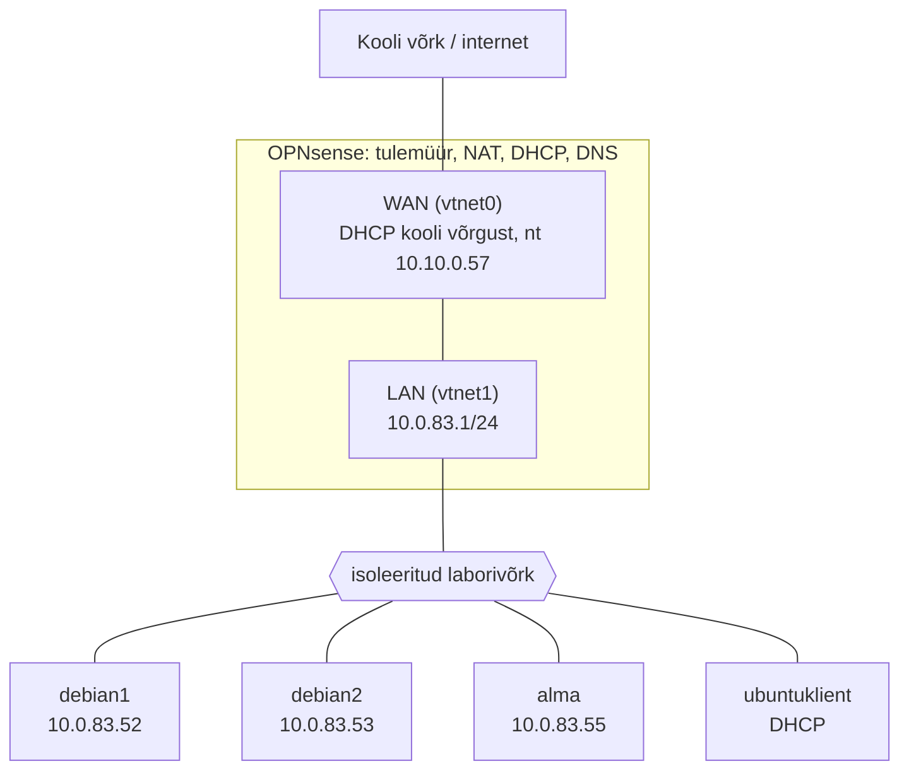

<!-- navigatsioon -->
[← Lõpuprojekt](../lopuprojekt.md) · [Sisukord](../../README.md#sisukord) · [Laboritöö 21. OPNsense laborivõrgu tulemüürina →](labor.md)
<!-- /navigatsioon -->

# Moodul 21. BSD praktikas: OPNsense tulemüür

**Maht:** 8 tundi · **Laboritöö:** OPNsense (FreeBSD), kliendid Debian ja Ubuntu · **Eeldused:** moodulid 1–7 · **Valikmoodul**

## Õpiväljundid

Mooduli läbinud õppija:

- selgitab, mis on OPNsense ja kuidas see on seotud FreeBSD-ga;
- paigaldab OPNsense'i virtuaalmasinasse kahe võrguliidesega (WAN ja LAN);
- seadistab OPNsense'i konsoolist ja veebiliidesest;
- seadistab DHCP-teenuse, DNS-i, tulemüürireeglid, NAT-i ja pordisuunamise;
- kasutab aliaseid ja logisid tulemüürireeglite haldamiseks;
- varundab ja taastab OPNsense'i seadistuse;
- kasutab FreeBSD käsurida ja võrdleb seda Linuxiga.

---

## 21.1 Miks OPNsense?

Seni oleme kõike teinud Linuxis. Selles moodulis kasutame **BSD**-põhist süsteemi, sest:

- **tulemüürid ja ruuterid** on valdkond, kus BSD on väga levinud (OPNsense, pfSense) - neid kohtab koolides, väikeettevõtetes ja kodudes;
- OPNsense loob **isoleeritud laborivõrgu**, mida kasutavad ka moodulid 22–25 (oma DHCP-server, PXE, domeenikontroller), ilma et need segaksid kooli võrku;
- BSD-ga töötamine näitab, millised oskused on **UNIX-i-laadsetes süsteemides ühised** ja millised Linuxi-spetsiifilised (vt [BSD ja Linux](../lisad/distrod.md#bsd-ja-linux)).

**OPNsense** on avatud lähtekoodiga **FreeBSD**-l põhinev tulemüüri- ja marsruutimistarkvara. Seda arendab Hollandi ettevõte Deciso alates 2015. aastast. OPNsense on hargnenud **pfSense**'ist, mis omakorda põhines projektil m0n0wall.

| | **OPNsense** | **pfSense CE** |
|---|---|---|
| Arendaja | Deciso (Holland) | Netgate (USA) |
| Alus | FreeBSD | FreeBSD |
| Väljalasked | Kaks suurt versiooni aastas (jaanuaris ja juulis), versiooninumber = aasta.kuu (nt 26.1) | Harvemad väljalasked |
| Veebiliides | Uuem, MVC-põhine | Klassikaline |
| Litsents | BSD 2-Clause | Apache 2.0 (CE) |

Mõlemad oskavad: tulemüür (pf), NAT, DHCP, DNS (Unbound), VPN (WireGuard, OpenVPN, IPsec), liikluse piiramine, VLAN-id, pistikprogrammid (nt IDS/IPS).

## 21.2 Võrgu ülesehitus

Tüüpiline OPNsense'i paigaldus jagab võrgu kaheks:



- **WAN** (*Wide Area Network*) - „väline“ pool, kust tuleb internet;
- **LAN** (*Local Area Network*) - sisevõrk, mida OPNsense kaitseb;
- **NAT** - sisevõrgu masinad pääsevad välja OPNsense'i WAN-aadressi kaudu;
- vaikimisi on **LAN-ist välja kõik lubatud** ja **WAN-ist sisse kõik keelatud**.

### Proxmoxis

| Liides | Proxmoxi sild | Selgitus |
|---|---|---|
| `net0` → WAN | `vmbr0` (või õpetaja antud sild) | Kooli võrk |
| `net1` → LAN | Isoleeritud sild ilma füüsilise pordita (nt `vmbr<number>`) või **SDN VNet** | Ainult sinu laborimasinad |

Isoleeritud silla saab teha Proxmoxi sõlme *System* → *Network* → *Create* → *Linux Bridge*, jättes *Bridge ports* tühjaks. Klastris on mugavam **SDN** (*Datacenter* → *SDN*), kus VNet on kõigis sõlmedes sama nimega kättesaadav. Laborimasinate võrguliides ühendatakse samasse silda või VNet-i.

VirtualBoxis: WAN - *Bridged Adapter*, LAN - *Internal Network*.

## 21.3 Paigaldus

### Virtuaalmasin

| Seade | Väärtus |
|---|---|
| Paigaldusmeedia | OPNsense *dvd* ISO (opnsense.org/download) |
| Guest OS | Other |
| Mälu | 2–4 GiB |
| Ketas | 16–20 GiB |
| Protsessor | 1–2 tuuma, tüüp `host` |
| Võrk | 2 × VirtIO: `net0` WAN, `net1` LAN |

FreeBSD-s on VirtIO võrguliidesed nimega `vtnet0`, `vtnet1` (VirtualBoxi Intel-kaardid `em0`, `em1`).

### Konsoolipaigaldus

1. Käivita masin. Paigaldusmeedia käivitab OPNsense'i **live-režiimis**: see töötab, kuid muudatusi ei salvestata.
2. **Liideste määramine:** kui automaatse määramise ajal midagi ei vajuta, võidakse liidesed määrata valesti. Vali käsitsi: **WAN = `vtnet0`**, **LAN = `vtnet1`**. (VLAN-e ja liideste koondamist pole vaja.)
3. Logi sisse kasutajaga **`installer`**, parool **`opnsense`**.
4. Klaviatuur: vaikimisi sobib.
5. Failisüsteem: **UFS** (lihtne) või **ZFS** (töökindlam, hetktõmmised). Laboris sobib mõlemad.
6. Vali ketas (`da0` või `vtbd0`) ja kinnita, et selle sisu kustutatakse.
7. Paigalduse lõpus **muuda juurkasutaja parool** (vaikimisi `opnsense`).
8. Taaskäivita ja **eemalda paigaldusmeedia** - muidu käivitub jälle paigaldaja.

Pärast taaskäivitust näed konsoolis mõlema liidese IP-aadressi. Logi sisse kasutajaga `root`.

### Konsoolimenüü

```text
  0) Logout                              7) Ping host
  1) Assign interfaces                   8) Shell
  2) Set interface IP address            9) pfTop
  3) Reset the root password            10) Firewall log
  4) Reset to factory defaults          11) Reload all services
  5) Power off system                   12) Update from console
  6) Reboot system                      13) Restore a backup
```

Kõige sagedamini vajad punkte **1** (liidesed), **2** (LAN-i aadress, kui see ei sobi sinu võrguplaaniga) ja **8** (FreeBSD käsurida).

LAN-i vaikimisi aadress on `192.168.1.1/24`. Kui sinu võrguplaanis on muu võrk (nt `10.0.83.0/24`), muuda see kohe punktis **2**: sisesta uus aadress ja mask, luba LAN-il DHCP-server ja määra DHCP vahemik võrguplaani järgi.

<!-- PILT: ../pildid/m21-konsoolimenuu.png | OPNsense'i konsoolimenüü (liidesed ja aadressid, valikud 0-13) -->

### Veebiliides

Ava LAN-i võrgus olevast masinast brauseris `https://<LAN-aadress>` (nt `https://10.0.83.1`) ja logi sisse kasutajaga `root`. Esimesel sisselogimisel käivitub **seadistusviisard**:

1. **General:** hostinimi, domeen (nt `lab.example`), DNS-serverid.
2. **Time server:** ajavöönd `Europe/Tallinn`.
3. **WAN:** tavaliselt DHCP.

   > **Block private networks from entering via WAN** - see valik keelab WAN-ist sisse tuleva liikluse privaatvõrgu aadressidelt (10.x, 172.16–31.x, 192.168.x). Päris internetis peab see sees olema. **Laboris, kus WAN ise on kooli privaatvõrk, lülita see välja** - muidu ei saa pordisuunamised töötada.

4. **LAN:** aadress ja mask (kui ei muutnud konsoolis).
5. **Root password:** võib muuta.
6. **Reload** - seadistus rakendub.

> [!NOTE]
> **Kui muutsid LAN-i aadressi:** sinu brauseriga masin tuleb ühendada uude võrku (uus DHCP-aadress või staatiline aadress) ja avada uus aadress. Kontrolli ka, et DHCP vahemik on uues võrgus - paigaldaja ei pruugi seda muuta, ja kui vahemik on väljaspool võrku, DHCP-server ei käivitu.

<!-- PILT: ../pildid/m21-armatuurlaud.png | OPNsense'i veebiliidese armatuurlaud (*Lobby → Dashboard*) -->

## 21.4 DHCP ja DNS

### DHCP

Uutes OPNsense'i versioonides on vaikimisi DHCP-server **Dnsmasq** (*Services* → *Dnsmasq DNS & DHCP*). Alternatiiv on **Kea** (*Services* → *Kea DHCP*). Vanem **ISC DHCP** on aegunud ega saa enam turvaparandusi - vanemates juhendites näed seda menüüs *Services* → *ISC DHCPv4*.

Olulised seaded (nimetused võivad versiooniti veidi erineda):

| Seade | Tähendus |
|---|---|
| Vahemik (*range*) | Aadressid, mida jagatakse. Ei tohi kattuda staatiliste aadresside ega ruuteri aadressiga |
| DNS-server, vaikelüüs | Vaikimisi OPNsense ise |
| Domeen | DNS-i järelliide, mida klientidele jagatakse |
| Rendiaeg | Kui kauaks aadress antakse |
| Staatilised vastendused (*host / static mapping*) | Kindel MAC-aadress saab alati sama IP-aadressi |
| Võrgualglaadimine | PXE-serveri aadress ja alglaadimisfail (vt moodul 22) |

Antud rendid näed DHCP-teenuse lehel *Leases*.

> [!WARNING]
> **Ainult üks DHCP-server võrgus!** Kui moodulis 22 seadistad Linuxi DHCP-serveri, tuleb OPNsense'i DHCP sellel liidesel välja lülitada - muidu jagavad kaks serverit klientidele vastuolulisi aadresse.

### DNS

OPNsense kasutab DNS-i lahendajana **Unbound**-i (*Services* → *Unbound DNS*). See:

- lahendab klientide eest internetinimesid;
- oskab registreerida DHCP-klientide nimed (nt `ubuntuklient.lab.example`);
- võimaldab lisada käsitsi kirjeid (*Overrides* → *Hosts*), nt `www.lab.example → 10.0.83.55`;
- võimaldab suunata kindla domeeni päringud teisele serverile (*Query Forwarding*) - nt `ad.lab.example` päringud domeenikontrollerile (moodul 25).

## 21.5 Tulemüür

OPNsense'i tulemüür põhineb FreeBSD-s **pf**-il (*packet filter*). Reegleid hallatakse veebiliideses *Firewall* → *Rules*.

### Kuidas reegleid töödeldakse

- reeglid on **liidese kaupa** ja kehtivad liiklusele, mis **siseneb** sellele liidesele;
- reegleid töödeldakse **ülevalt alla** ja kehtib **esimene sobiv** reegel;
- kui ükski reegel ei sobi, liiklus **keelatakse**;
- tulemüür on **olekupõhine** (*stateful*): kui väljaminev ühendus on lubatud, lubatakse automaatselt ka selle vastused.

Seetõttu: LAN-i liidesel on vaikimisi reegel „luba LAN-ist kõikjale“, WAN-il reegleid pole - kõik sissetulev keelatakse.

### Reegli osad

| Väli | Tähendus |
|---|---|
| Action | *Pass* (luba), *Block* (keela vaikselt), *Reject* (keela ja teavita) |
| Interface | Liides, kuhu liiklus siseneb |
| Direction | Tavaliselt *in* |
| Protocol | TCP, UDP, ICMP, any |
| Source | Kust liiklus tuleb (aadress, võrk, alias, nt *LAN net*) |
| Destination / Port | Kuhu ja millisele pordile |
| Log | Logi reegli tabamused |
| Description | Kirjeldus - kirjuta alati! |

Pärast muutmist vajuta **Apply changes**.

<!-- PILT: ../pildid/m21-tulemuurireeglid.png | *Firewall → Rules → LAN* reeglite loend -->

### Aliased

**Alias** on nimega aadresside, võrkude või portide loend (*Firewall* → *Aliases*). Reeglites kasutatakse aliast numbrite asemel:

| Alias | Tüüp | Sisu |
|---|---|---|
| `serverid` | Host(s) | `10.0.83.52`, `10.0.83.53`, `10.0.83.55` |
| `veebipordid` | Port(s) | `80`, `443` |
| `haldusvork` | Network(s) | `10.10.0.0/24` |

Nii on reeglid loetavad ja muudatuse (nt uus server) saab teha ühes kohas.

### NAT ja pordisuunamine

**Väljaminev NAT** (*Firewall* → *NAT* → *Outbound*) on vaikimisi automaatne: LAN-i masinad pääsevad internetti OPNsense'i WAN-aadressi kaudu.

**Pordisuunamine** (*Firewall* → *NAT* → *Port Forward*, uuemates versioonides ka *Destination NAT*) teeb sisevõrgu teenuse väljast kättesaadavaks:

| Väli | Näide |
|---|---|
| Interface | WAN |
| Protocol | TCP |
| Destination | WAN address |
| Destination port | 8080 |
| Redirect target IP | `10.0.83.55` |
| Redirect target port | 80 |
| Description | Veebiserver alma |

Nüüd suunatakse ühendus `http://<WAN-aadress>:8080` sisevõrgu masina `alma` porti 80. OPNsense loob vaikimisi automaatselt ka sobiva tulemüürireegli WAN-il.

<!-- PILT: ../pildid/m21-pordisuunamine.png | *Firewall → NAT → Port Forward* reegli vorm -->

### Logid ja diagnostika

- *Firewall* → *Log Files* → *Live View* - tulemüüri tabamused reaalajas (filtreeri IP või reegli järgi);
- *Interfaces* → *Diagnostics* - ping, traceroute, pakettide püüdmine (*Packet Capture*), ARP-tabel, olekute tabel (*States*).

## 21.6 Haldus

| Tegevus | Kus |
|---|---|
| Uuendused | *System* → *Firmware* → *Updates* (või konsoolis punkt 12) |
| Seadistuse varundus | *System* → *Configuration* → *Backups* → *Download configuration* |
| Seadistuse taastamine | Samast lehest või konsoolis punkt 13 |
| Kasutajad ja õigused | *System* → *Access* → *Users / Groups* |
| Pistikprogrammid | *System* → *Firmware* → *Plugins* (nt `os-qemu-guest-agent`) |
| Ajalugu | *System* → *Configuration* → *History* - iga muudatuse kohta on salvestatud seadistuse versioon |

Kogu OPNsense'i seadistus on **ühes XML-failis** (`/conf/config.xml`). Selle allalaadimine on täielik varukoopia - uude masinasse paigaldades saab selle kohe importida.

Proxmoxi jaoks paigalda pistikprogramm **`os-qemu-guest-agent`**.

## 21.7 FreeBSD käsurida

Konsoolimenüü punkt **8** avab FreeBSD kesta. OPNsense'i hallatakse tavaliselt veebiliidesest - **käsitsi tehtud muudatused (nt failides `/etc`) kirjutatakse üle**, sest süsteem genereerib seadistuse failist `config.xml`. Käsurida sobib aga suurepäraselt diagnostikaks ja BSD tundmaõppimiseks.

| Tegevus | Linux | FreeBSD / OPNsense |
|---|---|---|
| Liidesed ja aadressid | `ip a` | `ifconfig` |
| Marsruudid | `ip r` | `netstat -rn` |
| Kuulavad pordid | `ss -tulpn` | `sockstat -4l` |
| Tulemüüri reeglid | `nft list ruleset` | `pfctl -sr` |
| NAT-reeglid | `nft list ruleset` | `pfctl -sn` |
| Olekute tabel | `conntrack -L` | `pfctl -ss` |
| Pakettide püüdmine | `tcpdump -i ens18` | `tcpdump -i vtnet1` |
| Protsessid | `top`, `ps aux` | `top`, `ps aux` |
| Paketid | `apt`, `dnf` | `pkg info`, `pkg update` |
| Teenused | `systemctl status x` | `service x status` (OPNsense'is ka `configctl`) |
| OS-i versioon | `cat /etc/os-release` | `freebsd-version`, `opnsense-version` |
| Kettad | `lsblk`, `df -h` | `geom disk list`, `gpart show`, `df -h` |
| Logid | `journalctl` | failid kataloogis `/var/log/` (`tail`, `less`) |
| Kest | `bash` | `sh` või `csh`/`tcsh` |

Näed, et põhitööriistad (`ls`, `cd`, `grep`, `ps`, `top`, `tcpdump`, `ssh`) on samad, kuid süsteemi haldus (võrk, teenused, tulemüür, paketid) erineb.

## 21.8 Turvalisus

- muuda juurkasutaja parool ja loo eraldi administraatorikasutaja;
- veebiliides peaks olema kättesaadav ainult LAN-ist (vaikimisi nii);
- hoia OPNsense uuendatud;
- varunda seadistus enne iga suurt muudatust;
- **ära ava haldusliidest (443, 22) WAN-i poole**;
- kasuta aliaseid ja kirjelda iga reeglit.

---

## Kokkuvõte

| Teema | Kus / käsk |
|---|---|
| Paigaldus | `installer` / `opnsense`, WAN `vtnet0`, LAN `vtnet1` |
| Konsool | 1 - liidesed, 2 - IP, 8 - kest |
| Veebiliides | `https://<LAN-aadress>`, kasutaja `root` |
| DHCP | *Services* → *Dnsmasq DNS & DHCP* (või Kea) |
| DNS | *Services* → *Unbound DNS* |
| Tulemüür | *Firewall* → *Rules*, esimene sobiv reegel kehtib |
| Aliased | *Firewall* → *Aliases* |
| Pordisuunamine | *Firewall* → *NAT* → *Port Forward* |
| Logid | *Firewall* → *Log Files* → *Live View* |
| Varundus | *System* → *Configuration* → *Backups* |
| FreeBSD | `ifconfig`, `netstat -rn`, `sockstat -4l`, `pfctl -sr` |

**Järgmised sammud:** tee [laboritöö](labor.md) ja kontrolli oma teadmisi [enesekontrolli](enesekontroll.md) abil. FreeBSD-d käsurealt serverina haldad valikmoodulis [25. FreeBSD server](../moodul-29-freebsd/index.md).

## Lisamaterjal

- OPNsense'i dokumentatsioon (docs.opnsense.org) ja foorum (forum.opnsense.org)
- FreeBSD Handbook (docs.freebsd.org/en/books/handbook) - eriti peatükid „Firewalls“ ja „Network“
- pfSense'i dokumentatsioon (docs.netgate.com) - põhimõtted on samad

<!-- navigatsioon -->
---

[← Lõpuprojekt](../lopuprojekt.md) · [Sisukord](../../README.md#sisukord) · [Laboritöö 21. OPNsense laborivõrgu tulemüürina →](labor.md)
<!-- /navigatsioon -->
