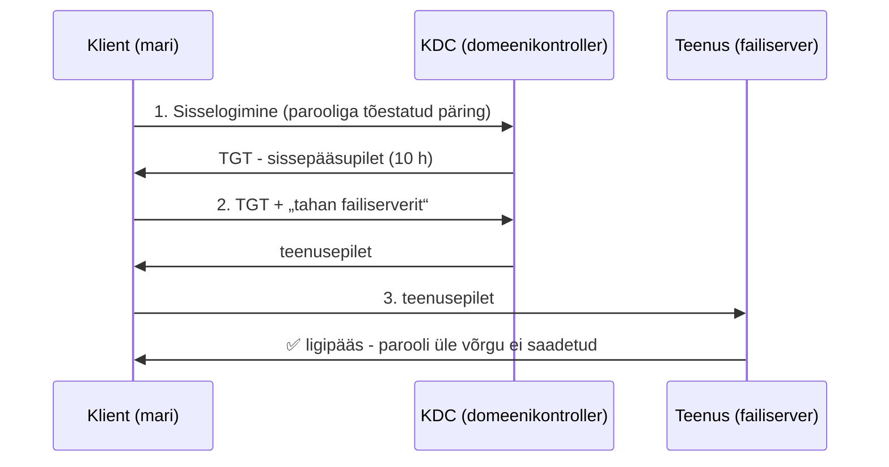

# Moodul 21. Active Directory Linuxis: Samba AD DC

**Maht:** 10 tundi · **Laboritöö:** Debian (domeenikontroller), Ubuntu ja AlmaLinux (domeeni liikmed), Windows (klient) · **Eeldused:** moodulid 1–7, 15, 18; soovitatavalt 19 · **Valikmoodul**

## Õpiväljundid

Mooduli läbinud õppija:

- selgitab Active Directory põhimõisteid (domeen, domeenikontroller, mets, OU, GPO) ning Kerberose ja DNS-i rolli;
- võrdleb Active Directoryt ja OpenLDAP-i;
- paigaldab Debianile Samba AD domeenikontrolleri;
- haldab kasutajaid, gruppe, OU-sid ja DNS-kirjeid käsuga `samba-tool`;
- liidab domeeniga Windowsi kliendi ja haldab domeeni RSAT-tööriistadega;
- liidab domeeniga Ubuntu ja AlmaLinuxi masina (realmd, SSSD) ning piirab sisselogimist ja `sudo` õigusi AD gruppide järgi;
- lahendab tüüpilisi probleeme (DNS, kellaaeg, Kerberos).

---

## 21.1 Mis on Active Directory?

**Active Directory (AD)** on Microsofti kataloogiteenus, mis on enamiku asutuste (ka koolide) kasutajahalduse alus. AD ühendab mitu tehnoloogiat:

| Komponent | Roll |
|---|---|
| **LDAP** | Kataloog: kasutajad, grupid, arvutid, OU-d (moodul 20) |
| **Kerberos** | Autentimine piletite abil; parool ei liigu võrgus |
| **DNS** | Kliendid leiavad domeenikontrollerid SRV-kirjete kaudu |
| **SMB** | Failijagamine, sisselogimisskriptid, rühmapoliitikad (SYSVOL) |
| **Rühmapoliitika (GPO)** | Windowsi arvutite ja kasutajate seadistuste tsentraalne haldus |

Põhimõisted:

- **Domeen** - haldusala ühise kataloogi ja turvapoliitikaga, nt `ad.lab.example` (NetBIOS-nimi `AD`).
- **Domeenikontroller (DC)** - server, mis hoiab kataloogi koopiat ja autendib kasutajaid. Töökindluse jaoks on DC-sid vähemalt kaks.
- **Mets (forest)** ja **puu (tree)** - mitme domeeni kogum ühise skeemiga. Laboris piisab ühest domeenist.
- **OU (Organizational Unit)** - kataloogi kaust kasutajate ja arvutite rühmitamiseks ning GPO-de sidumiseks.
- **Realm** - Kerberose haldusala, kirjutatakse suurtähtedega: `AD.LAB.EXAMPLE`.

### Samba AD DC

**Samba** on vaba tarkvara, mis alates versioonist 4 (2012) oskab olla **täisväärtuslik AD domeenikontroller**. Windowsi arvutid ei näe vahet: nad liituvad domeeniga, rakendavad GPO-sid ja neid saab hallata Microsofti tööriistadega.

| | Windows Server AD | Samba AD DC |
|---|---|---|
| Litsents | tasuline (server + CAL) | vaba (GPL) |
| Haldus | graafilised tööriistad, PowerShell | `samba-tool` + Windowsi RSAT |
| GPO | täielik | täielik (Windowsi klientidele) |
| SYSVOL replikatsioon DC-de vahel | DFS-R | puudub - tuleb lahendada ise (nt `rsync`) |
| Funktsionaalne tase | uusim | kuni 2008 R2 (uuemad versioonid katsetamisel) |
| Tüüpiline kasutus | suurettevõtted, Windowsi-keskne keskkond | väikeasutused, koolid, labor, Linuxi-keskne keskkond |

### Active Directory või OpenLDAP?

| | OpenLDAP (moodul 20) | Active Directory |
|---|---|---|
| Skeem | vabalt valitav, väike | kindel, suur (Microsofti skeem) |
| Autentimine | LDAP bind (parool) | Kerberos (piletid), NTLM |
| Windowsi kliendid | keeruline | loomulik |
| GPO | puudub | olemas |
| Linuxi kliendid | SSSD (`id_provider = ldap`) | SSSD (`id_provider = ad`), realmd |

> [!NOTE]
> **Märkus:** kui keskkonnas on Windowsi arvutid, on AD peaaegu alati õige valik. Puhtalt Linuxi keskkonnas on lihtsam OpenLDAP või FreeIPA.

---

## 21.2 Kerberos lühidalt

Kerberos on autentimisprotokoll, kus usaldatav kolmas osapool (**KDC** - *Key Distribution Center*, AD-s on see domeenikontroller) annab välja **pileteid**:

1. Kasutaja logib sisse; klient saab KDC-lt **TGT** (*Ticket Granting Ticket*) - „sissepääsupileti“, mis kehtib vaikimisi 10 tundi.
2. Kui kasutaja tahab kasutada teenust (nt failiserverit), küsib klient TGT abil KDC-lt **teenusepileti**.
3. Teenus kontrollib piletit; parooli ei saadeta üle võrgu.



Kerberose eeldused, mida laboris tihti unustatakse:

- **Kellaaeg** - kliendi ja DC kellad tohivad erineda kõige rohkem **5 minutit**. Muidu: `Clock skew too great`.
- **DNS** - kliendid peavad leidma DC nime järgi ja nimi peab lahenduma ka tagurpidi.
- **Nimed** - kasutatakse täisnimesid (FQDN), mitte IP-aadresse.

```bash
kinit administrator@AD.LAB.EXAMPLE   # küsi TGT
klist                                # vaata pileteid
kdestroy                             # kustuta piletid
```

---

## 21.3 Planeerimine

Laboris on domeenikontroller **eraldi virtuaalmasin**, sest DC peab ise olema DNS-server (port 53) ega tohi jagada masinat muude DNS- või DHCP-teenustega.

| Seade | Väärtus näites |
|---|---|
| DC hostinimi | `dc1` |
| DC FQDN | `dc1.ad.lab.example` |
| DC IP | `10.0.83.56` (staatiline) |
| DNS-domeen / Kerberose realm | `ad.lab.example` / `AD.LAB.EXAMPLE` |
| NetBIOS-domeen | `AD` |
| DNS edastaja (forwarder) | `10.0.83.1` (OPNsense Unbound) |

Reeglid:

- Kasuta **alamdomeeni** (`ad.lab.example`), mitte domeeni, mida juba haldab teine DNS-server. Ära kasuta `.local` lõppu (konflikt mDNS-iga).
- Hostinimi ei tohi olla sama mis NetBIOS-domeen ja peab olema kuni 15 märki.
- DC aadress peab olema staatiline.
- OPNsense'is suunatakse `ad.lab.example` päringud DC-le: *Services* → *Unbound DNS* → *Query Forwarding* → domeen `ad.lab.example`, server `10.0.83.56`. Nii lahendavad nimesid ka masinad, mille DNS on OPNsense.

> [!NOTE]
> **Märkus:** laboris võib kõigi domeeniga liituvate masinate DNS-iks panna otse DC. Siis peab DC oskama edastada ka välised päringud (`dns forwarder`).

---

## 21.4 Domeenikontrolleri paigaldus (Debian)

### Ettevalmistus

```bash
sudo hostnamectl set-hostname dc1
```

Fail `/etc/hosts` (rida `127.0.1.1 dc1` eemalda või asenda):

```text
127.0.0.1       localhost
10.0.83.56      dc1.ad.lab.example dc1
```

```bash
hostname -f          # dc1.ad.lab.example
hostname -i          # 10.0.83.56
```

### Paketid

```bash
sudo apt install samba-ad-dc krb5-user winbind dnsutils chrony smbclient
```

Paigaldamise ajal küsib `krb5-user` vaikimisi realm'i: sisesta `AD.LAB.EXAMPLE`. Serverite küsimused võid tühjaks jätta - `krb5.conf` asendatakse niikuinii.

Debiani pakett käivitab tavalise failiserveri teenused, mida DC ei vaja. Peata need ja eemalda vaikeseadistus:

```bash
sudo systemctl disable --now smbd nmbd winbind
sudo mv /etc/samba/smb.conf /etc/samba/smb.conf.orig
```

### Domeeni loomine (provisioning)

```bash
sudo samba-tool domain provision \
    --use-rfc2307 \
    --realm=AD.LAB.EXAMPLE \
    --domain=AD \
    --server-role=dc \
    --dns-backend=SAMBA_INTERNAL \
    --option="dns forwarder = 10.0.83.1"
```

Käsk küsib administraatori parooli (vähemalt 7 märki, suur- ja väiketähed ning number). Valik `--use-rfc2307` lisab skeemi Unixi atribuudid (`uidNumber`, `gidNumber`, `loginShell`), mida saab kasutada Linuxi klientidega.

Provisioning loob:

- `/etc/samba/smb.conf` - DC seadistus;
- `/var/lib/samba/private/` - kataloogi andmebaas ja võtmed;
- `/var/lib/samba/private/krb5.conf` - Kerberose seadistus;
- jagatud kaustad `sysvol` ja `netlogon`.

```bash
sudo cp /var/lib/samba/private/krb5.conf /etc/krb5.conf
sudo systemctl unmask samba-ad-dc
sudo systemctl enable --now samba-ad-dc
```

### DC enda DNS

DC peab kasutama iseennast DNS-serverina. Debianis ifupdown-iga muuda `/etc/network/interfaces` rida `dns-nameservers` või otse `/etc/resolv.conf`:

```text
search ad.lab.example
nameserver 10.0.83.56
```

> [!NOTE]
> **Märkus:** kui `/etc/resolv.conf` kirjutatakse üle (DHCP, NetworkManager, systemd-resolved), seadista DNS selle tööriista kaudu. Kontrolli pärast taaskäivitust uuesti.

### Kellaaja teenus

Windowsi kliendid sünkroniseerivad kella DC-ga ja ootavad **allkirjastatud** NTP vastuseid. Lisa `/etc/chrony/chrony.conf` lõppu:

```text
allow 10.0.83.0/24
ntpsigndsocket /var/lib/samba/ntp_signd
```

```bash
sudo chown root:_chrony /var/lib/samba/ntp_signd
sudo chmod 750 /var/lib/samba/ntp_signd
sudo systemctl restart chrony
```

### Kontroll

```bash
sudo samba-tool domain level show
host -t SRV _ldap._tcp.ad.lab.example
host -t SRV _kerberos._udp.ad.lab.example
host -t A dc1.ad.lab.example
host www.debian.org                       # edastamine töötab
smbclient -L localhost -N                 # sysvol ja netlogon
smbclient //localhost/netlogon -U Administrator -c 'ls'
kinit administrator
klist
```

`klist` peab näitama piletit `krbtgt/AD.LAB.EXAMPLE@AD.LAB.EXAMPLE`.

### Tulemüür

DC vajab palju porte: 53 (DNS), 88 (Kerberos), 123/udp (NTP), 135 (RPC), 389/636 (LDAP/LDAPS), 445 (SMB), 464 (paroolivahetus), 3268/3269 (globaalkataloog) ja dünaamilised RPC pordid 49152–65535. Laboris on lihtsaim lubada kogu laborivõrk:

```bash
sudo ufw allow from 10.0.83.0/24
sudo ufw allow OpenSSH
sudo ufw enable
```

---

## 21.5 Domeeni haldus: `samba-tool`

### Kasutajad

```bash
sudo samba-tool user create mari --given-name=Mari --surname=Maasikas
sudo samba-tool user list
sudo samba-tool user show mari
sudo samba-tool user setpassword mari
sudo samba-tool user disable mari
sudo samba-tool user enable mari
sudo samba-tool user setexpiry mari --noexpiry
sudo samba-tool user delete mari
```

### Grupid ja OU-d

```bash
sudo samba-tool group add opilased
sudo samba-tool group addmembers opilased mari,jaan
sudo samba-tool group listmembers opilased
sudo samba-tool ou create "OU=Opilased,DC=ad,DC=lab,DC=example"
sudo samba-tool user move mari "OU=Opilased,DC=ad,DC=lab,DC=example"
```

### Paroolipoliitika

```bash
sudo samba-tool domain passwordsettings show
sudo samba-tool domain passwordsettings set --min-pwd-length=10 --max-pwd-age=180
```

### DNS-kirjed

```bash
sudo samba-tool dns zonelist dc1 -U administrator
sudo samba-tool dns add dc1 ad.lab.example www A 10.0.83.55 -U administrator
sudo samba-tool dns query dc1 ad.lab.example @ ALL -U administrator
sudo samba-tool dns delete dc1 ad.lab.example www A 10.0.83.55 -U administrator
```

Pöördtsooni (PTR-kirjed) jaoks:

```bash
sudo samba-tool dns zonecreate dc1 83.0.10.in-addr.arpa -U administrator
sudo samba-tool dns add dc1 83.0.10.in-addr.arpa 56 PTR dc1.ad.lab.example -U administrator
```

### Kataloogi vaatamine LDAP-i kaudu

AD on LDAP-kataloog - mooduli 20 tööriistad töötavad ka siin (Kerberose piletiga):

```bash
sudo apt install ldb-tools
sudo ldbsearch -H /var/lib/samba/private/sam.ldb "(sAMAccountName=mari)" memberOf
```

### Varundus

```bash
sudo samba-tool domain backup online --targetdir=/srv/varu --server=dc1 -U administrator
```

Varukoopiast taastatakse käsuga `samba-tool domain backup restore`. Kuna Samba DC-de vahel SYSVOL-i ei replitseerita, varunda ka kataloog `/var/lib/samba/sysvol`.

### Teine domeenikontroller

Teine DC liidetakse olemasolevasse domeeni (samad ettevalmistused, aga provisioning'u asemel):

```bash
sudo samba-tool domain join ad.lab.example DC -U administrator --dns-backend=SAMBA_INTERNAL
```

Kataloog ja DNS replitseeritakse automaatselt; kontrolli `samba-tool drs showrepl`.

---

## 21.6 Windowsi klient

1. Seadista Windowsi võrguliidese DNS-iks DC (`10.0.83.56`) või OPNsense, kui seal on Query Forwarding.
2. Kontrolli PowerShellis:

    ```powershell
    Resolve-DnsName -Type SRV _ldap._tcp.ad.lab.example
    Test-NetConnection dc1.ad.lab.example -Port 389
    ```

3. *Seaded* → *Süsteem* → *Teave* → *Domeen või töörühm* → *Muuda* → *Domeen*: `ad.lab.example`. Sisesta `Administrator` ja parool. Taaskäivita.

    PowerShelliga: `Add-Computer -DomainName ad.lab.example -Restart`.

4. Logi sisse kui `AD\mari`.

> [!NOTE]
> **Märkus:** domeeniga saab liita ainult Windowsi Pro, Education ja Enterprise väljaandeid, mitte Home'i.

### RSAT - haldus Windowsist

Domeeniga liidetud Windowsi arvutisse paigalda **RSAT** (*Seaded* → *Süsteem* → *Valikulised funktsioonid* → *Lisa funktsioon*): *Active Directory Domain Services and Lightweight Directory Services Tools*, *Group Policy Management Tools*, *DNS Server Tools*. Seejärel saab Samba domeeni hallata samamoodi nagu Windows Serverit:

- **Active Directory Users and Computers** (`dsa.msc`) - kasutajad, grupid, OU-d;
- **Group Policy Management** (`gpmc.msc`) - GPO-d;
- **DNS** (`dnsmgmt.msc`) - DNS-tsoonid ja kirjed.

<!-- PILT: ../pildid/m21-aduc.png | *Active Directory Users and Computers* Samba domeeniga -->

### Rühmapoliitika näide

1. `gpmc.msc` → loo OU `Opilased` juurde uus GPO „Õppijate töölaud“.
2. Muuda: *User Configuration* → *Policies* → *Administrative Templates* → *Control Panel* → *Prohibit access to Control Panel and PC settings* → *Enabled*.
3. Logi kliendis sisse OU `Opilased` kasutajana ja kontrolli `gpupdate /force`, `gpresult /r`.

GPO-d salvestatakse DC kataloogi `/var/lib/samba/sysvol/ad.lab.example/Policies/`.

<!-- PILT: ../pildid/m21-gpo-haldus.png | *Group Policy Management* - lingitud rühmapoliitika -->

---

## 21.7 Linuxi klient: realmd ja SSSD

**realmd** avastab domeeni ja liidab masina sellega (loob arvutikonto, Kerberose võtmefaili `/etc/krb5.keytab` ja SSSD seadistuse). **SSSD** teeb seejärel sama mis moodulis 20: annab NSS-ile ja PAM-ile kasutajad ning autendib, aga `id_provider = ad`.

### Ettevalmistus (kõik distrod)

- DNS peab lahendama `ad.lab.example` SRV-kirjed: `host -t SRV _ldap._tcp.ad.lab.example`;
- kell peab olema sünkroonis (`timedatectl`, `chronyc sources`) - soovitatavalt DC-ga;
- hostinimi on FQDN-iga: `sudo hostnamectl set-hostname ubuntuklient.ad.lab.example`.

### Paketid

```bash
# Ubuntu / Debian
sudo apt install realmd sssd sssd-tools libnss-sss libpam-sss adcli \
    samba-common-bin oddjob oddjob-mkhomedir packagekit krb5-user

# AlmaLinux
sudo dnf install realmd sssd oddjob oddjob-mkhomedir adcli samba-common-tools krb5-workstation
```

### Liitumine

```bash
realm discover ad.lab.example
sudo realm join -U Administrator ad.lab.example
realm list
id administrator@ad.lab.example
getent passwd mari@ad.lab.example
```

AlmaLinuxis seadistab `realm join` ka `authselect` profiili koos kodukataloogi loomisega. Ubuntus luba see eraldi:

```bash
sudo pam-auth-update --enable mkhomedir
```

### SSSD seadistus

`realm join` loob faili `/etc/sssd/sssd.conf`, umbes nii:

```ini
[sssd]
domains = ad.lab.example
services = nss, pam

[domain/ad.lab.example]
id_provider = ad
access_provider = ad
ad_domain = ad.lab.example
krb5_realm = AD.LAB.EXAMPLE
realmd_tags = manages-system joined-with-adcli
cache_credentials = True
krb5_store_password_if_offline = True
default_shell = /bin/bash
ldap_id_mapping = True
use_fully_qualified_names = True
fallback_homedir = /home/%u@%d
```

Levinud muudatused:

| Valik | Tähendus |
|---|---|
| `use_fully_qualified_names = False` | sisselogimine `mari`, mitte `mari@ad.lab.example` |
| `fallback_homedir = /home/%u` | kodukataloog `/home/mari` |
| `ldap_id_mapping = True` | UID/GID arvutatakse kasutaja SID-ist - kõigis SSSD masinates sama |
| `ldap_id_mapping = False` | kasutatakse AD-s salvestatud RFC2307 atribuute (`uidNumber`) - vajalik, kui UID-d peavad olema kindlad (nt NFS-iga ühine OpenLDAP-iga) |
| `ad_gpo_access_control` | SSSD järgib vaikimisi GPO sisselogimisõigusi (`enforcing`); probleemide korral `permissive` |

Pärast muudatusi:

```bash
sudo systemctl restart sssd
sudo sss_cache -E
```

### Sisselogimise piiramine

Vaikimisi saavad sisse logida kõik domeeni kasutajad. Piira gruppidega:

```bash
sudo realm deny --all
sudo realm permit -g opilased@ad.lab.example
sudo realm permit -g linuxadminid@ad.lab.example
```

### `sudo` AD grupile

```bash
sudo visudo -f /etc/sudoers.d/ad-adminid
```

```text
%linuxadminid@ad.lab.example ALL=(ALL:ALL) ALL
```

Kui `use_fully_qualified_names = False`, kirjuta lihtsalt `%linuxadminid`. Tühikuga grupinimes (nt *Domain Admins*) kasuta paomärki: `%domain\ admins@ad.lab.example`.

### Domeenist lahkumine

```bash
sudo realm leave ad.lab.example -U Administrator
```

---

## 21.8 Kui on olemas Windows Server AD

Paljudes asutustes (ka HKHK laborivõrgu IT25 plaanis) on domeenikontrollerid Windows Serverid (nt `AD1` ja `AD2`, mis pakuvad AD-d, DNS-i ja DHCP-d). Linuxi kliendi liitmine käib **täpselt samamoodi** nagu punktis 21.7 - realmd ja SSSD ei tee vahet, kas DC on Windows või Samba. Erinevused:

- DNS-iks on Windows Serveri DNS (sageli jagab selle DHCP);
- haldus käib Windows Serveri tööriistadega (`dsa.msc`, PowerShelli `New-ADUser`, `Add-ADGroupMember`);
- Linuxi masina arvutikonto tekib vaikimisi konteinerisse `CN=Computers`; teise OU-sse: `realm join --computer-ou="OU=Linux,DC=ad,DC=lab,DC=example"`.

Samba AD DC on hea viis õppida AD-d ilma Windows Serveri litsentsita ja mõista, mis toimub „kapoti all“: LDAP, Kerberos ja DNS.

---

## 21.9 Veaotsing

| Sümptom | Tõenäoline põhjus | Kontroll |
|---|---|---|
| `realm discover` ei leia domeeni | DNS ei osuta DC-le | `host -t SRV _ldap._tcp.ad.lab.example` |
| `Clock skew too great` | kellad erinevad üle 5 min | `timedatectl`, `chronyc tracking` |
| `kinit: Cannot find KDC for realm` | realm väiketähtedega või `krb5.conf` vale | kasuta `AD.LAB.EXAMPLE` |
| `id mari@ad.lab.example` ei leia kasutajat | SSSD ei tööta või vahemälu | `systemctl status sssd`, `sss_cache -E`, `/var/log/sssd/` |
| Sisselogimine keelatud, parool õige | `realm permit` või GPO | `realm list`, `ad_gpo_access_control` |
| `samba-ad-dc` ei käivitu | `smbd`/`nmbd` töötavad samaaegselt, port 53 hõivatud | `ss -tulpn`, `journalctl -u samba-ad-dc` |
| Windows ei liitu | Windowsi DNS ei ole DC | `Resolve-DnsName` |

Põhjalikum kontroll DC-s:

```bash
sudo samba-tool dbcheck
sudo samba-tool drs showrepl          # kui DC-sid on mitu
sudo samba_dnsupdate --verbose        # kas DC DNS-kirjed on olemas
```

Kliendis suurenda SSSD logitaset: lisa `[domain/…]` jaotisesse `debug_level = 6` ja vaata `/var/log/sssd/sssd_ad.lab.example.log`.

---

## Distrode erinevused

| | Debian 13 | Ubuntu 24.04 | AlmaLinux 10 |
|---|---|---|---|
| Samba AD DC | jah (`samba-ad-dc`) | jah (`samba-ad-dc` / `samba`) | **ei** - RHEL-i Samba on ehitatud MIT Kerberosega ja DC rolli ei toetata |
| Domeeniliikme paketid | `realmd sssd adcli …` | sama | `realmd sssd adcli samba-common-tools` |
| Kerberose kliendi pakett | `krb5-user` | `krb5-user` | `krb5-workstation` |
| Kodukataloogi loomine | `pam-auth-update --enable mkhomedir` | sama | `realm join` teeb ise (`authselect … with-mkhomedir`) |
| Ajateenus | `chrony` | `chrony` või `systemd-timesyncd` | `chrony` |
| Tulemüür | `ufw` | `ufw` | `firewalld` |

Seepärast on selles moodulis domeenikontroller Debian ning Ubuntu ja AlmaLinux on domeeni liikmed. RHEL-i maailmas on AD-le sarnane lahendus **FreeIPA / Red Hat IdM** (LDAP + Kerberos + DNS + sertifikaadid), mis oskab ka AD-ga usaldussuhet luua.

---

## Kokkuvõte

| Tegevus | Käsk |
|---|---|
| DC paketid | `apt install samba-ad-dc krb5-user winbind dnsutils chrony` |
| Domeeni loomine | `samba-tool domain provision --use-rfc2307 --realm=… --domain=… --server-role=dc` |
| Teenus | `systemctl unmask samba-ad-dc`, `systemctl enable --now samba-ad-dc` |
| DNS test | `host -t SRV _ldap._tcp.ad.lab.example` |
| Kerberose test | `kinit administrator`, `klist` |
| Kasutajad | `samba-tool user create/list/setpassword/disable` |
| Grupid | `samba-tool group add`, `group addmembers` |
| DNS-kirjed | `samba-tool dns add dc1 <tsoon> <nimi> A <IP> -U administrator` |
| Linuxi liitmine | `realm discover`, `realm join -U Administrator <domeen>` |
| Ligipääsu piiramine | `realm deny --all`, `realm permit -g <grupp>` |
| Windowsi liitmine | `Add-Computer -DomainName ad.lab.example -Restart` |

**Järgmised sammud:** tee [laboritöö](labor.md) ja kontrolli oma teadmisi [enesekontrolli](enesekontroll.md) abil.

## Lisamaterjal

- Samba Wiki: *Setting up Samba as an Active Directory Domain Controller* (wiki.samba.org)
- Samba Wiki: *Joining a Windows Client or Server to a Domain*
- Red Hat dokumentatsioon: *Integrating RHEL systems directly with Windows Active Directory*
- `man realm`, `man sssd-ad`, `man samba-tool`

<!-- navigatsioon -->
---

[← Moodul 20. Enesekontroll](../moodul-20-openldap/enesekontroll.md) · [Sisukord](../../README.md#sisukord) · [Laboritöö 21. Samba AD domeen →](labor.md)
<!-- /navigatsioon -->
