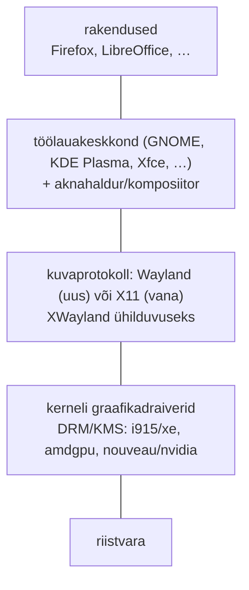
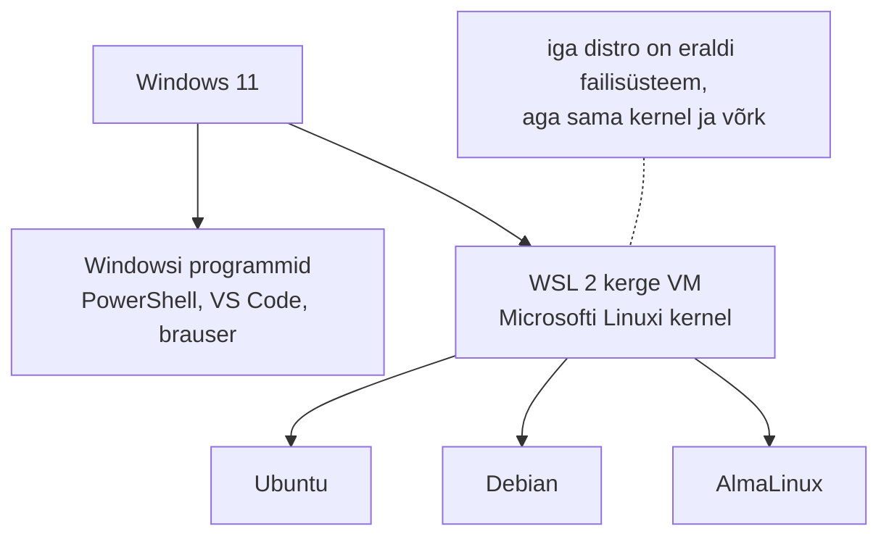

<!-- navigatsioon -->
[← Moodul 21. Enesekontroll](../moodul-21-samba-ad/enesekontroll.md) · [Sisukord](../../README.md#sisukord) · [Laboritöö 22. Linux töölaual, Kali ja WSL →](labor.md)
<!-- /navigatsioon -->

# Moodul 22. Linux töölaual ja WSL

**Maht:** 8 tundi · **Laboritöö:** Ubuntu Desktop, Kali Linux, Windows (WSL) · **Eeldused:** moodulid 1–5, 7 · **Valikmoodul**

## Õpiväljundid

Mooduli läbinud õppija:

- selgitab, miks töölaua Linux on muutunud olulisemaks (mängud, digitaalne suveräänsus, Windows 10 toe lõpp);
- võrdleb levinumaid töölaua distrosid ja töölauakeskkondi;
- kirjeldab graafilise süsteemi osi (kuvaserver, Wayland ja X11, sisselogimishaldur, töölauakeskkond);
- paigaldab tarkvara distro hoidlast, Flatpaki ja Snapiga ning võrdleb neid;
- leiab levinud Windowsi programmidele Linuxi alternatiivid ja selgitab, kuidas töötavad mängud (Proton, SteamOS);
- haldab töölaua Linuxit: printerid, uuendused, varundus, kaugtöölaud, Eesti ID-kaart;
- kasutab Kali Linuxit vastutustundlikult isoleeritud laboris;
- paigaldab ja kasutab WSL-i ning selgitab selle piiranguid.

---

## 22.1 Miks töölaua Linux?

Serverites on Linux ammu valitsev operatsioonisüsteem. Töölaual on see olnud väike nišš, kuid viimastel aastatel on mitu suundumust Linuxi sinna tagasi toonud:

- **Mängud.** Valve'i **Steam Deck** (2022) kasutab **SteamOS**-i - Arch Linuxil põhinevat distrot. Windowsi mängud töötavad seal ühilduvuskihi **Proton** abil. Steami riistvaraküsitluse järgi kasutas 2026. aasta oktoobris Linuxit ligikaudu 4% Steami kasutajatest ja neist umbes viiendik SteamOS-i - see on rohkem kui kunagi varem.
- **Digitaalne suveräänsus.** Euroopa avalik sektor arutab, kui palju võib sõltuda väheste (enamasti USA) tarnijate tarkvarast ja pilveteenustest. Seda mõjutavad litsentsikulud, andmekaitse (nt GDPR ja USA *CLOUD Act*) ning riikidevahelised suhted. Näiteid:
    - Prantsusmaa **Gendarmerie** kasutab töölaual Linuxit alates 2008. aastast (2024. aastal ligi 97% ehk üle 100 000 töökoha);
    - Saksamaa liidumaa **Schleswig-Holstein** viib umbes 30 000 töökohta Microsofti tarkvaralt üle LibreOffice'ile ja Linuxile (2025. aasta lõpus kasutas LibreOffice'it liidumaa enda andmetel ~80% töökohtadest);
    - Saksamaal arendatakse avaliku sektori avatud tarkvaral põhinevat töökeskkonda **openDesk**;
    - Taani digiministeerium alustas 2025. aastal pilootprojekti (mis osutus väiksemaks, kui esialgu uudistes kirjutati), ja Prantsusmaal on 2026. aastal meedias kirjeldatud plaani viia ministeeriumid Windowsilt ära.
- **Windows 10 toe lõpp** (oktoober 2025): miljonid arvutid ei vasta Windows 11 riistvaranõuetele. Linux annab neile turvauuendustega teise elu.
- **Arendajad** - veebi-, pilve- ja konteineritöö käib Linuxi tööriistadega; paljud arendajad kasutavad Linuxit kas otse või WSL-i kaudu (punkt 22.9).

> [!NOTE]
> **Märkus:** suveräänsuse küsimused on poliitilised ja muutuvad kiiresti. Siin on toodud näited, mitte hinnang - kontrolli värskeid andmeid ja mõtle, millised on mõlema poole argumendid (ühilduvus, koolituskulud, tugi, turvalisus, sõltumatus).

---

## 22.2 Töölaua distrod

| Distro | Alus | Töölaud | Kellele |
|---|---|---|---|
| **Ubuntu Desktop** | Debian | GNOME | Levinuim; hea riistvaratugi, palju juhendeid (ka HKHK laboris) |
| **Linux Mint** | Ubuntu | Cinnamon, MATE, Xfce | Windowsilt tulijatele: tuttav menüü ja tegumiriba |
| **Fedora Workstation** | (Red Hat) | GNOME | Uusim tarkvara, RHEL-i tulevik; KDE versioon Fedora KDE |
| **Debian** | - | valikuline (GNOME, KDE, Xfce …) | Stabiilsus, vaba tarkvara |
| **Kubuntu**, **KDE neon** | Ubuntu | KDE Plasma | KDE eelistajatele |
| **Pop!_OS** | Ubuntu | COSMIC | Arendajad, NVIDIA graafikakaardid |
| **Zorin OS**, **elementary OS** | Ubuntu | oma | Lihtsus, Windowsi või macOS-i sarnane välimus |
| **openSUSE** Tumbleweed / Leap | - | KDE, GNOME | Võimas haldustööriist YaST, *rolling* või stabiilne |
| **SteamOS** | Arch | Steam / KDE Plasma (töölauarežiim) | Mänguseadmed |
| **Bazzite** | Fedora Atomic | KDE või GNOME | Mängud tavalises arvutis |
| **Kali Linux** | Debian testing | Xfce | Turvatestimine - mitte igapäevaseks kasutuseks (punkt 22.8) |

Kasutusel on ka **muutumatud** (*immutable*, *atomic*) distrod: SteamOS, Fedora Silverblue/Kinoite, Bazzite, openSUSE Aeon. Neis on süsteemi osa ainult lugemiseks, uuendus paigaldatakse tervikuna (sageli A/B-skeemiga) ja ebaõnnestumise korral saab eelmise versiooni käivitada. Programmid paigaldatakse Flatpakina või konteineritesse (Distrobox, Toolbx).

Töölaua paigaldus käib samamoodi nagu serveril (vt [paigalduslisa](../lisad/paigaldus.md)), lisaks pakub enamik distrosid **live-režiimi**: süsteemi saab enne paigaldust USB-mälupulgalt proovida.

---

## 22.3 Graafiline süsteem

Linuxi töölaud koosneb mitmest vahetatavast kihist:



| Kiht | Näited | Märkus |
|---|---|---|
| Sisselogimishaldur (*display manager*) | GDM (GNOME), SDDM (KDE), LightDM | Käivitub `graphical.target`-iga (moodul 10) |
| Töölauakeskkond | GNOME, KDE Plasma, Xfce, Cinnamon, MATE, LXQt, COSMIC | Mitu võib olla paigaldatud korraga; valitakse sisselogimisel |
| Kuvaprotokoll | **Wayland**, X11 (Xorg) | Uuemad GNOME ja KDE versioonid loobuvad X11-seansist |

**Wayland** asendab 1980. aastatest pärit X11-t. Wayland on turvalisem (rakendus ei näe teiste akende sisu ega klaviatuurisisestust) ja paremini sobiv tänapäeva ekraanidele (eri skaleerimisega monitorid, kõrge värskendussagedus). Vanemad X11 programmid töötavad Waylandis kihi **XWayland** kaudu. Mõned vanad tööriistad (nt ekraanipildistajad, kaugtöölaua serverid) vajavad Waylandiga uuemat versiooni.

```bash
echo $XDG_SESSION_TYPE           # wayland või x11
echo $XDG_CURRENT_DESKTOP        # nt ubuntu:GNOME
loginctl                         # sisselogimisseansid
systemctl get-default            # graphical.target
systemctl status gdm             # Ubuntu/Debian GNOME-iga; KDE-ga sddm
```

Töölauakeskkondade võrdlus:

| | GNOME | KDE Plasma | Xfce |
|---|---|---|---|
| Filosoofia | lihtne, vähe seadeid, tegevuste ülevaade | väga seadistatav, Windowsi sarnane | kerge ja traditsiooniline |
| Mälu (ligikaudu, tühjalt) | 1–1,5 GiB | ~1 GiB | ~0,5 GiB |
| Vaikimisi | Ubuntu, Fedora, Debian | Kubuntu, SteamOS, openSUSE | Kali, Xubuntu |

<!-- PILT: ../pildid/m22-gnome-toolaud.png | Ubuntu GNOME töölaud (*Activities* vaade) -->

---

## 22.4 Tarkvara paigaldamine töölaual

Töölaual on lisaks distro hoidlale (moodul 4) levinud **universaalsed paketid**:

| | Distro hoidla (`apt`, `dnf`) | **Flatpak** (Flathub) | **Snap** (Snap Store) | **AppImage** |
|---|---|---|---|---|
| Kes haldab | distro | rakenduse arendaja või kogukond | Canonical (Ubuntu) | arendaja |
| Versioonid | distro väljalaske järgi | uusim | uusim | uusim |
| Isoleerimine | ei | liivakast (portaalid) | liivakast (AppArmor) | ei |
| Uuendus | süsteemiga | `flatpak update` | automaatne | käsitsi |
| Kus vaikimisi | kõik | Fedora, Mint, SteamOS jt | Ubuntu | - |

Flatpak Ubuntus:

```bash
sudo apt install flatpak gnome-software-plugin-flatpak
flatpak remote-add --if-not-exists flathub https://dl.flathub.org/repo/flathub.flatpakrepo
flatpak install flathub org.gimp.GIMP
flatpak run org.gimp.GIMP
flatpak list
flatpak info --show-permissions org.gimp.GIMP
flatpak update
flatpak uninstall --unused
```

Flatpaki rakenduse õigusi (failisüsteem, võrk, seadmed) saab vaadata ja muuta graafilise tööriistaga **Flatseal**.

### Levinud alternatiivid

| Windowsis | Linuxis |
|---|---|
| Microsoft Office | LibreOffice, OnlyOffice; veebis Collabora Online, openDesk; Microsoft 365 brauseris |
| Outlook | Thunderbird, Evolution |
| Teams, Zoom | brauseris; Zoomil on Linuxi klient; avatud alternatiivid Jitsi, Element (Matrix) |
| Photoshop | GIMP, Krita (joonistamine) |
| Illustrator | Inkscape |
| Premiere | Kdenlive, Shotcut; DaVinci Resolve (ka Linuxile) |
| Visual Studio | VS Code / VSCodium, JetBrainsi IDE-d (ka Linuxile) |
| AutoCAD | FreeCAD, LibreCAD |
| 7-Zip, WinRAR | failihalduri arhiivitööriist, `7z` |
| KeePass | KeePassXC, Bitwarden |

Kui programmi Linuxi versiooni pole, aitab mõnikord **Wine** (Windowsi API ühilduvuskiht; graafiliselt Bottles, Lutris) või virtuaalmasin.

---

## 22.5 Mängud: Steam, Proton ja SteamOS

**Proton** on Valve'i loodud Wine'il ja muudel vabadel komponentidel (DXVK, VKD3D - DirectX → Vulkan) põhinev ühilduvuskiht, mis on Steami kliendisse sisse ehitatud. Kasutaja jaoks näeb Windowsi mäng välja nagu Linuxi mäng.

- Steam Linuxil: Ubuntus `sudo apt install steam-installer` (või Flatpak `com.valvesoftware.Steam`); *Settings* → *Compatibility* → *Enable Steam Play for all other titles*.
- **ProtonDB** (protondb.com) - kasutajate hinnangud, kui hästi mäng töötab.
- Muud poed: **Heroic** (Epic, GOG), **Lutris**.
- **Piirangud:** osa võistlusmänge keelab Linuxi petmisvastase süsteemi (*anti-cheat*) tõttu; uusimad graafikakaardid ja funktsioonid võivad vajada uuemat kernelit ja Mesa draiverit.

**SteamOS 3** on muutumatu Arch-põhine distro: mängurežiim (Steam) ja töölauarežiim (KDE Plasma). Seda kasutavad Steam Deck, mõned teiste tootjate pihuarvutid ja Valve'i uued seadmed. Valve'i panus on parandanud ka Linuxi graafikadraivereid, KDE-d ja Wine'i, millest võidavad kõik töölaua kasutajad.

---

## 22.6 Töölaua haldus

### Kasutajad ja õigused

Graafilises seadete rakenduses loodud kasutajad on tavalised Linuxi kasutajad (moodul 3). Administraator on kasutaja, kes kuulub gruppi `sudo` (Ubuntu, Debian) või `wheel` (Fedora, AlmaLinux).

### Uuendused

Ubuntu teavitab uuendustest rakendusega *Software Updater* ja paigaldab turvauuendused automaatselt (`unattended-upgrades`, moodul 11). Snapid uuenevad ise, Flatpakid `flatpak update` või tarkvarakeskuse kaudu. Püsivara (BIOS/UEFI, SSD, dokid) uuendusi pakub **fwupd**:

```bash
fwupdmgr get-devices
fwupdmgr refresh
fwupdmgr get-updates
```

### Printerid

Linuxi printimissüsteem on **CUPS**. Uuemad võrguprinterid töötavad ilma draiverita (*IPP Everywhere*, *driverless*) ja leitakse automaatselt.

```bash
lpstat -p -d                  # printerid ja vaikeprinter
lp -d PRINTER fail.pdf        # prindi
```

Veebiliides: `http://localhost:631`. Virtuaalne PDF-printer: `sudo apt install printer-driver-cups-pdf`.

### Ligipääsetavus

Kõigil suurematel töölaudadel on ligipääsetavuse seaded (GNOME: *Settings* → *Accessibility*, KDE: *System Settings* → *Accessibility*):

- **ekraanilugeja Orca** loeb ekraanil olevat teksti ette (GNOME-s sisse/välja **Super+Alt+S**);
- **ekraaniluup**, suur tekst ja **suur kontrastsus** nägemispuudega kasutajale;
- **ekraaniklaviatuur**, **kleepuvad klahvid** (klahvikombinatsioone saab vajutada ükshaaval), **aeglased klahvid** ja klaviatuuriga hiire juhtimine liikumispuudega kasutajale;
- visuaalsed hoiatused helisignaalide asemel kuulmispuudega kasutajale.

Administraatorina tasub teada, et need seaded on kasutaja kontol ja et ekraanilugeja vajab heliväljundit ka kaugtöölaual.

### Varundus ja hetktõmmised

- **Timeshift** teeb süsteemifailidest hetktõmmiseid (rsync või Btrfs) - saab taastada pärast ebaõnnestunud uuendust;
- **Déjà Dup** (*Backups*) varundab kodukataloogi;
- **LUKS** ketta krüpteerimine valitakse paigaldamisel - sülearvutitel kohustuslik hea tava.

### Eesti ID-kaart

Eesti ID-kaardi tarkvara (DigiDoc4, ID-kaardi haldusvahend ja brauserilaiend **Web eID**) on Linuxile olemas. Riigi Infosüsteemi Amet pakub ametlikult tuge Ubuntu LTS-versioonidele: paigaldusjuhend ja skript on lehel **id.ee** (*ID-tarkvara paigaldamine Ubuntu*). Teistes distrodes on paketid sageli distro hoidlas (nt `qdigidoc4`, `web-eid`). Kaardilugeja vajab teenust `pcscd`:

```bash
systemctl status pcscd
pcsc_scan                     # pakett pcsc-tools: kas lugeja ja kaart on näha
```

Virtuaalmasinas tuleb USB-kaardilugeja VM-ile edasi suunata (Proxmox: *Hardware* → *Add* → *USB Device*, või SPICE-i USB-suunamine).

### Kaugtöölaud

| Viis | Protokoll | Märkus |
|---|---|---|
| Proxmoxi konsool | noVNC, **SPICE** | SPICE: parem pilt, lõikelaud, USB; kliendis `virt-viewer`, VM-is `spice-vdagent` |
| GNOME Remote Desktop | **RDP** | Ubuntu 24.04: *Settings* → *System* → *Remote Desktop*; Windowsist `mstsc` |
| xrdp | RDP | Töötab nt Xfce-ga, eraldi seanss igale kasutajale |
| VNC (TigerVNC jt) | VNC | Lihtne, kuid krüpteeri SSH tunneliga |
| RustDesk, Remmina | erinev | Kasutajatoe ja klientprogrammid |

Proxmoxis valitakse VM-ile graafikaadapter *Hardware* → *Display*: töölaua VM-ile sobib **SPICE (qxl)** või **VirtIO-GPU**.

---

## 22.7 Distrode erinevused töölaual

| | Ubuntu Desktop | Debian | AlmaLinux / Fedora |
|---|---|---|---|
| Vaikimisi töölaud | GNOME (Ubuntu kohandustega) | paigaldusel valitav, vaikimisi GNOME | AlmaLinux: „Workstation“ / „Server with GUI“ (GNOME); Fedora Workstation |
| Graafika lisamine serverile | `sudo apt install ubuntu-desktop-minimal` | `sudo tasksel` → valik töölaud | `sudo dnf groupinstall "Server with GUI"`, `systemctl set-default graphical.target` |
| Universaalsed paketid | Snap vaikimisi, Flatpak lisatav | Flatpak lisatav | Flatpak vaikimisi (Fedora) |
| Kolmandate osapoolte draiverid | `ubuntu-drivers autoinstall` | `non-free-firmware`, `nvidia-driver` | RPM Fusion (Fedora), ELRepo (Alma) |
| Kellele | töölaud, arendajad | stabiilsus | Fedora - uusim tarkvara; AlmaLinux - tööjaamad ettevõttes |

> [!NOTE]
> **Server ja töölaud:** serverisse graafilist keskkonda ei paigaldata - see kulutab ressursse, suurendab ründepinda ja uuenduste mahtu. Serverit hallatakse SSH ja veebiliideste kaudu.

---

## 22.8 Kali Linux

**Kali Linux** (arendaja OffSec) on Debian testing'ul põhinev distro **turvatestimiseks ja digiekspertiisiks**. Sellesse on eelnevalt paigaldatud sadu tööriistu:

| Valdkond | Tööriistad |
|---|---|
| Võrgu uurimine | `nmap`, Wireshark, `netdiscover` |
| Veebirakendused | Burp Suite, `nikto`, `sqlmap`, `gobuster` |
| Paroolid | `john`, `hashcat`, `hydra` |
| Ärakasutamine | Metasploit Framework |
| Traadita võrgud | Aircrack-ng |
| Ekspertiis | Autopsy, `binwalk` |

Kali on *rolling*-väljalaskega, vaikimisi Xfce töölauaga ja tavakasutajaga (`kali`, mitte `root`). Tööriistad on rühmitatud metapakettidesse (`kali-linux-default`, `kali-tools-web` jt).

Head tavad:

- **Kali ei ole igapäevane töölaud** - see on tööriistakast. Igapäevaseks kasutuseks sobib tavaline distro.
- Kasuta Kalit **isoleeritud laborivõrgus** koos harjutussihtmärkidega (nt Metasploitable). HKHK Proxmoxi laboris on selleks eraldi isoleeritud SDN-võrk koos Kali ja Metasploitable 3 masinatega.
- **Testi ainult süsteeme, mille testimiseks on sul luba** (vt ka moodul 11). Võõraste süsteemide skannimine või ründamine on ebaseaduslik ka siis, kui „ainult proovid“.
- Muuda vaikeparool ja hoia masin uuendatud (`sudo apt update && sudo apt full-upgrade`).

Sarnane distro on **Parrot Security OS**.

---

## 22.9 WSL - Linux Windowsis

**WSL** (*Windows Subsystem for Linux*) võimaldab käivitada Linuxi distrot otse Windowsis. Praegune versioon **WSL 2** käitab päris Linuxi kernelit kerges Hyper-V virtuaalmasinas, mis käivitub sekunditega ja jagab Windowsiga failisüsteemi, võrku ja kuva. WSL on alates 2025. aastast avatud lähtekoodiga.



### Paigaldus ja põhikäsud (PowerShell)

```powershell
wsl --install                     # WSL + Ubuntu (vaikimisi), vajab taaskäivitust
wsl --list --online               # saadaolevad distrod
wsl --install -d Debian
wsl --list --verbose              # paigaldatud distrod, olek ja WSL-i versioon
wsl -d Debian                     # käivita kindel distro
wsl --set-default Debian
wsl --shutdown                    # peata kõik distrod ja WSL-i VM
wsl --update                      # uuenda WSL-i ja kernelit
wsl --export Debian D:\varu\debian.tar          # varundus
wsl --import Debian2 D:\WSL\Debian2 D:\varu\debian.tar
wsl --unregister Debian2          # KUSTUTAB distro koos kõigi andmetega!
```

Esimesel käivitamisel luuakse Linuxi kasutaja ja parool (eraldi Windowsi omast). Sealt edasi on tegemist tavalise distroga: `sudo apt update && sudo apt upgrade`, paigalda tarkvara, kirjuta skripte.

<!-- PILT: ../pildid/m22-wsl-terminal.png | Windows Terminal: PowerShell `wsl -l -v` ja Ubuntu vahekaart -->

### Failid ja programmid kahe süsteemi vahel

| Kust | Kuhu | Kuidas |
|---|---|---|
| Linuxist | Windowsi failid | `/mnt/c/Users/<nimi>/` |
| Windowsist | Linuxi failid | Exploreris `\\wsl.localhost\Debian\home\<nimi>` või Linuxis `explorer.exe .` |
| Linuxist | Windowsi programm | `notepad.exe fail.txt`, `code .` (VS Code WSL-i laiendiga) |
| Windowsist | Linuxi käsk | `wsl ls -la`, `wsl -d Debian -- uname -r` |

> [!NOTE]
> **Jõudlus:** hoia Linuxi projekte Linuxi failisüsteemis (`~/`), mitte `/mnt/c` all - üle piiri failide lugemine on mitu korda aeglasem.

### Seadistus

Distro sees `/etc/wsl.conf`:

```ini
[boot]
systemd=true          # systemd PID 1-na (uutes Ubuntu paigaldustes vaikimisi sees)

[user]
default=mari

[network]
hostname=wsl-debian
```

Kogu WSL-i jaoks Windowsis `%UserProfile%\.wslconfig`:

```ini
[wsl2]
memory=4GB
processors=2
networkingMode=mirrored     # Linux kasutab Windowsi võrguliideseid (lihtsam VPN-i ja pordiga)
```

Muudatused jõustuvad pärast `wsl --shutdown`.

**WSLg** võimaldab käivitada ka Linuxi graafilisi programme - need avanevad tavaliste Windowsi akendena (`sudo apt install gedit`, `gedit &`).

### Mida WSL-is õppida ja mida mitte

| Sobib hästi | Ei sobi või töötab teisiti |
|---|---|
| käsurida, failid, torud (moodulid 1–2) | alglaadimine, GRUB, kernel (moodul 10) |
| kasutajad ja õigused (moodul 3) | kettad, partitsioonid, LVM (moodul 8) |
| pakihaldus (moodul 4) | võrguseadistus, Netplan (moodul 7) |
| Bash ja Git (moodul 6), Docker/Podman (moodul 12), Ansible'i juhtmasin (moodul 16) | tulemüür, SELinux/AppArmor (moodul 11) |
| SSH klient, arendustööriistad | teenused, mis peavad olema võrgust kättesaadavad 24/7 |

> [!NOTE]
> **WSL virtuaalmasinas:** kui Windows ise töötab Proxmoxi VM-is (nt laboris `winklient`), vajab WSL 2 **pesastatud virtualiseerimist** (*nested virtualization*): VM-i protsessori tüüp peab olema `host` ja Proxmoxi sõlmes peab pesastatud virtualiseerimine olema lubatud. Muidu annab `wsl --install` vea virtualiseerimise puudumise kohta.

Alternatiivid Windowsis: virtuaalmasin (Hyper-V, VirtualBox), Docker Desktop (kasutab ise WSL-i), MSYS2/Git Bash (ainult tööriistad, mitte päris Linux).

---

## Kokkuvõte

| Teema | Käsk või tööriist |
|---|---|
| Seansi tüüp | `echo $XDG_SESSION_TYPE`, `loginctl` |
| Graafiline režiim | `systemctl get-default`, `systemctl set-default graphical.target` |
| Töölaua lisamine | `apt install ubuntu-desktop-minimal`, `tasksel`, `dnf groupinstall "Server with GUI"` |
| Flatpak | `flatpak remote-add … flathub`, `flatpak install`, `flatpak info --show-permissions` |
| Snap | `snap list`, `snap install` |
| Püsivara | `fwupdmgr get-updates` |
| Printerid | CUPS, `lpstat -p`, `http://localhost:631` |
| Kaugtöölaud | SPICE + `spice-vdagent`, GNOME Remote Desktop (RDP), `xrdp` |
| ID-kaart | id.ee paigaldusjuhend, `pcscd`, `pcsc_scan` |
| WSL | `wsl --install -d`, `wsl -l -v`, `wsl --shutdown`, `/etc/wsl.conf`, `.wslconfig` |

**Järgmised sammud:** tee [laboritöö](labor.md) ja kontrolli oma teadmisi [enesekontrolli](enesekontroll.md) abil.

## Lisamaterjal

- Ubuntu Desktop dokumentatsioon (help.ubuntu.com)
- Flathub (flathub.org) ja Flatpaki dokumentatsioon (docs.flatpak.org)
- ProtonDB (protondb.com)
- Kali Linuxi dokumentatsioon (kali.org/docs)
- Microsoft Learn: *Windows Subsystem for Linux Documentation*
- ID-tarkvara paigaldamine Linuxis (id.ee)

<!-- navigatsioon -->
---

[← Moodul 21. Enesekontroll](../moodul-21-samba-ad/enesekontroll.md) · [Sisukord](../../README.md#sisukord) · [Laboritöö 22. Linux töölaual, Kali ja WSL →](labor.md)
<!-- /navigatsioon -->
