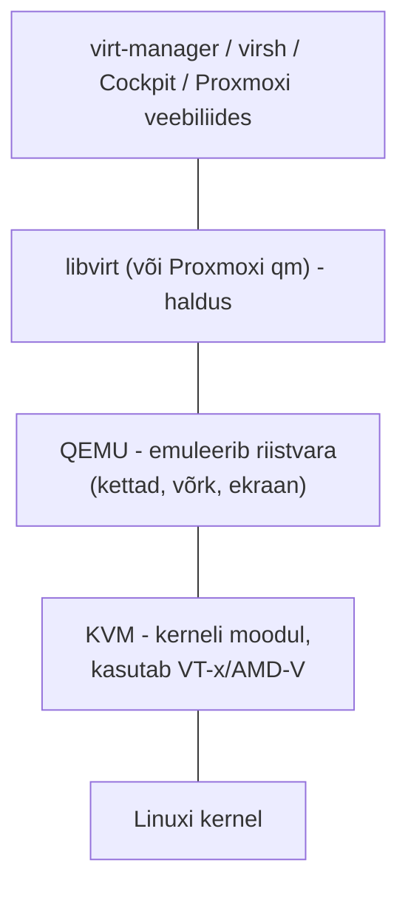
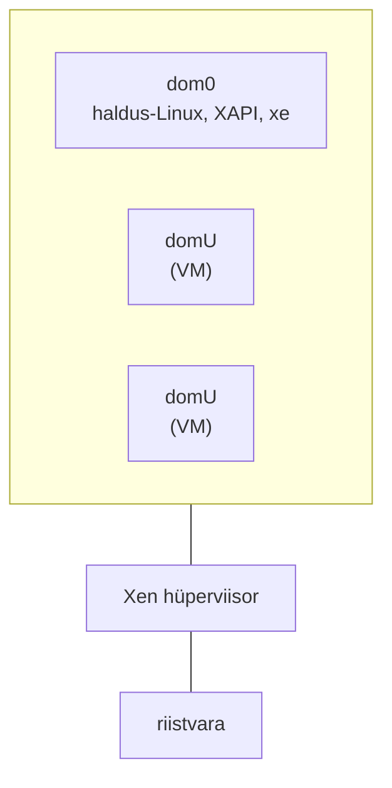

<!-- navigatsioon -->
[← Moodul 22. Enesekontroll](../moodul-22-toolaud-wsl/enesekontroll.md) · [Sisukord](../../README.md#sisukord) · [Laboritöö 23. KVM, Proxmox VE ja XCP-ng →](labor.md)
<!-- /navigatsioon -->

# Moodul 23. Virtualiseerimine: KVM, Proxmox VE ja XCP-ng

**Maht:** 12 tundi · **Laboritöö:** Debian (KVM), Proxmox VE, XCP-ng · **Eeldused:** moodulid 1–10, 12 · **Valikmoodul**

> [!NOTE]
> **HKHK õppijale:** hüperviisorite paigaldust ja riistvara käsitletakse põhjalikumalt aines „Majutuskeskkonna riistvara“. See moodul vaatab virtualiseerimist **Linuxi administraatori pilgu läbi**: mis toimub kapoti all, kuidas hüperviisorit käsurealt hallata ja kuidas see seostub kursuse teiste teemadega (võrk, kettad, ZFS, konteinerid, varundus).

## Õpiväljundid

Mooduli läbinud õppija:

- selgitab virtualiseerimise põhimõisteid (hüperviisori tüübid, riistvaraline tugi, pesastatud virtualiseerimine) ning virtuaalmasina ja konteineri erinevust;
- kasutab Linuxis KVM-i ja QEMU-t libvirt'i tööriistadega;
- paigaldab Proxmox VE, seadistab hoidlad, uuendab süsteemi ning haldab virtuaalmasinaid ja LXC konteinereid nii veebiliidesest kui ka käsurealt;
- seadistab Proxmoxis salvestust, võrgusildu, VLAN-e ja NAT-i;
- teeb varukoopiaid, malle ja klone ning kirjeldab klastri ja kõrge kättesaadavuse põhimõtteid;
- seadistab Proxmox Backup Serveri, varundab sinna virtuaalmasinaid ning taastab terve masina ja üksikud failid;
- paigaldab XCP-ng ja Xen Orchestra ning võrdleb seda Proxmoxiga.

---

## 23.1 Virtualiseerimise alused

**Virtualiseerimine** võimaldab ühel füüsilisel serveril (**host**) käitada mitut eraldatud operatsioonisüsteemi (**külaline**, *guest*). Seda teeb **hüperviisor**.

| | Tüüp 1 (*bare metal*) | Tüüp 2 (*hosted*) |
|---|---|---|
| Kus töötab | otse riistvaral | tavalise operatsioonisüsteemi peal programmina |
| Näited | Proxmox VE (KVM), XCP-ng (Xen), VMware ESXi, Microsoft Hyper-V | VirtualBox, VMware Workstation, UTM |
| Kasutus | serverid, andmekeskused, kooli labor | oma arvuti, arendus, õppimine |

> [!NOTE]
> KVM on mõlema vahepeal: see on Linuxi kerneli moodul, mis muudab kogu Linuxi hüperviisoriks. Seepärast loetakse Proxmoxi tüüp 1 hüperviisoriks, kuigi selle all töötab terve Debian.

### Riistvaraline tugi

Tänapäeva virtualiseerimine vajab protsessorilt laiendusi **Intel VT-x** või **AMD-V** (ja seadmete läbisuunamiseks **VT-d** / **AMD-Vi**, ehk IOMMU). Need lülitatakse sisse BIOS/UEFI seadetes.

```bash
grep -cE 'vmx|svm' /proc/cpuinfo        # > 0 - tugi on olemas (vmx - Intel, svm - AMD)
lscpu | grep -i virtualization
ls -l /dev/kvm                          # KVM on kasutatav
```

**Pesastatud virtualiseerimine** (*nested virtualization*) tähendab hüperviisori käitamist virtuaalmasinas - nt Proxmox Proxmoxi sees laboris või WSL Windowsi VM-is (moodul 22). Proxmoxis: VM-i protsessori tüüp `host` ja sõlmes lubatud pesastamine (`cat /sys/module/kvm_intel/parameters/nested` → `Y`).

### Virtuaalmasin ja konteiner

| | Virtuaalmasin | Konteiner (moodul 12), LXC |
|---|---|---|
| Kernel | oma | jagab hosti kernelit |
| OS | mis tahes (Linux, Windows, BSD) | ainult Linux (sama kernel) |
| Käivitus | kümneid sekundeid | sekund |
| Isolatsioon | tugevam (riistvara tasemel) | nõrgem (kerneli nimeruumid) |
| Ressursid | rohkem (terve OS) | vähem |

**Paravirtualiseeritud** seadmed (**VirtIO** KVM-is, Xeni PV-draiverid) on virtuaalmasinale „teadlikult virtuaalsed“ võrgu- ja kettakaardid, mis on palju kiiremad kui emuleeritud päris riistvara. Linux sisaldab VirtIO draivereid, Windows vajab eraldi draivereid.

### Hüperviisorite võrdlus

| | Proxmox VE | XCP-ng | VMware vSphere/ESXi | Microsoft Hyper-V |
|---|---|---|---|---|
| Hüperviisor | KVM (+ LXC konteinerid) | Xen | ESXi | Hyper-V |
| Alus | Debian | CentOS-põhine dom0 | oma | Windows Server |
| Litsents | vaba (AGPL), tasuline tugi | vaba (GPL), tasuline tugi | kommerts | Windows Serveri litsents |
| Haldus | sisseehitatud veebiliides, CLI, API | Xen Orchestra, XO Lite, `xe` | vCenter | Windows Admin Center, PowerShell |
| Salvestus | ZFS, LVM-thin, Ceph, NFS, iSCSI jt | LVM, ext, NFS, iSCSI, ZFS (eksperimentaalne) | VMFS, vSAN, NFS | NTFS/ReFS, S2D |

Broadcomi poolt VMware'i ostu järel (2023) muutusid VMware'i litsentsitingimused ja hinnad ning paljud asutused, sh koolid, on hakanud vaatama avatud alternatiive nagu Proxmox VE ja XCP-ng.

---

## 23.2 KVM ja QEMU Linuxis

Proxmoxi „kapoti all“ töötavad samad komponendid, mida saab kasutada igas Linuxis:



```bash
sudo apt install qemu-system-x86 qemu-utils libvirt-daemon-system virtinst libguestfs-tools
# AlmaLinux: sudo dnf install qemu-kvm libvirt virt-install && sudo systemctl enable --now libvirtd
sudo usermod -aG libvirt,kvm $USER
virsh -c qemu:///system list --all
virsh net-list --all                           # vaikimisi NAT-võrk "default" (virbr0)
```

Virtuaalmasina loomine pilvetõmmisest (kiire, ilma paigalduseta):

```bash
cd /var/lib/libvirt/images
sudo wget https://cloud.debian.org/images/cloud/trixie/latest/debian-13-genericcloud-amd64.qcow2
sudo qemu-img create -f qcow2 -b debian-13-genericcloud-amd64.qcow2 -F qcow2 test1.qcow2 10G
sudo virt-install --name test1 --memory 1024 --vcpus 1 \
    --disk /var/lib/libvirt/images/test1.qcow2 --import \
    --os-variant debian12 --network network=default \
    --cloud-init root-password-generate=on --noautoconsole
virsh list
virsh console test1                  # välju Ctrl+]
```

Põhikäsud:

| Käsk | Tegevus |
|---|---|
| `virsh list --all` | kõik masinad |
| `virsh start/shutdown/destroy <nimi>` | käivita / sule viisakalt / lülita jõuga välja |
| `virsh dominfo <nimi>`, `virsh domifaddr <nimi>` | info, IP-aadress |
| `virsh snapshot-create-as <nimi> enne` / `snapshot-revert` | hetktõmmis |
| `virsh dumpxml <nimi>` | masina seadistus XML-ina |
| `virsh undefine <nimi> --remove-all-storage` | kustuta |
| `qemu-img info`, `qemu-img convert -O raw` | kettatõmmiste info ja teisendamine (qcow2, raw, vmdk, vhdx) |

Graafiliselt: **virt-manager** (töölaud) või **Cockpit** (`cockpit-machines`, veebiliides pordil 9090 - AlmaLinuxis levinud).

---

## 23.3 Proxmox VE

**Proxmox Virtual Environment** on Debianil põhinev avatud lähtekoodiga virtualiseerimisplatvorm, mis ühendab ühte veebiliidesesse KVM-i virtuaalmasinad, **LXC** konteinerid, tarkvaralise salvestuse (ZFS, Ceph) ja võrgu, klastri, kõrge kättesaadavuse ning varundusvahendid. HKHK-s on kasutusel mitu Proxmoxi klastrit.

| Komponent | Roll |
|---|---|
| Debian | aluseks olev OS (Proxmox VE 9 - Debian 13 „trixie“) |
| KVM/QEMU, `qm` | virtuaalmasinad |
| LXC, `pct` | süsteemikonteinerid |
| `pve-cluster`, `/etc/pve` | klastri ühine seadistusfailisüsteem (pmxcfs) |
| Corosync, `pvecm` | klastri liikmesus ja kvoorum |
| `pvesm` | salvestuse haldus |
| `vzdump` | varundus |
| veebiliides | `https://<server>:8006` |

### Paigaldus

1. Laadi ISO alla (proxmox.com → *Downloads*) ja kirjuta USB-pulgale (**Rufus** või **Ventoy** - Ventoyga saab ühele pulgale panna mitu ISO-faili). Kui serveril on halduskonsool (iDRAC, iLO, IPMI), saab ISO ühendada ka üle võrgu.
2. **Enne paigaldust** uuenda serveri püsivara (BIOS/UEFI, halduskonsool, RAID-kontroller) ja lülita sisse virtualiseerimine (VT-x/AMD-V, VT-d).
3. Otsusta ketaste kasutus: **ZFS** (RAID1, RAID10, RAIDZ - vt moodul 9), kui kettad on HBA- või JBOD-režiimis; **ext4/xfs** + LVM-thin üksiku ketta või riistvaralise RAID-i korral. Riistvaraline RAID tuleb luua enne paigaldust.
4. Käivita USB-lt (ühekordne käivitusmenüü, sageli **F11**, **F12** või **F10**) → *Install Proxmox VE (Graphical)* → nõustu litsentsiga.
5. Vali sihtketas ja failisüsteem, riik, ajavöönd, klaviatuur.
6. Määra **root**-parool ja e-posti aadress teavituste jaoks (aadress ei tohi lõppeda `.invalid`).
7. Võrk: vali haldusliides, **staatiline IP**, vaikelüüs, DNS ja **FQDN hostinimi** (nt `pve1.lab.example`). Kui DHCP ei anna domeeni, jääb hostinime lõppu `.invalid` ja paigaldaja ei lase edasi. Hostinime ja IP-d on hiljem tülikas muuta - eriti klastris.
8. Pärast paigaldust ja taaskäivitust ava `https://<IP>:8006` (brauser hoiatab iseallkirjastatud sertifikaadi eest) ja logi sisse kasutajaga `root`, *Realm*: *Linux PAM standard authentication*.

### Hoidlad ja uuendused

Ilma tellimuseta (*subscription*) ei pääse ettevõtte hoidlale (*enterprise*) ja uuenduste värskendamine annab vea. Õppe- ja testkeskkonnas lisatakse **no-subscription** hoidla:

*Sõlm* → *Updates* → *Repositories* → *Add* → *No-Subscription*, seejärel vali `pve-enterprise` (ja `ceph enterprise`) ning *Disable*. Seejärel *Updates* → *Refresh* (taustal `apt update`) ja *Upgrade*.

Käsurealt:

```bash
apt update
apt full-upgrade        # Proxmoxis kasuta alati full-upgrade/dist-upgrade, mitte ainult upgrade
pveversion -v
reboot                  # kui uuendati kernelit
```

> [!NOTE]
> Tootmises on soovitatav tellimus ja enterprise-hoidla: paketid on rohkem testitud ja ametlik tugi on olemas. No-subscription hoidla sobib labori- ja väiksema tähtsusega keskkonda.

### Põhiversiooni uuendus

Põhiversiooni uuendus (nt 7 → 8 või 8 → 9) järgib sama loogikat nagu Debiani väljalaske uuendus (moodul 4), kuna Proxmoxi põhiversioon on seotud Debiani väljalaskega:

| Proxmox VE | Debian |
|---|---|
| 7 | 11 „bullseye“ |
| 8 | 12 „bookworm“ |
| 9 | 13 „trixie“ |

1. Uuenda praegune versioon lõpuni ja tee varukoopiad.
2. Käivita kontrollskript: `pve7to8` või `pve8to9 --full` ja paranda kõik hoiatused.
3. Vaheta hoidlates Debiani koodnimi (näide 7 → 8):

    ```bash
    sed -i -e 's/bullseye/bookworm/g' /etc/apt/sources.list
    sed -i -e 's/bullseye/bookworm/g' /etc/apt/sources.list.d/pve-enterprise.list
    apt update && apt dist-upgrade
    ```

    Proxmox VE 9 kasutab hoidlate kirjeldamiseks deb822 vormingut (`*.sources` failid) - järgi uuendamisel Proxmoxi wiki juhendit *Upgrade from 8 to 9*.

4. Vasta seadistusfailide küsimustele (vaikimisi - jäta olemasolev fail, kui ei tea paremini), luba teenuste taaskäivitus ja taaskäivita server. Kontrolli `pveversion`.

Vanemat versiooni uuendatakse **üks põhiversioon korraga**.

### Salvestus

| Tüüp | Mida hoiab | Märkus |
|---|---|---|
| `dir` (nt `local`) | ISO-d, mallid, varukoopiad | kataloog, `/var/lib/vz` |
| **LVM-thin** (`local-lvm`) | VM-ide kettad | õhukesed köited, hetktõmmised |
| **ZFS** (`local-zfs`) | VM-ide kettad (zvol), konteinerid | hetktõmmised, replikatsioon (moodul 9) |
| NFS, SMB/CIFS | ISO-d, varukoopiad, kettad | jagatud kõigile sõlmedele |
| iSCSI (moodul 19), Ceph | kettad | jagatud salvestus klastrile |
| Proxmox Backup Server | varukoopiad | inkrementaalsed, deduplitseeritud |

ISO-failid laaditakse *storage* → *ISO Images* → *Upload* (oma arvutist) või *Download from URL* (otse tootja peeglist). Kui sõlmi on palju, on mugavam ühendada võrgu failiserver: *Datacenter* → *Storage* → *Add* → *SMB/CIFS* (või NFS). Proxmox loob sinna alamkataloogid (`template/iso` jt) ja salvestus on kohe nähtav kõigile klastri sõlmedele.

```bash
pvesm status
pvesm list local
```

### Virtuaalmasinad

Virtuaalmasina loomist veebiliideses (*Create VM*) on kirjeldatud [paigalduslisas](../lisad/paigaldus.md) (punkt 3). Olulised valikud:

- **VM ID** on unikaalne (vaikimisi alates 100); *Start at boot* - käivitub koos serveriga;
- *System*: **QEMU Guest Agent** sisse (külalises paigalda `qemu-guest-agent`);
- *Disks*: VirtIO SCSI, *Discard* SSD/ZFS puhul;
- *CPU*: vanemate serverite puhul muuda tüüp `x86-64-v2-AES` → `x86-64-v2` või `host`, muidu masin ei käivitu; mitme füüsilise protsessoriga hostis lülita sisse **NUMA**;
- **Windowsi** masinad: märgi *Add additional drive for VirtIO drivers* (virtio-win ISO), lisa EFI- ja TPM-salvestus, paigaldusel laadi kettadraiver (`amd64` → OS versioon) ja pärast paigaldust käivita `virtio-win-guest-tools.exe`.

Käsurealt (`qm`):

```bash
qm list
qm config 101
qm start 101 ; qm shutdown 101 ; qm stop 101        # stop = toide välja
qm set 101 --memory 4096 --cores 2
qm snapshot 101 enne-uuendust ; qm listsnapshot 101 ; qm rollback 101 enne-uuendust
qm clone 9000 120 --name uus-masin --full
qm template 9000                                    # muuda mall(iks)
qm unlock 101                                       # kui masin on lukus (nt katkenud varundus)
qm destroy 101 --purge
```

Hangunud masina puhul: `qm unlock` ja `qm stop`; kui ka see ei aita, leia QEMU protsess (`ps aux | grep "id 101"`) ja lõpeta see juurkasutajana `kill -9 <PID>`.

<!-- PILT: ../pildid/m23-proxmox-ulevaade.png | Proxmoxi veebiliides: sõlm, VM-id ja konteinerid, *Summary* -->

### LXC konteinerid

**LXC** konteinerid on süsteemikonteinerid: need käituvad nagu väikesed virtuaalmasinad (oma init, kasutajad, SSH), kuid jagavad hosti kernelit (vrd Podman, moodul 12 - rakenduskonteinerid).

```bash
pveam update
pveam available --section system | grep debian
pveam download local debian-13-standard_13.1-2_amd64.tar.zst    # nimi vastavalt eelmisele käsule
pct create 200 local:vztmpl/debian-13-standard_13.1-2_amd64.tar.zst \
    --hostname ct1 --memory 512 --cores 1 --rootfs local-lvm:8 \
    --net0 name=eth0,bridge=vmbr0,ip=dhcp --unprivileged 1 --password
pct start 200
pct enter 200
pct list
```

Kasuta **õigusteta** (*unprivileged*) konteinereid - konteineri `root` ei ole hostis `root`.

### Varundus, mallid ja kloonid

- **Varukoopia** (*Backup*, `vzdump`): režiimid *snapshot* (masin töötab), *suspend*, *stop* (kõige järjepidevam; soovitatav enne olulist muudatust). Kompressioon `zstd`. Ajastatud varundus: *Datacenter* → *Backup*.
- **Taastamine**: masina menüüst kirjutab olemasoleva masina üle; salvestuse menüüst saab varukoopiast luua **uue** masina - märgi siis **Unique**, et genereeritaks uus MAC-aadress jm.
- **Hetktõmmis** (*snapshot*) ei ole varukoopia: see asub samal salvestusel (moodul 15, 3-2-1 reegel). Laboris tee hetktõmmis masina **väljalülitatuna ja ilma RAM-ita** - siis on see kiire ega lukusta masinat.
- **Mall** (*Convert to template*) ja **kloonid**: *Full Clone* on iseseisev koopia; *Linked Clone* on kiire ja säästab ruumi, kuid sõltub mallist - malli ei tohi kustutada. Enne malliks muutmist puhasta masin (`machine-id`, SSH võtmed - vt paigalduslisa punkt 8) või kasuta **cloud-init**-i.

```bash
vzdump 101 --mode stop --compress zstd --storage local
qmrestore /var/lib/vz/dump/vzdump-qemu-101-*.vma.zst 150 --unique
```

<!-- PILT: ../pildid/m23-proxmox-varunduse-too.png | *Datacenter → Backup* ajastatud varunduse töö -->

### Proxmox Backup Server

`vzdump` teeb igal korral **täieliku** varukoopia ja salvestab selle failina - 20 varukoopiat 30 GiB masinast võtavad ruumi peaaegu 20 korda. **Proxmox Backup Server** (PBS) on Proxmoxi eraldi toode (samuti Debiani põhine ja vaba tarkvara), mis lahendab selle:

| Omadus | Mida see annab |
|---|---|
| **Deduplitseerimine** | andmed jagatakse tükkideks (*chunks*) ja iga tükk salvestatakse ainult üks kord - ka eri masinate vahel. Kümme sarnast Debiani VM-i võtavad vähe rohkem ruumi kui üks |
| **Inkrementaalne varundus** | töötava VM-i puhul jälgib QEMU muutunud plokke (*dirty bitmap*) ja PBS-i saadetakse ainult need - järgmine varukoopia võtab sekundeid, mitte minuteid |
| **Kliendipoolne krüpteerimine** | andmed krüpteeritakse juba Proxmoxis; PBS-i haldaja ei näe sisu |
| **Kontroll** (*verify*) | kontrollib regulaarselt, et salvestatud tükid on terved |
| **Üksikfailide taastamine** | VM-i varukoopiast saab alla laadida üksiku faili ilma kogu masinat taastamata |
| **Sünkroonimine** | teine PBS (nt teises hoones) tõmbab varukoopiad endale - 3-2-1 reegel (moodul 15) |
| **Iga Linuxi masin** | `proxmox-backup-client` varundab ka tavalisi Linuxi servereid, mitte ainult Proxmoxi VM-e |

**Paigaldus.** PBS paigaldatakse ISO-st eraldi masinasse või VM-i (laboris: 2 vCPU, 4 GiB RAM, süsteemiketas 32 GiB ja **eraldi andmeketas** varukoopiate jaoks). Tootmises ei panda PBS-i samasse Proxmoxi, mida see varundab - rikke korral kaoksid koos masinatega ka varukoopiad. Veebiliides on pordil **8007** (`https://<pbs>:8007`, kasutaja `root`, realm *Linux PAM*). Hoidlad seadistatakse samamoodi nagu Proxmox VE-s (*no-subscription*).

**Andmehoidla** (*datastore*) on kataloog või ZFS-i andmekogum, kuhu tükid salvestatakse. Veebiliideses *Administration* → *Storage / Disks* → *Directory* (või *ZFS*) → vali andmeketas ja märgi *Add as Datastore*. Käsurealt:

```bash
proxmox-backup-manager datastore create andmed /mnt/datastore/andmed
proxmox-backup-manager datastore list
```

**Kasutaja Proxmoxi jaoks.** Ära kasuta Proxmoxis PBS-i `root`-i, vaid eraldi kasutajat, kellel on ainult varundamise õigus:

```bash
proxmox-backup-manager user create pve@pbs --password 'Pikk-parool-2026'
proxmox-backup-manager acl update /datastore/andmed DatastoreBackup --auth-id pve@pbs
proxmox-backup-manager cert info | grep Fingerprint     # sertifikaadi sõrmejälg
```

`DatastoreBackup` lubab varukoopiaid teha ja oma varukoopiaid taastada, kuid mitte teiste omi kustutada - kui ründaja saab Proxmoxi enda kätte, ei saa ta PBS-ist vanu varukoopiaid hävitada.

**PBS Proxmoxi salvestuseks.** Proxmox VE-s *Datacenter* → *Storage* → *Add* → *Proxmox Backup Server*: ID (nt `pbs`), server, kasutaja `pve@pbs`, parool, andmehoidla `andmed` ja sõrmejälg. Vahekaardil *Encryption* saab luua krüpteerimisvõtme - **salvesta võti ka mujale** (nt paroolihaldurisse või paberile), ilma selleta ei saa krüpteeritud varukoopiaid taastada.

Seejärel töötab PBS nagu iga teine varunduse sihtkoht:

```bash
vzdump 101 --storage pbs --mode snapshot      # käsitsi
pvesm list pbs                                # varukoopiad
```

Ajastatud varundus: *Datacenter* → *Backup* → *Add*, sihtkohaks `pbs`.

**Hooldustööd PBS-is** (*Datastore* → `andmed`):

| Töö | Mida teeb | Soovitus |
|---|---|---|
| **Prune** | kustutab säilitusreegli järgi vanad varukoopiad (nt *keep-last 3, keep-daily 7, keep-weekly 4, keep-monthly 6*) | iga päev |
| **Garbage collection** | vabastab ruumi tükkidest, millele ükski varukoopia enam ei viita (alles pärast seda ruum päriselt vabaneb) | iga päev pärast prune'i |
| **Verify** | loeb tükid ja kontrollib nende kontrollsummasid | kord nädalas, uued varukoopiad kohe |
| **Sync** | tõmbab varukoopiad teisest PBS-ist (*Remotes*) | välise koopia jaoks |

*Summary* vaates on näha **deduplitseerimistegur** (*Deduplication Factor*) - mitu korda vähem ruumi kulub võrreldes tavaliste varukoopiatega.

**Taastamine.** Proxmoxis vali salvestus `pbs` → varukoopia → *Restore* (kogu masin, soovitatavalt uue ID-ga ja *Unique*) või *File Restore* (sirvi varukoopia failisüsteemi ja laadi alla üksikud failid).

**Tavalise Linuxi serveri varundus.** `proxmox-backup-client` (pakett Proxmoxi hoidlast) varundab katalooge PBS-i - sobib nt füüsilisele serverile või kodukataloogidele:

```bash
export PBS_REPOSITORY='pve@pbs@10.0.83.65:andmed'
export PBS_FINGERPRINT='<sõrmejälg>'
proxmox-backup-client backup etc.pxar:/etc
proxmox-backup-client snapshot list
```

> [!IMPORTANT]
> **Varundus pole valmis, kuni taastamine on testitud** (moodul 15). Proovi PBS-i varukoopiast taastada nii terve masin kui ka üksik fail ja mõõda, kui kaua see aega võttis.

<!-- PILT: ../pildid/m23-pbs-andmehoidla.png | PBS-i andmehoidla *Summary* koos deduplitseerimisteguriga -->

### Cloud-init mall

Distrode pilvetõmmistes on cloud-init (moodul 16, punkt 16.5) juba sees. Neist tehtud malli kloonid saavad esimesel käivitusel nime, IP-aadressi, kasutaja ja SSH-võtme Proxmoxi seadetest - ilma paigaldajata ja mõne sekundiga.

```bash
# Proxmoxi sõlmes juurkasutajana
wget https://cloud.debian.org/images/cloud/trixie/latest/debian-13-genericcloud-amd64.qcow2
qm create 9000 --name debian13-mall --memory 2048 --cores 2 \
   --net0 virtio,bridge=vmbr0 --scsihw virtio-scsi-pci
qm set 9000 --scsi0 local-lvm:0,import-from=/root/debian-13-genericcloud-amd64.qcow2
qm set 9000 --ide2 local-lvm:cloudinit --boot order=scsi0 --serial0 socket --vga serial0
qm template 9000

# kloon: nimi, IP, kasutaja ja võti
qm clone 9000 201 --name k3s1 --full
qm set 201 --ciuser kasutaja --sshkeys /root/.ssh/id_ed25519.pub \
   --ipconfig0 ip=10.0.83.61/24,gw=10.0.83.1 --nameserver 10.0.83.1
qm resize 201 scsi0 20G
qm start 201
```

Pilvetõmmise ketas on väike (ca 3 GiB) - suurenda seda kloonimisel (`qm resize`), cloud-init laiendab failisüsteemi ise. Veebiliideses on samad seaded VM-i vahekaardil *Cloud-Init*. Sama malli kasutavad ka OpenTofu ja Ansible'i `proxmox_kvm` (moodul 16).

<!-- PILT: ../pildid/m23-cloud-init.png | VM-i vahekaart *Cloud-Init* (kasutaja, SSH-võti, IP) -->

### Võrk: sillad, VLAN-id ja NAT

Proxmoxi virtuaalmasinad ühendatakse **Linuxi sildadega** (`vmbrX`) - tarkvaraline kommutaator, kuhu on ühendatud füüsiline liides ja VM-ide liidesed. Seadistus on Debiani failis `/etc/network/interfaces` (moodul 7) ja seda saab muuta veebiliideses *System* → *Network*.

Eraldi sild ilma füüsilise liideseta (nt iga õppija oma võrk):

```text
auto vmbr10
iface vmbr10 inet static
    address 10.0.222.1/24
    bridge-ports none
    bridge-stp off
    bridge-fd 0
    bridge-vlan-aware yes
    bridge-vids 2-4094
```

**NAT**, et selle silla masinad pääseksid internetti läbi hosti (`vmbr0`):

```text
    post-up   echo 1 > /proc/sys/net/ipv4/ip_forward
    post-up   iptables -t nat -A POSTROUTING -s '10.0.222.0/24' -o vmbr0 -j MASQUERADE
    post-down iptables -t nat -D POSTROUTING -s '10.0.222.0/24' -o vmbr0 -j MASQUERADE
```

Kui Proxmoxi tulemüür on sisse lülitatud ja NAT ei tööta, lisa ka:

```text
    post-up   iptables -t raw -I PREROUTING -i fwbr+ -j CT --zone 1
    post-down iptables -t raw -D PREROUTING -i fwbr+ -j CT --zone 1
```

```bash
ifreload -a          # rakenda muudatused (või: systemctl restart networking)
```

**VLAN-id:** VLAN-teadlik sild (`bridge-vlan-aware yes`) laseb läbi kommutaatorilt tulevad märgistatud kaadrid. Virtuaalmasin pannakse VLAN-i, kui määrata tema võrguliidesele *VLAN Tag*. Hosti enda IP-aadressi konkreetses VLAN-is seadistab eraldi liides `vmbr0.<vlan>`:

```text
auto vmbr0.20
iface vmbr0.20 inet static
    address 10.20.0.5/24
    gateway 10.20.0.1
```

**SDN** (*Software-Defined Networking*, *Datacenter* → *SDN*) haldab tsoone ja virtuaalvõrke (**VNet**) kogu klastris korraga - HKHK laboris on õppijate võrgud osaliselt VNet-id (`vnetX`, vt [paigalduslisa](../lisad/paigaldus.md), punkt 1).

### Kasutajad ja õigused

- **Realm**: *Linux PAM* (hosti kasutajad, nt `root`), *Proxmox VE authentication server* (Proxmoxi enda kasutajad), LDAP või Active Directory (moodulid 20–21). HKHK-s logivad õppijad sisse realm'iga `hkhk.edu.ee`.
- **Rollid** (*PVEAdmin*, *PVEVMUser* jt), **grupid** ja **ressursikogumid** (*pools*) määravad, kes milliseid masinaid näeb ja hallata saab.
- Automatiseerimiseks loo API-võti (*API Token*), mitte ära kasuta `root`-i parooli skriptides.

### API ja skriptid

Kõik, mida veebiliides teeb, käib **REST API** kaudu (`https://<sõlm>:8006/api2/json/…`) - seda saab kasutada ka skriptides (moodul 6), Ansible'is ja OpenTofus (moodul 16). Sõlmes endas on API käsurea klient `pvesh`:

```bash
pvesh get /cluster/resources --type vm --output-format json-pretty
pvesh get /nodes/pve1/qemu/101/status/current
```

Väljastpoolt kasutatakse API-võtit (*Datacenter* → *Permissions* → *API Tokens*; anna tokenile ainult vajalikud õigused):

```bash
TOKEN='kasutaja@pve!skript=xxxxxxxx-xxxx-xxxx-xxxx-xxxxxxxxxxxx'
curl -s -H "Authorization: PVEAPIToken=$TOKEN" \
     https://pve.lab.example:8006/api2/json/cluster/resources?type=vm |
     jq -r '.data[] | "\(.vmid) \(.name) \(.status)"'
curl -s -X POST -H "Authorization: PVEAPIToken=$TOKEN" \
     https://pve.lab.example:8006/api2/json/nodes/pve1/qemu/101/status/start
```

Laboris isesigneeritud sertifikaadi korral lisa `curl`-ile `--cacert` Proxmoxi CA-ga (`/etc/pve/pve-root-ca.pem`), mitte `-k`. API dokumentatsioon koos kõigi teedega on aadressil pve.proxmox.com/pve-docs/api-viewer.

### Klaster

**Klaster** ühendab mitu Proxmoxi sõlme ühiseks halduskeskkonnaks: üks veebiliides, masinate migreerimine sõlmede vahel ja **kõrge kättesaadavus** (HA) - rikkis sõlme masinad käivitatakse automaatselt teistes sõlmedes.

- Klastri loomine: *Datacenter* → *Cluster* → *Create Cluster* (`pvecm create <nimi>`).
- Liitumine: olemasolevas klastris *Join Information* → *Copy Information*; uues, **tühjas** sõlmes *Join Cluster*, kleebi info ja sisesta klastri `root`-parool (`pvecm add <olemasoleva sõlme IP>`).
- Olek: `pvecm status`, `pvecm nodes`.
- **Kvoorum:** klaster töötab, kui üle poole sõlmedest on kättesaadavad. Seepärast tehakse HA-klaster vähemalt **kolmest** sõlmest (või kahest + QDevice).
- **Migreerimine:** masin → *Migrate* → *Target node*. Jagatud salvestusega (Ceph, NFS, iSCSI) saab migreerida töötavat masinat; kohaliku ZFS-iga aitab **Storage Replication**.

Sõlme eemaldamine klastrist:

1. Migreeri või kustuta kõik selle sõlme masinad (muidu jäävad VM ID-d klastris hõivatuks).
2. Lülita sõlm välja.
3. Teises sõlmes: `pvecm delnode <sõlme nimi>`.
4. Kui sõlm on veebiliideses ikka näha: `rm -rf /etc/pve/nodes/<sõlme nimi>`.
5. Kontrolli: `pvecm status`, `pvecm nodes`.

> [!WARNING]
> Eemaldatud sõlme **ei tohi** uuesti samas olekus võrku ühendada - paigalda see uuesti.

---

## 23.4 XCP-ng

**XCP-ng** (*Xen Cloud Platform - next generation*) on Linuxi distributsioon, mis sisaldab **Xen** hüperviisorit ja **XAPI** haldusplatvormi töövalmis lahendusena. Projekt sündis pärast seda, kui Citrix lõpetas XenServeri tasuta avatud lähtekoodiga versiooni tarnimise.

### Xeni ülesehitus



Erinevalt KVM-ist ei ole Xen Linuxi kerneli osa: hüperviisor käivitub esimesena ja haldus-Linux (**dom0**) on ise privileegidega virtuaalmasin. Külalismasinad on **domU**.

### Paigaldus

1. Laadi ISO alla (xcp-ng.org), kontrolli süsteeminõudeid (docs.xcp-ng.org), kirjuta USB-pulgale (Rufus, Ventoy).
2. Uuenda serveri püsivara ja vajadusel loo riistvaraline RAID enne paigaldust.
3. Käivita USB-lt → vali klaviatuur (õige paigutus erisümbolite jaoks) → nõustu EULA-ga.
4. Vali ketas, kuhu luuakse VM-ide salvestus (*local storage*), ja paigaldusallikas (*Local media*).
5. Määra root-parool, haldusliidese **staatiline IP**, VLAN (kui vaja), hostinimi ja DNS.
6. Ajavöönd ja aja tuvastamine: vali **NTP**, server `pool.ntp.org` (moodul 7).
7. *Install*; lisapakkide küsimusele võib vastata *No*. Pärast paigaldust eemalda meedia ja taaskäivita.

Konsoolis avaneb **xsconsole** - tekstimenüü, kust saab muuta võrku, vaadata olekut ja hallata masinaid (rohkem kui paljude teiste hüperviisorite konsoolis). Brauseris avaneb serveri aadressil **XO Lite** - kerge veebiliides ühe hosti haldamiseks.

### xe - käsurida

```bash
xe host-list
xe vm-list
xe vm-start vm=<nimi> ; xe vm-shutdown vm=<nimi>
xe sr-list                       # salvestusrepositooriumid (Storage Repository)
xe network-list
xe template-list | grep name-label | head
```

Kohalik ISO-repositoorium (nt testserveris, kui võrgus olevat ISO-hoidlat pole):

```bash
mkdir -p /var/opt/xen/ISO_Store
xe sr-create name-label=LocalISO type=iso device-config:location=/var/opt/xen/ISO_Store \
    device-config:legacy_mode=true content-type=iso
```

Kopeeri ISO-failid sinna (`scp`) ja värskenda SR-i haldusliideses (*Rescan*). Tootmises kasutatakse võrgus asuvat ISO-hoidlat (NFS/SMB).

### Külalistööriistad (Guest tools)

Nagu QEMU agent Proxmoxis, vajab XCP-ng igas VM-is **külalistööriistu**: draiverid (PV) ja haldusagent, mis teatab IP-aadressi, mälukasutuse ja võimaldab viisakat sulgemist. Linuxis on need sageli distro hoidlas (`xe-guest-utilities`), samuti hosti `guest-tools.iso` plaadil; Windowsi draiverid laaditakse alla XCP-ng GitHubist.

Paigaldus Debiani VM-i `guest-tools.iso`-st:

```bash
# Ühenda Xen Orchestras VM-ile DVD-ks guest-tools.iso
sudo mount /dev/cdrom /mnt
cd /mnt/Linux
sudo ./install.sh
sudo reboot
```

### Xen Orchestra

**Xen Orchestra** (XO) on XCP-ng serverite (ja kogumite, *pools*) täisfunktsionaalne veebihaldus: VM-id, salvestus, varundus, replikatsioon, kasutajad. Valmis seade **XOA** paigaldatakse XO Lite'ist ühe klõpsuga, kuid tasuta versioonis on selle funktsionaalsus piiratud. Õppekeskkonnas kasutatakse sageli **XO-d lähtekoodist** - kõik funktsioonid, kuid ilma ametliku toeta.

Paigaldus Debiani VM-i kogukonna skriptiga (vähemalt 3 GiB mälu):

```bash
sudo apt update && sudo apt install -y git
git clone https://github.com/ronivay/XenOrchestraInstallerUpdater
cd XenOrchestraInstallerUpdater
cp sample.xo-install.cfg xo-install.cfg
sudo ./xo-install.sh          # vali 1 (Install)
```

Pärast paigaldust ava `http(s)://<VM-i IP>`. Vaikimisi kasutaja on `admin@admin.net`, parool `admin` - **muuda kohe**. Lisa XCP-ng server: *Settings* → *Servers* → aadress, `root` ja parool.

> [!WARNING]
> Loe enne käivitamist alati läbi, mida võõras skript teeb (moodul 4) - see paigaldab Node.js-i, ehitab XO lähtekoodist ja loob teenuse.

<!-- PILT: ../pildid/m23-xen-orchestra.png | Xen Orchestra VM-ide loend -->

---

## 23.5 Proxmox VE või XCP-ng?

| | Proxmox VE | XCP-ng |
|---|---|---|
| Hüperviisor | KVM (Linuxi kernelis) | Xen (eraldi hüperviisor, dom0) |
| Konteinerid | LXC sisseehitatud | ei (VM-id) |
| Veebihaldus | sisseehitatud, kõik ühes | XO Lite (üks host), Xen Orchestra (eraldi VM) |
| Salvestus | ZFS, Ceph sisseehitatud | LVM/ext, NFS, iSCSI; XOSTOR |
| Varundus | `vzdump`, Proxmox Backup Server (deduplitseeritud, inkrementaalne) | Xen Orchestra (inkrementaalne, replikatsioon) |
| Linuxi administraatorile | tuttav Debian, `/etc/network/interfaces`, `apt` | dom0 on suletum, haldus `xe` ja XO kaudu |
| Tüüpiline kasutaja | koolid, väikesed ja keskmised asutused, kodulaborid | VMware'ilt/Citrixilt tulijad, suuremad Xeni keskkonnad |

Mõlemad on vabad ja tootmiskõlbulikud. Valiku määravad olemasolevad oskused, salvestuslahendus, varundusvajadus ja tugi.

---

## Distrode erinevused

| | **Debian** | **Ubuntu** | **AlmaLinux** |
|---|---|---|---|
| KVM/QEMU | `qemu-system-x86`, `libvirt-daemon-system`, `virtinst` | sama + `qemu-kvm` | `qemu-kvm`, `libvirt`, `virt-install` |
| Veebihaldus | Cockpit (`cockpit-machines`) | Cockpit | Cockpit (vaikimisi paigaldatav, pordil 9090) |
| Proxmox VE | on ise Debian | - | - |
| Pesastamise kontroll | `/sys/module/kvm_intel/parameters/nested` | sama | sama |

---

## Kokkuvõte

| Tegevus | Käsk või koht |
|---|---|
| Riistvaraline tugi | `grep -cE 'vmx\|svm' /proc/cpuinfo`, `ls /dev/kvm` |
| libvirt | `virsh list --all`, `virt-install`, `virsh console` |
| Proxmoxi versioon ja uuendus | `pveversion -v`, `apt update && apt full-upgrade`, `pve8to9` |
| Proxmoxi VM-id | `qm list/start/shutdown/stop/snapshot/clone/template/destroy`, `qm unlock` |
| Proxmoxi konteinerid | `pveam`, `pct create/start/enter/list` |
| Varundus | `vzdump`, `qmrestore --unique` |
| Proxmox Backup Server | port 8007, `proxmox-backup-manager datastore/user/acl`, *Prune*, *Garbage collection*, *Verify*, *File Restore*, `proxmox-backup-client` |
| Salvestus | `pvesm status` |
| Võrk | `/etc/network/interfaces`, `ifreload -a` |
| Klaster | `pvecm create/add/status/nodes/delnode` |
| XCP-ng | `xsconsole`, `xe vm-list/sr-list/sr-create`, Xen Orchestra |

**Järgmised sammud:** tee [laboritöö](labor.md) ja kontrolli oma teadmisi [enesekontrolli](enesekontroll.md) abil.

## Lisamaterjal

- Proxmox VE dokumentatsioon (pve.proxmox.com/pve-docs), wiki (pve.proxmox.com/wiki) ja foorum (forum.proxmox.com)
- XCP-ng dokumentatsioon (docs.xcp-ng.org) ja Xen Orchestra dokumentatsioon (docs.xen-orchestra.com)
- libvirt'i dokumentatsioon (libvirt.org) ja Red Hati juhend „Configuring and managing virtualization“
- Arch Wiki - KVM, QEMU, libvirt

<!-- navigatsioon -->
---

[← Moodul 22. Enesekontroll](../moodul-22-toolaud-wsl/enesekontroll.md) · [Sisukord](../../README.md#sisukord) · [Laboritöö 23. KVM, Proxmox VE ja XCP-ng →](labor.md)
<!-- /navigatsioon -->
