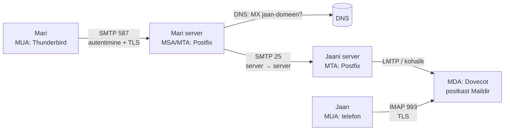
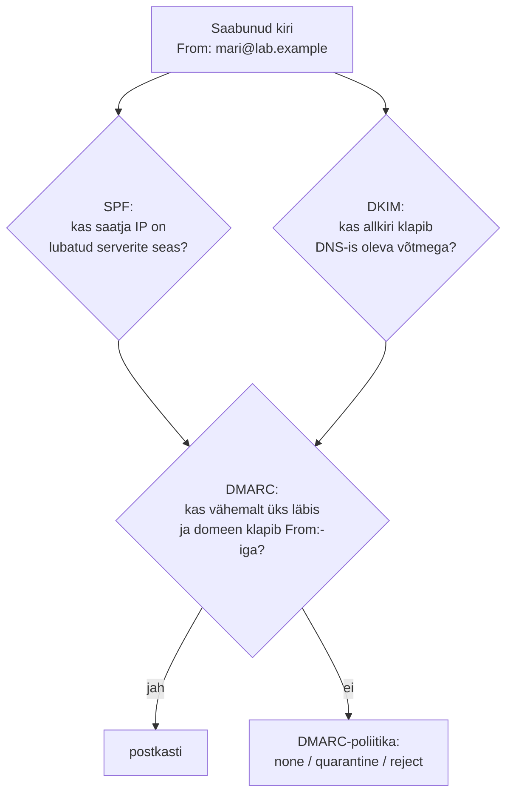

<!-- navigatsioon -->
[← Moodul 23. Enesekontroll](../moodul-23-pxe-iscsi/enesekontroll.md) · [Sisukord](../../README.md#sisukord) · [Laboritöö 24. E-posti server →](labor.md)
<!-- /navigatsioon -->

# Moodul 24. E-posti server

**Maht:** 10 tundi · **Laboritöö:** Ubuntu (server), Debian (DNS), Ubuntu töölaud (klient, valikuline) · **Eeldused:** moodulid 1–21 (eriti 12, 15, 17 ja 21) · **Valikmoodul**

> [!NOTE]
> **Süsteemihalduri vaade e-postile.** See moodul näitab, kuidas e-posti server Linuxis kokku pannakse ja kuidas see DNS-i, TLS-i ja turvalisusega seotud on. Eesmärk on töötav laboriserver ja e-posti toimimise mõistmine - mitte suure e-posti teenuse täielik valdamine.
>
> **HKHK õppijale:** e-posti serveri paigaldust käsitletakse põhjalikumalt eraldi moodulis. See valikmoodul annab Linuxi poolt vaadates aluse ja seob e-posti kursuse teiste teemadega (DNS, TLS, seire).

E-post on üks vanimaid ja kõige laiemalt kasutatud internetiteenuseid. Paljud asutused kasutavad täna pilveposti (Microsoft 365, Google Workspace, Zone jt), kuid süsteemihaldur peab ka siis mõistma, kuidas e-post liigub, miks kiri jõuab rämpsposti ja kuidas DNS-kirjed (MX, SPF, DKIM, DMARC) toimivad. Selles moodulis ehitame laborivõrku täieliku e-posti serveri: Postfix võtab kirju vastu ja saadab neid, Dovecot hoiab postkaste ja annab neile ligipääsu ning OpenDKIM allkirjastab väljuvad kirjad.

> [!NOTE]
> **Oma e-posti server internetis** nõuab püsivat avalikku IP-aadressi koos pöördkirjega, puhast mainet (aadress ei tohi olla mustas nimekirjas), korrektseid DNS-kirjeid ja pidevat hooldust. Paljud teenusepakkujad blokeerivad koduühendustes pordi 25. Laboris töötame sisevõrgu domeeniga `lab.example`, kus neid piiranguid pole.

## Õpiväljundid

Mooduli läbinud õppija:

- selgitab e-kirja teekonda ning MUA, MSA, MTA ja MDA rolle ja kasutatavaid protokolle (SMTP, IMAP);
- seadistab e-posti jaoks vajalikud DNS-kirjed (MX, A, PTR, SPF, DKIM, DMARC);
- paigaldab ja seadistab Postfixi kirjade vastuvõtuks ja saatmiseks ning väldib avatud releed;
- seadistab Dovecoti IMAP-serveriks ja autentimiseks koos TLS-iga;
- seadistab kasutajate kirjade saatmise (*submission*, port 587) autentimise ja krüpteerimisega;
- allkirjastab väljuvad kirjad DKIM-iga ja selgitab rämpsposti tõrjumise vahendeid;
- testib e-posti serverit ja leiab vigu logidest;
- varundab e-posti serveri.

---

## 24.1 Kuidas e-post töötab

Kui Mari saadab Jaanile kirja, osalevad selles mitu programmi:



| Lühend | Nimi | Ülesanne | Näited |
|---|---|---|---|
| **MUA** | *Mail User Agent* | Kasutaja e-posti programm | Thunderbird, Outlook, telefoni rakendus, veebipost (Roundcube) |
| **MSA** | *Mail Submission Agent* | Võtab kasutaja kirja vastu (autentimisega) | Postfix pordil 587 |
| **MTA** | *Mail Transfer Agent* | Edastab kirju serverite vahel | **Postfix**, Exim, Sendmail, Microsoft Exchange |
| **MDA** | *Mail Delivery Agent* | Paneb kirja postkasti | **Dovecot** (LMTP), Postfix `local` |
| **IMAP/POP3 server** | | Annab MUA-le ligipääsu postkastile | **Dovecot** |

| Port | Protokoll | Kasutus |
|---|---|---|
| **25** | SMTP | Serverilt serverile (MTA ↔ MTA) |
| **587** | SMTP *submission* + STARTTLS | Kasutaja saadab kirja oma serverisse (autentimisega) |
| **465** | SMTP üle TLS-i (*submissions*) | Sama mis 587, kohe krüpteeritud |
| **993** | IMAP üle TLS-i | Postkasti lugemine, kirjad jäävad serverisse |
| 143 | IMAP + STARTTLS | Sama, vanem viis |
| 995 / 110 | POP3 | Kirjade allalaadimine (tänapäeval harva) |

### Ümbrik ja päis

SMTP-s on kirjal kaks aadresside komplekti, nagu paberkirjal ümbrik ja kirja sees olev pöördumine:

- **ümbrik** (*envelope*: `MAIL FROM`, `RCPT TO`) - mille järgi serverid kirja edastavad;
- **päis** (*header*: `From:`, `To:`, `Subject:`) - mida kasutaja oma programmis näeb.

Need võivad erineda (nt postiloendid, Bcc). Rämpspostitajad võltsivad sageli `From:` päist - selle vastu on SPF, DKIM ja DMARC (punkt 24.2).

### SMTP-dialoog

SMTP on tekstiprotokoll, mida saab ka käsitsi „rääkida“:

```text
$ nc mail.lab.example 25
220 mail.lab.example ESMTP Postfix (Ubuntu)
EHLO klient.lab.example
250-mail.lab.example
250-STARTTLS
250 ...
MAIL FROM:<mari@lab.example>
250 2.1.0 Ok
RCPT TO:<jaan@lab.example>
250 2.1.5 Ok
DATA
354 End data with <CR><LF>.<CR><LF>
Subject: Tere

Tere, Jaan!
.
250 2.0.0 Ok: queued as 4F2A11C0A3
QUIT
```

Vastuskoodid: `2xx` - õnnestus, `4xx` - ajutine viga (saatja proovib hiljem uuesti), `5xx` - püsiv viga (kiri tagastatakse saatjale).

## 24.2 DNS ja e-post

Saatev server leiab saaja serveri **MX-kirjest**. Teised kirjed aitavad saajal otsustada, kas kirja võib usaldada:

| Kirje | Näide (`lab.example` tsoonis) | Milleks |
|---|---|---|
| **MX** | `@ IN MX 10 mail.lab.example.` | Kuhu saata domeeni kirjad (väiksem number = eelistatum) |
| **A** | `mail IN A 10.0.83.154` | MX-i nimi peab lahenema aadressiks (mitte CNAME!) |
| **PTR** | `154 IN PTR mail.lab.example.` | Saaja kontrollib, kas saatja IP pöördkirje klapib nimega |
| **SPF** (TXT) | `@ IN TXT "v=spf1 mx -all"` | Millised serverid tohivad domeeni nimel kirju saata |
| **DKIM** (TXT) | `kool._domainkey IN TXT "v=DKIM1; k=rsa; p=MIIB…"` | Avalik võti, millega kontrollitakse kirja allkirja |
| **DMARC** (TXT) | `_dmarc IN TXT "v=DMARC1; p=quarantine; rua=mailto:dmarc@lab.example"` | Mida teha kirjaga, mis SPF-i ja DKIM-i kontrolli ei läbi; kuhu saata aruanded |



- **SPF** (`v=spf1 mx -all`): kirju võivad saata domeeni MX-serverid; `-all` - kõik teised mitte (`~all` - pehme keeld).
- **DKIM**: saatev server allkirjastab päised ja sisu privaatvõtmega; avalik võti on DNS-is valija (*selector*) nime all.
- **DMARC**: seob kokku SPF-i ja DKIM-i ning `From:` päise domeeni. Alusta `p=none`-ga (ainult aruanded), siis `quarantine`, lõpuks `reject`.

Suured postiteenused (Gmail, Microsoft) nõuavad tänapäeval kõiki kolme - ilma nendeta jõuavad kirjad rämpsposti või lükatakse tagasi.

```bash
dig MX hkhk.edu.ee +short
dig TXT hkhk.edu.ee +short | grep spf
dig TXT _dmarc.gmail.com +short
```

## 24.3 Postfix

**Postfix** on Linuxi levinuim MTA: turvaline (koosneb väikestest eraldi õigustega protsessidest), kiire ja hästi dokumenteeritud.

```bash
sudo apt install postfix          # vali "Internet Site", süsteemi nimi lab.example
sudo apt install bsd-mailx swaks  # kliendid testimiseks
```

Põhiseaded failis `/etc/postfix/main.cf` (muuda käsuga `postconf -e` või redaktoriga):

```text
myhostname = mail.lab.example                 # serveri nimi (EHLO, peab klappima A- ja PTR-kirjega)
mydomain = lab.example
myorigin = $mydomain                          # kohalikult saadetud kirjade domeen
mydestination = $myhostname, $mydomain, localhost.$mydomain, localhost   # kelle kirjad on "meie omad"
mynetworks = 127.0.0.0/8 [::1]/128            # kes tohib ilma autentimiseta saata - AINULT localhost
inet_interfaces = all                         # võta kirju vastu kõigilt liidestelt
inet_protocols = all
home_mailbox = Maildir/                       # kasutaja postkast ~/Maildir/ (üks fail kirja kohta)
smtpd_relay_restrictions = permit_mynetworks, permit_sasl_authenticated, defer_unauth_destination
```

```bash
sudo postconf -n                   # kõik vaikimisi erinevad seaded
sudo postfix check                 # seadistuse kontroll
sudo systemctl reload postfix
```

`smtpd_relay_restrictions` on **kõige olulisem turvaseade**: server edastab kirju võõrastesse domeenidesse ainult oma võrgu või autenditud kasutajate jaoks. Server, mis edastab kõigi kirju (**avatud relee**), on mõne tunniga rämpspostitajate tööriist ja satub mustadesse nimekirjadesse.

Järjekord ja logid:

```bash
mailq                              # järjekorras kirjad (postqueue -p)
sudo postqueue -f                  # proovi kõiki kohe uuesti saata
sudo postsuper -d ALL deferred     # kustuta edasilükatud kirjad (ettevaatlikult!)
sudo journalctl -u postfix -f      # või /var/log/mail.log
sudo grep "status=" /var/log/mail.log | tail      # sent / deferred / bounced
```

Iga kirja logiread on seotud **järjekorra ID**-ga (nt `4F2A11C0A3`) - `grep 4F2A11C0A3 /var/log/mail.log` näitab kirja kogu teekonda.

### Aliased

```text
# /etc/aliases
postmaster: root
abuse:      root
root:       mari
opetajad:   mari, jaan
```

```bash
sudo newaliases
```

`postmaster` ja `abuse` aadressid peavad igas domeenis olemas olema (standard). Domeenipõhised aliased (nt `info@lab.example` → `mari`) kirjeldatakse failis `virtual_alias_maps`.

## 24.4 Dovecot: IMAP ja autentimine

**Dovecot** annab kasutajatele IMAP-ligipääsu postkastidele ja autendib kasutajad - ka Postfixi jaoks.

```bash
sudo apt install dovecot-imapd dovecot-lmtpd
```

Postkasti asukoht (Ubuntu 24.04, Dovecot 2.3) failis `/etc/dovecot/conf.d/10-mail.conf`:

```text
mail_location = maildir:~/Maildir
```

TLS failis `/etc/dovecot/conf.d/10-ssl.conf` (sertifikaat oma CA-st, moodul 15, või Let's Encryptist):

```text
ssl = required
ssl_cert = </etc/ssl/certs/mail.lab.example.crt
ssl_key = </etc/ssl/private/mail.lab.example.key
```

Autentimine (`10-auth.conf`): `disable_plaintext_auth = yes` (paroolid ainult TLS-i sees), `auth_mechanisms = plain login`. Kasutajad on süsteemi kasutajad (`/etc/passwd`); suuremas süsteemis tulevad nad LDAP-ist või andmebaasist (**virtuaalsed kasutajad**).

**Postfixi autentimine Dovecoti kaudu** - Dovecot avab Postfixile pesa (`10-master.conf`):

```text
service auth {
  unix_listener /var/spool/postfix/private/auth {
    mode = 0660
    user = postfix
    group = postfix
  }
}
```

```bash
sudo systemctl restart dovecot
sudo doveconf -n                  # aktiivne seadistus
sudo doveadm user mari            # kas Dovecot leiab kasutaja
sudo doveadm mailbox list -u mari
```

> [!NOTE]
> **Debian 13 kasutab Dovecot 2.4**, kus mitme seade nimi muutus: `mail_location` asemel `mail_driver = maildir` ja `mail_path = ~/Maildir`, `ssl_cert` asemel `ssl_server_cert_file` (ilma `<`-märgita) jne. Põhimõte on sama; kontrolli nimesid paketi näidisfailidest ja `doveconf -n` väljundist.

## 24.5 Kirjade saatmine: submission

Kasutajad ei saada kirju pordile 25 (seda blokeerivad paljud võrgud), vaid **pordile 587** koos **TLS-i** ja **autentimisega**. Lülita see sisse failis `/etc/postfix/master.cf` (rida on kommentaarina olemas):

```text
submission inet n       -       y       -       -       smtpd
  -o syslog_name=postfix/submission
  -o smtpd_tls_security_level=encrypt
  -o smtpd_sasl_auth_enable=yes
  -o smtpd_client_restrictions=permit_sasl_authenticated,reject
```

`main.cf`-i lisa TLS ja SASL:

```text
smtpd_tls_cert_file = /etc/ssl/certs/mail.lab.example.crt
smtpd_tls_key_file = /etc/ssl/private/mail.lab.example.key
smtpd_tls_security_level = may                # port 25: TLS, kui teine pool oskab
smtp_tls_security_level = may                 # väljuvad ühendused
smtpd_sasl_type = dovecot
smtpd_sasl_path = private/auth
```

```bash
sudo systemctl restart postfix
sudo ss -tlpn | grep -E ':(25|587|993) '
swaks --to jaan@lab.example --from mari@lab.example --server mail.lab.example:587 \
      --tls --auth-user mari --auth-password 'parool'
```

## 24.6 Rämpspost, DKIM ja turvalisus

### DKIM-allkiri: OpenDKIM

```bash
sudo apt install opendkim opendkim-tools
sudo mkdir -p /etc/opendkim/keys/lab.example
sudo opendkim-genkey -b 2048 -d lab.example -s kool -D /etc/opendkim/keys/lab.example
sudo chown -R opendkim:opendkim /etc/opendkim/keys
sudo cat /etc/opendkim/keys/lab.example/kool.txt      # DNS-i TXT-kirje sisu
```

`/etc/opendkim.conf` (olulised read):

```text
Domain      lab.example
Selector    kool
KeyFile     /etc/opendkim/keys/lab.example/kool.private
Socket      inet:8891@localhost
Mode        sv                 # s = allkirjasta väljuvad, v = kontrolli saabuvaid
```

Postfix (`main.cf`) saadab kirjad OpenDKIM-ile läbi *milter*-liidese:

```text
milter_default_action = accept
smtpd_milters = inet:localhost:8891
non_smtpd_milters = $smtpd_milters
```

```bash
sudo systemctl restart opendkim postfix
sudo opendkim-testkey -d lab.example -s kool -vvv     # kas DNS-i võti klapib
```

Allkirjastatud kirja päises on rida `DKIM-Signature: v=1; a=rsa-sha256; d=lab.example; s=kool; …`.

### Rämpsposti tõrje

| Vahend | Mida teeb |
|---|---|
| `smtpd_relay_restrictions` | Ei lase serverit kasutada avatud releena |
| `postscreen` (Postfix) | Tõrjub robotid enne SMTP-dialoogi (kiirustavad, mustas nimekirjas olevad IP-d) |
| **DNSBL** (`reject_rbl_client zen.spamhaus.org`) | Musta nimekirja IP-d |
| **Rspamd** (või SpamAssassin) | Hindab kirja sisu, päiseid, SPF/DKIM/DMARC-i ja märgib või tõrjub rämpsposti; oskab ka DKIM-allkirja |
| **ClamAV** | Viiruste kontroll manustes |
| **fail2ban** (moodul 12) | Blokeerib aadressid, mis arvavad SMTP/IMAP-i paroole (`postfix-sasl`, `dovecot` vanglad) |

## 24.7 Testimine ja tõrkeotsing

```bash
swaks --to mari@lab.example --server mail.lab.example                 # lihtne test port 25
openssl s_client -connect mail.lab.example:587 -starttls smtp -quiet   # TLS ja sertifikaat
curl -k --user mari:parool "imaps://mail.lab.example/INBOX"           # postkasti kirjade arv (IMAP)
curl -k --user mari:parool "imaps://mail.lab.example/INBOX;UID=1"     # esimese kirja sisu
sudo doveadm log errors
```

| Viga logis või vastuses | Tähendus |
|---|---|
| `Relay access denied` (554) | Saatja pole autenditud ega oma võrgus - releekaitse töötab (või klient ei autendi) |
| `User unknown in local recipient table` (550) | Saajat pole olemas |
| `status=deferred (connect to …:25: Connection timed out)` | Saaja server või port 25 pole kättesaadav (tulemüür, teenusepakkuja blokeerib) |
| `SASL authentication failed` | Vale parool või Dovecoti pesa puudub (`private/auth`) |
| `SPF fail`, `DKIM … fail` saaja poolel | DNS-kirjed puuduvad või ei klapi |

Välise serveri testimiseks on veebitööriistad (nt mail-tester.com, MXToolbox), mis kontrollivad DNS-kirjeid, musti nimekirju ja allkirju.

## 24.8 Varundus ja hooldus

Varunda (moodul 9):

- postkastid (`/home/*/Maildir`, virtuaalsete kasutajate korral `/var/vmail`);
- seadistus (`/etc/postfix`, `/etc/dovecot`, `/etc/opendkim`, `/etc/aliases`);
- **DKIM privaatvõti** - selle kaotamisel tuleb luua uus võti ja muuta DNS-kirjet;
- TLS-sertifikaadid ja võtmed.

Maildiri vorming (üks fail kirja kohta) on varundamiseks mugav: muutunud on ainult uued kirjad ja restic'u või `rsync`-i juurdekasv on väike. Jälgi seires (moodul 21) järjekorra pikkust (`mailq`), kettaruumi ja sertifikaatide aegumist.

---

## Distrode erinevused

| | **Debian 13** | **Ubuntu 24.04** | **AlmaLinux 10** |
|---|---|---|---|
| Postfix | `postfix`, paigaldaja küsib tüüpi | sama | `postfix`, vaikimisi ainult localhost (`inet_interfaces`) |
| Dovecot | `dovecot-imapd` (versioon **2.4**, uued seadete nimed) | `dovecot-imapd` (2.3) | `dovecot` (2.3) |
| Logid | `/var/log/mail.log` (kui rsyslog) või `journalctl -u postfix` | `/var/log/mail.log` | `journalctl -u postfix` |
| OpenDKIM | `opendkim` | `opendkim` | EPEL-ist `opendkim` |
| Tulemüür | nftables/ufw | `ufw allow 25,587,993/tcp` | `firewall-cmd --add-service={smtp,smtp-submission,imaps}`, SELinux |

---

## Kokkuvõte

| Käsk või fail | Tegevus |
|---|---|
| MX, A, PTR, SPF, DKIM, DMARC | E-posti DNS-kirjed |
| `/etc/postfix/main.cf`, `master.cf`, `postconf -n`, `postfix check` | Postfixi seadistus |
| `smtpd_relay_restrictions` | Avatud relee vältimine |
| `mailq`, `postqueue -f`, `/var/log/mail.log` | Järjekord ja logid |
| `/etc/aliases`, `newaliases` | Aliased |
| `/etc/dovecot/conf.d/`, `doveconf -n`, `doveadm` | Dovecot IMAP ja autentimine |
| `opendkim-genkey`, `opendkim-testkey` | DKIM |
| `swaks`, `openssl s_client -starttls smtp`, `curl imaps://` | Testimine |

**Järgmised sammud:** tee [laboritöö](labor.md) ja kontrolli oma teadmisi [enesekontrolli](enesekontroll.md) abil.

## Lisamaterjal

- Postfixi dokumentatsioon (www.postfix.org/documentation.html), eriti *Basic configuration* ja *SASL howto*
- Dovecoti dokumentatsioon (doc.dovecot.org)
- Ubuntu Server dokumentatsioon - *Mail services* (documentation.ubuntu.com)
- M3AAWG ja Google'i saatjate juhised (*Email sender guidelines*) SPF, DKIM ja DMARC kohta

<!-- navigatsioon -->
---

[← Moodul 23. Enesekontroll](../moodul-23-pxe-iscsi/enesekontroll.md) · [Sisukord](../../README.md#sisukord) · [Laboritöö 24. E-posti server →](labor.md)
<!-- /navigatsioon -->
