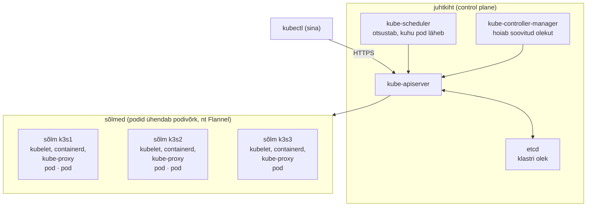
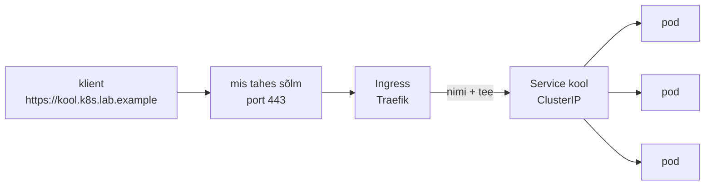

<!-- navigatsioon -->
[← Moodul 23. Enesekontroll](../moodul-23-virtualiseerimine/enesekontroll.md) · [Sisukord](../../README.md#sisukord) · [Laboritöö 24. k3s klaster →](labor.md)
<!-- /navigatsioon -->

# Moodul 24. Kubernetes: k3s

**Maht:** 10 tundi · **Laboritöö:** Debian (kolm sõlme) · **Eeldused:** moodulid 1–13, soovitatavalt 16 ja 23 · **Valikmoodul**

Moodulis 12 käivitasid konteinereid ühes masinas Podmani, Compose'i ja Quadletiga. Kui konteinereid ja servereid on palju, on vaja süsteemi, mis otsustab, millises masinas konteiner töötab, taaskäivitab selle rikke korral teises masinas, jagab koormust ja uuendab rakendusi katkestuseta. Seda nimetatakse **orkestreerimiseks** ja selle valdkonna standard on **Kubernetes**. Moodulis kasutame kerget, kuid täisväärtuslikku Kubernetese distributsiooni **k3s**.

## Õpiväljundid

Mooduli läbinud õppija:

- selgitab, milleks on konteinerite orkestreerimine ja millal seda **ei ole** vaja;
- kirjeldab Kubernetese klastri ülesehitust (juhtkiht, sõlmed, kubelet, konteinerikäitur, võrk) ja deklaratiivse halduse põhimõtet;
- võrdleb Kubernetese distributsioone (kubeadm, k3s, RKE2, k0s, MicroK8s, minikube, kind) ja valib olukorrale sobiva;
- paigaldab mitmesõlmelise k3s klastri ja haldab seda `kubectl`-iga;
- käivitab rakenduse Deploymenti, Service'i ja Ingressi abil koos TLS-iga;
- skaleerib rakendust, uuendab seda katkestuseta ja võtab vigase uuenduse tagasi;
- kasutab ConfigMap'e, Secret'eid ja püsikettaid (PersistentVolumeClaim);
- paigaldab rakenduse Helmiga;
- hooldab klastrit (sõlme tühjendamine, uuendamine, varundus) ning kirjeldab kõrge kättesaadavuse ja GitOps-i põhimõtteid.

---

## 24.1 Miks orkestreerimine?

| Ülesanne | Üks masin (moodul 12) | Kubernetes |
|---|---|---|
| Konteineri käivitamine | `podman run`, Quadlet | Kubernetes valib ise sobiva sõlme |
| Konteiner jookseb kokku | systemd `Restart=always` | taaskäivitatakse; kui **masin** rikneb, käivitatakse teises masinas |
| Rohkem koormust | käsitsi uus konteiner + koormusejaotur | `kubectl scale --replicas=5` |
| Rakenduse uuendus | peata vana, käivita uus (katkestus) | järkjärguline uuendus ilma katkestuseta, tagasivõtt ühe käsuga |
| Teenuse leidmine | IP-aadressid ja pordid käsitsi | sisemine DNS ja teenuse nimi |
| Seadistus ja saladused | failid hostis | ConfigMap, Secret |

**Millal Kubernetest ei ole vaja?** Kui sul on paar teenust ühes või kahes serveris, on Compose või Quadlet (moodul 12) koos varundusega **lihtsam, odavam ja töökindlam** - Kubernetes lisab palju liikuvaid osi, mida tuleb õppida, jälgida ja uuendada. Kubernetes tasub end ära, kui teenuseid ja servereid on palju, rakendusi uuendatakse tihti või on vaja kõrget kättesaadavust. Paljud ettevõtted kasutavad seda ka seetõttu, et see on kujunenud **ühtseks liideseks** kõigi pilveplatvormide vahel.

## 24.2 Kubernetese ülesehitus



| Komponent | Ülesanne |
|---|---|
| **kube-apiserver** | klastri ainus sissepääs: kõik (sina, `kubectl`, sõlmed) räägivad ainult temaga (port **6443**) |
| **etcd** | võti-väärtus andmebaas, kus on kogu klastri olek (k3s-is ühe serveri korral SQLite) |
| **kube-scheduler** | valib uuele podile sõlme (vaba mälu ja protsessor, piirangud) |
| **kube-controller-manager** | kontrollerid, mis võrdlevad pidevalt **soovitud olekut** tegelikuga ja parandavad erinevused |
| **kubelet** | igas sõlmes: käivitab konteinerid konteinerikäituri kaudu ja annab olekust teada |
| **containerd** | konteinerikäitur (*container runtime*) - sama tehnoloogia, millel põhineb Docker (moodul 12) |
| **kube-proxy** | suunab teenuse aadressile tulnud liikluse õigetele podidele (nftables/iptables reeglid) |
| **CNI** | võrgulisa, mis annab igale podile IP-aadressi ja ühendab sõlmede podid (k3s-is Flannel, VXLAN) |

**Deklaratiivne haldus.** Kubernetesele ei öelda „käivita konteiner“, vaid kirjeldatakse YAML-failis (**manifest**), milline olek peab olema: „rakendus `kool`, pilt `nginx:1.27-alpine`, 3 koopiat“. Kontrollerid jälgivad olekut pidevalt ja parandavad kõrvalekalded: kui pod kustub, luuakse uus; kui sõlm kaob, käivitatakse podid mujal. Sama põhimõte on Ansible'il (moodul 16) - kirjeldad olekut, mitte samme.

### Põhiobjektid

| Objekt | Mis see on |
|---|---|
| **Pod** | väikseim üksus: üks (või mõni tihedalt seotud) konteiner ühise IP-aadressi ja kettaga. Pod on **ajutine** - see võib kaduda ja asenduda uuega |
| **Deployment** | kirjeldab rakendust: pilt, koopiate arv, uuendamise viis. Loob ja haldab podide hulka (ReplicaSet) |
| **Service** | püsiv nimi ja IP-aadress podide hulgale; jagab liikluse terveid pode vahel |
| **Ingress** | HTTP(S) sissepääs väljast: nimi ja tee → teenus (pöördpuhver, moodul 13) |
| **ConfigMap**, **Secret** | seadistus ja saladused, mis antakse podile failina või keskkonnamuutujana |
| **PersistentVolumeClaim** (PVC) | taotlus püsiketta järele, mis säilib podi kadumisel |
| **Namespace** (nimeruum) | klastri loogiline jaotus (nt rakenduse või meeskonna kaupa) |
| **Node** (sõlm) | klastri masin |

## 24.3 Kubernetese distributsioonid

Kubernetes on avatud lähtekoodiga projekt (CNCF), mille põhjal on tehtud palju distributsioone - sarnaselt Linuxi kerneli ja Linuxi distrodega.

| Distributsioon | Kellelt | Iseloomustus | Sobib |
|---|---|---|---|
| **kubeadm** | Kubernetese projekt | „puhas“ Kubernetes, iga komponent eraldi; paigaldamine ja hooldus on töömahukam | sügavuti õppimine, CKA eksam, suured paigaldused |
| **k3s** | SUSE (Rancher), CNCF projekt | sertifitseeritud Kubernetes ühe (alla 100 MB) binaarfailina; sees containerd, Flannel, CoreDNS, Traefik, koormusejaotur ja kohalik salvestus; sõlm vajab alates 512 MiB mälu | labor, väiksemad serverid, servaseadmed (*edge*), Raspberry Pi, ka tootmine |
| **RKE2** | SUSE (Rancher) | k3s-iga sarnane paigaldus, kuid turvalisusele ja standarditele (CIS, FIPS) häälestatud | ettevõtte ja avaliku sektori tootmine |
| **k0s** | Mirantis | üks binaarfail, k3s-i sarnane | nagu k3s |
| **MicroK8s** | Canonical | Snapi pakett, lisad käsuga `microk8s enable` | Ubuntu keskkonnad |
| **minikube** | Kubernetese projekt | **ühe sõlme** klaster arendaja arvutis (VM-is või konteineris), palju lisasid | rakenduste arendamine ja esimene tutvus oma arvutis |
| **kind** | Kubernetese projekt | „Kubernetes in Docker“ - sõlmed on Dockeri konteinerid | testimine ja CI |
| **Talos Linux** | Sidero Labs | muutumatu operatsioonisüsteem ainult Kubernetese jaoks, hallatakse API kaudu (SSH-d pole) | tootmisklastrid |
| **OpenShift** / OKD | Red Hat | Kubernetes koos arendusplatvormi, turbe ja veebiliidesega | suurettevõtted |
| EKS, AKS, GKE | AWS, Azure, Google | hallatud Kubernetes pilves - juhtkihi eest hoolitseb pakkuja | pilv |

### Miks k3s, mitte minikube?

minikube on hea vahend, kuid see on mõeldud **arendaja arvutisse**: üks sõlm, mis töötab virtuaalmasinas või konteineris, ja eesmärk on rakendust kiiresti proovida. Süsteemiadministraatori kursuses tahame näha **päris klastrit**: mitu eraldi serverit, sõlmede lisamine, ühe masina rike ja podide ümberpaiknemine, võrgu ja tulemüüri seadistus, teenuse uuendamine ja varundus. Seda annab k3s:

- paigaldub tavalisse Linuxi serverisse ühe käsuga ja töötab **systemd teenusena** (`k3s`, `k3s-agent`) - kõik moodulis 5 õpitu kehtib;
- sama klastri saab ehitada nii kooli Proxmoxi VM-idest kui ka Raspberry Pidest;
- on **sertifitseeritud** Kubernetes - `kubectl`, manifestid ja Helm töötavad täpselt nagu suurtes klastrites;
- vajab vähe ressursse (laboris 2 GiB mälu sõlme kohta).

**minikube või kind** sobivad iseõppijale, kellel on ainult üks arvuti (ka Windows koos WSL-iga, moodul 22): `minikube start` loob klastri mõne minutiga ja kõik selle mooduli `kubectl` harjutused (24.5–24.9) töötavad ka seal. Mitme sõlme ja hoolduse harjutusi (24.4, 24.11) seal teha ei saa.

## 24.4 k3s klastri paigaldus

Laboris on kolm Debiani masinat:

| Masin | IP | Roll |
|---|---|---|
| `k3s1` | `10.0.83.61` | server (juhtkiht + töökoormus) |
| `k3s2` | `10.0.83.62` | agent (töösõlm) |
| `k3s3` | `10.0.83.63` | agent (töösõlm) |

### Server

Seadistus kirjutatakse enne paigaldust faili `/etc/rancher/k3s/config.yaml` (iga võti vastab käsurea võtmele `--node-ip` jne):

```yaml
# /etc/rancher/k3s/config.yaml (k3s1)
node-ip: 10.0.83.61
tls-san:
  - k3s1.lab.example
write-kubeconfig-mode: "0600"
```

```bash
curl -sfL https://get.k3s.io -o k3s-install.sh
less k3s-install.sh                     # loe enne käivitamist, mida skript teeb!
sudo INSTALL_K3S_CHANNEL=stable sh k3s-install.sh
systemctl status k3s
sudo k3s kubectl get nodes
```

Paigaldusskript laadib alla `k3s` binaarfaili (`/usr/local/bin/k3s`), loob viited `kubectl`, `crictl` ja `ctr`, systemd teenuse `k3s` ning eemaldusskriptid `k3s-uninstall.sh` ja `k3s-killall.sh`. Kindla versiooni saab valida muutujaga `INSTALL_K3S_VERSION=v1.xx.y+k3s1` - tootmises pane versioon alati paika.

> [!WARNING]
> **`curl … | sh`** on Kubernetese maailmas levinud, kuid see käivitab internetist tulnud koodi juurkasutajana. Laadi skript esmalt faili, vaata see üle ja käivita siis - nagu ülal.

Klastri haldamiseks tavakasutajana kopeeri **kubeconfig** (klastri aadress ja administraatori sertifikaat):

```bash
mkdir -p ~/.kube
sudo cp /etc/rancher/k3s/k3s.yaml ~/.kube/config
sudo chown $USER: ~/.kube/config && chmod 600 ~/.kube/config
echo 'export KUBECONFIG=~/.kube/config' >> ~/.bashrc && source ~/.bashrc
kubectl get nodes
```

Fail `k3s.yaml` annab **täieliku administraatori õiguse** kogu klastrile - kaitse seda nagu juurkasutaja parooli. Oma arvutist haldamiseks kopeeri fail sinna ja asenda selles `https://127.0.0.1:6443` serveri aadressiga.

### Agendid

Agent vajab serveri aadressi ja **liitumisluba** (*token*), mis on serveris failis `/var/lib/rancher/k3s/server/node-token`:

```bash
sudo cat /var/lib/rancher/k3s/server/node-token        # k3s1-s
```

```bash
# k3s2 ja k3s3
curl -sfL https://get.k3s.io -o k3s-install.sh
sudo K3S_URL=https://10.0.83.61:6443 K3S_TOKEN='<token>' INSTALL_K3S_CHANNEL=stable sh k3s-install.sh
systemctl status k3s-agent
```

```bash
kubectl get nodes -o wide        # k3s1-s: kolm sõlme olekus Ready
```

### Mis on k3s-is kaasas?

```bash
kubectl get pods -n kube-system
```

| Komponent | Ülesanne |
|---|---|
| **CoreDNS** | klastri sisemine DNS: teenus `kool` nimeruumis `kool` on nimega `kool.kool.svc.cluster.local` (moodul 15, CoreDNS) |
| **Flannel** | podivõrk (vaikimisi VXLAN, UDP 8472); podid saavad aadressi võrgust `10.42.0.0/16`, teenused `10.43.0.0/16` |
| **Traefik** | Ingressi kontroller - pöördpuhver pordil 80 ja 443 (moodul 13) |
| **ServiceLB** | lihtne koormusejaotur: `LoadBalancer` tüüpi teenus avatakse kõigi sõlmede IP-aadressidel |
| **local-path-provisioner** | püsikettad sõlme kohalikus kataloogis `/var/lib/rancher/k3s/storage` |
| **metrics-server** | sõlmede ja podide ressursikasutus (`kubectl top`) |
| **Helmi kontroller** | paigaldab Helmi tabeleid failidest (punkt 24.10) |

Iga komponendi saab välja lülitada (nt `disable: [traefik]` seadistusfailis), kui soovid kasutada teist lahendust.

### Tulemüür

| Port | Kes kellele | Milleks |
|---|---|---|
| 6443/tcp | agendid ja administraator → server | Kubernetese API |
| 8472/udp | kõik sõlmed omavahel | Flannel VXLAN (podivõrk) |
| 10250/tcp | kõik sõlmed omavahel | kubelet (logid, `exec`, mõõdikud) |
| 2379–2380/tcp | serverid omavahel | etcd (ainult mitme serveri korral, punkt 24.11) |
| 80/tcp, 443/tcp | kliendid → sõlmed | Traefik (Ingress) |

Debianis pole tulemüür vaikimisi sees. Kui kasutad `ufw`-d (moodul 7), luba lisaks portidele ka podi- ja teenusevõrk: `sudo ufw allow from 10.42.0.0/16` ja `sudo ufw allow from 10.43.0.0/16`. AlmaLinuxis soovitab k3s-i dokumentatsioon firewalld välja lülitada või lisada podi- ja teenusevõrk tsooni `trusted` (`firewall-cmd --permanent --zone=trusted --add-source=10.42.0.0/16` jne).

## 24.5 kubectl ja esimene rakendus

### kubectl põhikäsud

| Käsk | Tegevus |
|---|---|
| `kubectl get nodes,pods,svc -A` | loetle objektid (kõigis nimeruumides) |
| `kubectl get pods -o wide` | lisaks sõlm ja IP |
| `kubectl describe pod <nimi>` | üksikasjad ja **sündmused** (vigade otsimisel esimene käsk) |
| `kubectl logs <pod>` / `-f` / `-l app=kool` | konteineri logid |
| `kubectl exec -it <pod> -- sh` | käsk konteineris |
| `kubectl apply -f fail.yaml` | loo või uuenda manifesti järgi |
| `kubectl delete -f fail.yaml` | kustuta manifesti objektid |
| `kubectl get events --sort-by=.lastTimestamp` | viimased sündmused |
| `kubectl explain deployment.spec` | objekti väljade dokumentatsioon |
| `kubectl port-forward svc/kool 8080:80` | ajutine ühendus teenusega oma masinast |
| `kubectl config get-contexts` | millise klastriga oled ühendatud |

Lühendid: `po` (pods), `deploy`, `svc`, `ns`, `no` (nodes), `cm` (configmap), `pvc`, `ing`. `-n kool` valib nimeruumi.

### Deployment ja Service

```yaml
# kool.yaml
apiVersion: v1
kind: Namespace
metadata:
  name: kool
---
apiVersion: apps/v1
kind: Deployment
metadata:
  name: kool
  namespace: kool
spec:
  replicas: 3
  selector:
    matchLabels:
      app: kool
  template:                       # podi mall
    metadata:
      labels:
        app: kool
    spec:
      containers:
        - name: veeb
          image: docker.io/library/nginx:1.27-alpine
          ports:
            - containerPort: 80
          resources:
            requests:             # ajastaja arvestab sellega sõlme valides
              cpu: 50m
              memory: 32Mi
            limits:               # cgroup piirang (moodul 5)
              cpu: 200m
              memory: 64Mi
          readinessProbe:         # kas pod on valmis liiklust vastu võtma?
            httpGet:
              path: /
              port: 80
            periodSeconds: 5
          livenessProbe:          # kas pod on elus? Kui ei, taaskäivita
            httpGet:
              path: /
              port: 80
            initialDelaySeconds: 5
            periodSeconds: 10
---
apiVersion: v1
kind: Service
metadata:
  name: kool
  namespace: kool
spec:
  selector:
    app: kool                     # kõik podid sildiga app=kool
  ports:
    - port: 80
      targetPort: 80
```

```bash
kubectl apply -f kool.yaml
kubectl get all -n kool
kubectl get pods -n kool -o wide          # podid on jaotatud eri sõlmedesse
```

Kõik ühendab **silt** (*label*) `app: kool`: Deployment loob sellise sildiga podid ja Service saadab liikluse kõigile sellise sildiga podidele, mis on valmis (`readinessProbe`).

| Service tüüp | Kust kättesaadav |
|---|---|
| `ClusterIP` (vaikimisi) | ainult klastri seest (nimi `kool.kool.svc.cluster.local`) |
| `NodePort` | iga sõlme IP-aadressil pordil vahemikus 30000–32767 |
| `LoadBalancer` | välisel aadressil - k3s-is ServiceLB kaudu sõlmede aadressidel, pilves pilve koormusejaotur |

Veebirakendused avatakse väljapoole tavaliselt **Ingressi** kaudu (punkt 24.8).

**Isetervenemine:** kustuta üks pod (`kubectl delete pod <nimi> -n kool`) - Deployment loob kohe uue, sest soovitud olek on 3 koopiat.

## 24.6 Skaleerimine, uuendused ja tagasivõtt

```bash
kubectl scale deployment kool -n kool --replicas=5
kubectl set image deployment/kool veeb=docker.io/library/nginx:1.28-alpine -n kool
kubectl rollout status deployment/kool -n kool     # jälgi uuendust
kubectl rollout history deployment/kool -n kool
kubectl rollout undo deployment/kool -n kool       # tagasi eelmisele versioonile
```

**Järkjärguline uuendus** (*rolling update*): Kubernetes loob uue versiooni podi, ootab, kuni see on valmis (`readinessProbe`), ja alles siis peatab ühe vana. Nii jätkub teenus kogu uuenduse ajal. Kui uus pilt ei käivitu (nt vale silt → `ImagePullBackOff`), jääb uuendus pooleli ja vanad podid teenindavad edasi - siis aitab `rollout undo`.

Püsivalt muudetakse ikka **manifesti** (pilt, koopiate arv) ja tehakse `kubectl apply` - nii on Gitis alati tegelik olek. `kubectl scale` ja `set image` sobivad katsetamiseks ja hädaolukorda.

**Ressursid:** `requests` on garanteeritud osa, mille järgi ajastaja valib sõlme; `limits` on ülempiir (cgroup, moodul 5). Mälupiirangu ületamisel tapab kernel konteineri (`OOMKilled` väljundis `kubectl describe pod`).

## 24.7 Seadistus ja saladused: ConfigMap ja Secret

**ConfigMap** hoiab seadistust, mille saab podile anda failina või keskkonnamuutujana:

```yaml
apiVersion: v1
kind: ConfigMap
metadata:
  name: kool-leht
  namespace: kool
data:
  index.html: |
    <!doctype html>
    <html lang="et"><meta charset="utf-8">
    <h1>Haapsalu õppekool Kubernetesis</h1>
    </html>
```

Deploymenti podi mallis haagitakse see kataloogi:

```yaml
    spec:
      containers:
        - name: veeb
          # … nagu eespool …
          volumeMounts:
            - name: leht
              mountPath: /usr/share/nginx/html
              readOnly: true
      volumes:
        - name: leht
          configMap:
            name: kool-leht
```

**Secret** hoiab paroole, võtmeid ja sertifikaate:

```bash
kubectl create secret generic db-parool -n kool --from-literal=parool='Väga-salajane-1'
kubectl get secret db-parool -n kool -o jsonpath='{.data.parool}' | base64 -d
```

```yaml
          env:
            - name: DB_PAROOL
              valueFrom:
                secretKeyRef:
                  name: db-parool
                  key: parool
```

> [!WARNING]
> **Secret ei ole krüpteeritud** - väärtus on ainult base64-kodeeritud ja seda näeb igaüks, kellel on õigus Secret'eid lugeda. Kaitse tuleb õigustest (RBAC) ja andmebaasi krüpteerimisest (k3s: `secrets-encryption: true`). Secret'eid **ei panda Giti** avatekstina - selleks on vahendid nagu Sealed Secrets, SOPS või External Secrets (sarnaselt Ansible Vaultiga, moodul 16).

## 24.8 Väljast ligipääs: Ingress ja TLS

**Ingress** kirjeldab, milline nimi ja tee suunatakse millisele teenusele. Seda täidab **Ingressi kontroller** - k3s-is Traefik (moodul 13), mis kuulab kõigil sõlmedel porte 80 ja 443.

Päringu teekond kliendist podini:



TLS-i jaoks pane sertifikaat ja võti Secret'iks (labori CA-ga allkirjastatud sertifikaat, moodul 13):

```bash
kubectl create secret tls kool-tls -n kool --cert=k8s.crt --key=k8s.key
```

```yaml
apiVersion: networking.k8s.io/v1
kind: Ingress
metadata:
  name: kool
  namespace: kool
spec:
  ingressClassName: traefik
  tls:
    - hosts:
        - kool.k8s.lab.example
      secretName: kool-tls
  rules:
    - host: kool.k8s.lab.example
      http:
        paths:
          - path: /
            pathType: Prefix
            backend:
              service:
                name: kool
                port:
                  number: 80
```

Klient peab nime lahendama mõne sõlme aadressiks (DNS või `/etc/hosts`). Kõik sõlmed suunavad päringu õigele podile, ükskõik millisel sõlmel see töötab. Tootmises pannakse sõlmede ette välise koormusejaoturi või virtuaalse IP-aadressi (keepalived, moodul 13), et ühe sõlme rike ei katkestaks ligipääsu.

> [!NOTE]
> Avalikus klastris hangib sertifikaate automaatselt **cert-manager** (Let's Encrypt ACME, moodul 13) - see on Kubernetese vaste certbotile.

## 24.9 Püsiandmed: PersistentVolumeClaim

Konteineri failisüsteem kaob koos podiga. Andmed, mis peavad säilima (andmebaas, üleslaadimised), pannakse **püsikettale**. Pod küsib ketast **PVC**-ga ja **StorageClass** otsustab, kust see võetakse.

```yaml
apiVersion: v1
kind: PersistentVolumeClaim
metadata:
  name: andmed
  namespace: kool
spec:
  accessModes:
    - ReadWriteOnce               # üks sõlm korraga
  storageClassName: local-path
  resources:
    requests:
      storage: 1Gi
```

Podis: `volumes: - name: andmed, persistentVolumeClaim: { claimName: andmed }` ja `volumeMounts` nagu ConfigMap'i puhul.

| StorageClass | Kus andmed on | Eripära |
|---|---|---|
| `local-path` (k3s vaikimisi) | sõlme kataloogis `/var/lib/rancher/k3s/storage` | lihtne ja kiire, kuid pod on **seotud selle sõlmega**: kui sõlm rikneb, pole andmed kättesaadavad |
| NFS (`nfs-subdir-external-provisioner`) | NFS-serveris (moodul 15) | pod võib liikuda sõlmede vahel; NFS-server on üksik rikkepunkt |
| **Longhorn** | replitseeritakse mitme sõlme ketastele | rikkekindel, Rancheri projekt, sobib k3s-iga |
| Ceph (Rook), iSCSI (moodul 19) | välises või klastrisiseses salvestuses | suuremad paigaldused |

Andmebaase käivitatakse Kubernetesis tavaliselt **StatefulSet**-iga, mis annab igale podile püsiva nime ja oma ketta. Väiksemas asutuses on sageli mõistlikum hoida andmebaas eraldi VM-is (moodul 14) ja Kubernetesis ainult rakendusi.

## 24.10 Helm - Kubernetese pakihaldur

Päris rakendus koosneb kümnetest manifestidest. **Helm** pakib need **tabeliks** (*chart*), mida saab paigaldada, seadistada ja uuendada ühe käsuga - nagu `apt` paketid (moodul 4).

Helm on üks binaarfail; paigalda see ametliku juhendi järgi (helm.sh → *Docs* → *Installing Helm*), näiteks väljalaske failist:

```bash
HELM=v3.x.y        # vaata viimast versiooni: github.com/helm/helm/releases
curl -fsSLO https://get.helm.sh/helm-${HELM}-linux-amd64.tar.gz
tar xzf helm-${HELM}-linux-amd64.tar.gz
sudo install linux-amd64/helm /usr/local/bin/helm
helm version
```

| Käsk | Tegevus |
|---|---|
| `helm repo add <nimi> <URL>`, `helm repo update` | lisa tabelite hoidla |
| `helm search repo <sõna>` | otsi |
| `helm show values <tabel>` | seadistatavad väärtused |
| `helm install <väljalase> <tabel> -n <ns> --create-namespace -f values.yaml` | paigalda |
| `helm upgrade <väljalase> <tabel> --set replicaCount=3` | uuenda või muuda seadeid |
| `helm history`, `helm rollback <väljalase> 1` | ajalugu ja tagasivõtt |
| `helm list -A`, `helm uninstall` | loetle, eemalda |

Näide - testrakendus **podinfo**:

```bash
helm repo add podinfo https://stefanprodan.github.io/podinfo
helm install demo podinfo/podinfo -n demo --create-namespace
kubectl get pods -n demo
```

Seadistused hoitakse failis `values.yaml` Gitis, mitte käsurea `--set` võtmetes - siis on paigaldus korratav. k3s oskab Helmi tabeleid paigaldada ka ise: kataloogi `/var/lib/rancher/k3s/server/manifests/` pandud manifestid (ka `HelmChart` objektid) rakendatakse automaatselt.

> [!WARNING]
> Usalda tabeleid nagu kolmanda osapoole hoidlaid (moodul 4): eelista projekti ametlikke tabeleid ja vaata enne paigaldust üle, mida need loovad (`helm template`).

## 24.11 Klastri haldus

### Sõlme hooldus

```bash
kubectl cordon k3s2                                         # uusi pode sinna ei paigutata
kubectl drain k3s2 --ignore-daemonsets --delete-emptydir-data   # vii podid mujale
# … uuendused, taaskäivitus (sudo apt full-upgrade && sudo reboot) …
kubectl uncordon k3s2
```

Kui sõlm kaob ootamatult (nt VM lülitatakse välja), muutub see olekusse `NotReady` ja vaikimisi **5 minuti** pärast käivitatakse selle podid teistes sõlmedes. `local-path` kettaga podid jäävad ootama, kuni sõlm tagasi tuleb.

### k3s uuendamine

Uuenda **kõigepealt serverid, siis agendid** ja ühe Kubernetese alamversiooni kaupa (nt 1.32 → 1.33, mitte 1.31 → 1.33). Lihtsaim viis: käivita paigaldusskript uuesti uue `INSTALL_K3S_VERSION`-iga - skript vahetab binaarfaili ja taaskäivitab teenuse. Enne loe väljalaske märkmeid. Paljude sõlmede jaoks on automaatne **system-upgrade-controller**.

### Varundus

| Mida | Kuidas |
|---|---|
| Manifestid ja Helmi väärtused | **Gitis** (parim varukoopia - klastri saab nendest uuesti ehitada) |
| Klastri olek (ühe serveri SQLite) | peata `k3s`, kopeeri `/var/lib/rancher/k3s/server/db/` ja `/var/lib/rancher/k3s/server/token`, käivita uuesti |
| Klastri olek (etcd) | `sudo k3s etcd-snapshot save`; automaatsed tõmmised vaikimisi iga 12 h kataloogis `/var/lib/rancher/k3s/server/db/snapshots/` |
| Püsiketaste andmed | rakenduse oma varundus (`mariadb-dump` jne, moodul 14), Longhorni varukoopiad või **Velero** |

`k3s` teenuse peatamine **ei peata** podisid - konteinerid töötavad edasi. Kõik peatab `k3s-killall.sh`.

### Kõrge kättesaadavus

Ühe serveriga klastris on server üksik rikkepunkt: kui see on maas, töötavad olemasolevad podid edasi, kuid midagi muuta ega uusi pode käivitada ei saa. Kõrge kättesaadavusega k3s-is on **kolm serverit** koos sisseehitatud etcd-ga (paaritu arv, et häälteenamus - *quorum* - oleks alati võimalik):

```yaml
# esimene server: /etc/rancher/k3s/config.yaml
cluster-init: true
token: "<ühine-salajane-token>"
tls-san: [k3s.lab.example, 10.0.83.64]
```

```yaml
# teine ja kolmas server
server: https://10.0.83.64:6443      # virtuaalne IP (keepalived) või DNS-nimi
token: "<ühine-salajane-token>"
tls-san: [k3s.lab.example, 10.0.83.64]
```

Agendid ühendatakse samuti **virtuaalse IP** või DNS-nime kaudu, mitte ühe serveri aadressiga. Kolmest serverist võib üks rikki minna; kahe rikke korral peatub klastri juhtimine.

### Seire

- `kubectl top nodes`, `kubectl top pods -A` - hetke ressursikasutus (metrics-server);
- **kube-prometheus-stack** (Helmi tabel) paigaldab Prometheuse, Grafana ja valmis Kubernetese töölauad ning häired (moodul 17);
- konteinerite logid kogutakse tsentraalselt nt Grafana Loki või Wazuhiga (moodul 11).

### GitOps

**GitOps** tähendab, et klastri soovitud olek on **Gitis** ja klastris töötav kontroller (**Argo CD** või **Flux**) rakendab iga muudatuse automaatselt. Rakenduse uuendamiseks tehakse sissekanne Giti (moodul 6), mitte `kubectl`-käsk; Git on muudatuste logi ja tagasivõtt on `git revert`. See on infrastruktuuri koodina (moodul 16) põhimõte Kubernetese maailmas.

## Distrode erinevused

| | **Debian** | **Ubuntu** | **AlmaLinux** |
|---|---|---|---|
| k3s paigaldus | paigaldusskript | paigaldusskript (või MicroK8s Snapina) | paigaldusskript; paigaldab ka SELinuxi poliitika `k3s-selinux` (vajab paketti `container-selinux`) |
| Tulemüür | vaikimisi puudub; `ufw` puhul luba 10.42.0.0/16 ja 10.43.0.0/16 | `ufw` vaikimisi väljas; sama | firewalld: lülita välja või lisa podi- ja teenusevõrk tsooni `trusted` |
| Kohustuslik juurdepääsukontroll | AppArmor | AppArmor | SELinux (k3s toetab `enforcing` režiimi poliitikaga `k3s-selinux`) |
| Pilvetõmmis malliks | `debian-13-genericcloud` | Ubuntu Cloud Images | AlmaLinux GenericCloud |

Kontrolli enne paigaldust k3s-i dokumentatsioonist (docs.k3s.io → *Installation* → *Requirements*), kas sinu distro ja versioon on toetatud.

---

## Kokkuvõte

| Tegevus | Käsk või fail |
|---|---|
| Server, agent | `sh k3s-install.sh`, `K3S_URL=… K3S_TOKEN=…`, `/etc/rancher/k3s/config.yaml` |
| Teenused ja logid | `systemctl status k3s` / `k3s-agent`, `journalctl -u k3s` |
| Kubeconfig | `/etc/rancher/k3s/k3s.yaml` → `~/.kube/config` |
| Objektid | `kubectl get`, `describe`, `logs`, `exec`, `apply -f`, `delete -f` |
| Skaleerimine ja uuendus | `kubectl scale`, `set image`, `rollout status/history/undo` |
| Seadistus | ConfigMap, `kubectl create secret generic/tls` |
| Ligipääs väljast | Service, Ingress (Traefik), TLS Secret |
| Püsiandmed | PVC, StorageClass `local-path` |
| Pakid | `helm repo add`, `install`, `upgrade`, `rollback` |
| Hooldus | `kubectl cordon/drain/uncordon`, `k3s etcd-snapshot save`, `kubectl top` |
| Eemaldus | `k3s-uninstall.sh`, `k3s-agent-uninstall.sh` |

**Järgmised sammud:** tee [laboritöö](labor.md) ja kontrolli oma teadmisi [enesekontrolli](enesekontroll.md) abil.

## Lisamaterjal

- k3s dokumentatsioon (docs.k3s.io)
- Kubernetese dokumentatsioon (kubernetes.io/docs) - „Tutorials“ ja „Concepts“
- minikube (minikube.sigs.k8s.io) ja kind (kind.sigs.k8s.io) oma arvutis harjutamiseks
- Helmi dokumentatsioon (helm.sh/docs), Artifact Hub (artifacthub.io) - Helmi tabelite otsing
- Kubernetes the Hard Way (K. Hightower) - klaster käsitsi, iga komponent eraldi (süvenemiseks)
- Sertifikaadid: CKA (*Certified Kubernetes Administrator*), KCNA (algtase)

<!-- navigatsioon -->
---

[← Moodul 23. Enesekontroll](../moodul-23-virtualiseerimine/enesekontroll.md) · [Sisukord](../../README.md#sisukord) · [Laboritöö 24. k3s klaster →](labor.md)
<!-- /navigatsioon -->
