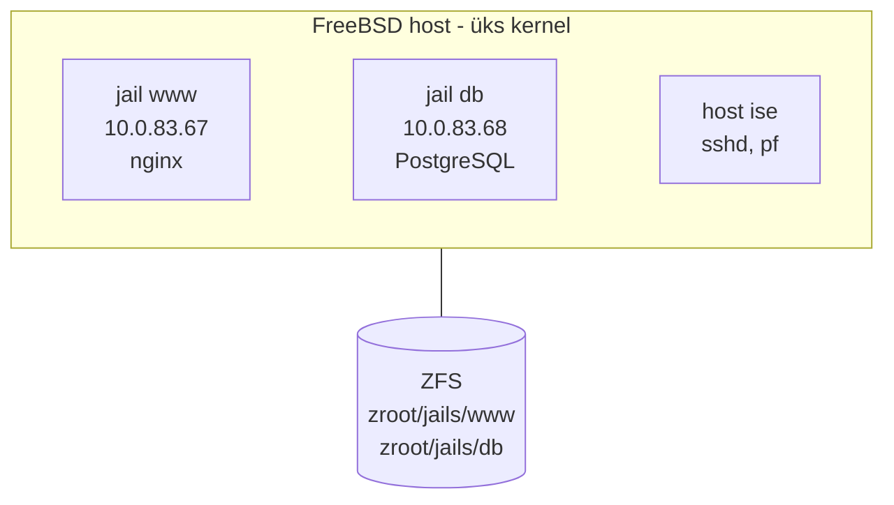

<!-- navigatsioon -->
[← Moodul 24. Enesekontroll](../moodul-24-kubernetes/enesekontroll.md) · [Sisukord](../../README.md#sisukord) · [Laboritöö 25. FreeBSD server →](labor.md)
<!-- /navigatsioon -->

# Moodul 25. FreeBSD server

**Maht:** 10 tundi · **Laboritöö:** FreeBSD 15 · **Eeldused:** moodulid 1–8, soovitatavalt 9 (ZFS) ja 18 · **Valikmoodul**

Kogu kursus on seni olnud Linuxi keskne. Moodulis 18 kasutasid FreeBSD-d OPNsense'i sees, kus seda hallatakse veebiliidesest. Selles moodulis haldad **puhast FreeBSD serverit** käsurealt: paigaldus, paketid ja uuendused, teenused, kasutajad, võrk, ZFS ja alglaadimiskeskkonnad, tulemüür pf ning jailid. Moodul näitab, millised oskused on kõigis UNIX-i laadsetes süsteemides ühised ja mis on Linuxi omapära.

## Õpiväljundid

Mooduli läbinud õppija:

- selgitab, mis on BSD ja FreeBSD ning mille poolest erineb **baassüsteemi** ja kolmanda osapoole tarkvara käsitlus Linuxist;
- paigaldab FreeBSD virtuaalmasinasse ZFS juurfailisüsteemiga;
- haldab tarkvara `pkg`-ga ning uuendab baassüsteemi (`freebsd-update`), teab portide ja pkgbase'i põhimõtet;
- haldab teenuseid rc.d süsteemiga (`/etc/rc.conf`, `sysrc`, `service`) ja leiab logid;
- haldab kasutajaid ja gruppe (`adduser`, `pw`) ning annab halduriõigused (`wheel`, `doas`/`sudo`);
- seadistab võrgu (`ifconfig`, `rc.conf`) ja diagnoosib seda;
- kasutab ZFS-i hetktõmmiseid ja **alglaadimiskeskkondi** (`bectl`) turvaliseks uuendamiseks;
- seadistab tulemüüri pf;
- loob jaili ja käivitab selles teenuse;
- võrdleb FreeBSD ja Linuxi haldust.

---

## 25.1 BSD ja FreeBSD

**BSD** (*Berkeley Software Distribution*) sai alguse 1970. aastate lõpus California Berkeley ülikoolis UNIX-i täiendustena. Sellest on välja kasvanud mitu vaba operatsioonisüsteemi (ajalugu vt [BSD ja Linux](../lisad/distrod.md#bsd-ja-linux)):

| Süsteem | Rõhuasetus |
|---|---|
| **FreeBSD** | üldotstarbeline server, jõudlus, ZFS, võrk - levinuim |
| **OpenBSD** | turvalisus ja korrektne kood (sealt pärinevad OpenSSH ja pf) |
| **NetBSD** | kaasaskantavus - töötab väga paljudel riistvaraplatvormidel |
| **DragonFly BSD** | HAMMER2 failisüsteem, mitmetuumaline jõudlus |

FreeBSD-d kasutavad näiteks Netflix (videoedastuse serverid), Juniper (ruuterite Junos), Sony (PlayStationi süsteemi alus), OPNsense ja pfSense ning paljud hostingu- ja salvestusettevõtted.

**Peamine erinevus Linuxist.** Linux on kernel, millele distro lisab tööriistad eri projektidest. FreeBSD on **terviklik operatsioonisüsteem**: kernel, C-teek, käsud (`ls`, `ps`, `ifconfig`), alglaadija ja dokumentatsioon arendatakse **ühes hoidlas ühe meeskonna poolt** ja väljastatakse koos. Seda nimetatakse **baassüsteemiks** (*base system*). Kõik muu (nginx, bash, Python, sudo) on **kolmanda osapoole tarkvara** ja paikneb eraldi kataloogis `/usr/local`.

| | Linux (nt Debian) | FreeBSD |
|---|---|---|
| Kernel ja käsud | eri projektidest, distro paneb kokku | üks projekt, üks väljalase |
| Baassüsteemi tarkvara | `/usr/bin`, seadistus `/etc` | `/bin`, `/usr/bin`, seadistus `/etc` |
| Lisatarkvara | samuti `/usr/bin`, `/etc` | **`/usr/local/bin`**, seadistus **`/usr/local/etc`** |
| Litsents | GPL (kernel) | BSD litsents (lubab kasutada ka suletud toodetes) |
| Init | systemd | rc.d (lihtsad shelliskriptid) |
| Vaikimisi kest | bash | `sh` (juurkasutaja ja uued kasutajad) |
| Dokumentatsioon | man-lehed + veeb | väga põhjalikud man-lehed ja **FreeBSD Handbook** |

**Väljalasked.** *RELEASE* versioonid (nt 15.1) on toetatud kindla aja; uuemaid toetatud versioone näed lehelt freebsd.org → *Releases*. Lisaks on arendusharud *STABLE* ja *CURRENT*. Lab kasutab viimast *RELEASE* versiooni.

## 25.2 Paigaldus

FreeBSD paigaldaja **bsdinstall** on tekstipõhine ja lühike. Proxmoxis: tüüp *Other*, ketas VirtIO SCSI, võrk VirtIO (FreeBSD-s `vtnet0`), 2 vCPU, 2 GiB RAM, 20 GiB ketas. Paigalduspilt `FreeBSD-15.x-RELEASE-amd64-disc1.iso` (download.freebsd.org).

| Samm | Valik laboris |
|---|---|
| Klaviatuur | *Estonian* (või jäta vaikimisi) |
| Hostinimi | `fbsd.lab.example` |
| Paigaldusviis | *Distribution Sets* (traditsiooniline; FreeBSD 15 pakub ka baassüsteemi pakettidena - vt 25.5) |
| Komponendid | vaikimisi; `kernel-dbg` ja `lib32` võib laboris eemaldada |
| Partitsioonid | **Auto (ZFS)**, *stripe* ühe kettaga, GPT (BIOS + UEFI) |
| Võrk | `vtnet0`, IPv4 DHCP (staatiline aadress hiljem, 25.8) |
| Ajavöönd | Europe → Estonia |
| Teenused | `sshd`, `ntpd` (ja `ntpd_sync_on_start`) |
| Turvaseaded | soovitatavalt kõik (nt `hide_uids`, `clear_tmp`, `disable_sendmail`) |
| Kasutaja | lisa tavakasutaja, **lisagrupp `wheel`** |

Pärast taaskäivitust logi sisse tavakasutajana SSH-ga. Juurkasutajaks saab `su -` abil - FreeBSD lubab seda **ainult grupi `wheel` liikmetele**.

<!-- PILT: ../pildid/m25-bsdinstall-zfs.png | bsdinstall *ZFS Configuration* aken -->

## 25.3 Esimesed sammud

```sh
freebsd-version -kru     # kerneli, töötava kerneli ja kasutajaruumi versioon
uname -a
sysctl hw.model hw.ncpu hw.physmem
geom disk list           # kettad
gpart show               # partitsioonid
zpool status && zfs list
df -h
top
```

Enamik moodulites 1–3 õpitud käske töötab samamoodi (`ls`, `cd`, `grep`, `find`, `ps`, `chmod`, `ssh`), kuid **võtmed võivad erineda**, sest FreeBSD käsud ei ole GNU tööriistad: näiteks `sed -i ''` (tühi laiend), `ls --color` puudub (`ls -G`), `grep -P` puudub. Kahtluse korral vaata `man`-lehte - FreeBSD man-lehed on täpsed ja näidetega.

**Kest.** Juurkasutaja ja uute kasutajate kest on `sh` (POSIX-kest, mitte bash). Bash on paigaldatav paketina ja asub `/usr/local/bin/bash` - seepärast kirjutatakse FreeBSD-s skriptide algusesse `#!/bin/sh` või `#!/usr/bin/env bash`, mitte `#!/bin/bash`.

**Abi:** `man hier` (kataloogide tähendus), `man rc.conf`, `man 7 security`, FreeBSD Handbook (docs.freebsd.org).

## 25.4 Olulised failid ja kataloogid

| Fail või kataloog | Tähendus |
|---|---|
| `/etc/rc.conf` | **peamine seadistusfail**: hostinimi, võrk, lubatud teenused |
| `/etc/rc.conf.local`, `/etc/rc.conf.d/` | lisaseaded (soovi korral) |
| `/boot/loader.conf` | alglaadija ja kerneli moodulid (nt `zfs_load="YES"`) |
| `/etc/sysctl.conf` | kerneli parameetrid (nagu Linuxis) |
| `/etc/fstab` | haakimised (ZFS-i andmekogumid haagib ZFS ise) |
| `/usr/local/etc/` | kolmanda osapoole tarkvara seadistus (nt `nginx/nginx.conf`) |
| `/usr/local/etc/rc.d/` | kolmanda osapoole teenuste käivitusskriptid |
| `/var/log/messages` | peamine süsteemilogi (syslogd) |
| `/var/log/auth.log`, `/var/log/security` | sisselogimised, tulemüüri logid |
| `/etc/periodic/`, `/var/mail/root` | igapäevased ja -nädalased kontrollid; aruanded saadetakse e-postiga juurkasutajale |

## 25.5 Tarkvara ja uuendused

### pkg - kolmanda osapoole paketid

```sh
pkg bootstrap -y          # esimesel korral paigaldab pkg enda
pkg update                # värskenda pakettide loendit
pkg search nginx
pkg install -y nginx bash doas tmux
pkg info                  # paigaldatud paketid
pkg info -l nginx         # paketi failid
pkg which /usr/local/sbin/nginx   # millisest paketist fail pärineb
pkg upgrade               # uuenda kõik paketid
pkg autoremove            # eemalda tarbetud sõltuvused
pkg audit -F              # teadaolevad haavatavused paigaldatud pakettides
```

Pakihoidlal on kaks haru: **quarterly** (vaikimisi; uuendatakse kord kvartalis, vahepeal ainult turva- ja veaparandused) ja **latest** (värskeim). Hoidlate seadistus on failis `/etc/pkg/FreeBSD.conf`; muudatused tehakse failidesse kataloogis `/usr/local/etc/pkg/repos/`.

**Pordid** (*ports*) on kogum retsepte (~36 000 programmi), millest pkg paketid ehitatakse. Pordist saab programmi ise kompileerida, kui on vaja teistsuguseid kompileerimisvalikuid (`make config`). Tavaliselt piisab pakettidest; pakette ja porte ei ole soovitatav segi kasutada.

### Baassüsteemi uuendamine

Traditsioonilise paigalduse (*distribution sets*) baassüsteemi ja kerneli uuendab **freebsd-update**:

```sh
freebsd-update fetch      # laadi turva- ja veaparandused
freebsd-update install    # paigalda
# põhiversiooni uuendus (nt 15.0 → 15.1):
freebsd-update upgrade -r 15.1-RELEASE
freebsd-update install    # paigaldab kerneli
shutdown -r now
freebsd-update install    # paigaldab kasutajaruumi
pkg upgrade               # uuenda paketid uue versiooni jaoks
```

Pärast uuendust kontrolli `freebsd-version -kru`. **Enne põhiversiooni uuendust loe väljalaskemärkmeid** (*Release Notes*) - seal on kirjas ka vajalikud eelparandused.

**pkgbase.** FreeBSD 15-s saab baassüsteemi paigaldada ka **pakettidena** (paigaldajas valik *Packages*). Siis uuendatakse kogu süsteem (baas ja lisatarkvara) käsuga `pkg upgrade` - sarnaselt Linuxi distrodega. See on uus viis ja muutub tulevikus tõenäoliselt peamiseks; laboris kasutame traditsioonilist paigaldust, mida enamik olemasolevaid servereid kasutab.

## 25.6 Teenused: rc.d ja rc.conf

FreeBSD-s pole systemd-d. Teenuste käivitusskriptid on kataloogides `/etc/rc.d/` (baassüsteem) ja `/usr/local/etc/rc.d/` (paketid). Teenus käivitub alglaadimisel, kui failis `/etc/rc.conf` on rida `<teenus>_enable="YES"`.

```sh
sysrc nginx_enable=YES          # kirjuta rc.conf-i (turvalisem kui käsitsi muutmine)
sysrc -a                        # kõik rc.conf seaded
service nginx start             # käivita
service nginx status
service nginx reload
service -e                      # alglaadimisel käivituvad teenused
service nginx onestart          # käivita üks kord, ilma rc.conf-ita
sysrc -x nginx_enable           # eemalda seade
```

| systemd (Linux) | rc.d (FreeBSD) |
|---|---|
| `systemctl enable --now x` | `sysrc x_enable=YES && service x start` |
| `systemctl status x` | `service x status` |
| `systemctl list-unit-files --state=enabled` | `service -e` |
| `journalctl -u x` | teenuse logifail `/var/log/` all (nt `/var/log/nginx/`) või `/var/log/messages` |
| systemd timer | `cron` (`crontab -e`, `/etc/crontab`) ja `periodic` |
| `/etc/systemd/system/x.service` | shelliskript `/usr/local/etc/rc.d/x` |

Logid kirjutab **syslogd** tekstifailidesse; logide rotatsiooni teeb **newsyslog** (`/etc/newsyslog.conf`, vasteks Linuxi `logrotate`). **periodic** käivitab igapäevased kontrollid (kettaruum, turvateated, sisselogimised) ja saadab tulemuse juurkasutaja postkasti (`mail` või `less /var/mail/root`).

## 25.7 Kasutajad ja halduriõigused

```sh
adduser                          # interaktiivne kasutaja loomine
pw groupadd opetajad -g 4000
pw useradd mari -m -s /bin/sh -G opetajad,wheel -c "Mari Maasikas"
passwd mari
pw usermod mari -G opetajad      # NB! -G asendab lisagrupid (lisamiseks: pw groupmod opetajad -m mari)
pw groupmod opetajad -m jaan     # lisa jaan gruppi
pw userdel mari -r               # kustuta koos kodukataloogiga
id mari
```

Paroolid ja kontoinfo on failis `/etc/master.passwd` (Linuxi `/etc/shadow` vaste); sellest genereeritakse `/etc/passwd` ja andmebaasid. Käsitsi muutmiseks kasuta `vipw` - see lukustab faili ja uuendab andmebaasid (`pwd_mkdb`).

**Halduriõigused.** `su` lubab juurkasutajaks saada ainult grupi `wheel` liikmetele. `sudo` ei ole baassüsteemis - paigalda see (`pkg install sudo`) või kasuta lihtsamat **doas**-i (OpenBSD-st):

```sh
pkg install -y doas
echo 'permit persist :wheel' > /usr/local/etc/doas.conf
doas pkg update                  # tavakasutajana
```

## 25.8 Võrk

```sh
ifconfig                         # liidesed (nagu ip a)
netstat -rn                      # marsruudid (nagu ip r)
sockstat -4l                     # kuulavad pordid (nagu ss -tlnp)
host www.freebsd.org             # DNS
```

Staatiline aadress kirjutatakse `/etc/rc.conf`-i:

```sh
sysrc hostname="fbsd.lab.example"
sysrc ifconfig_vtnet0="inet 10.0.83.66/24"
sysrc defaultrouter="10.0.83.1"
echo "nameserver 10.0.83.1" > /etc/resolv.conf
service netif restart && service routing restart
```

> [!WARNING]
> Võrgu taaskäivitamine SSH kaudu katkestab ühenduse, kui aadress muutub. Tee seda **Proxmoxi konsoolist** või ole valmis uue aadressiga uuesti ühenduma.

IPv6, VLAN (`vlans_vtnet0`), liitliides (`lagg`) ja sild (`bridge`) seadistatakse samuti `rc.conf`-is (vt `man rc.conf`).

## 25.9 ZFS ja alglaadimiskeskkonnad

FreeBSD on üks vanimaid ja küpsemaid ZFS-i platvorme (OpenZFS on mõlemas sama, vt moodul 9). Paigaldaja *Auto (ZFS)* loob kogumi `zroot` ja andmekogumid:

```sh
zfs list
# zroot/ROOT/default   - juurfailisüsteem (aktiivne alglaadimiskeskkond)
# zroot/usr/home       - kodukataloogid
# zroot/var/log        - logid
zfs snapshot -r zroot/usr/home@enne-muudatust
zfs list -t snapshot
```

**Alglaadimiskeskkond** (*boot environment*, BE) on juurfailisüsteemi kloon, millest saab alglaadida. Kui uuendus või seadistusmuudatus rikub süsteemi, saab alglaadija menüüs või käsuga valida eelmise keskkonna ja olla sekunditega tagasi töötavas olekus.

```sh
bectl list                       # keskkonnad; N = praegu aktiivne, R = järgmisel alglaadimisel
bectl create enne-uuendust       # tee enne riskantset muudatust
# … uuendus, mis läks valesti …
bectl activate enne-uuendust     # järgmine alglaadimine vanast keskkonnast
shutdown -r now
bectl destroy vana-keskkond      # kustuta, kui pole enam vaja
```

Uuemad `freebsd-update` versioonid loovad ZFS-i juurfailisüsteemi korral enne paigaldust ise alglaadimiskeskkonna - kontrolli `bectl list`-iga ja kui seda ei tekkinud, loo see enne uuendust käsitsi. Kodukataloogid ja `/var/log` on eraldi andmekogumid ega lähe alglaadimiskeskkonnaga tagasi - nii ei kao kasutajate andmed ega logid.

<!-- PILT: ../pildid/m25-alglaadija-be.png | FreeBSD alglaadija menüü, *Boot Environments* valik -->

## 25.10 Tulemüür pf

**pf** (*packet filter*) pärineb OpenBSD-st ja on sama tulemüür, mida kasutab OPNsense (moodul 18). Reeglid on failis `/etc/pf.conf`. Erinevalt `nftables`-ist kehtib pf-is **viimane sobiv reegel**, kui reeglil pole võtmesõna `quick`.

```text
# /etc/pf.conf
ext_if = "vtnet0"
haldus = "10.0.83.0/24"

table <ryndajad> persist

set skip on lo0
block in log all
block in quick from <ryndajad>
pass out all keep state
pass in on $ext_if inet proto icmp
pass in on $ext_if proto tcp from $haldus to port ssh keep state \
    (max-src-conn 10, max-src-conn-rate 5/30, overload <ryndajad> flush global)
pass in on $ext_if proto tcp to port { http, https } keep state
```

`log` saadab blokeeritud paketid liidesele `pflog0` (vaata `tcpdump -n -e -i pflog0`). SSH-reegel paneb aadressi, mis avab 30 sekundi jooksul üle 5 ühenduse, tabelisse `<ryndajad>` ja katkestab tema ühendused - fail2ban-i sarnane kaitse ilma lisatarkvarata.

```sh
pfctl -nf /etc/pf.conf           # kontrolli süntaksit ilma laadimata
sysrc pf_enable=YES pflog_enable=YES
service pf start                 # NB! võib katkestada olemasoleva SSH-seansi
pfctl -sr                        # aktiivsed reeglid
pfctl -si                        # statistika
pfctl -t ryndajad -T show        # tabeli sisu
pfctl -t ryndajad -T delete 10.0.83.99
pfctl -f /etc/pf.conf            # laadi muudatused uuesti
```

> [!WARNING]
> **Lülita pf esimest korda sisse Proxmoxi konsoolist.** Olemasoleva SSH-ühenduse pakettidel pole pf-i olekutabelis kirjet ja `block in all` võib seansi katkestada. Turvanõks kaugtööks: `pfctl -f /etc/pf.conf; sleep 60; pfctl -d` - kui sa ühendust ei kaota, katkesta `sleep` (Ctrl+C) enne tulemüüri väljalülitamist.

## 25.11 Jailid

**Jail** on FreeBSD isoleeritud keskkond (aastast 2000 - üks konteinerite eelkäijaid): oma failisüsteemi juur, oma IP-aadress, oma kasutajad ja protsessid, kuid **sama kernel**. Jaili protsessid ei näe hosti ega teiste jailide protsesse. Jailis töötab tavaliselt üks teenus (veebiserver, andmebaas).



| | Linuxi konteiner (moodul 12) | FreeBSD jail |
|---|---|---|
| Alus | nimeruumid ja cgroups | jail kerneli alamsüsteem |
| Pilt | konteinerpilt registrist | baassüsteemi arhiiv (`base.txz`) või ZFS-i kloon |
| Haldus | `podman`, Compose | `jail`, `jls`, `jexec`; haldurid **Bastille**, **AppJail**, pot |
| Võrk | sild, NAT | jagatud IP hosti liidesel või oma võrgupinu (**VNET**) |

Lihtne jail käsitsi:

```sh
zfs create -o mountpoint=/usr/local/jails zroot/jails
zfs create zroot/jails/www
fetch https://download.freebsd.org/releases/amd64/$(freebsd-version -u | cut -d- -f1-2)/base.txz -o /tmp/base.txz
tar -xf /tmp/base.txz -C /usr/local/jails/www
cp /etc/resolv.conf /etc/localtime /usr/local/jails/www/etc/
```

```text
# /etc/jail.conf
www {
    host.hostname = "www.lab.example";
    path = "/usr/local/jails/$name";
    ip4.addr = "vtnet0|10.0.83.67/24";
    mount.devfs;
    exec.clean;
    exec.start = "/bin/sh /etc/rc";
    exec.stop = "/bin/sh /etc/rc.shutdown";
}
```

```sh
sysrc jail_enable=YES jail_list="www"
service jail start www
jls                              # töötavad jailid
jexec www sh                     # kest jaili sees (exit väljub)
pkg -j www install -y nginx      # paigalda pakett jaili
sysrc -j www nginx_enable=YES
service -j www nginx start
```

Jaili uuendatakse nagu tavalist süsteemi (`freebsd-update -b /usr/local/jails/www …`, `pkg -j www upgrade`) ja see on ZFS-i andmekogum - hetktõmmis enne muudatust annab kiire tagasivõtu. Suurema hulga jailide puhul kasuta haldurit (nt **Bastille**: `bastille create`, `bastille pkg`, mallid).

## 25.12 FreeBSD ja Linux: halduse kokkuvõte

| Tegevus | Debian / AlmaLinux | FreeBSD |
|---|---|---|
| Versioon | `cat /etc/os-release` | `freebsd-version -kru` |
| Kettad | `lsblk` | `geom disk list`, `gpart show` |
| Paketid | `apt` / `dnf` | `pkg` |
| Süsteemi uuendus | `apt full-upgrade` / `dnf upgrade` | `freebsd-update fetch install` (+ `pkg upgrade`) |
| Teenused | `systemctl` | `service`, `sysrc` |
| Peamine seadistus | palju faile `/etc` all | `/etc/rc.conf` |
| Lisatarkvara seadistus | `/etc/` | `/usr/local/etc/` |
| Kasutajad | `useradd`, `usermod -aG` | `pw useradd`, `pw groupmod -m` |
| Halduriõigus | `sudo` | `su` (grupp `wheel`), `doas` või `sudo` paketist |
| Võrk | `ip`, NetworkManager/Netplan | `ifconfig`, `rc.conf` |
| Kuulavad pordid | `ss -tulpn` | `sockstat -4l` |
| Tulemüür | `nftables`, `ufw`, `firewalld` | `pf` (ka `ipfw`) |
| Logid | `journalctl` | `/var/log/messages`, `newsyslog` |
| Konteinerid | Podman, Docker | jailid |
| Tagasivõtt pärast uuendust | hetktõmmis (LVM, VM) | `bectl` alglaadimiskeskkond |

## Distrode erinevused

Moodulis on üks süsteem - FreeBSD. Linuxi distrodega võrdlus on punktis 25.12. OPNsense'is (moodul 18) on sama FreeBSD, kuid seda hallatakse veebiliidesest ja käsitsi muudetud failid kirjutatakse üle; puhtas FreeBSD-s on kõik selle mooduli käsud sinu kontrolli all.

---

## Kokkuvõte

| Tegevus | Käsk või fail |
|---|---|
| Versioon ja riistvara | `freebsd-version -kru`, `sysctl hw.model hw.physmem`, `geom disk list` |
| Paketid | `pkg install/search/info/upgrade/autoremove`, `pkg audit -F` |
| Baassüsteemi uuendus | `freebsd-update fetch install`, `freebsd-update upgrade -r X` |
| Teenused | `sysrc x_enable=YES`, `service x start/status`, `service -e` |
| Kasutajad | `adduser`, `pw useradd/usermod/groupmod`, `vipw`, grupp `wheel`, `doas` |
| Võrk | `ifconfig`, `netstat -rn`, `sockstat -4l`, `rc.conf` (`ifconfig_vtnet0`, `defaultrouter`) |
| ZFS | `zfs list`, `zfs snapshot`, `bectl list/create/activate` |
| Tulemüür | `/etc/pf.conf`, `pfctl -nf/-f/-sr/-si`, tabelid |
| Jailid | `/etc/jail.conf`, `service jail start`, `jls`, `jexec`, `pkg -j`, `service -j` |
| Logid | `/var/log/messages`, `/var/log/auth.log`, `/var/mail/root` (periodic) |

**Järgmised sammud:** tee [laboritöö](labor.md) ja kontrolli oma teadmisi [enesekontrolli](enesekontroll.md) abil.

## Lisamaterjal

- FreeBSD Handbook (docs.freebsd.org/en/books/handbook) - eriti peatükid „Installing FreeBSD“, „Installing Applications“, „Updating and Upgrading“, „Jails“, „Firewalls“, „ZFS“
- `man hier`, `man rc.conf`, `man pf.conf`, `man jail.conf`, `man bectl`
- „Absolute FreeBSD“ (M. W. Lucas) - põhjalik halduse raamat
- BastilleBSD (bastillebsd.org) - jailide haldur
- FreeBSD Forums (forums.freebsd.org)

<!-- navigatsioon -->
---

[← Moodul 24. Enesekontroll](../moodul-24-kubernetes/enesekontroll.md) · [Sisukord](../../README.md#sisukord) · [Laboritöö 25. FreeBSD server →](labor.md)
<!-- /navigatsioon -->
